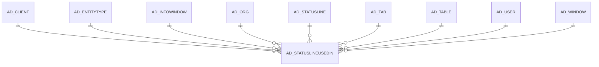

# AD_STATUSLINEUSEDIN

Area [AD](../../data-model/ad/index.md) · class **config** (proposed) · read from database `idempiere-db` (owner `ADEMPIERE`) · 14 row(s) when profiled

Application model: `org.compiere.model.X_AD_StatusLineUsedIn`, access level 4 - System.

## Columns

| column | type | key | not null | business name | references (code) | nulls | distinct |
|---|---|---|---|---|---|---|---|
| `AD_STATUSLINEUSEDIN_ID` | NUMBER(10,0) | PK | yes | AD_StatusLineUsedIn |  | 0 | 14 |
| `AD_CLIENT_ID` | NUMBER(10,0) |  | yes | Tenant |  | 0 | 1 |
| `AD_ORG_ID` | NUMBER(10,0) |  | yes | Organization |  | 0 | 1 |
| `AD_STATUSLINEUSEDIN_UU` | VARCHAR2(36 CHAR) |  |  | AD_StatusLineUsedIn_UU |  | 0 | 14 |
| `AD_STATUSLINE_ID` | NUMBER(10,0) |  | yes | Status Line | [AD_STATUSLINE](../../data-model/ad/ad_statusline.md) | 0 | 5 |
| `CREATED` | DATE |  | yes | Created |  | 0 | 11 |
| `CREATEDBY` | NUMBER(10,0) |  | yes | Created By |  | 0 | 1 |
| `ISACTIVE` | CHAR(1) |  | yes | Active |  | 0 | 1 |
| `UPDATED` | DATE |  | yes | Updated |  | 0 | 11 |
| `UPDATEDBY` | NUMBER(10,0) |  | yes | Updated By |  | 0 | 1 |
| `AD_WINDOW_ID` | NUMBER(10,0) |  |  | Window | [AD_WINDOW](../../data-model/ad/ad_window.md) | 12 | 2 |
| `AD_TAB_ID` | NUMBER(10,0) |  |  | Tab | [AD_TAB](../../data-model/ad/ad_tab.md) | 12 | 2 |
| `ISSTATUSLINE` | CHAR(1) |  | yes | Status Line |  | 0 | 1 |
| `SEQNO` | NUMBER(10,0) |  |  | Sequence |  | 0 | 1 |
| `AD_TABLE_ID` | NUMBER(10,0) |  |  | Table | [AD_TABLE](../../data-model/ad/ad_table.md) | 2 | 12 |
| `ENTITYTYPE` | VARCHAR2(40 CHAR) |  |  | Entity Type |  | 0 | 1 |
| `AD_INFOWINDOW_ID` | NUMBER(10,0) |  |  | Info Window | [AD_INFOWINDOW](../../data-model/ad/ad_infowindow.md) | 14 | 0 |

*references (code)* is the table the application model's code says a column points to; *Foreign keys* below are the constraints the database declares. Counts come from the profile; no value is ever shown.

## Check constraints

| name | expression |
|---|---|
| `SYS_C0019963` | `IsActive IN ('Y','N')` |
| `SYS_C0019964` | `IsStatusLine IN ('Y','N')` |

## Foreign keys

**References**

| table | columns | on delete |
|---|---|---|
| [AD_CLIENT](../../data-model/ad/ad_client.md) | AD_STATUSLINEUSEDIN.AD_CLIENT_ID → AD_CLIENT.AD_CLIENT_ID | NO ACTION |
| [AD_ENTITYTYPE](../../data-model/ad/ad_entitytype.md) | AD_STATUSLINEUSEDIN.ENTITYTYPE → AD_ENTITYTYPE.ENTITYTYPE | NO ACTION |
| [AD_INFOWINDOW](../../data-model/ad/ad_infowindow.md) | AD_STATUSLINEUSEDIN.AD_INFOWINDOW_ID → AD_INFOWINDOW.AD_INFOWINDOW_ID | CASCADE |
| [AD_ORG](../../data-model/ad/ad_org.md) | AD_STATUSLINEUSEDIN.AD_ORG_ID → AD_ORG.AD_ORG_ID | NO ACTION |
| [AD_STATUSLINE](../../data-model/ad/ad_statusline.md) | AD_STATUSLINEUSEDIN.AD_STATUSLINE_ID → AD_STATUSLINE.AD_STATUSLINE_ID | NO ACTION |
| [AD_TAB](../../data-model/ad/ad_tab.md) | AD_STATUSLINEUSEDIN.AD_TAB_ID → AD_TAB.AD_TAB_ID | NO ACTION |
| [AD_TABLE](../../data-model/ad/ad_table.md) | AD_STATUSLINEUSEDIN.AD_TABLE_ID → AD_TABLE.AD_TABLE_ID | NO ACTION |
| [AD_USER](../../data-model/ad/ad_user.md) | AD_STATUSLINEUSEDIN.CREATEDBY → AD_USER.AD_USER_ID | NO ACTION |
| [AD_WINDOW](../../data-model/ad/ad_window.md) | AD_STATUSLINEUSEDIN.AD_WINDOW_ID → AD_WINDOW.AD_WINDOW_ID | NO ACTION |

**Referenced by**

_None._

## Write behaviour

- updates: **po_only**
- deletes: **deleted_by_users, deleted_by_cascade**
- change log: **recorded**
- evidence: 2 citation(s)

## Schema history

57 change(s); the latest:

| applied | release | operation | column | tickets |
|---|---|---|---|---|
| 2023-06-19T09:14 | iD11 | `add_column` | AD_InfoWindow_ID | IDEMPIERE-5772 |
| 2023-06-19T09:14 | iD11 | `add_constraint` |  | IDEMPIERE-5772 |
| 2023-06-19T09:14 | iD11 | `add_column` | AD_InfoWindow_ID | IDEMPIERE-5772 |
| 2023-06-19T09:14 | iD11 | `add_constraint` |  | IDEMPIERE-5772 |
| 2020-09-16T16:00 | i7.1z | `add_constraint` |  | IDEMPIERE-3336 |
| 2020-09-16T16:00 | i7.1z | `add_constraint` |  | IDEMPIERE-3336 |
| 2020-09-16T16:00 | i7.1z | `add_column` | EntityType | IDEMPIERE-3336 |
| 2020-09-16T16:00 | i7.1z | `add_column` | EntityType | IDEMPIERE-3336 |
| 2020-08-04T01:00 | i7.1z | `modify_column` | AD_STATUSLINEUSEDIN_UU | IDEMPIERE-3862 |
| 2014-01-12T15:25 | i2.0z | `add_constraint` |  | IDEMPIERE-1150 |
| 2014-01-12T15:25 | i2.0z | `add_constraint` |  | IDEMPIERE-1150 |
| 2014-01-12T15:25 | i2.0z | `add_column` | IsStatusLine | IDEMPIERE-1150 |
| 2014-01-12T15:25 | i2.0z | `create_table` |  | IDEMPIERE-1150 |
| 2014-01-12T15:25 | i2.0z | `add_constraint` |  | IDEMPIERE-1150 |
| 2014-01-12T15:25 | i2.0z | `add_constraint` |  | IDEMPIERE-1150 |

## Open conflicts

| type | attribute | explanation |
|---|---|---|
| `mandatory_but_nullable` | `columns.EntityType.nullable` | unexplained |

## Notes

<!-- ekos:manual id="table.ad_statuslineusedin.notes" -->
_Business notes about this table._
<!-- /ekos:manual -->
