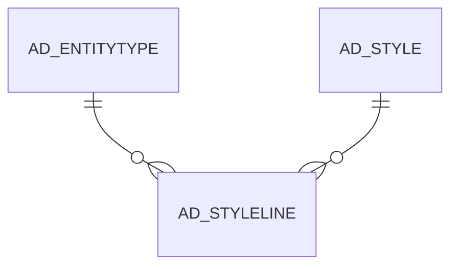

# AD_STYLELINE

Area [AD](../../data-model/ad/index.md) · class **config** (proposed) · read from database `idempiere-db` (owner `ADEMPIERE`) · 1 row(s) when profiled

Application model: `org.compiere.model.X_AD_StyleLine`, access level 6 - System - Client.

## Columns

| column | type | key | not null | business name | references (code) | nulls | distinct |
|---|---|---|---|---|---|---|---|
| `AD_CLIENT_ID` | NUMBER(10,0) |  | yes | Tenant |  | 0 | 1 |
| `AD_ORG_ID` | NUMBER(10,0) |  | yes | Organization |  | 0 | 1 |
| `AD_STYLE_ID` | NUMBER(10,0) |  | yes | Style | [AD_STYLE](../../data-model/ad/ad_style.md) | 0 | 1 |
| `AD_STYLELINE_ID` | NUMBER(10,0) | PK | yes | Style Line |  | 0 | 1 |
| `AD_STYLELINE_UU` | VARCHAR2(36 CHAR) |  | yes | Style Line |  | 0 | 1 |
| `CREATED` | DATE |  | yes | Created |  | 0 | 1 |
| `CREATEDBY` | NUMBER(10,0) |  | yes | Created By |  | 0 | 1 |
| `DISPLAYLOGIC` | VARCHAR2(2000 CHAR) |  |  | Display Logic |  | 0 | 1 |
| `INLINESTYLE` | VARCHAR2(2000 CHAR) |  | yes | Inline Style |  | 0 | 1 |
| `ISACTIVE` | CHAR(1) |  | yes | Active |  | 0 | 1 |
| `LINE` | NUMBER(10,0) |  | yes | Line No |  | 0 | 1 |
| `THEME` | VARCHAR2(60 CHAR) |  |  | Theme |  | 1 | 0 |
| `UPDATED` | DATE |  | yes | Updated |  | 0 | 1 |
| `UPDATEDBY` | NUMBER(10,0) |  | yes | Updated By |  | 0 | 1 |
| `ENTITYTYPE` | VARCHAR2(40 CHAR) |  | yes | Entity Type |  | 0 | 1 |

*references (code)* is the table the application model's code says a column points to; *Foreign keys* below are the constraints the database declares. Counts come from the profile; no value is ever shown.

## Check constraints

| name | expression |
|---|---|
| `SYS_C0019587` | `IsActive IN ('Y','N')` |

## Foreign keys

**References**

| table | columns | on delete |
|---|---|---|
| [AD_ENTITYTYPE](../../data-model/ad/ad_entitytype.md) | AD_STYLELINE.ENTITYTYPE → AD_ENTITYTYPE.ENTITYTYPE | NO ACTION |
| [AD_STYLE](../../data-model/ad/ad_style.md) | AD_STYLELINE.AD_STYLE_ID → AD_STYLE.AD_STYLE_ID | NO ACTION |

**Referenced by**

_None._

## Write behaviour

- updates: **po_only**
- deletes: **deleted_by_users**
- change log: **recorded**
- evidence: 1 citation(s)

## Schema history

17 change(s); the latest:

| applied | release | operation | column | tickets |
|---|---|---|---|---|
| 2020-08-04T01:00 | i7.1z | `modify_column` | AD_STYLELINE_UU | IDEMPIERE-3862 |
| 2020-08-04T01:00 | i7.1z | `modify_column` | THEME | IDEMPIERE-3862 |
| 2020-08-04T01:00 | i7.1z | `modify_column` | DISPLAYLOGIC | IDEMPIERE-3862 |
| 2020-08-04T01:00 | i7.1z | `modify_column` | ENTITYTYPE | IDEMPIERE-3862 |
| 2020-08-04T01:00 | i7.1z | `modify_column` | INLINESTYLE | IDEMPIERE-3862 |
| 2019-12-27T17:15 | i7.1 | `modify_column` | EntityType | IDEMPIERE-3952 |
| 2019-12-27T17:15 | i7.1 | `modify_column` | EntityType | IDEMPIERE-3952 |
| 2019-04-21T12:40 | i6.2z | `modify_column` | EntityType | IDEMPIERE-3952 |
| 2019-04-21T12:40 | i6.2z | `modify_column` | EntityType | IDEMPIERE-3952 |
| 2019-04-15T11:44 | i6.2z | `add_constraint` |  | IDEMPIERE-3952 |
| 2019-04-15T11:44 | i6.2z | `add_constraint` |  | IDEMPIERE-3952 |
| 2019-04-15T11:44 | i6.2z | `add_column` | EntityType | IDEMPIERE-3952 |
| 2019-04-15T11:44 | i6.2z | `add_column` | EntityType | IDEMPIERE-3952 |
| 2016-05-06T18:00 | i3.1 | `create_table` |  |  |
| 2016-05-06T18:00 | i3.1 | `create_table` |  |  |

## Notes

<!-- ekos:manual id="table.ad_styleline.notes" -->
_Business notes about this table._
<!-- /ekos:manual -->
