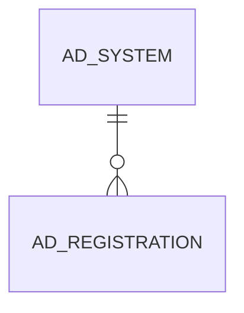

# AD_SYSTEM

Area [AD](../../data-model/ad/index.md) · class **config** (proposed) · read from database `idempiere-db` (owner `ADEMPIERE`) · 1 row(s) when profiled

Application model: `org.compiere.model.X_AD_System`, access level 4 - System.

## Columns

| column | type | key | not null | business name | references (code) | nulls | distinct |
|---|---|---|---|---|---|---|---|
| `AD_SYSTEM_ID` | NUMBER(10,0) | PK | yes | System |  | 0 | 1 |
| `AD_CLIENT_ID` | NUMBER(10,0) | PK | yes | Tenant |  | 0 | 1 |
| `AD_ORG_ID` | NUMBER(10,0) |  | yes | Organization |  | 0 | 1 |
| `ISACTIVE` | CHAR(1) |  | yes | Active |  | 0 | 1 |
| `CREATED` | DATE |  | yes | Created |  | 0 | 1 |
| `CREATEDBY` | NUMBER(10,0) |  | yes | Created By |  | 0 | 1 |
| `UPDATED` | DATE |  | yes | Updated |  | 0 | 1 |
| `UPDATEDBY` | NUMBER(10,0) |  | yes | Updated By |  | 0 | 1 |
| `NAME` | VARCHAR2(60 CHAR) |  | yes | Name |  | 0 | 1 |
| `USERNAME` | VARCHAR2(60 CHAR) |  | yes | User Name |  | 0 | 1 |
| `INFO` | VARCHAR2(255 CHAR) |  |  | Info |  | 0 | 1 |
| `VERSION` | VARCHAR2(20 CHAR) |  |  | Version |  | 0 | 1 |
| `RELEASENO` | VARCHAR2(10 CHAR) |  |  | Release No |  | 0 | 1 |
| `SUPPORTUNITS` | NUMBER(10,0) |  |  | Internal Users |  | 0 | 1 |
| `PASSWORD` | VARCHAR2(20 CHAR) |  |  |  |  | 0 | 1 |
| `REPLICATIONTYPE` | CHAR(1) |  | yes | Replication Type |  | 0 | 1 |
| `IDRANGESTART` | NUMBER |  |  | ID Range Start |  | 1 | 0 |
| `IDRANGEEND` | NUMBER |  |  | ID Range End |  | 1 | 0 |
| `LDAPHOST` | VARCHAR2(60 CHAR) |  |  | LDAP URL |  | 1 | 0 |
| `CUSTOMPREFIX` | VARCHAR2(60 CHAR) |  |  | Custom Prefix |  | 1 | 0 |
| `ISJUSTMIGRATED` | CHAR(1) |  |  | Just Migrated |  | 0 | 1 |
| `DBINSTANCE` | VARCHAR2(60 CHAR) |  |  | Database Name |  | 0 | 1 |
| `DBADDRESS` | VARCHAR2(255 CHAR) |  |  | DB Address |  | 0 | 1 |
| `NOPROCESSORS` | NUMBER(10,0) |  |  | Processors |  | 0 | 1 |
| `SUMMARY` | VARCHAR2(255 CHAR) |  |  | Summary |  | 1 | 0 |
| `ENCRYPTIONKEY` | VARCHAR2(255 CHAR) |  |  | Encryption Class |  | 1 | 0 |
| `LDAPDOMAIN` | VARCHAR2(255 CHAR) |  |  | LDAP Domain |  | 1 | 0 |
| `ISAUTOERRORREPORT` | CHAR(1) |  | yes | Error Reporting |  | 0 | 1 |
| `RECORD_ID` | NUMBER(10,0) |  |  | Record ID |  | 1 | 0 |
| `SUPPORTEXPDATE` | DATE |  |  | Support Expires |  | 1 | 0 |
| `PROCESSING` | CHAR(1) |  |  | Process Now |  | 1 | 0 |
| `SUPPORTEMAIL` | VARCHAR2(60 CHAR) |  |  | Support EMail |  | 1 | 0 |
| `ISALLOWSTATISTICS` | CHAR(1) |  | yes | Maintain Statistics |  | 0 | 1 |
| `STATISTICSINFO` | VARCHAR2(60 CHAR) |  |  | Statistics |  | 0 | 1 |
| `PROFILEINFO` | VARCHAR2(4000 CHAR) |  |  | Profile |  | 0 | 1 |
| `OLDNAME` | VARCHAR2(60 CHAR) |  |  | Old Name |  | 1 | 0 |
| `DESCRIPTION` | VARCHAR2(255 CHAR) |  |  | Description |  | 1 | 0 |
| `SYSTEMSTATUS` | CHAR(1) |  | yes | System Status |  | 0 | 1 |
| `ISFAILONMISSINGMODELVALIDATOR` | CHAR(1) |  | yes | Fail on Missing Model Validator |  | 0 | 1 |
| `LASTBUILDINFO` | VARCHAR2(255 CHAR) |  |  | Last Build Info |  | 0 | 1 |
| `ISFAILONBUILDDIFFER` | CHAR(1) |  | yes | Fail if Build Differ |  | 0 | 1 |
| `AD_SYSTEM_UU` | VARCHAR2(36 CHAR) |  |  | AD_System_UU |  | 0 | 1 |
| `LASTMIGRATIONSCRIPTAPPLIED` | VARCHAR2(255 CHAR) |  |  | Last Migration Script Applied |  | 0 | 1 |

*references (code)* is the table the application model's code says a column points to; *Foreign keys* below are the constraints the database declares. Counts come from the profile; no value is ever shown.

## Check constraints

| name | expression |
|---|---|
| `SYS_C0022832` | `IsFailOnMissingModelValidator IN ('Y','N')` |
| `SYS_C0022833` | `IsActive in ('Y','N')` |
| `SYS_C0022835` | `IsFailOnBuildDiffer IN ('Y','N')` |

## Foreign keys

**References**

_None._

**Referenced by**

| table | columns | on delete |
|---|---|---|
| [AD_REGISTRATION](../../data-model/ad/ad_registration.md) | AD_REGISTRATION.AD_SYSTEM_ID, AD_CLIENT_ID → AD_SYSTEM.AD_SYSTEM_ID, AD_CLIENT_ID | NO ACTION |

## Write behaviour

- updates: **raw_sql_skips_updated**
- deletes: **deleted_by_users**
- change log: **recorded**
- evidence: 5 citation(s)

## Read by

| kind | name |
|---|---|
| Procedure | [register_migration_script](../../logic/register_migration_script.md) |

## Written by

| kind | name |
|---|---|
| Procedure | [register_migration_script](../../logic/register_migration_script.md) |

## Schema history

73 change(s); the latest:

| applied | release | operation | column | tickets |
|---|---|---|---|---|
| 2023-04-09T15:47 | iD11 | `add_constraint` |  | IDEMPIERE-5567 |
| 2023-04-09T15:47 | iD11 | `add_constraint` |  | IDEMPIERE-5567 |
| 2022-05-11T10:56 | i9 | `modify_column` | ProfileInfo | IDEMPIERE-1575 |
| 2022-05-11T10:56 | i9 | `modify_column` | ProfileInfo | IDEMPIERE-1575 |
| 2020-08-04T01:00 | i7.1z | `add_column` | tmp_col_6_tmp | IDEMPIERE-3862 |
| 2020-08-04T01:00 | i7.1z | `modify_column` | SUMMARY | IDEMPIERE-3862 |
| 2020-08-04T01:00 | i7.1z | `add_column` | tmp_col_4_tmp | IDEMPIERE-3862 |
| 2020-08-04T01:00 | i7.1z | `add_column` | tmp_col_12_tmp | IDEMPIERE-3862 |
| 2020-08-04T01:00 | i7.1z | `add_column` | tmp_col_8_tmp | IDEMPIERE-3862 |
| 2020-08-04T01:00 | i7.1z | `modify_column` | LDAPHOST | IDEMPIERE-3862 |
| 2020-08-04T01:00 | i7.1z | `add_column` | tmp_col_20_tmp | IDEMPIERE-3862 |
| 2020-08-04T01:00 | i7.1z | `modify_column` | PROFILEINFO | IDEMPIERE-3862 |
| 2020-08-04T01:00 | i7.1z | `modify_column` | OLDNAME | IDEMPIERE-3862 |
| 2020-08-04T01:00 | i7.1z | `drop_column` | tmp_col_2_tmp | IDEMPIERE-3862 |
| 2020-08-04T01:00 | i7.1z | `modify_column` | LDAPDOMAIN | IDEMPIERE-3862 |

## Open conflicts

| type | attribute | explanation |
|---|---|---|
| `mandatory_but_nullable` | `columns.Info.nullable` | unexplained |
| `mandatory_but_nullable` | `columns.Version.nullable` | unexplained |

## Notes

<!-- ekos:manual id="table.ad_system.notes" -->
_Business notes about this table._
<!-- /ekos:manual -->
