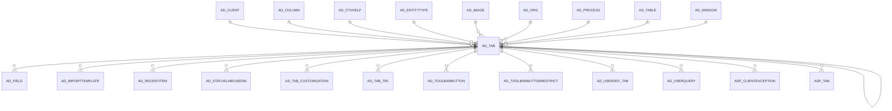

# AD_TAB

Area [AD](../../data-model/ad/index.md) · class **config** (proposed) · read from database `idempiere-db` (owner `ADEMPIERE`) · 1137 row(s) when profiled

Application model: `org.compiere.model.X_AD_Tab`, access level 4 - System.

## Columns

| column | type | key | not null | business name | references (code) | nulls | distinct |
|---|---|---|---|---|---|---|---|
| `AD_TAB_ID` | NUMBER(10,0) | PK | yes | Tab |  | 0 | 1137 |
| `AD_CLIENT_ID` | NUMBER(10,0) |  | yes | Tenant |  | 0 | 1 |
| `AD_ORG_ID` | NUMBER(10,0) |  | yes | Organization |  | 0 | 1 |
| `ISACTIVE` | CHAR(1) |  | yes | Active |  | 0 | 2 |
| `CREATED` | DATE |  | yes | Created |  | 0 | 1038 |
| `CREATEDBY` | NUMBER(10,0) |  | yes | Created By |  | 0 | 3 |
| `UPDATED` | DATE |  | yes | Updated |  | 0 | 726 |
| `UPDATEDBY` | NUMBER(10,0) |  | yes | Updated By |  | 0 | 3 |
| `NAME` | VARCHAR2(60 CHAR) |  | yes | Name |  | 0 | 836 |
| `DESCRIPTION` | VARCHAR2(255 CHAR) |  |  | Description |  | 349 | 708 |
| `HELP` | VARCHAR2(2000 CHAR) |  |  | Comment/Help |  | 586 | 493 |
| `AD_TABLE_ID` | NUMBER(10,0) |  | yes | Table | [AD_TABLE](../../data-model/ad/ad_table.md) | 0 | 857 |
| `AD_WINDOW_ID` | NUMBER(10,0) |  | yes | Window | [AD_WINDOW](../../data-model/ad/ad_window.md) | 0 | 446 |
| `SEQNO` | NUMBER(10,0) |  | yes | Sequence |  | 0 | 42 |
| `TABLEVEL` | NUMBER(10,0) |  | yes | Tab Level |  | 0 | 5 |
| `ISSINGLEROW` | CHAR(1) |  | yes | Single Row Layout |  | 0 | 2 |
| `ISINFOTAB` | CHAR(1) |  |  | Accounting Tab |  | 0 | 2 |
| `ISTRANSLATIONTAB` | CHAR(1) |  | yes | Translation Tab |  | 0 | 2 |
| `ISREADONLY` | CHAR(1) |  | yes | Read Only |  | 0 | 2 |
| `AD_COLUMN_ID` | NUMBER(10,0) |  |  | Column | [AD_COLUMN](../../data-model/ad/ad_column.md) | 791 | 307 |
| `HASTREE` | CHAR(1) |  | yes | Has Tree |  | 0 | 2 |
| `WHERECLAUSE` | VARCHAR2(2000 CHAR) |  |  | Sql WHERE |  | 1055 | 80 |
| `ORDERBYCLAUSE` | VARCHAR2(2000 CHAR) |  |  | Sql ORDER BY |  | 965 | 139 |
| `COMMITWARNING` | VARCHAR2(2000 CHAR) |  |  | Commit Warning |  | 1128 | 9 |
| `AD_PROCESS_ID` | NUMBER(10,0) |  |  | Process | [AD_PROCESS](../../data-model/ad/ad_process.md) | 1116 | 14 |
| `PROCESSING` | CHAR(1) |  |  | Process Now |  | 2 | 1 |
| `AD_IMAGE_ID` | NUMBER(10,0) |  |  | Image | [AD_IMAGE](../../data-model/ad/ad_image.md) | 1137 | 0 |
| `IMPORTFIELDS` | CHAR(1) |  |  | Import Fields |  | 506 | 1 |
| `AD_COLUMNSORTORDER_ID` | NUMBER(10,0) |  |  | Order Column | [AD_COLUMN](../../data-model/ad/ad_column.md) | 1130 | 7 |
| `AD_COLUMNSORTYESNO_ID` | NUMBER(10,0) |  |  | Included Column | [AD_COLUMN](../../data-model/ad/ad_column.md) | 1130 | 6 |
| `ISSORTTAB` | CHAR(1) |  | yes | Order Tab |  | 0 | 2 |
| `ENTITYTYPE` | VARCHAR2(40 CHAR) |  | yes | Entity Type |  | 0 | 6 |
| `INCLUDED_TAB_ID` | NUMBER(10,0) |  |  | Included Tab | [AD_TAB](../../data-model/ad/ad_tab.md) | 1136 | 1 |
| `READONLYLOGIC` | VARCHAR2(2000 CHAR) |  |  | Read Only Logic |  | 1095 | 4 |
| `DISPLAYLOGIC` | VARCHAR2(2000 CHAR) |  |  | Display Logic |  | 1099 | 26 |
| `ISINSERTRECORD` | CHAR(1) |  | yes | Insert Record |  | 0 | 2 |
| `ISADVANCEDTAB` | CHAR(1) |  | yes | Advanced Tab |  | 0 | 2 |
| `PARENT_COLUMN_ID` | NUMBER(10,0) |  |  | Parent Column | [AD_COLUMN](../../data-model/ad/ad_column.md) | 1124 | 10 |
| `AD_TAB_UU` | VARCHAR2(36 CHAR) |  |  | AD_Tab_UU |  | 0 | 1137 |
| `AD_CTXHELP_ID` | NUMBER(10,0) |  |  | Context Help | [AD_CTXHELP](../../data-model/ad/ad_ctxhelp.md) | 1137 | 0 |
| `TREEDISPLAYEDON` | CHAR(1) |  | yes | Tree displayed |  | 0 | 2 |
| `MAXQUERYRECORDS` | NUMBER(10,0) |  |  | Max Query Records |  | 0 | 1 |
| `ISLOOKUPONLYSELECTION` | CHAR(1) |  |  | Lookup Only Selection Columns |  | 0 | 1 |
| `ISALLOWADVANCEDLOOKUP` | CHAR(1) |  |  | Allow Advanced Lookup |  | 0 | 1 |
| `AD_TABTYPE` | VARCHAR2(40 CHAR) |  |  | Tab Type |  | 1131 | 1 |
| `ISHIGHVOLUME` | CHAR(1) |  |  | High Volume |  | 1137 | 0 |
| `DELETECONFIRMATIONLOGIC` | VARCHAR2(255 CHAR) |  |  | Delete Confirmation Logic |  | 1137 | 0 |

*references (code)* is the table the application model's code says a column points to; *Foreign keys* below are the constraints the database declares. Counts come from the profile; no value is ever shown.

## Check constraints

| name | expression |
|---|---|
| `SYS_C0019510` | `IsTranslationTab in ('Y','N')` |
| `SYS_C0019511` | `IsSingleRow in ('Y','N')` |
| `SYS_C0019514` | `IsAllowAdvancedLookup IN ('Y','N')` |
| `SYS_C0019515` | `HasTree in ('Y','N')` |
| `SYS_C0019516` | `IsInfoTab in ('Y','N')` |
| `SYS_C0019517` | `IsActive in ('Y','N')` |
| `SYS_C0019518` | `IsLookupOnlySelection IN ('Y','N')` |
| `SYS_C0019519` | `IsReadOnly in ('Y','N')` |

## Foreign keys

**References**

| table | columns | on delete |
|---|---|---|
| [AD_CLIENT](../../data-model/ad/ad_client.md) | AD_TAB.AD_CLIENT_ID → AD_CLIENT.AD_CLIENT_ID | NO ACTION |
| [AD_COLUMN](../../data-model/ad/ad_column.md) | AD_TAB.AD_COLUMNSORTORDER_ID → AD_COLUMN.AD_COLUMN_ID | NO ACTION |
| [AD_CTXHELP](../../data-model/ad/ad_ctxhelp.md) | AD_TAB.AD_CTXHELP_ID → AD_CTXHELP.AD_CTXHELP_ID | NO ACTION |
| [AD_ENTITYTYPE](../../data-model/ad/ad_entitytype.md) | AD_TAB.ENTITYTYPE → AD_ENTITYTYPE.ENTITYTYPE | NO ACTION |
| [AD_IMAGE](../../data-model/ad/ad_image.md) | AD_TAB.AD_IMAGE_ID → AD_IMAGE.AD_IMAGE_ID | NO ACTION |
| [AD_ORG](../../data-model/ad/ad_org.md) | AD_TAB.AD_ORG_ID → AD_ORG.AD_ORG_ID | NO ACTION |
| [AD_PROCESS](../../data-model/ad/ad_process.md) | AD_TAB.AD_PROCESS_ID → AD_PROCESS.AD_PROCESS_ID | NO ACTION |
| [AD_TAB](../../data-model/ad/ad_tab.md) | AD_TAB.INCLUDED_TAB_ID → AD_TAB.AD_TAB_ID | NO ACTION |
| [AD_TABLE](../../data-model/ad/ad_table.md) | AD_TAB.AD_TABLE_ID → AD_TABLE.AD_TABLE_ID | NO ACTION |
| [AD_WINDOW](../../data-model/ad/ad_window.md) | AD_TAB.AD_WINDOW_ID → AD_WINDOW.AD_WINDOW_ID | CASCADE |

**Referenced by**

| table | columns | on delete |
|---|---|---|
| [AD_FIELD](../../data-model/ad/ad_field.md) | AD_FIELD.AD_TAB_ID → AD_TAB.AD_TAB_ID | CASCADE |
| [AD_IMPORTTEMPLATE](../../data-model/ad/ad_importtemplate.md) | AD_IMPORTTEMPLATE.AD_TAB_ID → AD_TAB.AD_TAB_ID | NO ACTION |
| [AD_RECENTITEM](../../data-model/ad/ad_recentitem.md) | AD_RECENTITEM.AD_TAB_ID → AD_TAB.AD_TAB_ID | CASCADE |
| [AD_STATUSLINEUSEDIN](../../data-model/ad/ad_statuslineusedin.md) | AD_STATUSLINEUSEDIN.AD_TAB_ID → AD_TAB.AD_TAB_ID | NO ACTION |
| [AD_TAB](../../data-model/ad/ad_tab.md) | AD_TAB.INCLUDED_TAB_ID → AD_TAB.AD_TAB_ID | NO ACTION |
| [AD_TAB_CUSTOMIZATION](../../data-model/ad/ad_tab_customization.md) | AD_TAB_CUSTOMIZATION.AD_TAB_ID → AD_TAB.AD_TAB_ID | NO ACTION |
| [AD_TAB_TRL](../../data-model/ad/ad_tab_trl.md) | AD_TAB_TRL.AD_TAB_ID → AD_TAB.AD_TAB_ID | CASCADE |
| [AD_TOOLBARBUTTON](../../data-model/ad/ad_toolbarbutton.md) | AD_TOOLBARBUTTON.AD_TAB_ID → AD_TAB.AD_TAB_ID | NO ACTION |
| [AD_TOOLBARBUTTONRESTRICT](../../data-model/ad/ad_toolbarbuttonrestrict.md) | AD_TOOLBARBUTTONRESTRICT.AD_TAB_ID → AD_TAB.AD_TAB_ID | NO ACTION |
| [AD_USERDEF_TAB](../../data-model/ad/ad_userdef_tab.md) | AD_USERDEF_TAB.AD_TAB_ID → AD_TAB.AD_TAB_ID | NO ACTION |
| [AD_USERQUERY](../../data-model/ad/ad_userquery.md) | AD_USERQUERY.AD_TAB_ID → AD_TAB.AD_TAB_ID | NO ACTION |
| [ASP_CLIENTEXCEPTION](../../data-model/asp/asp_clientexception.md) | ASP_CLIENTEXCEPTION.AD_TAB_ID → AD_TAB.AD_TAB_ID | NO ACTION |
| [ASP_TAB](../../data-model/asp/asp_tab.md) | ASP_TAB.AD_TAB_ID → AD_TAB.AD_TAB_ID | NO ACTION |

## Write behaviour

- updates: **po_only**
- deletes: **deleted_by_users, deleted_by_cascade**
- change log: **recorded**
- evidence: 2 citation(s)

## Read by

| kind | name |
|---|---|
| Procedure | [AD_Synchronize](../../logic/ad_synchronize.md) |
| View | `AD_FIELD_V` |
| View | `AD_FIELD_VT` |
| View | `AD_TAB_V` |
| View | `AD_TAB_VT` |
| View | `ad_field_v` |
| View | `ad_field_vt` |
| View | `ad_tab_v` |
| View | `ad_tab_vt` |

## Schema history

76 change(s); the latest:

| applied | release | operation | column | tickets |
|---|---|---|---|---|
| 2023-04-09T15:47 | iD11 | `add_constraint` |  | IDEMPIERE-5567 |
| 2023-04-09T15:47 | iD11 | `add_constraint` |  | IDEMPIERE-5567 |
| 2022-06-17T12:31 | iD10 | `add_column` | DeleteConfirmationLogic | IDEMPIERE-5319 |
| 2022-06-17T12:31 | iD10 | `add_column` | DeleteConfirmationLogic | IDEMPIERE-5319 |
| 2022-01-19T10:00 | i9 | `add_column` | IsHighVolume | IDEMPIERE-3044 |
| 2022-01-19T10:00 | i9 | `add_column` | IsHighVolume | IDEMPIERE-3044 |
| 2021-12-05T16:45 | i8.2z | `add_constraint` |  | IDEMPIERE-5075 |
| 2021-12-05T16:45 | i8.2z | `drop_constraint` |  | IDEMPIERE-5075 |
| 2021-12-05T16:45 | i8.2z | `add_constraint` |  | IDEMPIERE-5075 |
| 2021-12-05T16:45 | i8.2z | `drop_constraint` |  | IDEMPIERE-5075 |
| 2021-12-05T16:45 | i8.2z | `add_constraint` |  | IDEMPIERE-5075 |
| 2021-12-05T16:45 | i8.2z | `add_constraint` |  | IDEMPIERE-5075 |
| 2021-12-05T16:45 | i8.2z | `add_constraint` |  | IDEMPIERE-5075 |
| 2021-12-05T16:45 | i8.2z | `drop_constraint` |  | IDEMPIERE-5075 |
| 2021-12-05T16:45 | i8.2z | `add_constraint` |  | IDEMPIERE-5075 |

## Notes

<!-- ekos:manual id="table.ad_tab.notes" -->
_Business notes about this table._
<!-- /ekos:manual -->
