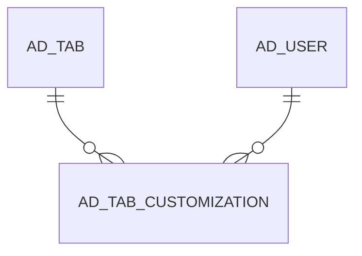

# AD_TAB_CUSTOMIZATION

Area [AD](../../data-model/ad/index.md) · class **config** (proposed) · read from database `idempiere-db` (owner `ADEMPIERE`) · 0 row(s) when profiled

Application model: `org.compiere.model.X_AD_Tab_Customization`, access level 4 - System.

## Columns

| column | type | key | not null | business name | references (code) | nulls | distinct |
|---|---|---|---|---|---|---|---|
| `AD_CLIENT_ID` | NUMBER(10,0) |  | yes | Tenant |  | 0 | 0 |
| `AD_ORG_ID` | NUMBER(10,0) |  | yes | Organization |  | 0 | 0 |
| `AD_TAB_CUSTOMIZATION_ID` | NUMBER(10,0) | PK | yes | Tab Customization |  | 0 | 0 |
| `AD_TAB_ID` | NUMBER(10,0) |  |  | Tab | [AD_TAB](../../data-model/ad/ad_tab.md) | 0 | 0 |
| `AD_USER_ID` | NUMBER(10,0) |  | yes | User/Contact | [AD_USER](../../data-model/ad/ad_user.md) | 0 | 0 |
| `CREATED` | DATE |  | yes | Created |  | 0 | 0 |
| `CREATEDBY` | NUMBER(10,0) |  | yes | Created By |  | 0 | 0 |
| `CUSTOM` | VARCHAR2(2000 CHAR) |  | yes | Custom |  | 0 | 0 |
| `ISACTIVE` | CHAR(1) |  | yes | Active |  | 0 | 0 |
| `UPDATED` | DATE |  | yes | Updated |  | 0 | 0 |
| `UPDATEDBY` | NUMBER(10,0) |  | yes | Updated By |  | 0 | 0 |
| `AD_TAB_CUSTOMIZATION_UU` | VARCHAR2(36 CHAR) |  |  | AD_Tab_Customization_UU |  | 0 | 0 |
| `ISDISPLAYEDGRID` | CHAR(1) |  |  | Show in Grid |  | 0 | 0 |
| `ISQUICKFORM` | CHAR(1) |  |  | Quick Form |  | 0 | 0 |
| `ISAUTOHIDEEMPTYCOLUMN` | CHAR(1) |  |  | Auto Hide Empty Column |  | 0 | 0 |

*references (code)* is the table the application model's code says a column points to; *Foreign keys* below are the constraints the database declares. Counts come from the profile; no value is ever shown.

## Check constraints

| name | expression |
|---|---|
| `SYS_C0019560` | `IsQuickForm IN ('Y','N')` |
| `SYS_C0019561` | `IsActive IN ('Y','N')` |

## Foreign keys

**References**

| table | columns | on delete |
|---|---|---|
| [AD_TAB](../../data-model/ad/ad_tab.md) | AD_TAB_CUSTOMIZATION.AD_TAB_ID → AD_TAB.AD_TAB_ID | NO ACTION |
| [AD_USER](../../data-model/ad/ad_user.md) | AD_TAB_CUSTOMIZATION.AD_USER_ID → AD_USER.AD_USER_ID | CASCADE |

**Referenced by**

_None._

## Write behaviour

- updates: **po_only**
- deletes: **deleted_by_app, deleted_by_users, deleted_by_cascade**
- change log: **recorded**
- evidence: 4 citation(s)

## Schema history

32 change(s); the latest:

| applied | release | operation | column | tickets |
|---|---|---|---|---|
| 2023-04-09T15:47 | iD11 | `add_constraint` |  | IDEMPIERE-5567 |
| 2023-04-09T15:47 | iD11 | `add_constraint` |  | IDEMPIERE-5567 |
| 2021-12-05T16:45 | i8.2z | `drop_constraint` |  | IDEMPIERE-5075 |
| 2021-12-05T16:45 | i8.2z | `add_constraint` |  | IDEMPIERE-5075 |
| 2021-06-17T16:41 | i8.2z | `add_column` | IsAutoHideEmptyColumn | IDEMPIERE-4835 |
| 2021-06-17T16:41 | i8.2z | `add_column` | IsAutoHideEmptyColumn | IDEMPIERE-4835 |
| 2020-08-04T01:00 | i7.1z | `modify_column` | CUSTOM | IDEMPIERE-3862 |
| 2020-08-04T01:00 | i7.1z | `modify_column` | AD_TAB_CUSTOMIZATION_UU | IDEMPIERE-3862 |
| 2020-08-04T01:00 | i7.1z | `add_column` | tmp_col_2_tmp | IDEMPIERE-3862 |
| 2020-08-04T01:00 | i7.1z | `modify_column` | CUSTOM | IDEMPIERE-3862 |
| 2020-08-04T01:00 | i7.1z | `modify_column` | CUSTOM | IDEMPIERE-3862 |
| 2020-08-04T01:00 | i7.1z | `add_column` | tmp_col_1_tmp | IDEMPIERE-3862 |
| 2020-08-04T01:00 | i7.1z | `drop_column` | tmp_col_2_tmp | IDEMPIERE-3862 |
| 2020-08-04T01:00 | i7.1z | `drop_column` | tmp_col_1_tmp | IDEMPIERE-3862 |
| 2020-02-26T16:03 | i7.1z | `add_column` | IsQuickForm | IDEMPIERE-4157 |

## Notes

<!-- ekos:manual id="table.ad_tab_customization.notes" -->
_Business notes about this table._
<!-- /ekos:manual -->
