# AD_TABLE

AD_Table definition

Area [AD](../../data-model/ad/index.md) · class **config** (proposed) · read from database `idempiere-db` (owner `ADEMPIERE`) · 1056 row(s) when profiled

Application model: `org.compiere.model.X_AD_Table`, access level 4 - System.

## Columns

| column | type | key | not null | business name | references (code) | nulls | distinct |
|---|---|---|---|---|---|---|---|
| `AD_TABLE_ID` | NUMBER(10,0) | PK | yes | Table |  | 0 | 1056 |
| `AD_CLIENT_ID` | NUMBER(10,0) |  | yes | Tenant |  | 0 | 1 |
| `AD_ORG_ID` | NUMBER(10,0) |  | yes | Organization |  | 0 | 1 |
| `ISACTIVE` | CHAR(1) |  | yes | Active |  | 0 | 2 |
| `CREATED` | DATE |  | yes | Created |  | 0 | 662 |
| `CREATEDBY` | NUMBER(10,0) |  | yes | Created By |  | 0 | 3 |
| `UPDATED` | DATE |  | yes | Updated |  | 0 | 729 |
| `UPDATEDBY` | NUMBER(10,0) |  | yes | Updated By |  | 0 | 3 |
| `NAME` | VARCHAR2(60 CHAR) |  | yes | Name |  | 0 | 1038 |
| `DESCRIPTION` | VARCHAR2(255 CHAR) |  |  | Description |  | 494 | 504 |
| `HELP` | VARCHAR2(2000 CHAR) |  |  | Comment/Help |  | 995 | 55 |
| `TABLENAME` | VARCHAR2(60 CHAR) |  | yes | DB Table Name |  | 0 | 1056 |
| `ISVIEW` | CHAR(1) |  | yes | View |  | 0 | 2 |
| `ACCESSLEVEL` | CHAR(1) |  | yes | Data Access Level |  | 0 | 6 |
| `ENTITYTYPE` | VARCHAR2(40 CHAR) |  | yes | Entity Type |  | 0 | 6 |
| `AD_WINDOW_ID` | NUMBER(10,0) |  |  | Window | [AD_WINDOW](../../data-model/ad/ad_window.md) | 190 | 405 |
| `AD_VAL_RULE_ID` | NUMBER(10,0) |  |  | Dynamic Validation | [AD_VAL_RULE](../../data-model/ad/ad_val_rule.md) | 1056 | 0 |
| `LOADSEQ` | NUMBER(10,0) |  |  | Sequence |  | 170 | 24 |
| `ISSECURITYENABLED` | CHAR(1) |  | yes | Security enabled |  | 0 | 2 |
| `ISDELETEABLE` | CHAR(1) |  | yes | Records deletable |  | 0 | 2 |
| `ISHIGHVOLUME` | CHAR(1) |  | yes | High Volume |  | 0 | 2 |
| `IMPORTTABLE` | CHAR(1) |  |  | Import Table |  | 601 | 1 |
| `ISCHANGELOG` | CHAR(1) |  | yes | Maintain Change Log |  | 0 | 2 |
| `REPLICATIONTYPE` | CHAR(1) |  | yes | Replication Type |  | 0 | 1 |
| `PO_WINDOW_ID` | NUMBER(10,0) |  |  | PO Window | [AD_WINDOW](../../data-model/ad/ad_window.md) | 1040 | 5 |
| `COPYCOLUMNSFROMTABLE` | VARCHAR2(1 CHAR) |  |  | Copy Columns From Table |  | 857 | 1 |
| `ISCENTRALLYMAINTAINED` | CHAR(1) |  |  | Centrally maintained |  | 0 | 1 |
| `AD_TABLE_UU` | VARCHAR2(36 CHAR) |  |  | AD_Table_UU |  | 0 | 1056 |
| `PROCESSING` | CHAR(1) |  |  | Process Now |  | 905 | 1 |
| `DATABASEVIEWDROP` | CHAR(1) |  |  | Drop view |  | 954 | 1 |
| `COPYCOMPONENTSFROMVIEW` | CHAR(1) |  |  | Copy Components From View |  | 969 | 1 |
| `CREATEWINDOWFROMTABLE` | CHAR(1) |  |  | Create Window From Table |  | 980 | 1 |
| `ISSHOWINDRILLOPTIONS` | CHAR(1) |  |  | Show In Drill Options |  | 0 | 2 |
| `ISPARTITION` | CHAR(1) |  | yes | Partition |  | 0 | 1 |
| `CREATEPARTITION` | CHAR(1) |  |  | Create/update partition |  | 1054 | 1 |

*references (code)* is the table the application model's code says a column points to; *Foreign keys* below are the constraints the database declares. Counts come from the profile; no value is ever shown.

## Check constraints

| name | expression |
|---|---|
| `SYS_C0021385` | `IsActive in ('Y','N')` |
| `SYS_C0021386` | `IsHighVolume in ('Y','N')` |
| `SYS_C0021387` | `IsPartition IN ('Y','N')` |
| `SYS_C0021388` | `IsDeleteable in ('Y','N')` |
| `SYS_C0021389` | `IsShowInDrillOptions IN ('Y','N')` |
| `SYS_C0021390` | `IsSecurityEnabled in ('Y','N')` |
| `SYS_C0021392` | `IsView in ('Y','N')` |
| `SYS_C0021394` | `IsCentrallyMaintained IN ('Y','N')` |

## Foreign keys

**References**

| table | columns | on delete |
|---|---|---|
| [AD_CLIENT](../../data-model/ad/ad_client.md) | AD_TABLE.AD_CLIENT_ID → AD_CLIENT.AD_CLIENT_ID | NO ACTION |
| [AD_ENTITYTYPE](../../data-model/ad/ad_entitytype.md) | AD_TABLE.ENTITYTYPE → AD_ENTITYTYPE.ENTITYTYPE | NO ACTION |
| [AD_ORG](../../data-model/ad/ad_org.md) | AD_TABLE.AD_ORG_ID → AD_ORG.AD_ORG_ID | NO ACTION |
| [AD_VAL_RULE](../../data-model/ad/ad_val_rule.md) | AD_TABLE.AD_VAL_RULE_ID → AD_VAL_RULE.AD_VAL_RULE_ID | NO ACTION |
| [AD_WINDOW](../../data-model/ad/ad_window.md) | AD_TABLE.PO_WINDOW_ID → AD_WINDOW.AD_WINDOW_ID | NO ACTION |

**Referenced by**

| table | columns | on delete |
|---|---|---|
| `AD_ACCESSLOG` | AD_ACCESSLOG.AD_TABLE_ID → AD_TABLE.AD_TABLE_ID | NO ACTION |
| [AD_ALERTRULE](../../data-model/ad/ad_alertrule.md) | AD_ALERTRULE.AD_TABLE_ID → AD_TABLE.AD_TABLE_ID | NO ACTION |
| [AD_ARCHIVE](../../data-model/ad/ad_archive.md) | AD_ARCHIVE.AD_TABLE_ID → AD_TABLE.AD_TABLE_ID | NO ACTION |
| [AD_ATTACHMENT](../../data-model/ad/ad_attachment.md) | AD_ATTACHMENT.AD_TABLE_ID → AD_TABLE.AD_TABLE_ID | NO ACTION |
| [AD_ATTRIBUTE](../../data-model/ad/ad_attribute.md) | AD_ATTRIBUTE.AD_TABLE_ID → AD_TABLE.AD_TABLE_ID | CASCADE |
| `AD_CHANGELOG` | AD_CHANGELOG.AD_TABLE_ID → AD_TABLE.AD_TABLE_ID | CASCADE |
| [AD_CHARTDATASOURCE](../../data-model/ad/ad_chartdatasource.md) | AD_CHARTDATASOURCE.AD_TABLE_ID → AD_TABLE.AD_TABLE_ID | NO ACTION |
| [AD_CLIENTSHARE](../../data-model/ad/ad_clientshare.md) | AD_CLIENTSHARE.AD_TABLE_ID → AD_TABLE.AD_TABLE_ID | NO ACTION |
| [AD_COLUMN](../../data-model/ad/ad_column.md) | AD_COLUMN.AD_TABLE_ID → AD_TABLE.AD_TABLE_ID | CASCADE |
| [AD_COLUMN_ACCESS](../../data-model/ad/ad_column_access.md) | AD_COLUMN_ACCESS.AD_TABLE_ID → AD_TABLE.AD_TABLE_ID | NO ACTION |
| [AD_HOUSEKEEPING](../../data-model/ad/ad_housekeeping.md) | AD_HOUSEKEEPING.AD_TABLE_ID → AD_TABLE.AD_TABLE_ID | NO ACTION |
| [AD_IMPFORMAT](../../data-model/ad/ad_impformat.md) | AD_IMPFORMAT.AD_TABLE_ID → AD_TABLE.AD_TABLE_ID | NO ACTION |
| [AD_INFOWINDOW](../../data-model/ad/ad_infowindow.md) | AD_INFOWINDOW.AD_TABLE_ID → AD_TABLE.AD_TABLE_ID | NO ACTION |
| [AD_LABELASSIGNMENT](../../data-model/ad/ad_labelassignment.md) | AD_LABELASSIGNMENT.AD_TABLE_ID → AD_TABLE.AD_TABLE_ID | NO ACTION |
| [AD_LABELCATEGORYTABLE](../../data-model/ad/ad_labelcategorytable.md) | AD_LABELCATEGORYTABLE.AD_TABLE_ID → AD_TABLE.AD_TABLE_ID | NO ACTION |
| [AD_NOTE](../../data-model/ad/ad_note.md) | AD_NOTE.AD_TABLE_ID → AD_TABLE.AD_TABLE_ID | NO ACTION |
| [AD_PACKAGE_EXP_COMMON](../../data-model/ad/ad_package_exp_common.md) | AD_PACKAGE_EXP_COMMON.AD_TABLE_ID → AD_TABLE.AD_TABLE_ID | NO ACTION |
| [AD_PACKAGE_EXP_DETAIL](../../data-model/ad/ad_package_exp_detail.md) | AD_PACKAGE_EXP_DETAIL.AD_TABLE_ID → AD_TABLE.AD_TABLE_ID | NO ACTION |
| [AD_PACKAGE_IMP_DETAIL](../../data-model/ad/ad_package_imp_detail.md) | AD_PACKAGE_IMP_DETAIL.AD_TABLE_ID → AD_TABLE.AD_TABLE_ID | NO ACTION |
| [AD_PACKAGE_UUID_MAP](../../data-model/ad/ad_package_uuid_map.md) | AD_PACKAGE_UUID_MAP.AD_TABLE_ID → AD_TABLE.AD_TABLE_ID | NO ACTION |
| [AD_PINSTANCE](../../data-model/ad/ad_pinstance.md) | AD_PINSTANCE.AD_TABLE_ID → AD_TABLE.AD_TABLE_ID | NO ACTION |
| `AD_PINSTANCE_LOG` | AD_PINSTANCE_LOG.AD_TABLE_ID → AD_TABLE.AD_TABLE_ID | NO ACTION |
| [AD_POSTIT](../../data-model/ad/ad_postit.md) | AD_POSTIT.AD_TABLE_ID → AD_TABLE.AD_TABLE_ID | NO ACTION |
| [AD_PRINTFORMAT](../../data-model/ad/ad_printformat.md) | AD_PRINTFORMAT.AD_TABLE_ID → AD_TABLE.AD_TABLE_ID | NO ACTION |
| [AD_PRINTLABEL](../../data-model/ad/ad_printlabel.md) | AD_PRINTLABEL.AD_TABLE_ID → AD_TABLE.AD_TABLE_ID | NO ACTION |
| [AD_PRIVATE_ACCESS](../../data-model/ad/ad_private_access.md) | AD_PRIVATE_ACCESS.AD_TABLE_ID → AD_TABLE.AD_TABLE_ID | NO ACTION |
| [AD_PROCESS_DRILLRULE](../../data-model/ad/ad_process_drillrule.md) | AD_PROCESS_DRILLRULE.AD_TABLE_ID → AD_TABLE.AD_TABLE_ID | NO ACTION |
| [AD_RECENTITEM](../../data-model/ad/ad_recentitem.md) | AD_RECENTITEM.AD_TABLE_ID → AD_TABLE.AD_TABLE_ID | CASCADE |
| [AD_RECORD_ACCESS](../../data-model/ad/ad_record_access.md) | AD_RECORD_ACCESS.AD_TABLE_ID → AD_TABLE.AD_TABLE_ID | NO ACTION |
| [AD_REF_TABLE](../../data-model/ad/ad_ref_table.md) | AD_REF_TABLE.AD_TABLE_ID → AD_TABLE.AD_TABLE_ID | NO ACTION |
| [AD_REPLICATIONDOCUMENT](../../data-model/ad/ad_replicationdocument.md) | AD_REPLICATIONDOCUMENT.AD_TABLE_ID → AD_TABLE.AD_TABLE_ID | NO ACTION |
| [AD_REPLICATIONTABLE](../../data-model/ad/ad_replicationtable.md) | AD_REPLICATIONTABLE.AD_TABLE_ID → AD_TABLE.AD_TABLE_ID | CASCADE |
| [AD_REPORTVIEW](../../data-model/ad/ad_reportview.md) | AD_REPORTVIEW.AD_TABLE_ID → AD_TABLE.AD_TABLE_ID | CASCADE |
| [AD_SCHEDULER](../../data-model/ad/ad_scheduler.md) | AD_SCHEDULER.AD_TABLE_ID → AD_TABLE.AD_TABLE_ID | NO ACTION |
| [AD_SEARCHDEFINITION](../../data-model/ad/ad_searchdefinition.md) | AD_SEARCHDEFINITION.AD_TABLE_ID → AD_TABLE.AD_TABLE_ID | NO ACTION |
| [AD_SEQUENCE_AUDIT](../../data-model/ad/ad_sequence_audit.md) | AD_SEQUENCE_AUDIT.AD_TABLE_ID → AD_TABLE.AD_TABLE_ID | CASCADE |
| [AD_STATUSLINEUSEDIN](../../data-model/ad/ad_statuslineusedin.md) | AD_STATUSLINEUSEDIN.AD_TABLE_ID → AD_TABLE.AD_TABLE_ID | NO ACTION |
| [AD_TAB](../../data-model/ad/ad_tab.md) | AD_TAB.AD_TABLE_ID → AD_TABLE.AD_TABLE_ID | NO ACTION |
| [AD_TABLEINDEX](../../data-model/ad/ad_tableindex.md) | AD_TABLEINDEX.AD_TABLE_ID → AD_TABLE.AD_TABLE_ID | NO ACTION |
| [AD_TABLEPARTITION](../../data-model/ad/ad_tablepartition.md) | AD_TABLEPARTITION.AD_TABLE_ID → AD_TABLE.AD_TABLE_ID | NO ACTION |
| [AD_TABLEVALRULE](../../data-model/ad/ad_tablevalrule.md) | AD_TABLEVALRULE.AD_TABLE_ID → AD_TABLE.AD_TABLE_ID | NO ACTION |
| [AD_TABLE_ACCESS](../../data-model/ad/ad_table_access.md) | AD_TABLE_ACCESS.AD_TABLE_ID → AD_TABLE.AD_TABLE_ID | CASCADE |
| [AD_TABLE_SCRIPTVALIDATOR](../../data-model/ad/ad_table_scriptvalidator.md) | AD_TABLE_SCRIPTVALIDATOR.AD_TABLE_ID → AD_TABLE.AD_TABLE_ID | NO ACTION |
| [AD_TABLE_TRL](../../data-model/ad/ad_table_trl.md) | AD_TABLE_TRL.AD_TABLE_ID → AD_TABLE.AD_TABLE_ID | CASCADE |
| [AD_TREE](../../data-model/ad/ad_tree.md) | AD_TREE.AD_TABLE_ID → AD_TABLE.AD_TABLE_ID | NO ACTION |
| [AD_USERQUERY](../../data-model/ad/ad_userquery.md) | AD_USERQUERY.AD_TABLE_ID → AD_TABLE.AD_TABLE_ID | CASCADE |
| [AD_VERIFYMIGRATION](../../data-model/ad/ad_verifymigration.md) | AD_VERIFYMIGRATION.AD_TABLE_ID → AD_TABLE.AD_TABLE_ID | NO ACTION |
| [AD_VIEWCOMPONENT](../../data-model/ad/ad_viewcomponent.md) | AD_VIEWCOMPONENT.AD_TABLE_ID → AD_TABLE.AD_TABLE_ID | NO ACTION |
| [AD_WF_ACTIVITY](../../data-model/ad/ad_wf_activity.md) | AD_WF_ACTIVITY.AD_TABLE_ID → AD_TABLE.AD_TABLE_ID | NO ACTION |
| [AD_WF_EVENTAUDIT](../../data-model/ad/ad_wf_eventaudit.md) | AD_WF_EVENTAUDIT.AD_TABLE_ID → AD_TABLE.AD_TABLE_ID | NO ACTION |
| [AD_WF_PROCESS](../../data-model/ad/ad_wf_process.md) | AD_WF_PROCESS.AD_TABLE_ID → AD_TABLE.AD_TABLE_ID | NO ACTION |
| [AD_WORKFLOW](../../data-model/ad/ad_workflow.md) | AD_WORKFLOW.AD_TABLE_ID → AD_TABLE.AD_TABLE_ID | NO ACTION |
| [AD_ZOOMCONDITION](../../data-model/ad/ad_zoomcondition.md) | AD_ZOOMCONDITION.AD_TABLE_ID → AD_TABLE.AD_TABLE_ID | NO ACTION |
| [CM_CHAT](../../data-model/cm/cm_chat.md) | CM_CHAT.AD_TABLE_ID → AD_TABLE.AD_TABLE_ID | CASCADE |
| [CM_CHATTYPE](../../data-model/cm/cm_chattype.md) | CM_CHATTYPE.AD_TABLE_ID → AD_TABLE.AD_TABLE_ID | CASCADE |
| [CM_TEMPLATETABLE](../../data-model/cm/cm_templatetable.md) | CM_TEMPLATETABLE.AD_TABLE_ID → AD_TABLE.AD_TABLE_ID | NO ACTION |
| [CM_WIKITOKEN](../../data-model/cm/cm_wikitoken.md) | CM_WIKITOKEN.AD_TABLE_ID → AD_TABLE.AD_TABLE_ID | NO ACTION |
| [C_ACCTPROCESSOR](../../data-model/c/c_acctprocessor.md) | C_ACCTPROCESSOR.AD_TABLE_ID → AD_TABLE.AD_TABLE_ID | NO ACTION |
| [C_ONLINETRXHISTORY](../../data-model/c/c_onlinetrxhistory.md) | C_ONLINETRXHISTORY.AD_TABLE_ID → AD_TABLE.AD_TABLE_ID | NO ACTION |
| [EXP_FORMAT](../../data-model/exp/exp_format.md) | EXP_FORMAT.AD_TABLE_ID → AD_TABLE.AD_TABLE_ID | NO ACTION |
| [FACT_ACCT](../../data-model/fact/fact_acct.md) | FACT_ACCT.AD_TABLE_ID → AD_TABLE.AD_TABLE_ID | NO ACTION |
| [K_INDEX](../../data-model/k/k_index.md) | K_INDEX.AD_TABLE_ID → AD_TABLE.AD_TABLE_ID | CASCADE |
| [M_ATTRIBUTESETEXCLUDE](../../data-model/m/m_attributesetexclude.md) | M_ATTRIBUTESETEXCLUDE.AD_TABLE_ID → AD_TABLE.AD_TABLE_ID | NO ACTION |
| [M_LOTCTLEXCLUDE](../../data-model/m/m_lotctlexclude.md) | M_LOTCTLEXCLUDE.AD_TABLE_ID → AD_TABLE.AD_TABLE_ID | NO ACTION |
| [M_SERNOCTLEXCLUDE](../../data-model/m/m_sernoctlexclude.md) | M_SERNOCTLEXCLUDE.AD_TABLE_ID → AD_TABLE.AD_TABLE_ID | NO ACTION |
| `M_STORAGERESERVATIONLOG` | M_STORAGERESERVATIONLOG.AD_TABLE_ID → AD_TABLE.AD_TABLE_ID | NO ACTION |
| [PA_DOCUMENTSTATUS](../../data-model/pa/pa_documentstatus.md) | PA_DOCUMENTSTATUS.AD_TABLE_ID → AD_TABLE.AD_TABLE_ID | NO ACTION |
| [PA_MEASURECALC](../../data-model/pa/pa_measurecalc.md) | PA_MEASURECALC.AD_TABLE_ID → AD_TABLE.AD_TABLE_ID | NO ACTION |
| [PA_SLA_MEASURE](../../data-model/pa/pa_sla_measure.md) | PA_SLA_MEASURE.AD_TABLE_ID → AD_TABLE.AD_TABLE_ID | NO ACTION |
| [PP_ORDER_WORKFLOW](../../data-model/pp/pp_order_workflow.md) | PP_ORDER_WORKFLOW.AD_TABLE_ID → AD_TABLE.AD_TABLE_ID | NO ACTION |
| [R_REQUEST](../../data-model/r/r_request.md) | R_REQUEST.AD_TABLE_ID → AD_TABLE.AD_TABLE_ID | NO ACTION |
| [TEST](../../data-model/other/test.md) | TEST.AD_TABLE_ID → AD_TABLE.AD_TABLE_ID | NO ACTION |
| [WS_WEBSERVICETYPE](../../data-model/ws/ws_webservicetype.md) | WS_WEBSERVICETYPE.AD_TABLE_ID → AD_TABLE.AD_TABLE_ID | NO ACTION |

```mermaid
erDiagram
  AD_CLIENT ||--o{ AD_TABLE : ""
  AD_ENTITYTYPE ||--o{ AD_TABLE : ""
  AD_ORG ||--o{ AD_TABLE : ""
  AD_TABLE ||--o{ AD_ACCESSLOG : ""
  AD_TABLE ||--o{ AD_ALERTRULE : ""
  AD_TABLE ||--o{ AD_ARCHIVE : ""
  AD_TABLE ||--o{ AD_ATTACHMENT : ""
  AD_TABLE ||--o{ AD_ATTRIBUTE : ""
  AD_TABLE ||--o{ AD_CHANGELOG : ""
  AD_TABLE ||--o{ AD_CHARTDATASOURCE : ""
  AD_TABLE ||--o{ AD_CLIENTSHARE : ""
  AD_TABLE ||--o{ AD_COLUMN : ""
  AD_TABLE ||--o{ AD_COLUMN_ACCESS : ""
  AD_TABLE ||--o{ AD_HOUSEKEEPING : ""
  AD_TABLE ||--o{ AD_IMPFORMAT : ""
  AD_TABLE ||--o{ AD_INFOWINDOW : ""
  AD_TABLE ||--o{ AD_LABELASSIGNMENT : ""
  AD_TABLE ||--o{ AD_LABELCATEGORYTABLE : ""
  AD_TABLE ||--o{ AD_NOTE : ""
  AD_TABLE ||--o{ AD_PACKAGE_EXP_COMMON : ""
  AD_TABLE ||--o{ AD_PACKAGE_EXP_DETAIL : ""
  AD_TABLE ||--o{ AD_PACKAGE_IMP_DETAIL : ""
  AD_TABLE ||--o{ AD_PACKAGE_UUID_MAP : ""
  AD_TABLE ||--o{ AD_PINSTANCE : ""
  AD_TABLE ||--o{ AD_PINSTANCE_LOG : ""
  AD_TABLE ||--o{ AD_POSTIT : ""
  AD_TABLE ||--o{ AD_PRINTFORMAT : ""
  AD_TABLE ||--o{ AD_PRINTLABEL : ""
  AD_TABLE ||--o{ AD_PRIVATE_ACCESS : ""
```

49 more neighbour(s) not drawn.

## Write behaviour

- updates: **raw_sql_skips_updated**
- deletes: **deleted_by_users**
- change log: **recorded**
- evidence: 5 citation(s)

## Read by

| kind | name |
|---|---|
| Procedure | [AD_Column_Sync](../../logic/ad_column_sync.md) |
| Procedure | [AD_Synchronize](../../logic/ad_synchronize.md) |
| Procedure | [DBA_Cleanup](../../logic/dba_cleanup.md) |
| Procedure | [add_missing_translations](../../logic/add_missing_translations.md) |
| Procedure | [torecordid](../../logic/torecordid.md) |
| Procedure | [update_sequences](../../logic/update_sequences.md) |
| View | `AD_CHANGELOG_V` |
| View | `AD_FIELD_V` |
| View | `AD_FIELD_VT` |
| View | `AD_TAB_V` |
| View | `AD_TAB_VT` |
| View | `RV_FACT_ADAXA` |
| View | `ad_changelog_v` |
| View | `ad_field_v` |
| View | `ad_field_vt` |
| View | `ad_tab_v` |
| View | `ad_tab_vt` |
| View | `rv_fact_adaxa` |

## Written by

| kind | name |
|---|---|
| Procedure | [AD_Synchronize](../../logic/ad_synchronize.md) |

## Schema history

53 change(s); the latest:

| applied | release | operation | column | tickets |
|---|---|---|---|---|
| 2024-04-03T12:26 | iD11 | `modify_column` | TableName | IDEMPIERE-6064 |
| 2024-04-03T12:26 | iD11 | `modify_column` | TableName | IDEMPIERE-6064 |
| 2024-04-03T12:26 | iD11 | `create_index` |  | IDEMPIERE-6064 |
| 2023-12-04T15:49 | iD11 | `add_column` | CreatePartition | IDEMPIERE-5943 |
| 2023-12-04T15:49 | iD11 | `add_column` | IsPartition | IDEMPIERE-5943 |
| 2023-12-04T15:49 | iD11 | `add_column` | CreatePartition | IDEMPIERE-5943 |
| 2023-12-04T15:49 | iD11 | `add_column` | IsPartition | IDEMPIERE-5943 |
| 2023-04-09T15:47 | iD11 | `add_constraint` |  | IDEMPIERE-5567 |
| 2023-04-09T15:47 | iD11 | `add_constraint` |  | IDEMPIERE-5567 |
| 2022-07-08T17:47 | iD10 | `add_column` | IsShowInDrillOptions | IDEMPIERE-5302 |
| 2022-07-08T17:47 | iD10 | `add_column` | IsShowInDrillOptions | IDEMPIERE-5302 |
| 2021-12-05T16:45 | i8.2z | `add_constraint` |  | IDEMPIERE-5075 |
| 2021-12-05T16:45 | i8.2z | `add_constraint` |  | IDEMPIERE-5075 |
| 2021-12-05T16:45 | i8.2z | `drop_constraint` |  | IDEMPIERE-5075 |
| 2021-12-05T16:45 | i8.2z | `add_constraint` |  | IDEMPIERE-5075 |

## Notes

<!-- ekos:manual id="table.ad_table.notes" -->
_Business notes about this table._
<!-- /ekos:manual -->
