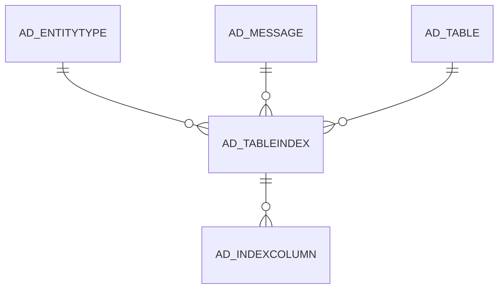

# AD_TABLEINDEX

Area [AD](../../data-model/ad/index.md) · class **config** (proposed) · read from database `idempiere-db` (owner `ADEMPIERE`) · 1181 row(s) when profiled

Application model: `org.compiere.model.X_AD_TableIndex`, access level 4 - System.

## Columns

| column | type | key | not null | business name | references (code) | nulls | distinct |
|---|---|---|---|---|---|---|---|
| `AD_CLIENT_ID` | NUMBER(10,0) |  | yes | Tenant |  | 0 | 1 |
| `AD_ORG_ID` | NUMBER(10,0) |  | yes | Organization |  | 0 | 1 |
| `AD_TABLE_ID` | NUMBER(10,0) |  | yes | Table | [AD_TABLE](../../data-model/ad/ad_table.md) | 0 | 892 |
| `AD_TABLEINDEX_ID` | NUMBER(10,0) | PK | yes | Table Index |  | 0 | 1181 |
| `AD_TABLEINDEX_UU` | VARCHAR2(36 CHAR) |  |  | AD_TableIndex_UU |  | 0 | 1181 |
| `CREATED` | DATE |  | yes | Created |  | 0 | 1137 |
| `CREATEDBY` | NUMBER(10,0) |  | yes | Created By |  | 0 | 3 |
| `DESCRIPTION` | VARCHAR2(255 CHAR) |  |  | Description |  | 1177 | 4 |
| `ENTITYTYPE` | VARCHAR2(40 CHAR) |  | yes | Entity Type |  | 0 | 2 |
| `HELP` | VARCHAR2(2000 CHAR) |  |  | Comment/Help |  | 1181 | 0 |
| `ISACTIVE` | CHAR(1) |  | yes | Active |  | 0 | 2 |
| `ISCREATECONSTRAINT` | CHAR(1) |  | yes | Create Constraint |  | 0 | 2 |
| `ISUNIQUE` | CHAR(1) |  | yes | Unique |  | 0 | 2 |
| `NAME` | VARCHAR2(63 CHAR) |  | yes | Name |  | 0 | 1181 |
| `PROCESSING` | CHAR(1) |  |  | Process Now |  | 0 | 1 |
| `UPDATED` | DATE |  | yes | Updated |  | 0 | 1133 |
| `UPDATEDBY` | NUMBER(10,0) |  | yes | Updated By |  | 0 | 3 |
| `AD_MESSAGE_ID` | NUMBER(10,0) |  |  | Message | [AD_MESSAGE](../../data-model/ad/ad_message.md) | 1179 | 2 |
| `TABLEINDEXDROP` | CHAR(1) |  |  | Drop table index |  | 1110 | 1 |
| `ISKEY` | CHAR(1) |  | yes | Key column |  | 0 | 2 |

*references (code)* is the table the application model's code says a column points to; *Foreign keys* below are the constraints the database declares. Counts come from the profile; no value is ever shown.

## Check constraints

| name | expression |
|---|---|
| `SYS_C0019686` | `IsActive IN ('Y','N')` |
| `SYS_C0019687` | `IsUnique IN ('Y','N')` |
| `SYS_C0019689` | `IsCreateConstraint IN ('Y','N')` |
| `SYS_C0019690` | `IsKey IN ('Y','N')` |

## Foreign keys

**References**

| table | columns | on delete |
|---|---|---|
| [AD_ENTITYTYPE](../../data-model/ad/ad_entitytype.md) | AD_TABLEINDEX.ENTITYTYPE → AD_ENTITYTYPE.ENTITYTYPE | NO ACTION |
| [AD_MESSAGE](../../data-model/ad/ad_message.md) | AD_TABLEINDEX.AD_MESSAGE_ID → AD_MESSAGE.AD_MESSAGE_ID | NO ACTION |
| [AD_TABLE](../../data-model/ad/ad_table.md) | AD_TABLEINDEX.AD_TABLE_ID → AD_TABLE.AD_TABLE_ID | NO ACTION |

**Referenced by**

| table | columns | on delete |
|---|---|---|
| [AD_INDEXCOLUMN](../../data-model/ad/ad_indexcolumn.md) | AD_INDEXCOLUMN.AD_TABLEINDEX_ID → AD_TABLEINDEX.AD_TABLEINDEX_ID | NO ACTION |

## Write behaviour

- updates: **po_only**
- deletes: **deleted_by_users**
- change log: **recorded**
- evidence: 1 citation(s)

## Schema history

46 change(s); the latest:

| applied | release | operation | column | tickets |
|---|---|---|---|---|
| 2024-04-03T12:26 | iD11 | `modify_column` | Name | IDEMPIERE-6064 |
| 2024-04-03T12:26 | iD11 | `create_index` |  | IDEMPIERE-6064 |
| 2024-04-03T12:26 | iD11 | `modify_column` | Name | IDEMPIERE-6064 |
| 2022-03-16T13:42 | i9 | `create_index` |  | IDEMPIERE-5221 |
| 2022-03-16T13:42 | i9 | `modify_column` | Name | IDEMPIERE-5221 |
| 2022-03-16T13:42 | i9 | `modify_column` | Name | IDEMPIERE-5221 |
| 2020-08-04T01:00 | i7.1z | `drop_column` | tmp_col_2_tmp | IDEMPIERE-3862 |
| 2020-08-04T01:00 | i7.1z | `add_column` | tmp_col_3_tmp | IDEMPIERE-3862 |
| 2020-08-04T01:00 | i7.1z | `add_column` | tmp_col_1_tmp | IDEMPIERE-3862 |
| 2020-08-04T01:00 | i7.1z | `modify_column` | NAME | IDEMPIERE-3862 |
| 2020-08-04T01:00 | i7.1z | `drop_column` | tmp_col_3_tmp | IDEMPIERE-3862 |
| 2020-08-04T01:00 | i7.1z | `modify_column` | AD_TABLEINDEX_UU | IDEMPIERE-3862 |
| 2020-08-04T01:00 | i7.1z | `drop_column` | tmp_col_4_tmp | IDEMPIERE-3862 |
| 2020-08-04T01:00 | i7.1z | `modify_column` | NAME | IDEMPIERE-3862 |
| 2020-08-04T01:00 | i7.1z | `add_column` | tmp_col_2_tmp | IDEMPIERE-3862 |

## Notes

<!-- ekos:manual id="table.ad_tableindex.notes" -->
_Business notes about this table._
<!-- /ekos:manual -->
