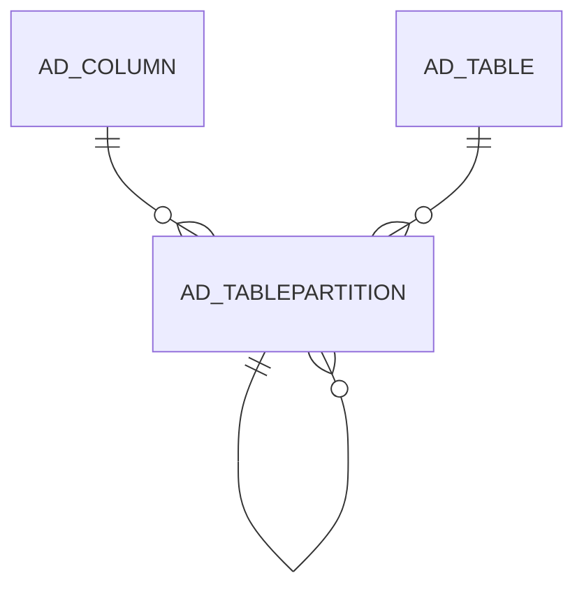

# AD_TABLEPARTITION

Area [AD](../../data-model/ad/index.md) · class **config** (proposed) · read from database `idempiere-db` (owner `ADEMPIERE`) · 0 row(s) when profiled

Application model: `org.compiere.model.X_AD_TablePartition`, access level 4 - System.

## Columns

| column | type | key | not null | business name | references (code) | nulls | distinct |
|---|---|---|---|---|---|---|---|
| `AD_CLIENT_ID` | NUMBER(10,0) |  |  | Tenant |  | 0 | 0 |
| `AD_ORG_ID` | NUMBER(10,0) |  |  | Organization |  | 0 | 0 |
| `AD_TABLE_ID` | NUMBER(10,0) |  | yes | Table | [AD_TABLE](../../data-model/ad/ad_table.md) | 0 | 0 |
| `AD_TABLEPARTITION_ID` | NUMBER(10,0) | PK | yes | Table Partition |  | 0 | 0 |
| `AD_TABLEPARTITION_UU` | VARCHAR2(36 CHAR) |  |  | AD_TablePartition_UU |  | 0 | 0 |
| `CREATED` | DATE |  |  | Created |  | 0 | 0 |
| `CREATEDBY` | NUMBER(10,0) |  |  | Created By |  | 0 | 0 |
| `EXPRESSIONPARTITION` | VARCHAR2(250 CHAR) |  | yes | Expression |  | 0 | 0 |
| `ISACTIVE` | CHAR(1) |  |  | Active |  | 0 | 0 |
| `NAME` | VARCHAR2(63 CHAR) |  | yes | Name |  | 0 | 0 |
| `UPDATED` | DATE |  |  | Updated |  | 0 | 0 |
| `UPDATEDBY` | NUMBER(10,0) |  |  | Updated By |  | 0 | 0 |
| `AD_COLUMN_ID` | NUMBER(10,0) |  | yes | Column | [AD_COLUMN](../../data-model/ad/ad_column.md) | 0 | 0 |
| `ISPARTITIONATTACHED` | CHAR(1) |  | yes | Attached |  | 0 | 0 |
| `PROCESSING` | CHAR(1) |  |  | Process Now |  | 0 | 0 |
| `PARENT_TABLEPARTITION_ID` | NUMBER(10,0) |  |  | Parent Partition | [AD_TABLEPARTITION](../../data-model/ad/ad_tablepartition.md) | 0 | 0 |

*references (code)* is the table the application model's code says a column points to; *Foreign keys* below are the constraints the database declares. Counts come from the profile; no value is ever shown.

## Check constraints

| name | expression |
|---|---|
| `SYS_C0020932` | `IsActive IN ('Y','N')` |
| `SYS_C0020933` | `IsPartitionAttached IN ('Y','N')` |

## Foreign keys

**References**

| table | columns | on delete |
|---|---|---|
| [AD_COLUMN](../../data-model/ad/ad_column.md) | AD_TABLEPARTITION.AD_COLUMN_ID → AD_COLUMN.AD_COLUMN_ID | NO ACTION |
| [AD_TABLE](../../data-model/ad/ad_table.md) | AD_TABLEPARTITION.AD_TABLE_ID → AD_TABLE.AD_TABLE_ID | NO ACTION |
| [AD_TABLEPARTITION](../../data-model/ad/ad_tablepartition.md) | AD_TABLEPARTITION.PARENT_TABLEPARTITION_ID → AD_TABLEPARTITION.AD_TABLEPARTITION_ID | NO ACTION |

**Referenced by**

| table | columns | on delete |
|---|---|---|
| [AD_TABLEPARTITION](../../data-model/ad/ad_tablepartition.md) | AD_TABLEPARTITION.PARENT_TABLEPARTITION_ID → AD_TABLEPARTITION.AD_TABLEPARTITION_ID | NO ACTION |

## Write behaviour

- updates: **po_only**
- deletes: **deleted_by_app**
- change log: **recorded**
- evidence: 7 citation(s)

## Schema history

18 change(s); the latest:

| applied | release | operation | column | tickets |
|---|---|---|---|---|
| 2024-04-03T12:26 | iD11 | `modify_column` | Name | IDEMPIERE-6064 |
| 2024-04-03T12:26 | iD11 | `modify_column` | Name | IDEMPIERE-6064 |
| 2023-12-27T14:20 | iD11 | `add_column` | Processing | IDEMPIERE-5963 |
| 2023-12-27T14:20 | iD11 | `add_column` | Parent_TablePartition_ID | IDEMPIERE-5963 |
| 2023-12-27T14:20 | iD11 | `add_column` | IsPartitionAttached | IDEMPIERE-5963 |
| 2023-12-27T14:20 | iD11 | `add_constraint` |  | IDEMPIERE-5963 |
| 2023-12-26T10:50 | iD11 | `add_constraint` |  | IDEMPIERE-5963 |
| 2023-12-26T10:50 | iD11 | `add_column` | IsPartitionAttached | IDEMPIERE-5963 |
| 2023-12-26T10:50 | iD11 | `add_column` | Processing | IDEMPIERE-5963 |
| 2023-12-26T10:50 | iD11 | `add_column` | Parent_TablePartition_ID | IDEMPIERE-5963 |
| 2023-12-20T11:02 | iD11 | `add_constraint` |  | IDEMPIERE-5943 |
| 2023-12-20T11:02 | iD11 | `add_constraint` |  | IDEMPIERE-5943 |
| 2023-12-20T11:02 | iD11 | `add_column` | AD_Column_ID | IDEMPIERE-5943 |
| 2023-12-20T11:02 | iD11 | `add_column` | AD_Column_ID | IDEMPIERE-5943 |
| 2023-12-04T15:49 | iD11 | `create_table` |  | IDEMPIERE-5943 |

## Notes

<!-- ekos:manual id="table.ad_tablepartition.notes" -->
_Business notes about this table._
<!-- /ekos:manual -->
