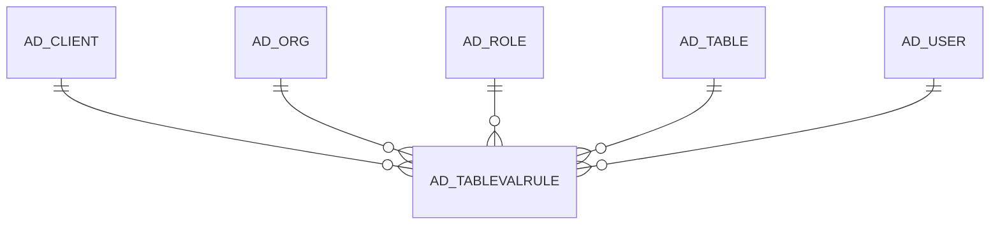

# AD_TABLEVALRULE

Area [AD](../../data-model/ad/index.md) · class **config** (proposed) · read from database `idempiere-db` (owner `ADEMPIERE`) · 0 row(s) when profiled

Application model: `org.compiere.model.X_AD_TableValRule`, access level 6 - System - Client.

## Columns

| column | type | key | not null | business name | references (code) | nulls | distinct |
|---|---|---|---|---|---|---|---|
| `AD_CLIENT_ID` | NUMBER(10,0) |  | yes | Tenant |  | 0 | 0 |
| `AD_ORG_ID` | NUMBER(10,0) |  | yes | Organization |  | 0 | 0 |
| `CREATED` | DATE |  | yes | Created |  | 0 | 0 |
| `CREATEDBY` | NUMBER(10,0) |  | yes | Created By |  | 0 | 0 |
| `UPDATED` | DATE |  | yes | Updated |  | 0 | 0 |
| `UPDATEDBY` | NUMBER(10,0) |  | yes | Updated By |  | 0 | 0 |
| `ISACTIVE` | CHAR(1) |  | yes | Active |  | 0 | 0 |
| `AD_TABLEVALRULE_UU` | VARCHAR2(36 CHAR) |  |  | AD_TableValRule_UU |  | 0 | 0 |
| `DESCRIPTION` | VARCHAR2(255 CHAR) |  |  | Description |  | 0 | 0 |
| `AD_TABLE_ID` | NUMBER(10,0) |  | yes | Table | [AD_TABLE](../../data-model/ad/ad_table.md) | 0 | 0 |
| `CODE` | VARCHAR2(4000 CHAR) |  | yes | Validation code |  | 0 | 0 |
| `AD_ROLE_ID` | NUMBER(10,0) |  |  | Role | [AD_ROLE](../../data-model/ad/ad_role.md) | 0 | 0 |
| `AD_USER_ID` | NUMBER(10,0) |  |  | User/Contact | [AD_USER](../../data-model/ad/ad_user.md) | 0 | 0 |

*references (code)* is the table the application model's code says a column points to; *Foreign keys* below are the constraints the database declares. Counts come from the profile; no value is ever shown.

## Check constraints

| name | expression |
|---|---|
| `SYS_C0021547` | `IsActive IN ('Y','N')` |

## Foreign keys

**References**

| table | columns | on delete |
|---|---|---|
| [AD_CLIENT](../../data-model/ad/ad_client.md) | AD_TABLEVALRULE.AD_CLIENT_ID → AD_CLIENT.AD_CLIENT_ID | NO ACTION |
| [AD_ORG](../../data-model/ad/ad_org.md) | AD_TABLEVALRULE.AD_ORG_ID → AD_ORG.AD_ORG_ID | NO ACTION |
| [AD_ROLE](../../data-model/ad/ad_role.md) | AD_TABLEVALRULE.AD_ROLE_ID → AD_ROLE.AD_ROLE_ID | CASCADE |
| [AD_TABLE](../../data-model/ad/ad_table.md) | AD_TABLEVALRULE.AD_TABLE_ID → AD_TABLE.AD_TABLE_ID | NO ACTION |
| [AD_USER](../../data-model/ad/ad_user.md) | AD_TABLEVALRULE.AD_USER_ID → AD_USER.AD_USER_ID | NO ACTION |

**Referenced by**

_None._

## Write behaviour

- updates: **po_only**
- deletes: **deleted_by_users, deleted_by_cascade**
- change log: **recorded**
- evidence: 2 citation(s)

## Schema history

44 change(s); the latest:

| applied | release | operation | column | tickets |
|---|---|---|---|---|
| 2024-01-25T15:53 | iD11 | `add_constraint` |  | IDEMPIERE-6013 |
| 2024-01-25T15:53 | iD11 | `add_column` | AD_Role_ID | IDEMPIERE-6013 |
| 2024-01-25T15:53 | iD11 | `add_constraint` |  | IDEMPIERE-6013 |
| 2024-01-25T15:53 | iD11 | `add_constraint` |  | IDEMPIERE-6013 |
| 2024-01-25T15:53 | iD11 | `add_constraint` |  | IDEMPIERE-6013 |
| 2024-01-25T15:53 | iD11 | `add_column` | AD_Role_ID | IDEMPIERE-6013 |
| 2024-01-25T15:53 | iD11 | `add_column` | AD_TableValRule_UU | IDEMPIERE-6013 |
| 2024-01-25T15:53 | iD11 | `add_column` | AD_Table_ID | IDEMPIERE-6013 |
| 2024-01-25T15:53 | iD11 | `add_constraint` |  | IDEMPIERE-6013 |
| 2024-01-25T15:53 | iD11 | `add_constraint` |  | IDEMPIERE-6013 |
| 2024-01-25T15:53 | iD11 | `create_table` |  | IDEMPIERE-6013 |
| 2024-01-25T15:53 | iD11 | `add_column` | IsActive | IDEMPIERE-6013 |
| 2024-01-25T15:53 | iD11 | `add_column` | AD_TableValRule_UU | IDEMPIERE-6013 |
| 2024-01-25T15:53 | iD11 | `add_constraint` |  | IDEMPIERE-6013 |
| 2024-01-25T15:53 | iD11 | `add_column` | CreatedBy | IDEMPIERE-6013 |

## Notes

<!-- ekos:manual id="table.ad_tablevalrule.notes" -->
_Business notes about this table._
<!-- /ekos:manual -->
