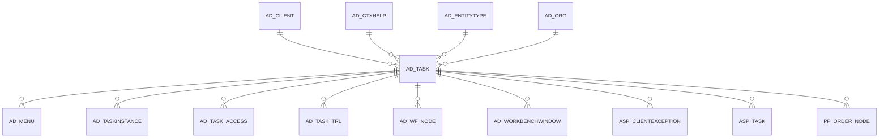

# AD_TASK

Area [AD](../../data-model/ad/index.md) · class **config** (proposed) · read from database `idempiere-db` (owner `ADEMPIERE`) · 3 row(s) when profiled

Application model: `org.compiere.model.X_AD_Task`, access level 6 - System - Client.

## Columns

| column | type | key | not null | business name | references (code) | nulls | distinct |
|---|---|---|---|---|---|---|---|
| `AD_TASK_ID` | NUMBER(10,0) | PK | yes | OS Task |  | 0 | 3 |
| `AD_CLIENT_ID` | NUMBER(10,0) |  | yes | Tenant |  | 0 | 1 |
| `AD_ORG_ID` | NUMBER(10,0) |  | yes | Organization |  | 0 | 1 |
| `ISACTIVE` | CHAR(1) |  | yes | Active |  | 0 | 1 |
| `CREATED` | DATE |  | yes | Created |  | 0 | 3 |
| `CREATEDBY` | NUMBER(10,0) |  | yes | Created By |  | 0 | 1 |
| `UPDATED` | DATE |  | yes | Updated |  | 0 | 3 |
| `UPDATEDBY` | NUMBER(10,0) |  | yes | Updated By |  | 0 | 2 |
| `NAME` | VARCHAR2(60 CHAR) |  | yes | Name |  | 0 | 3 |
| `DESCRIPTION` | VARCHAR2(255 CHAR) |  |  | Description |  | 0 | 3 |
| `HELP` | VARCHAR2(2000 CHAR) |  |  | Comment/Help |  | 0 | 2 |
| `ACCESSLEVEL` | CHAR(1) |  | yes | Data Access Level |  | 0 | 1 |
| `OS_COMMAND` | VARCHAR2(2000 CHAR) |  | yes | OS Command |  | 0 | 3 |
| `ENTITYTYPE` | VARCHAR2(40 CHAR) |  | yes | Entity Type |  | 0 | 1 |
| `ISSERVERPROCESS` | CHAR(1) |  |  |  |  | 0 | 1 |
| `AD_TASK_UU` | VARCHAR2(36 CHAR) |  |  | AD_Task_UU |  | 0 | 3 |
| `AD_CTXHELP_ID` | NUMBER(10,0) |  |  | Context Help | [AD_CTXHELP](../../data-model/ad/ad_ctxhelp.md) | 3 | 0 |

*references (code)* is the table the application model's code says a column points to; *Foreign keys* below are the constraints the database declares. Counts come from the profile; no value is ever shown.

## Check constraints

| name | expression |
|---|---|
| `SYS_C0019841` | `IsActive in ('Y','N')` |

## Foreign keys

**References**

| table | columns | on delete |
|---|---|---|
| [AD_CLIENT](../../data-model/ad/ad_client.md) | AD_TASK.AD_CLIENT_ID → AD_CLIENT.AD_CLIENT_ID | NO ACTION |
| [AD_CTXHELP](../../data-model/ad/ad_ctxhelp.md) | AD_TASK.AD_CTXHELP_ID → AD_CTXHELP.AD_CTXHELP_ID | NO ACTION |
| [AD_ENTITYTYPE](../../data-model/ad/ad_entitytype.md) | AD_TASK.ENTITYTYPE → AD_ENTITYTYPE.ENTITYTYPE | NO ACTION |
| [AD_ORG](../../data-model/ad/ad_org.md) | AD_TASK.AD_ORG_ID → AD_ORG.AD_ORG_ID | NO ACTION |

**Referenced by**

| table | columns | on delete |
|---|---|---|
| [AD_MENU](../../data-model/ad/ad_menu.md) | AD_MENU.AD_TASK_ID → AD_TASK.AD_TASK_ID | NO ACTION |
| [AD_TASKINSTANCE](../../data-model/ad/ad_taskinstance.md) | AD_TASKINSTANCE.AD_TASK_ID → AD_TASK.AD_TASK_ID | CASCADE |
| [AD_TASK_ACCESS](../../data-model/ad/ad_task_access.md) | AD_TASK_ACCESS.AD_TASK_ID → AD_TASK.AD_TASK_ID | CASCADE |
| [AD_TASK_TRL](../../data-model/ad/ad_task_trl.md) | AD_TASK_TRL.AD_TASK_ID → AD_TASK.AD_TASK_ID | CASCADE |
| [AD_WF_NODE](../../data-model/ad/ad_wf_node.md) | AD_WF_NODE.AD_TASK_ID → AD_TASK.AD_TASK_ID | NO ACTION |
| [AD_WORKBENCHWINDOW](../../data-model/ad/ad_workbenchwindow.md) | AD_WORKBENCHWINDOW.AD_TASK_ID → AD_TASK.AD_TASK_ID | NO ACTION |
| [ASP_CLIENTEXCEPTION](../../data-model/asp/asp_clientexception.md) | ASP_CLIENTEXCEPTION.AD_TASK_ID → AD_TASK.AD_TASK_ID | NO ACTION |
| [ASP_TASK](../../data-model/asp/asp_task.md) | ASP_TASK.AD_TASK_ID → AD_TASK.AD_TASK_ID | NO ACTION |
| [PP_ORDER_NODE](../../data-model/pp/pp_order_node.md) | PP_ORDER_NODE.AD_TASK_ID → AD_TASK.AD_TASK_ID | NO ACTION |

## Write behaviour

- updates: **po_only**
- deletes: **deleted_by_users**
- change log: **recorded**
- evidence: 1 citation(s)

## Read by

| kind | name |
|---|---|
| Procedure | [AD_Synchronize](../../logic/ad_synchronize.md) |

## Schema history

37 change(s); the latest:

| applied | release | operation | column | tickets |
|---|---|---|---|---|
| 2023-04-09T15:47 | iD11 | `add_constraint` |  | IDEMPIERE-5567 |
| 2023-04-09T15:47 | iD11 | `add_constraint` |  | IDEMPIERE-5567 |
| 2021-12-05T16:45 | i8.2z | `drop_constraint` |  | IDEMPIERE-5075 |
| 2021-12-05T16:45 | i8.2z | `drop_constraint` |  | IDEMPIERE-5075 |
| 2021-12-05T16:45 | i8.2z | `add_constraint` |  | IDEMPIERE-5075 |
| 2021-12-05T16:45 | i8.2z | `add_constraint` |  | IDEMPIERE-5075 |
| 2021-12-05T16:45 | i8.2z | `drop_constraint` |  | IDEMPIERE-5075 |
| 2021-12-05T16:45 | i8.2z | `add_constraint` |  | IDEMPIERE-5075 |
| 2020-12-14T02:40 | i8.1z | `modify_column` | IsServerProcess | IDEMPIERE-4598 |
| 2020-12-14T02:40 | i8.1z | `modify_column` | IsServerProcess | IDEMPIERE-4598 |
| 2020-12-14T02:40 | i8.1z | `modify_column` | IsServerProcess | IDEMPIERE-4598 |
| 2020-12-14T02:40 | i8.1z | `modify_column` | IsServerProcess | IDEMPIERE-4598 |
| 2020-08-04T01:00 | i7.1z | `modify_column` | ENTITYTYPE | IDEMPIERE-3862 |
| 2020-08-04T01:00 | i7.1z | `add_column` | tmp_col_1_tmp | IDEMPIERE-3862 |
| 2020-08-04T01:00 | i7.1z | `add_column` | tmp_col_3_tmp | IDEMPIERE-3862 |

## Notes

<!-- ekos:manual id="table.ad_task.notes" -->
_Business notes about this table._
<!-- /ekos:manual -->
