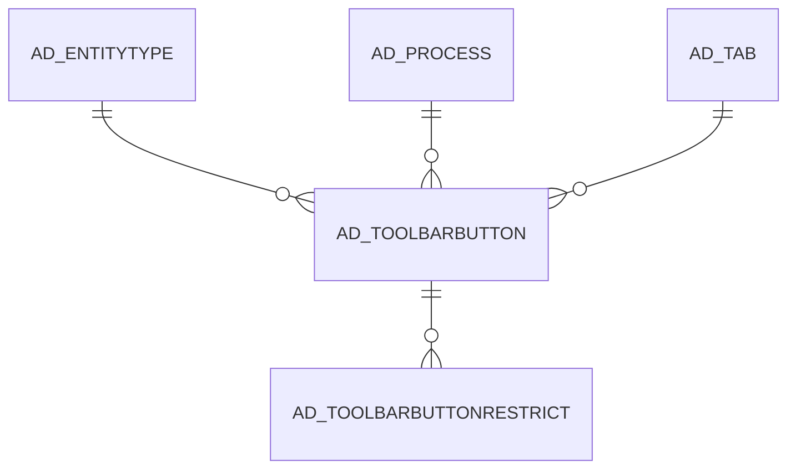

# AD_TOOLBARBUTTON

Area [AD](../../data-model/ad/index.md) · class **config** (proposed) · read from database `idempiere-db` (owner `ADEMPIERE`) · 86 row(s) when profiled

Application model: `org.compiere.model.X_AD_ToolBarButton`, access level 4 - System.

## Columns

| column | type | key | not null | business name | references (code) | nulls | distinct |
|---|---|---|---|---|---|---|---|
| `ACTIONCLASSNAME` | VARCHAR2(255 CHAR) |  |  | Service Component Name |  | 84 | 2 |
| `ACTIONNAME` | VARCHAR2(60 CHAR) |  |  | Action Name |  | 86 | 0 |
| `AD_CLIENT_ID` | NUMBER(10,0) |  | yes | Tenant |  | 0 | 1 |
| `AD_ORG_ID` | NUMBER(10,0) |  | yes | Organization |  | 0 | 1 |
| `AD_TOOLBARBUTTON_ID` | NUMBER(10,0) | PK | yes | ToolBar Button |  | 0 | 86 |
| `CLASSNAME` | VARCHAR2(255 CHAR) |  |  |  |  | 86 | 0 |
| `COMPONENTNAME` | VARCHAR2(255 CHAR) |  | yes | Component Name |  | 0 | 70 |
| `CREATED` | DATE |  | yes | Created |  | 0 | 86 |
| `CREATEDBY` | NUMBER(10,0) |  | yes | Created By |  | 0 | 3 |
| `ISACTIVE` | CHAR(1) |  | yes | Active |  | 0 | 2 |
| `ISCUSTOMIZATION` | CHAR(1) |  | yes | Customization |  | 0 | 2 |
| `KEYSTROKE_KEYCODE` | NUMBER(10,0) |  |  | Key Code |  | 30 | 1 |
| `KEYSTROKE_MODIFIERS` | NUMBER(10,0) |  |  | Keystroke Modifiers |  | 30 | 1 |
| `NAME` | VARCHAR2(60 CHAR) |  | yes | Name |  | 0 | 81 |
| `UPDATED` | DATE |  | yes | Updated |  | 0 | 86 |
| `UPDATEDBY` | NUMBER(10,0) |  | yes | Updated By |  | 0 | 3 |
| `AD_TOOLBARBUTTON_UU` | VARCHAR2(36 CHAR) |  |  | AD_ToolBarButton_UU |  | 0 | 86 |
| `ACTION` | CHAR(1) |  | yes | Action |  | 0 | 3 |
| `AD_TAB_ID` | NUMBER(10,0) |  |  | Tab | [AD_TAB](../../data-model/ad/ad_tab.md) | 56 | 22 |
| `AD_PROCESS_ID` | NUMBER(10,0) |  |  | Process | [AD_PROCESS](../../data-model/ad/ad_process.md) | 56 | 24 |
| `DISPLAYLOGIC` | VARCHAR2(2000 CHAR) |  |  | Display Logic |  | 66 | 13 |
| `SEQNO` | NUMBER(10,0) |  |  | Sequence |  | 16 | 31 |
| `ISADVANCEDBUTTON` | CHAR(1) |  | yes | Advanced Button |  | 0 | 2 |
| `ISADDSEPARATOR` | CHAR(1) |  | yes | Add Separator |  | 0 | 2 |
| `ENTITYTYPE` | VARCHAR2(40 CHAR) |  | yes | Entity Type |  | 0 | 1 |
| `ISSHOWMORE` | CHAR(1) |  |  | Group in show more |  | 0 | 2 |
| `READONLYLOGIC` | VARCHAR2(2000 CHAR) |  |  | Read Only Logic |  | 86 | 0 |
| `PRESSEDLOGIC` | VARCHAR2(2000 CHAR) |  |  | Pressed Logic |  | 86 | 0 |

*references (code)* is the table the application model's code says a column points to; *Foreign keys* below are the constraints the database declares. Counts come from the profile; no value is ever shown.

## Check constraints

| name | expression |
|---|---|
| `SYS_C0019615` | `IsShowMore IN ('Y','N')` |
| `SYS_C0019618` | `IsAddSeparator IN ('Y','N')` |
| `SYS_C0019619` | `IsCustomization IN ('Y','N')` |
| `SYS_C0019620` | `IsActive IN ('Y','N')` |
| `SYS_C0019621` | `IsAdvancedButton IN ('Y','N')` |

## Foreign keys

**References**

| table | columns | on delete |
|---|---|---|
| [AD_ENTITYTYPE](../../data-model/ad/ad_entitytype.md) | AD_TOOLBARBUTTON.ENTITYTYPE → AD_ENTITYTYPE.ENTITYTYPE | NO ACTION |
| [AD_PROCESS](../../data-model/ad/ad_process.md) | AD_TOOLBARBUTTON.AD_PROCESS_ID → AD_PROCESS.AD_PROCESS_ID | NO ACTION |
| [AD_TAB](../../data-model/ad/ad_tab.md) | AD_TOOLBARBUTTON.AD_TAB_ID → AD_TAB.AD_TAB_ID | NO ACTION |

**Referenced by**

| table | columns | on delete |
|---|---|---|
| [AD_TOOLBARBUTTONRESTRICT](../../data-model/ad/ad_toolbarbuttonrestrict.md) | AD_TOOLBARBUTTONRESTRICT.AD_TOOLBARBUTTON_ID → AD_TOOLBARBUTTON.AD_TOOLBARBUTTON_ID | NO ACTION |

## Write behaviour

- updates: **po_only**
- deletes: **deleted_by_users**
- change log: **recorded**
- evidence: 1 citation(s)

## Schema history

58 change(s); the latest:

| applied | release | operation | column | tickets |
|---|---|---|---|---|
| 2023-04-09T15:47 | iD11 | `add_constraint` |  | IDEMPIERE-5567 |
| 2023-04-09T15:47 | iD11 | `add_constraint` |  | IDEMPIERE-5567 |
| 2022-11-09T10:00 | iD10 | `add_column` | ReadOnlyLogic | IDEMPIERE-3334 |
| 2022-11-09T10:00 | iD10 | `add_column` | ReadOnlyLogic | IDEMPIERE-3334 |
| 2022-11-09T10:00 | iD10 | `add_column` | PressedLogic | IDEMPIERE-3334 |
| 2022-11-09T10:00 | iD10 | `add_column` | PressedLogic | IDEMPIERE-3334 |
| 2021-12-05T16:45 | i8.2z | `add_constraint` |  | IDEMPIERE-5075 |
| 2021-12-05T16:45 | i8.2z | `drop_constraint` |  | IDEMPIERE-5075 |
| 2021-12-05T16:45 | i8.2z | `add_constraint` |  | IDEMPIERE-5075 |
| 2021-12-05T16:45 | i8.2z | `drop_constraint` |  | IDEMPIERE-5075 |
| 2020-08-04T01:00 | i7.1z | `modify_column` | AD_TOOLBARBUTTON_UU | IDEMPIERE-3862 |
| 2020-08-04T01:00 | i7.1z | `modify_column` | ACTIONCLASSNAME | IDEMPIERE-3862 |
| 2020-08-04T01:00 | i7.1z | `add_column` | tmp_col_2_tmp | IDEMPIERE-3862 |
| 2020-08-04T01:00 | i7.1z | `add_column` | tmp_col_1_tmp | IDEMPIERE-3862 |
| 2020-08-04T01:00 | i7.1z | `modify_column` | NAME | IDEMPIERE-3862 |

## Notes

<!-- ekos:manual id="table.ad_toolbarbutton.notes" -->
_Business notes about this table._
<!-- /ekos:manual -->
