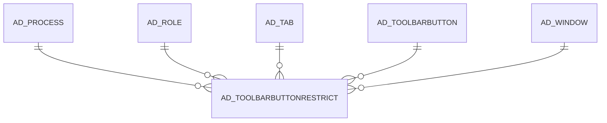

# AD_TOOLBARBUTTONRESTRICT

Area [AD](../../data-model/ad/index.md) · class **config** (proposed) · read from database `idempiere-db` (owner `ADEMPIERE`) · 0 row(s) when profiled

Application model: `org.compiere.model.X_AD_ToolBarButtonRestrict`, access level 6 - System - Client.

## Columns

| column | type | key | not null | business name | references (code) | nulls | distinct |
|---|---|---|---|---|---|---|---|
| `ACTION` | CHAR(1) |  | yes | Action |  | 0 | 0 |
| `AD_CLIENT_ID` | NUMBER(10,0) |  | yes | Tenant |  | 0 | 0 |
| `AD_ORG_ID` | NUMBER(10,0) |  | yes | Organization |  | 0 | 0 |
| `AD_ROLE_ID` | NUMBER(10,0) |  |  | Role | [AD_ROLE](../../data-model/ad/ad_role.md) | 0 | 0 |
| `AD_TOOLBARBUTTON_ID` | NUMBER(10,0) |  |  | ToolBar Button | [AD_TOOLBARBUTTON](../../data-model/ad/ad_toolbarbutton.md) | 0 | 0 |
| `AD_TOOLBARBUTTONRESTRICT_ID` | NUMBER(10,0) | PK | yes | ToolBar Button Restrict |  | 0 | 0 |
| `AD_WINDOW_ID` | NUMBER(10,0) |  |  | Window | [AD_WINDOW](../../data-model/ad/ad_window.md) | 0 | 0 |
| `CREATED` | DATE |  | yes | Created |  | 0 | 0 |
| `CREATEDBY` | NUMBER(10,0) |  | yes | Created By |  | 0 | 0 |
| `ISACTIVE` | CHAR(1) |  | yes | Active |  | 0 | 0 |
| `UPDATED` | DATE |  | yes | Updated |  | 0 | 0 |
| `UPDATEDBY` | NUMBER(10,0) |  | yes | Updated By |  | 0 | 0 |
| `AD_TOOLBARBUTTONRESTRICT_UU` | VARCHAR2(36 CHAR) |  |  | AD_ToolBarButtonRestrict_UU |  | 0 | 0 |
| `AD_PROCESS_ID` | NUMBER(10,0) |  |  | Process | [AD_PROCESS](../../data-model/ad/ad_process.md) | 0 | 0 |
| `ISEXCLUDE` | CHAR(1) |  | yes | Exclude |  | 0 | 0 |
| `AD_TAB_ID` | NUMBER(10,0) |  |  | Tab | [AD_TAB](../../data-model/ad/ad_tab.md) | 0 | 0 |

*references (code)* is the table the application model's code says a column points to; *Foreign keys* below are the constraints the database declares. Counts come from the profile; no value is ever shown.

## Check constraints

| name | expression |
|---|---|
| `SYS_C0019636` | `IsExclude IN ('Y','N')` |
| `SYS_C0019637` | `IsActive IN ('Y','N')` |

## Foreign keys

**References**

| table | columns | on delete |
|---|---|---|
| [AD_PROCESS](../../data-model/ad/ad_process.md) | AD_TOOLBARBUTTONRESTRICT.AD_PROCESS_ID → AD_PROCESS.AD_PROCESS_ID | NO ACTION |
| [AD_ROLE](../../data-model/ad/ad_role.md) | AD_TOOLBARBUTTONRESTRICT.AD_ROLE_ID → AD_ROLE.AD_ROLE_ID | NO ACTION |
| [AD_TAB](../../data-model/ad/ad_tab.md) | AD_TOOLBARBUTTONRESTRICT.AD_TAB_ID → AD_TAB.AD_TAB_ID | NO ACTION |
| [AD_TOOLBARBUTTON](../../data-model/ad/ad_toolbarbutton.md) | AD_TOOLBARBUTTONRESTRICT.AD_TOOLBARBUTTON_ID → AD_TOOLBARBUTTON.AD_TOOLBARBUTTON_ID | NO ACTION |
| [AD_WINDOW](../../data-model/ad/ad_window.md) | AD_TOOLBARBUTTONRESTRICT.AD_WINDOW_ID → AD_WINDOW.AD_WINDOW_ID | NO ACTION |

**Referenced by**

_None._

## Write behaviour

- updates: **po_only**
- deletes: **deleted_by_users**
- change log: **recorded**
- evidence: 1 citation(s)

## Schema history

23 change(s); the latest:

| applied | release | operation | column | tickets |
|---|---|---|---|---|
| 2023-04-09T15:47 | iD11 | `add_constraint` |  | IDEMPIERE-5567 |
| 2023-04-09T15:47 | iD11 | `add_constraint` |  | IDEMPIERE-5567 |
| 2021-12-05T16:45 | i8.2z | `drop_constraint` |  | IDEMPIERE-5075 |
| 2021-12-05T16:45 | i8.2z | `add_constraint` |  | IDEMPIERE-5075 |
| 2021-12-05T16:45 | i8.2z | `add_constraint` |  | IDEMPIERE-5075 |
| 2021-12-05T16:45 | i8.2z | `drop_constraint` |  | IDEMPIERE-5075 |
| 2021-12-05T16:45 | i8.2z | `add_constraint` |  | IDEMPIERE-5075 |
| 2021-12-05T16:45 | i8.2z | `drop_constraint` |  | IDEMPIERE-5075 |
| 2021-12-05T16:45 | i8.2z | `add_constraint` |  | IDEMPIERE-5075 |
| 2021-12-05T16:45 | i8.2z | `drop_constraint` |  | IDEMPIERE-5075 |
| 2021-12-05T16:45 | i8.2z | `drop_constraint` |  | IDEMPIERE-5075 |
| 2021-12-05T16:45 | i8.2z | `add_constraint` |  | IDEMPIERE-5075 |
| 2020-08-04T01:00 | i7.1z | `modify_column` | AD_TOOLBARBUTTONRESTRICT_UU | IDEMPIERE-3862 |
| 2020-08-04T01:00 | i7.1z | `drop_column` | tmp_col_1_tmp | IDEMPIERE-3862 |
| 2020-08-04T01:00 | i7.1z | `add_column` | tmp_col_1_tmp | IDEMPIERE-3862 |

## Notes

<!-- ekos:manual id="table.ad_toolbarbuttonrestrict.notes" -->
_Business notes about this table._
<!-- /ekos:manual -->
