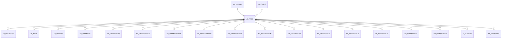

# AD_TREE

Area [AD](../../data-model/ad/index.md) · class **config** (proposed) · read from database `idempiere-db` (owner `ADEMPIERE`) · 23 row(s) when profiled

Application model: `org.compiere.model.X_AD_Tree`, access level 6 - System - Client.

## Columns

| column | type | key | not null | business name | references (code) | nulls | distinct |
|---|---|---|---|---|---|---|---|
| `AD_TREE_ID` | NUMBER(10,0) | PK | yes | Tree |  | 0 | 23 |
| `AD_CLIENT_ID` | NUMBER(10,0) |  | yes | Tenant |  | 0 | 2 |
| `AD_ORG_ID` | NUMBER(10,0) |  | yes | Organization |  | 0 | 2 |
| `CREATED` | DATE |  | yes | Created |  | 0 | 13 |
| `CREATEDBY` | NUMBER(10,0) |  | yes | Created By |  | 0 | 2 |
| `UPDATED` | DATE |  | yes | Updated |  | 0 | 16 |
| `UPDATEDBY` | NUMBER(10,0) |  | yes | Updated By |  | 0 | 2 |
| `ISACTIVE` | CHAR(1) |  | yes | Active |  | 0 | 2 |
| `NAME` | VARCHAR2(60 CHAR) |  | yes | Name |  | 0 | 23 |
| `DESCRIPTION` | VARCHAR2(255 CHAR) |  |  | Description |  | 8 | 10 |
| `TREETYPE` | CHAR(2) |  | yes | Type \| Area |  | 0 | 13 |
| `ISALLNODES` | CHAR(1) |  | yes | All Nodes |  | 0 | 2 |
| `PROCESSING` | CHAR(1) |  |  | Process Now |  | 15 | 1 |
| `ISDEFAULT` | CHAR(1) |  | yes | Default |  | 0 | 1 |
| `AD_TREE_UU` | VARCHAR2(36 CHAR) |  |  | AD_Tree_UU |  | 0 | 23 |
| `ISTREEDRIVENBYVALUE` | CHAR(1) |  | yes | Driven by Search Key |  | 0 | 1 |
| `AD_TABLE_ID` | NUMBER(10,0) |  |  | Table | [AD_TABLE](../../data-model/ad/ad_table.md) | 23 | 0 |
| `ISLOADALLNODESIMMEDIATELY` | CHAR(1) |  | yes | Loads directly all nodes |  | 0 | 1 |
| `ISVALUEDISPLAYED` | CHAR(1) |  | yes | Display Value |  | 0 | 1 |
| `PARENT_COLUMN_ID` | NUMBER(10,0) |  |  | Parent Column | [AD_COLUMN](../../data-model/ad/ad_column.md) | 23 | 0 |

*references (code)* is the table the application model's code says a column points to; *Foreign keys* below are the constraints the database declares. Counts come from the profile; no value is ever shown.

## Check constraints

| name | expression |
|---|---|
| `SYS_C0021189` | `IsAllNodes in ('Y','N')` |
| `SYS_C0021190` | `IsValueDisplayed IN ('Y','N')` |
| `SYS_C0021191` | `IsActive in ('Y','N')` |
| `SYS_C0021192` | `IsTreeDrivenByValue IN ('Y','N')` |
| `SYS_C0021193` | `IsLoadAllNodesImmediately IN ('Y','N')` |

## Foreign keys

**References**

| table | columns | on delete |
|---|---|---|
| [AD_COLUMN](../../data-model/ad/ad_column.md) | AD_TREE.PARENT_COLUMN_ID → AD_COLUMN.AD_COLUMN_ID | NO ACTION |
| [AD_TABLE](../../data-model/ad/ad_table.md) | AD_TREE.AD_TABLE_ID → AD_TABLE.AD_TABLE_ID | NO ACTION |

**Referenced by**

| table | columns | on delete |
|---|---|---|
| [AD_CLIENTINFO](../../data-model/ad/ad_clientinfo.md) | AD_CLIENTINFO.AD_TREE_ACTIVITY_ID → AD_TREE.AD_TREE_ID | NO ACTION |
| [AD_ROLE](../../data-model/ad/ad_role.md) | AD_ROLE.AD_TREE_ORG_ID → AD_TREE.AD_TREE_ID | NO ACTION |
| [AD_TREEBAR](../../data-model/ad/ad_treebar.md) | AD_TREEBAR.AD_TREE_ID → AD_TREE.AD_TREE_ID | CASCADE |
| [AD_TREENODE](../../data-model/ad/ad_treenode.md) | AD_TREENODE.AD_TREE_ID → AD_TREE.AD_TREE_ID | CASCADE |
| [AD_TREENODEBP](../../data-model/ad/ad_treenodebp.md) | AD_TREENODEBP.AD_TREE_ID → AD_TREE.AD_TREE_ID | CASCADE |
| [AD_TREENODECMC](../../data-model/ad/ad_treenodecmc.md) | AD_TREENODECMC.AD_TREE_ID → AD_TREE.AD_TREE_ID | NO ACTION |
| [AD_TREENODECMM](../../data-model/ad/ad_treenodecmm.md) | AD_TREENODECMM.AD_TREE_ID → AD_TREE.AD_TREE_ID | CASCADE |
| [AD_TREENODECMS](../../data-model/ad/ad_treenodecms.md) | AD_TREENODECMS.AD_TREE_ID → AD_TREE.AD_TREE_ID | CASCADE |
| [AD_TREENODECMT](../../data-model/ad/ad_treenodecmt.md) | AD_TREENODECMT.AD_TREE_ID → AD_TREE.AD_TREE_ID | CASCADE |
| [AD_TREENODEMM](../../data-model/ad/ad_treenodemm.md) | AD_TREENODEMM.AD_TREE_ID → AD_TREE.AD_TREE_ID | CASCADE |
| [AD_TREENODEPR](../../data-model/ad/ad_treenodepr.md) | AD_TREENODEPR.AD_TREE_ID → AD_TREE.AD_TREE_ID | CASCADE |
| [AD_TREENODEU1](../../data-model/ad/ad_treenodeu1.md) | AD_TREENODEU1.AD_TREE_ID → AD_TREE.AD_TREE_ID | CASCADE |
| [AD_TREENODEU2](../../data-model/ad/ad_treenodeu2.md) | AD_TREENODEU2.AD_TREE_ID → AD_TREE.AD_TREE_ID | CASCADE |
| [AD_TREENODEU3](../../data-model/ad/ad_treenodeu3.md) | AD_TREENODEU3.AD_TREE_ID → AD_TREE.AD_TREE_ID | CASCADE |
| [AD_TREENODEU4](../../data-model/ad/ad_treenodeu4.md) | AD_TREENODEU4.AD_TREE_ID → AD_TREE.AD_TREE_ID | CASCADE |
| [CM_WEBPROJECT](../../data-model/cm/cm_webproject.md) | CM_WEBPROJECT.AD_TREECMC_ID → AD_TREE.AD_TREE_ID | NO ACTION |
| [C_ELEMENT](../../data-model/c/c_element.md) | C_ELEMENT.AD_TREE_ID → AD_TREE.AD_TREE_ID | SET NULL |
| [PA_HIERARCHY](../../data-model/pa/pa_hierarchy.md) | PA_HIERARCHY.AD_TREE_ACCOUNT_ID → AD_TREE.AD_TREE_ID | NO ACTION |

## Write behaviour

- updates: **po_only**
- deletes: **deleted_by_users**
- change log: **recorded**
- evidence: 1 citation(s)

## Read by

| kind | name |
|---|---|
| Procedure | [IsMemberOfAcctSchema](../../logic/ismemberofacctschema.md) |
| Procedure | [ismemberofacctschema](../../logic/ismemberofacctschema.md) |

## Schema history

30 change(s); the latest:

| applied | release | operation | column | tickets |
|---|---|---|---|---|
| 2023-04-09T15:47 | iD11 | `add_constraint` |  | IDEMPIERE-5567 |
| 2023-04-09T15:47 | iD11 | `add_constraint` |  | IDEMPIERE-5567 |
| 2020-08-04T01:00 | i7.1z | `modify_column` | DESCRIPTION | IDEMPIERE-3862 |
| 2020-08-04T01:00 | i7.1z | `add_column` | tmp_col_3_tmp | IDEMPIERE-3862 |
| 2020-08-04T01:00 | i7.1z | `modify_column` | AD_TREE_UU | IDEMPIERE-3862 |
| 2020-08-04T01:00 | i7.1z | `modify_column` | NAME | IDEMPIERE-3862 |
| 2020-08-04T01:00 | i7.1z | `drop_column` | tmp_col_1_tmp | IDEMPIERE-3862 |
| 2020-08-04T01:00 | i7.1z | `modify_column` | NAME | IDEMPIERE-3862 |
| 2020-08-04T01:00 | i7.1z | `drop_column` | tmp_col_2_tmp | IDEMPIERE-3862 |
| 2020-08-04T01:00 | i7.1z | `create_index` |  | IDEMPIERE-3862 |
| 2020-08-04T01:00 | i7.1z | `add_column` | tmp_col_1_tmp | IDEMPIERE-3862 |
| 2020-08-04T01:00 | i7.1z | `drop_column` | tmp_col_3_tmp | IDEMPIERE-3862 |
| 2020-08-04T01:00 | i7.1z | `add_column` | tmp_col_2_tmp | IDEMPIERE-3862 |
| 2020-08-04T01:00 | i7.1z | `modify_column` | NAME | IDEMPIERE-3862 |
| 2018-12-28T23:33 | i6.1z | `add_column` | Parent_Column_ID | IDEMPIERE-2911 |

## Notes

<!-- ekos:manual id="table.ad_tree.notes" -->
_Business notes about this table._
<!-- /ekos:manual -->
