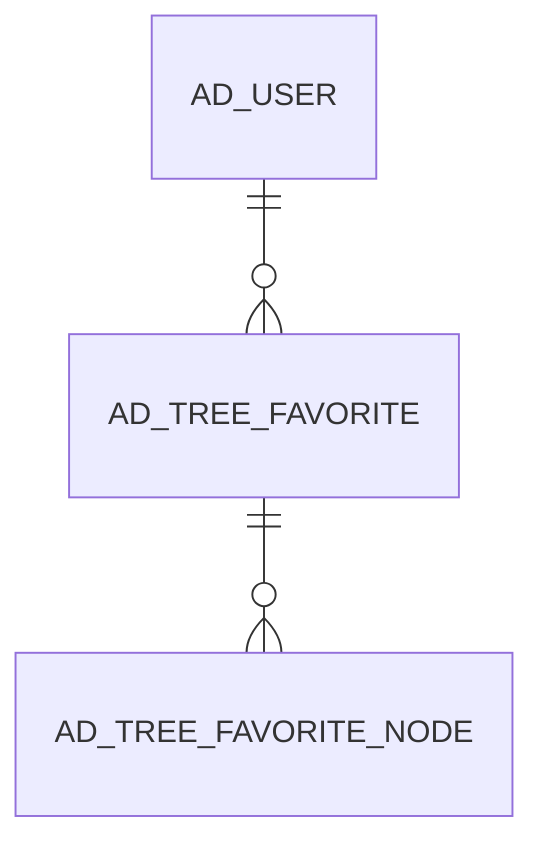

# AD_TREE_FAVORITE

Area [AD](../../data-model/ad/index.md) · class **config** (proposed) · read from database `idempiere-db` (owner `ADEMPIERE`) · 4 row(s) when profiled

Application model: `org.compiere.model.X_AD_Tree_Favorite`, access level 7 - System - Client - Org.

## Columns

| column | type | key | not null | business name | references (code) | nulls | distinct |
|---|---|---|---|---|---|---|---|
| `AD_CLIENT_ID` | NUMBER(10,0) |  | yes | Tenant |  | 0 | 2 |
| `AD_ORG_ID` | NUMBER(10,0) |  | yes | Organization |  | 0 | 2 |
| `AD_TREE_FAVORITE_ID` | NUMBER(10,0) | PK | yes | Favorite Tree |  | 0 | 4 |
| `AD_TREE_FAVORITE_UU` | VARCHAR2(36 CHAR) |  |  | Favorite Tree |  | 0 | 4 |
| `AD_USER_ID` | NUMBER(10,0) |  | yes | User/Contact | [AD_USER](../../data-model/ad/ad_user.md) | 0 | 4 |
| `CREATED` | DATE |  |  | Created |  | 0 | 4 |
| `CREATEDBY` | NUMBER(10,0) |  |  | Created By |  | 0 | 4 |
| `ISACTIVE` | CHAR(1) |  | yes | Active |  | 0 | 1 |
| `UPDATED` | DATE |  |  | Updated |  | 0 | 4 |
| `UPDATEDBY` | NUMBER(10,0) |  | yes | Updated By |  | 0 | 4 |

*references (code)* is the table the application model's code says a column points to; *Foreign keys* below are the constraints the database declares. Counts come from the profile; no value is ever shown.

## Check constraints

| name | expression |
|---|---|
| `SYS_C0021239` | `IsActive IN ('Y','N')` |

## Foreign keys

**References**

| table | columns | on delete |
|---|---|---|
| [AD_USER](../../data-model/ad/ad_user.md) | AD_TREE_FAVORITE.AD_USER_ID → AD_USER.AD_USER_ID | NO ACTION |

**Referenced by**

| table | columns | on delete |
|---|---|---|
| [AD_TREE_FAVORITE_NODE](../../data-model/ad/ad_tree_favorite_node.md) | AD_TREE_FAVORITE_NODE.AD_TREE_FAVORITE_ID → AD_TREE_FAVORITE.AD_TREE_FAVORITE_ID | NO ACTION |

## Write behaviour

- updates: **po_only**
- deletes: **deleted_by_users**
- change log: **not_recorded**
- evidence: 1 citation(s)

## Schema history

4 change(s); the latest:

| applied | release | operation | column | tickets |
|---|---|---|---|---|
| 2017-06-13T12:00 | i8.2z | `create_table` |  | IDEMPIERE-3340 |
| 2017-06-13T12:00 | i8.2z | `add_constraint` |  | IDEMPIERE-3340 |
| 2017-06-13T12:00 | i8.2z | `create_table` |  | IDEMPIERE-3340 |
| 2017-06-13T12:00 | i8.2z | `add_constraint` |  | IDEMPIERE-3340 |

## Notes

<!-- ekos:manual id="table.ad_tree_favorite.notes" -->
_Business notes about this table._
<!-- /ekos:manual -->
