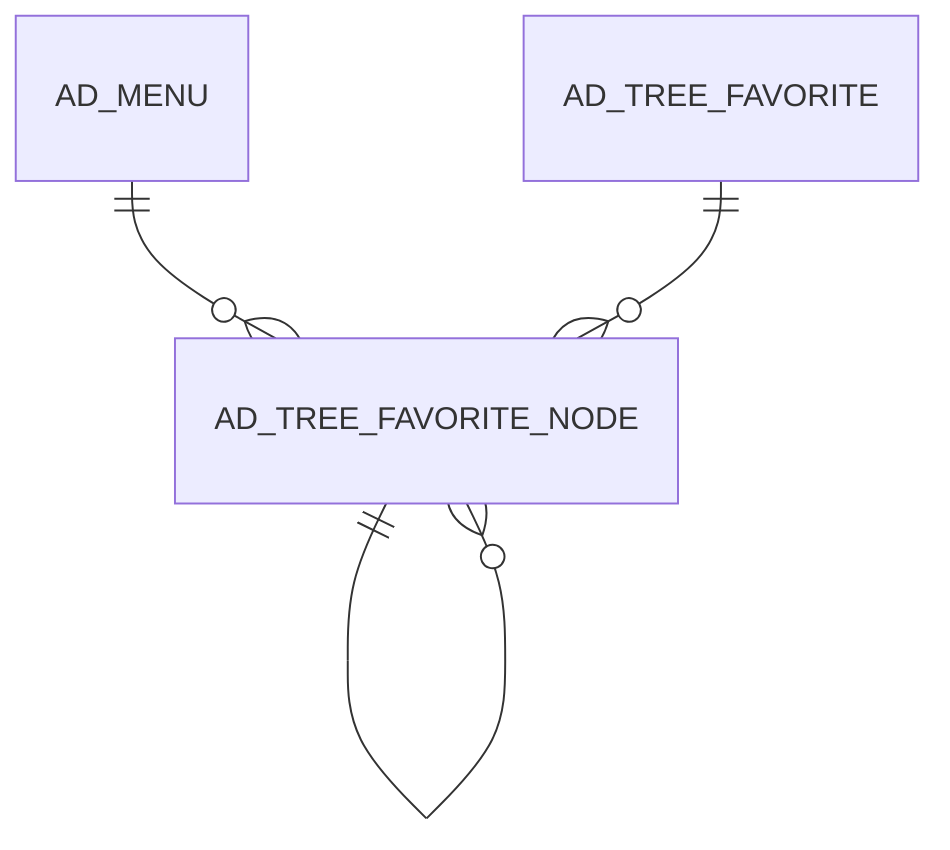

# AD_TREE_FAVORITE_NODE

Area [AD](../../data-model/ad/index.md) · class **config** (proposed) · read from database `idempiere-db` (owner `ADEMPIERE`) · 24 row(s) when profiled

Application model: `org.compiere.model.X_AD_Tree_Favorite_Node`, access level 7 - System - Client - Org.

## Columns

| column | type | key | not null | business name | references (code) | nulls | distinct |
|---|---|---|---|---|---|---|---|
| `AD_CLIENT_ID` | NUMBER(10,0) |  | yes | Tenant |  | 0 | 2 |
| `AD_MENU_ID` | NUMBER(10,0) |  |  | Menu | [AD_MENU](../../data-model/ad/ad_menu.md) | 0 | 14 |
| `AD_ORG_ID` | NUMBER(10,0) |  | yes | Organization |  | 0 | 2 |
| `AD_TREE_FAVORITE_ID` | NUMBER(10,0) |  | yes | Favorite Tree | [AD_TREE_FAVORITE](../../data-model/ad/ad_tree_favorite.md) | 0 | 4 |
| `AD_TREE_FAVORITE_NODE_ID` | NUMBER(10,0) | PK | yes | Favorite Node Tree |  | 0 | 24 |
| `AD_TREE_FAVORITE_NODE_UU` | VARCHAR2(36 CHAR) |  |  | Favorite Node Tree |  | 0 | 24 |
| `CREATED` | DATE |  | yes | Created |  | 0 | 24 |
| `CREATEDBY` | NUMBER(10,0) |  | yes | Created By |  | 0 | 4 |
| `ISACTIVE` | CHAR(1) |  | yes | Active |  | 0 | 1 |
| `ISCOLLAPSIBLE` | CHAR(1) |  | yes | Collapsible |  | 0 | 1 |
| `ISSUMMARY` | CHAR(1) |  | yes | Summary Level |  | 0 | 1 |
| `NAME` | VARCHAR2(120 CHAR) |  |  | Name |  | 24 | 0 |
| `PARENT_ID` | NUMBER(10,0) |  |  | Parent | [AD_TREE_FAVORITE_NODE](../../data-model/ad/ad_tree_favorite_node.md) | 24 | 0 |
| `SEQNO` | NUMBER(10,0) |  | yes | Sequence |  | 0 | 1 |
| `UPDATED` | DATE |  | yes | Updated |  | 0 | 24 |
| `UPDATEDBY` | NUMBER(10,0) |  | yes | Updated By |  | 0 | 4 |
| `ISFAVOURITE` | CHAR(1) |  | yes | Favourite |  | 0 | 1 |
| `LOGINOPENSEQNO` | NUMBER(10,0) |  |  | Login automatic open sequence |  | 24 | 0 |

*references (code)* is the table the application model's code says a column points to; *Foreign keys* below are the constraints the database declares. Counts come from the profile; no value is ever shown.

## Check constraints

| name | expression |
|---|---|
| `SYS_C0022716` | `IsActive IN ('Y','N')` |
| `SYS_C0022717` | `IsCollapsible IN ('Y','N')` |
| `SYS_C0022718` | `IsFavourite IN ('Y','N')` |
| `SYS_C0022719` | `IsSummary IN ('Y','N')` |

## Foreign keys

**References**

| table | columns | on delete |
|---|---|---|
| [AD_MENU](../../data-model/ad/ad_menu.md) | AD_TREE_FAVORITE_NODE.AD_MENU_ID → AD_MENU.AD_MENU_ID | NO ACTION |
| [AD_TREE_FAVORITE](../../data-model/ad/ad_tree_favorite.md) | AD_TREE_FAVORITE_NODE.AD_TREE_FAVORITE_ID → AD_TREE_FAVORITE.AD_TREE_FAVORITE_ID | NO ACTION |
| [AD_TREE_FAVORITE_NODE](../../data-model/ad/ad_tree_favorite_node.md) | AD_TREE_FAVORITE_NODE.PARENT_ID → AD_TREE_FAVORITE_NODE.AD_TREE_FAVORITE_NODE_ID | CASCADE |

**Referenced by**

| table | columns | on delete |
|---|---|---|
| [AD_TREE_FAVORITE_NODE](../../data-model/ad/ad_tree_favorite_node.md) | AD_TREE_FAVORITE_NODE.PARENT_ID → AD_TREE_FAVORITE_NODE.AD_TREE_FAVORITE_NODE_ID | CASCADE |

## Write behaviour

- updates: **raw_sql_skips_updated**
- deletes: **deleted_by_app, deleted_by_users, deleted_by_cascade**
- change log: **not_recorded**
- evidence: 5 citation(s)

## Schema history

12 change(s); the latest:

| applied | release | operation | column | tickets |
|---|---|---|---|---|
| 2020-10-28T19:00 | i8.2z | `add_column` | IsFavourite | IDEMPIERE-3340 |
| 2020-10-28T19:00 | i8.2z | `add_column` | LoginOpenSeqNo | IDEMPIERE-3340 |
| 2020-10-28T19:00 | i8.2z | `add_column` | IsFavourite | IDEMPIERE-3340 |
| 2020-10-28T19:00 | i8.2z | `add_column` | LoginOpenSeqNo | IDEMPIERE-3340 |
| 2017-06-13T12:00 | i8.2z | `add_constraint` |  | IDEMPIERE-3340 |
| 2017-06-13T12:00 | i8.2z | `add_constraint` |  | IDEMPIERE-3340 |
| 2017-06-13T12:00 | i8.2z | `add_constraint` |  | IDEMPIERE-3340 |
| 2017-06-13T12:00 | i8.2z | `create_table` |  | IDEMPIERE-3340 |
| 2017-06-13T12:00 | i8.2z | `create_table` |  | IDEMPIERE-3340 |
| 2017-06-13T12:00 | i8.2z | `add_constraint` |  | IDEMPIERE-3340 |
| 2017-06-13T12:00 | i8.2z | `add_constraint` |  | IDEMPIERE-3340 |
| 2017-06-13T12:00 | i8.2z | `add_constraint` |  | IDEMPIERE-3340 |

## Notes

<!-- ekos:manual id="table.ad_tree_favorite_node.notes" -->
_Business notes about this table._
<!-- /ekos:manual -->
