# AD_USER

Area [AD](../../data-model/ad/index.md) · class **config** (proposed) · read from database `idempiere-db` (owner `ADEMPIERE`) · 9 row(s) when profiled

Application model: `org.compiere.model.X_AD_User`, access level 7 - System - Client - Org.

## Columns

| column | type | key | not null | business name | references (code) | nulls | distinct |
|---|---|---|---|---|---|---|---|
| `AD_USER_ID` | NUMBER(10,0) | PK | yes | User/Contact |  | 0 | 9 |
| `AD_CLIENT_ID` | NUMBER(10,0) |  | yes | Tenant |  | 0 | 2 |
| `AD_ORG_ID` | NUMBER(10,0) |  | yes | Organization |  | 0 | 1 |
| `ISACTIVE` | CHAR(1) |  | yes | Active |  | 0 | 2 |
| `CREATED` | DATE |  | yes | Created |  | 0 | 7 |
| `CREATEDBY` | NUMBER(10,0) |  | yes | Created By |  | 0 | 2 |
| `UPDATED` | DATE |  | yes | Updated |  | 0 | 9 |
| `UPDATEDBY` | NUMBER(10,0) |  | yes | Updated By |  | 0 | 3 |
| `NAME` | VARCHAR2(60 CHAR) |  | yes | Name |  | 0 | 9 |
| `DESCRIPTION` | VARCHAR2(255 CHAR) |  |  | Description |  | 4 | 4 |
| `PASSWORD` | VARCHAR2(1024 CHAR) |  |  |  |  | 4 | 4 |
| `EMAIL` | VARCHAR2(60 CHAR) |  |  | EMail Address |  | 3 | 6 |
| `SUPERVISOR_ID` | NUMBER(10,0) |  |  | Supervisor | [AD_USER](../../data-model/ad/ad_user.md) | 6 | 2 |
| `C_BPARTNER_ID` | NUMBER(10,0) |  |  | Business Partner | [C_BPARTNER](../../data-model/c/c_bpartner.md) | 4 | 5 |
| `PROCESSING` | CHAR(1) |  |  | Process Now |  | 7 | 1 |
| `EMAILUSER` | VARCHAR2(60 CHAR) |  |  | EMail User ID |  | 9 | 0 |
| `EMAILUSERPW` | VARCHAR2(255 CHAR) |  |  | EMail User Password |  | 9 | 0 |
| `C_BPARTNER_LOCATION_ID` | NUMBER(10,0) |  |  | Partner Location | [C_BPARTNER_LOCATION](../../data-model/c/c_bpartner_location.md) | 9 | 0 |
| `C_GREETING_ID` | NUMBER(10,0) |  |  | Greeting | [C_GREETING](../../data-model/c/c_greeting.md) | 8 | 1 |
| `TITLE` | VARCHAR2(40 CHAR) |  |  | Title |  | 8 | 1 |
| `COMMENTS` | VARCHAR2(2000 CHAR) |  |  | Comments |  | 9 | 0 |
| `PHONE` | VARCHAR2(40 CHAR) |  |  | Phone |  | 9 | 0 |
| `PHONE2` | VARCHAR2(40 CHAR) |  |  | 2nd Phone |  | 9 | 0 |
| `FAX` | VARCHAR2(40 CHAR) |  |  | Fax |  | 9 | 0 |
| `LASTCONTACT` | DATE |  |  | Last Contact |  | 8 | 1 |
| `LASTRESULT` | VARCHAR2(255 CHAR) |  |  | Last Result |  | 8 | 1 |
| `BIRTHDAY` | DATE |  |  | Birthday |  | 9 | 0 |
| `AD_ORGTRX_ID` | NUMBER(10,0) |  |  | Trx Organization |  | 9 | 0 |
| `EMAILVERIFY` | VARCHAR2(40 CHAR) |  |  | Verification Info |  | 9 | 0 |
| `EMAILVERIFYDATE` | DATE |  |  | EMail Verify |  | 9 | 0 |
| `NOTIFICATIONTYPE` | CHAR(1) |  | yes | Notification Type |  | 0 | 2 |
| `ISFULLBPACCESS` | CHAR(1) |  | yes | Full BP Access |  | 0 | 1 |
| `C_JOB_ID` | NUMBER(10,0) |  |  | Position | [C_JOB](../../data-model/c/c_job.md) | 7 | 2 |
| `LDAPUSER` | VARCHAR2(60 CHAR) |  |  | LDAP User Name |  | 9 | 0 |
| `CONNECTIONPROFILE` | CHAR(1) |  |  |  |  | 9 | 0 |
| `VALUE` | VARCHAR2(40 CHAR) |  |  | Search Key |  | 3 | 6 |
| `USERPIN` | VARCHAR2(20 CHAR) |  |  | User PIN |  | 8 | 1 |
| `ISINPAYROLL` | CHAR(1) |  | yes | Is In Payroll |  | 0 | 1 |
| `AD_USER_UU` | VARCHAR2(36 CHAR) |  |  | AD_User_UU |  | 0 | 9 |
| `ISMENUAUTOEXPAND` | CHAR(1) |  |  | Auto expand menu |  | 9 | 0 |
| `SALT` | VARCHAR2(16 CHAR) |  |  | Salt |  | 9 | 0 |
| `ISLOCKED` | CHAR(1) |  | yes | Locked |  | 0 | 1 |
| `DATEACCOUNTLOCKED` | DATE |  |  | Date Account Locked |  | 9 | 0 |
| `FAILEDLOGINCOUNT` | NUMBER(10,0) |  | yes | Failed Login Count |  | 0 | 1 |
| `DATEPASSWORDCHANGED` | DATE |  |  | Date Password Changed |  | 9 | 0 |
| `DATELASTLOGIN` | DATE |  |  | Date Last Login |  | 9 | 0 |
| `ISNOPASSWORDRESET` | CHAR(1) |  | yes | No Password Reset |  | 0 | 1 |
| `ISEXPIRED` | CHAR(1) |  | yes | Expired |  | 0 | 1 |
| `SECURITYQUESTION` | VARCHAR2(1024 CHAR) |  |  | Security Question |  | 9 | 0 |
| `ANSWER` | VARCHAR2(1024 CHAR) |  |  | Answer |  | 9 | 0 |
| `ISSALESLEAD` | CHAR(1) |  | yes | Sales Lead |  | 0 | 1 |
| `C_LOCATION_ID` | NUMBER(10,0) |  |  | Address | [C_LOCATION](../../data-model/c/c_location.md) | 9 | 0 |
| `LEADSOURCE` | VARCHAR2(10 CHAR) |  |  | Lead Source |  | 9 | 0 |
| `LEADSTATUS` | VARCHAR2(10 CHAR) |  |  | Lead Status |  | 9 | 0 |
| `LEADSOURCEDESCRIPTION` | VARCHAR2(255 CHAR) |  |  | Lead Source Description |  | 9 | 0 |
| `LEADSTATUSDESCRIPTION` | VARCHAR2(255 CHAR) |  |  | Lead Status Description |  | 9 | 0 |
| `C_CAMPAIGN_ID` | NUMBER(10,0) |  |  | Campaign | [C_CAMPAIGN](../../data-model/c/c_campaign.md) | 9 | 0 |
| `SALESREP_ID` | NUMBER(10,0) |  |  | Sales Representative | [AD_USER](../../data-model/ad/ad_user.md) | 9 | 0 |
| `BPNAME` | VARCHAR2(60 CHAR) |  |  | BP Name |  | 9 | 0 |
| `BP_LOCATION_ID` | NUMBER(10,0) |  |  | BP Address | [C_LOCATION](../../data-model/c/c_location.md) | 9 | 0 |
| `ISADDMAILTEXTAUTOMATICALLY` | CHAR(1) |  | yes | Add Mail Text Automatically |  | 0 | 1 |
| `R_DEFAULTMAILTEXT_ID` | NUMBER(10,0) |  |  | Default mail template | [R_MAILTEXT](../../data-model/r/r_mailtext.md) | 9 | 0 |
| `AD_IMAGE_ID` | NUMBER(10,0) |  |  | Image |  | 9 | 0 |
| `ISNOEXPIRE` | CHAR(1) |  | yes | No Expire |  | 0 | 1 |
| `ISSUPPORTUSER` | CHAR(1) |  | yes | Support User |  | 0 | 2 |
| `ISBILLTO` | CHAR(1) |  | yes | Invoice Address |  | 0 | 1 |
| `ISSHIPTO` | CHAR(1) |  | yes | Ship Address |  | 0 | 1 |
| `ISVENDORLEAD` | CHAR(1) |  | yes | Vendor Lead |  | 0 | 1 |
| `AUTHENTICATIONTYPE` | VARCHAR2(10 CHAR) |  |  | Authentication Type |  | 9 | 0 |

*references (code)* is the table the application model's code says a column points to; *Foreign keys* below are the constraints the database declares. Counts come from the profile; no value is ever shown.

## Check constraints

| name | expression |
|---|---|
| `SYS_C0020139` | `IsExpired IN ('Y','N')` |
| `SYS_C0020140` | `IsNoExpire IN ('Y','N')` |
| `SYS_C0020141` | `IsMenuAutoExpand IN ('Y','N')` |
| `SYS_C0020142` | `IsSupportUser IN ('Y','N')` |
| `SYS_C0020145` | `IsShipTo IN ('Y','N')` |
| `SYS_C0020146` | `IsNoPasswordReset IN ('Y','N')` |
| `SYS_C0020147` | `IsLocked IN ('Y','N')` |
| `SYS_C0020148` | `IsVendorLead IN ('Y','N')` |
| `SYS_C0020149` | `IsInPayroll IN ('Y','N')` |
| `SYS_C0020150` | `IsAddMailTextAutomatically IN ('Y','N')` |
| `SYS_C0020151` | `IsSalesLead IN ('Y','N')` |
| `SYS_C0020152` | `IsBillTo IN ('Y','N')` |
| `SYS_C0020153` | `IsActive in ('Y','N')` |

## Foreign keys

**References**

| table | columns | on delete |
|---|---|---|
| [AD_CLIENT](../../data-model/ad/ad_client.md) | AD_USER.AD_CLIENT_ID → AD_CLIENT.AD_CLIENT_ID | NO ACTION |
| [AD_IMAGE](../../data-model/ad/ad_image.md) | AD_USER.AD_IMAGE_ID → AD_IMAGE.AD_IMAGE_ID | NO ACTION |
| [AD_ORG](../../data-model/ad/ad_org.md) | AD_USER.AD_ORGTRX_ID → AD_ORG.AD_ORG_ID | NO ACTION |
| [AD_USER](../../data-model/ad/ad_user.md) | AD_USER.SUPERVISOR_ID → AD_USER.AD_USER_ID | NO ACTION |
| [C_BPARTNER](../../data-model/c/c_bpartner.md) | AD_USER.C_BPARTNER_ID → C_BPARTNER.C_BPARTNER_ID | CASCADE |
| [C_BPARTNER_LOCATION](../../data-model/c/c_bpartner_location.md) | AD_USER.C_BPARTNER_LOCATION_ID → C_BPARTNER_LOCATION.C_BPARTNER_LOCATION_ID | NO ACTION |
| [C_CAMPAIGN](../../data-model/c/c_campaign.md) | AD_USER.C_CAMPAIGN_ID → C_CAMPAIGN.C_CAMPAIGN_ID | NO ACTION |
| [C_GREETING](../../data-model/c/c_greeting.md) | AD_USER.C_GREETING_ID → C_GREETING.C_GREETING_ID | NO ACTION |
| [C_JOB](../../data-model/c/c_job.md) | AD_USER.C_JOB_ID → C_JOB.C_JOB_ID | NO ACTION |
| [C_LOCATION](../../data-model/c/c_location.md) | AD_USER.BP_LOCATION_ID → C_LOCATION.C_LOCATION_ID | NO ACTION |
| [R_MAILTEXT](../../data-model/r/r_mailtext.md) | AD_USER.R_DEFAULTMAILTEXT_ID → R_MAILTEXT.R_MAILTEXT_ID | NO ACTION |

**Referenced by**

| table | columns | on delete |
|---|---|---|
| [AD_ALERTPROCESSOR](../../data-model/ad/ad_alertprocessor.md) | AD_ALERTPROCESSOR.SUPERVISOR_ID → AD_USER.AD_USER_ID | NO ACTION |
| [AD_ALERTRECIPIENT](../../data-model/ad/ad_alertrecipient.md) | AD_ALERTRECIPIENT.AD_USER_ID → AD_USER.AD_USER_ID | NO ACTION |
| [AD_ATTACHMENTNOTE](../../data-model/ad/ad_attachmentnote.md) | AD_ATTACHMENTNOTE.AD_USER_ID → AD_USER.AD_USER_ID | NO ACTION |
| [AD_AUTHORIZATIONACCOUNT](../../data-model/ad/ad_authorizationaccount.md) | AD_AUTHORIZATIONACCOUNT.AD_USER_ID → AD_USER.AD_USER_ID | NO ACTION |
| [AD_BROADCASTMESSAGE](../../data-model/ad/ad_broadcastmessage.md) | AD_BROADCASTMESSAGE.AD_USER_ID → AD_USER.AD_USER_ID | NO ACTION |
| [AD_BROADCASTMESSAGE_TRL](../../data-model/ad/ad_broadcastmessage_trl.md) | AD_BROADCASTMESSAGE_TRL.CREATEDBY → AD_USER.AD_USER_ID | NO ACTION |
| [AD_CHART_TRL](../../data-model/ad/ad_chart_trl.md) | AD_CHART_TRL.CREATEDBY → AD_USER.AD_USER_ID | NO ACTION |
| [AD_COLOR_TRL](../../data-model/ad/ad_color_trl.md) | AD_COLOR_TRL.CREATEDBY → AD_USER.AD_USER_ID | NO ACTION |
| [AD_CTXHELPSUGGESTION](../../data-model/ad/ad_ctxhelpsuggestion.md) | AD_CTXHELPSUGGESTION.AD_USER_ID → AD_USER.AD_USER_ID | NO ACTION |
| [AD_FIELDSUGGESTION](../../data-model/ad/ad_fieldsuggestion.md) | AD_FIELDSUGGESTION.AD_USER_ID → AD_USER.AD_USER_ID | NO ACTION |
| [AD_IMPORTTEMPLATE](../../data-model/ad/ad_importtemplate.md) | AD_IMPORTTEMPLATE.CREATEDBY → AD_USER.AD_USER_ID | NO ACTION |
| [AD_IMPORTTEMPLATEACCESS](../../data-model/ad/ad_importtemplateaccess.md) | AD_IMPORTTEMPLATEACCESS.CREATEDBY → AD_USER.AD_USER_ID | NO ACTION |
| [AD_INFORELATED](../../data-model/ad/ad_inforelated.md) | AD_INFORELATED.CREATEDBY → AD_USER.AD_USER_ID | NO ACTION |
| [AD_LABELCATEGORY_TRL](../../data-model/ad/ad_labelcategory_trl.md) | AD_LABELCATEGORY_TRL.CREATEDBY → AD_USER.AD_USER_ID | NO ACTION |
| [AD_LABEL_TRL](../../data-model/ad/ad_label_trl.md) | AD_LABEL_TRL.CREATEDBY → AD_USER.AD_USER_ID | NO ACTION |
| [AD_LDAPACCESS](../../data-model/ad/ad_ldapaccess.md) | AD_LDAPACCESS.AD_USER_ID → AD_USER.AD_USER_ID | NO ACTION |
| [AD_LDAPPROCESSOR](../../data-model/ad/ad_ldapprocessor.md) | AD_LDAPPROCESSOR.SUPERVISOR_ID → AD_USER.AD_USER_ID | NO ACTION |
| [AD_MODELGENERATORTEMPLATE](../../data-model/ad/ad_modelgeneratortemplate.md) | AD_MODELGENERATORTEMPLATE.CREATEDBY → AD_USER.AD_USER_ID | NO ACTION |
| [AD_NOTE](../../data-model/ad/ad_note.md) | AD_NOTE.AD_USER_ID → AD_USER.AD_USER_ID | NO ACTION |
| [AD_ORGINFO](../../data-model/ad/ad_orginfo.md) | AD_ORGINFO.SUPERVISOR_ID → AD_USER.AD_USER_ID | SET NULL |
| [AD_PASSWORD_HISTORY](../../data-model/ad/ad_password_history.md) | AD_PASSWORD_HISTORY.AD_USER_ID → AD_USER.AD_USER_ID | NO ACTION |
| [AD_PINSTANCE](../../data-model/ad/ad_pinstance.md) | AD_PINSTANCE.AD_USER_ID → AD_USER.AD_USER_ID | NO ACTION |
| [AD_POSTIT](../../data-model/ad/ad_postit.md) | AD_POSTIT.CREATEDBY → AD_USER.AD_USER_ID | NO ACTION |
| [AD_PREFERENCE](../../data-model/ad/ad_preference.md) | AD_PREFERENCE.AD_USER_ID → AD_USER.AD_USER_ID | NO ACTION |
| [AD_PRINTCOLOR_TRL](../../data-model/ad/ad_printcolor_trl.md) | AD_PRINTCOLOR_TRL.CREATEDBY → AD_USER.AD_USER_ID | NO ACTION |
| [AD_PRIVATE_ACCESS](../../data-model/ad/ad_private_access.md) | AD_PRIVATE_ACCESS.AD_USER_ID → AD_USER.AD_USER_ID | NO ACTION |
| [AD_RECENTITEM](../../data-model/ad/ad_recentitem.md) | AD_RECENTITEM.AD_USER_ID → AD_USER.AD_USER_ID | CASCADE |
| [AD_REPORTVIEW_COLUMN](../../data-model/ad/ad_reportview_column.md) | AD_REPORTVIEW_COLUMN.CREATEDBY → AD_USER.AD_USER_ID | NO ACTION |
| [AD_ROLE](../../data-model/ad/ad_role.md) | AD_ROLE.SUPERVISOR_ID → AD_USER.AD_USER_ID | NO ACTION |
| [AD_SCHEDULER](../../data-model/ad/ad_scheduler.md) | AD_SCHEDULER.SUPERVISOR_ID → AD_USER.AD_USER_ID | NO ACTION |
| [AD_SCHEDULERRECIPIENT](../../data-model/ad/ad_schedulerrecipient.md) | AD_SCHEDULERRECIPIENT.AD_USER_ID → AD_USER.AD_USER_ID | NO ACTION |
| [AD_STATUSLINE](../../data-model/ad/ad_statusline.md) | AD_STATUSLINE.CREATEDBY → AD_USER.AD_USER_ID | NO ACTION |
| [AD_STATUSLINEUSEDIN](../../data-model/ad/ad_statuslineusedin.md) | AD_STATUSLINEUSEDIN.CREATEDBY → AD_USER.AD_USER_ID | NO ACTION |
| [AD_TABLEVALRULE](../../data-model/ad/ad_tablevalrule.md) | AD_TABLEVALRULE.AD_USER_ID → AD_USER.AD_USER_ID | NO ACTION |
| [AD_TAB_CUSTOMIZATION](../../data-model/ad/ad_tab_customization.md) | AD_TAB_CUSTOMIZATION.AD_USER_ID → AD_USER.AD_USER_ID | CASCADE |
| [AD_TREEBAR](../../data-model/ad/ad_treebar.md) | AD_TREEBAR.AD_USER_ID → AD_USER.AD_USER_ID | CASCADE |
| [AD_TREE_FAVORITE](../../data-model/ad/ad_tree_favorite.md) | AD_TREE_FAVORITE.AD_USER_ID → AD_USER.AD_USER_ID | NO ACTION |
| [AD_USER](../../data-model/ad/ad_user.md) | AD_USER.SUPERVISOR_ID → AD_USER.AD_USER_ID | NO ACTION |
| [AD_USERBPACCESS](../../data-model/ad/ad_userbpaccess.md) | AD_USERBPACCESS.AD_USER_ID → AD_USER.AD_USER_ID | CASCADE |
| [AD_USERDEF_INFO](../../data-model/ad/ad_userdef_info.md) | AD_USERDEF_INFO.AD_USER_ID → AD_USER.AD_USER_ID | NO ACTION |
| [AD_USERDEF_PROC](../../data-model/ad/ad_userdef_proc.md) | AD_USERDEF_PROC.AD_USER_ID → AD_USER.AD_USER_ID | NO ACTION |
| [AD_USERDEF_THEME](../../data-model/ad/ad_userdef_theme.md) | AD_USERDEF_THEME.AD_USER_ID → AD_USER.AD_USER_ID | NO ACTION |
| [AD_USERDEF_THEME_DETAIL](../../data-model/ad/ad_userdef_theme_detail.md) | AD_USERDEF_THEME_DETAIL.CREATEDBY → AD_USER.AD_USER_ID | NO ACTION |
| [AD_USERDEF_WIN](../../data-model/ad/ad_userdef_win.md) | AD_USERDEF_WIN.AD_USER_ID → AD_USER.AD_USER_ID | NO ACTION |
| [AD_USERMAIL](../../data-model/ad/ad_usermail.md) | AD_USERMAIL.AD_USER_ID → AD_USER.AD_USER_ID | CASCADE |
| [AD_USERPREFERENCE](../../data-model/ad/ad_userpreference.md) | AD_USERPREFERENCE.AD_USER_ID → AD_USER.AD_USER_ID | CASCADE |
| [AD_USERQUERY](../../data-model/ad/ad_userquery.md) | AD_USERQUERY.AD_USER_ID → AD_USER.AD_USER_ID | CASCADE |
| [AD_USER_ORGACCESS](../../data-model/ad/ad_user_orgaccess.md) | AD_USER_ORGACCESS.AD_USER_ID → AD_USER.AD_USER_ID | NO ACTION |
| [AD_USER_ROLES](../../data-model/ad/ad_user_roles.md) | AD_USER_ROLES.AD_USER_ID → AD_USER.AD_USER_ID | CASCADE |
| [AD_USER_SUBSTITUTE](../../data-model/ad/ad_user_substitute.md) | AD_USER_SUBSTITUTE.SUBSTITUTE_ID → AD_USER.AD_USER_ID | CASCADE |
| [AD_VERIFYMIGRATION](../../data-model/ad/ad_verifymigration.md) | AD_VERIFYMIGRATION.CREATEDBY → AD_USER.AD_USER_ID | NO ACTION |
| [AD_WF_ACTIVITY](../../data-model/ad/ad_wf_activity.md) | AD_WF_ACTIVITY.AD_USER_ID → AD_USER.AD_USER_ID | SET NULL |
| [AD_WF_ACTIVITYAPPROVER](../../data-model/ad/ad_wf_activityapprover.md) | AD_WF_ACTIVITYAPPROVER.AD_USER_ID → AD_USER.AD_USER_ID | NO ACTION |
| [AD_WF_EVENTAUDIT](../../data-model/ad/ad_wf_eventaudit.md) | AD_WF_EVENTAUDIT.AD_USER_ID → AD_USER.AD_USER_ID | NO ACTION |
| [AD_WF_PROCESS](../../data-model/ad/ad_wf_process.md) | AD_WF_PROCESS.AD_USER_ID → AD_USER.AD_USER_ID | NO ACTION |
| [AD_WF_RESPONSIBLE](../../data-model/ad/ad_wf_responsible.md) | AD_WF_RESPONSIBLE.AD_USER_ID → AD_USER.AD_USER_ID | NO ACTION |
| [AD_WIZARDPROCESS](../../data-model/ad/ad_wizardprocess.md) | AD_WIZARDPROCESS.AD_USER_ID → AD_USER.AD_USER_ID | NO ACTION |
| [AD_WLISTBOX_CUSTOMIZATION](../../data-model/ad/ad_wlistbox_customization.md) | AD_WLISTBOX_CUSTOMIZATION.AD_USER_ID → AD_USER.AD_USER_ID | NO ACTION |
| [AD_WORKFLOWPROCESSOR](../../data-model/ad/ad_workflowprocessor.md) | AD_WORKFLOWPROCESSOR.SUPERVISOR_ID → AD_USER.AD_USER_ID | NO ACTION |
| [A_ASSET](../../data-model/a/a_asset.md) | A_ASSET.AD_USER_ID → AD_USER.AD_USER_ID | NO ACTION |
| [A_ASSET_CHANGE](../../data-model/a/a_asset_change.md) | A_ASSET_CHANGE.AD_USER_ID → AD_USER.AD_USER_ID | NO ACTION |
| [A_ASSET_DELIVERY](../../data-model/a/a_asset_delivery.md) | A_ASSET_DELIVERY.AD_USER_ID → AD_USER.AD_USER_ID | NO ACTION |
| [A_ASSET_GROUP_TRL](../../data-model/a/a_asset_group_trl.md) | A_ASSET_GROUP_TRL.CREATEDBY → AD_USER.AD_USER_ID | NO ACTION |
| [A_REGISTRATION](../../data-model/a/a_registration.md) | A_REGISTRATION.AD_USER_ID → AD_USER.AD_USER_ID | NO ACTION |
| [B_BID](../../data-model/b/b_bid.md) | B_BID.AD_USER_ID → AD_USER.AD_USER_ID | NO ACTION |
| [B_BIDCOMMENT](../../data-model/b/b_bidcomment.md) | B_BIDCOMMENT.AD_USER_ID → AD_USER.AD_USER_ID | NO ACTION |
| [B_BUYER](../../data-model/b/b_buyer.md) | B_BUYER.AD_USER_ID → AD_USER.AD_USER_ID | NO ACTION |
| [B_BUYERFUNDS](../../data-model/b/b_buyerfunds.md) | B_BUYERFUNDS.AD_USER_ID → AD_USER.AD_USER_ID | NO ACTION |
| [B_OFFER](../../data-model/b/b_offer.md) | B_OFFER.AD_USER_ID → AD_USER.AD_USER_ID | NO ACTION |
| [B_SELLER](../../data-model/b/b_seller.md) | B_SELLER.AD_USER_ID → AD_USER.AD_USER_ID | NO ACTION |
| [B_SELLERFUNDS](../../data-model/b/b_sellerfunds.md) | B_SELLERFUNDS.AD_USER_ID → AD_USER.AD_USER_ID | NO ACTION |
| [CM_CHATENTRY](../../data-model/cm/cm_chatentry.md) | CM_CHATENTRY.AD_USER_ID → AD_USER.AD_USER_ID | NO ACTION |
| [CM_CHATTYPEUPDATE](../../data-model/cm/cm_chattypeupdate.md) | CM_CHATTYPEUPDATE.AD_USER_ID → AD_USER.AD_USER_ID | CASCADE |
| [CM_CHATUPDATE](../../data-model/cm/cm_chatupdate.md) | CM_CHATUPDATE.AD_USER_ID → AD_USER.AD_USER_ID | CASCADE |
| `CM_WEBACCESSLOG` | CM_WEBACCESSLOG.AD_USER_ID → AD_USER.AD_USER_ID | NO ACTION |
| [C_ACCTPROCESSOR](../../data-model/c/c_acctprocessor.md) | C_ACCTPROCESSOR.SUPERVISOR_ID → AD_USER.AD_USER_ID | NO ACTION |
| [C_ACTIVITY_TRL](../../data-model/c/c_activity_trl.md) | C_ACTIVITY_TRL.CREATEDBY → AD_USER.AD_USER_ID | NO ACTION |
| [C_ADDRESSTRANSACTION](../../data-model/c/c_addresstransaction.md) | C_ADDRESSTRANSACTION.CREATEDBY → AD_USER.AD_USER_ID | NO ACTION |
| [C_ADDRESSVALIDATION](../../data-model/c/c_addressvalidation.md) | C_ADDRESSVALIDATION.CREATEDBY → AD_USER.AD_USER_ID | NO ACTION |
| [C_ADDRESSVALIDATIONCFG](../../data-model/c/c_addressvalidationcfg.md) | C_ADDRESSVALIDATIONCFG.CREATEDBY → AD_USER.AD_USER_ID | NO ACTION |
| [C_BPARTNER](../../data-model/c/c_bpartner.md) | C_BPARTNER.SALESREP_ID → AD_USER.AD_USER_ID | SET NULL |
| [C_BP_BANKACCOUNT](../../data-model/c/c_bp_bankaccount.md) | C_BP_BANKACCOUNT.AD_USER_ID → AD_USER.AD_USER_ID | NO ACTION |
| [C_CAMPAIGN_TRL](../../data-model/c/c_campaign_trl.md) | C_CAMPAIGN_TRL.CREATEDBY → AD_USER.AD_USER_ID | NO ACTION |
| [C_CONTACTACTIVITY](../../data-model/c/c_contactactivity.md) | C_CONTACTACTIVITY.AD_USER_ID → AD_USER.AD_USER_ID | NO ACTION |
| [C_COUNTRYGROUP](../../data-model/c/c_countrygroup.md) | C_COUNTRYGROUP.CREATEDBY → AD_USER.AD_USER_ID | NO ACTION |
| [C_COUNTRYGROUPCOUNTRY](../../data-model/c/c_countrygroupcountry.md) | C_COUNTRYGROUPCOUNTRY.CREATEDBY → AD_USER.AD_USER_ID | NO ACTION |
| [C_COUNTRYGROUP_TRL](../../data-model/c/c_countrygroup_trl.md) | C_COUNTRYGROUP_TRL.CREATEDBY → AD_USER.AD_USER_ID | NO ACTION |
| [C_DOCBASEGROUP](../../data-model/c/c_docbasegroup.md) | C_DOCBASEGROUP.CREATEDBY → AD_USER.AD_USER_ID | NO ACTION |
| [C_DOCBASEGROUPLINE](../../data-model/c/c_docbasegroupline.md) | C_DOCBASEGROUPLINE.CREATEDBY → AD_USER.AD_USER_ID | NO ACTION |
| [C_DUNNINGRUNENTRY](../../data-model/c/c_dunningrunentry.md) | C_DUNNINGRUNENTRY.AD_USER_ID → AD_USER.AD_USER_ID | NO ACTION |
| [C_INVOICE](../../data-model/c/c_invoice.md) | C_INVOICE.AD_USER_ID → AD_USER.AD_USER_ID | NO ACTION |
| [C_INVOICEBATCH](../../data-model/c/c_invoicebatch.md) | C_INVOICEBATCH.SALESREP_ID → AD_USER.AD_USER_ID | NO ACTION |
| [C_INVOICEBATCHLINE](../../data-model/c/c_invoicebatchline.md) | C_INVOICEBATCHLINE.AD_USER_ID → AD_USER.AD_USER_ID | NO ACTION |
| [C_JOBASSIGNMENT](../../data-model/c/c_jobassignment.md) | C_JOBASSIGNMENT.AD_USER_ID → AD_USER.AD_USER_ID | NO ACTION |
| [C_OPPORTUNITY](../../data-model/c/c_opportunity.md) | C_OPPORTUNITY.AD_USER_ID → AD_USER.AD_USER_ID | NO ACTION |
| [C_ORDER](../../data-model/c/c_order.md) | C_ORDER.BILL_USER_ID → AD_USER.AD_USER_ID | NO ACTION |
| [C_ORDERSOURCE](../../data-model/c/c_ordersource.md) | C_ORDERSOURCE.CREATEDBY → AD_USER.AD_USER_ID | NO ACTION |
| [C_ORGASSIGNMENT](../../data-model/c/c_orgassignment.md) | C_ORGASSIGNMENT.AD_USER_ID → AD_USER.AD_USER_ID | NO ACTION |
| [C_POS](../../data-model/c/c_pos.md) | C_POS.SALESREP_ID → AD_USER.AD_USER_ID | NO ACTION |
| [C_PROJECT](../../data-model/c/c_project.md) | C_PROJECT.AD_USER_ID → AD_USER.AD_USER_ID | SET NULL |
| [C_RECURRINGGROUP](../../data-model/c/c_recurringgroup.md) | C_RECURRINGGROUP.CREATEDBY → AD_USER.AD_USER_ID | NO ACTION |
| [C_REGION_TRL](../../data-model/c/c_region_trl.md) | C_REGION_TRL.CREATEDBY → AD_USER.AD_USER_ID | NO ACTION |
| [C_REVENUERECOG_SERVICE](../../data-model/c/c_revenuerecog_service.md) | C_REVENUERECOG_SERVICE.CREATEDBY → AD_USER.AD_USER_ID | NO ACTION |
| [C_RFQ](../../data-model/c/c_rfq.md) | C_RFQ.SALESREP_ID → AD_USER.AD_USER_ID | NO ACTION |
| [C_RFQRESPONSE](../../data-model/c/c_rfqresponse.md) | C_RFQRESPONSE.AD_USER_ID → AD_USER.AD_USER_ID | NO ACTION |
| [C_RFQ_TOPICSUBSCRIBER](../../data-model/c/c_rfq_topicsubscriber.md) | C_RFQ_TOPICSUBSCRIBER.AD_USER_ID → AD_USER.AD_USER_ID | NO ACTION |
| [C_SALESREGION](../../data-model/c/c_salesregion.md) | C_SALESREGION.SALESREP_ID → AD_USER.AD_USER_ID | NO ACTION |
| [C_SALESREGION_TRL](../../data-model/c/c_salesregion_trl.md) | C_SALESREGION_TRL.CREATEDBY → AD_USER.AD_USER_ID | NO ACTION |
| [C_SALESSTAGE_TRL](../../data-model/c/c_salesstage_trl.md) | C_SALESSTAGE_TRL.CREATEDBY → AD_USER.AD_USER_ID | NO ACTION |
| [C_TAXPROVIDER](../../data-model/c/c_taxprovider.md) | C_TAXPROVIDER.CREATEDBY → AD_USER.AD_USER_ID | NO ACTION |
| [C_TAXPROVIDERCFG](../../data-model/c/c_taxprovidercfg.md) | C_TAXPROVIDERCFG.CREATEDBY → AD_USER.AD_USER_ID | NO ACTION |
| [C_USERREMUNERATION](../../data-model/c/c_userremuneration.md) | C_USERREMUNERATION.AD_USER_ID → AD_USER.AD_USER_ID | NO ACTION |
| [DD_ORDER](../../data-model/dd/dd_order.md) | DD_ORDER.AD_USER_ID → AD_USER.AD_USER_ID | NO ACTION |
| [GL_CATEGORY_TRL](../../data-model/gl/gl_category_trl.md) | GL_CATEGORY_TRL.CREATEDBY → AD_USER.AD_USER_ID | NO ACTION |
| [HR_JOB](../../data-model/hr/hr_job.md) | HR_JOB.SUPERVISOR_ID → AD_USER.AD_USER_ID | NO ACTION |
| `I_BPARTNER` | I_BPARTNER.AD_USER_ID → AD_USER.AD_USER_ID | SET NULL |
| `I_INVOICE` | I_INVOICE.SALESREP_ID → AD_USER.AD_USER_ID | SET NULL |
| `I_MOVEMENT` | I_MOVEMENT.AD_USER_ID → AD_USER.AD_USER_ID | NO ACTION |
| `I_ORDER` | I_ORDER.SALESREP_ID → AD_USER.AD_USER_ID | SET NULL |
| `I_PRODUCTPLANNING` | I_PRODUCTPLANNING.PLANNER_ID → AD_USER.AD_USER_ID | NO ACTION |
| [MFA_REGISTEREDDEVICE](../../data-model/mfa/mfa_registereddevice.md) | MFA_REGISTEREDDEVICE.AD_USER_ID → AD_USER.AD_USER_ID | NO ACTION |
| [MFA_REGISTRATION](../../data-model/mfa/mfa_registration.md) | MFA_REGISTRATION.AD_USER_ID → AD_USER.AD_USER_ID | NO ACTION |
| [M_ATTRIBUTEINSTANCELINE](../../data-model/m/m_attributeinstanceline.md) | M_ATTRIBUTEINSTANCELINE.CREATEDBY → AD_USER.AD_USER_ID | NO ACTION |
| [M_FORECASTLINE](../../data-model/m/m_forecastline.md) | M_FORECASTLINE.SALESREP_ID → AD_USER.AD_USER_ID | NO ACTION |
| [M_INOUT](../../data-model/m/m_inout.md) | M_INOUT.AD_USER_ID → AD_USER.AD_USER_ID | NO ACTION |
| [M_LOCATORTYPE](../../data-model/m/m_locatortype.md) | M_LOCATORTYPE.CREATEDBY → AD_USER.AD_USER_ID | NO ACTION |
| [M_MOVEMENT](../../data-model/m/m_movement.md) | M_MOVEMENT.AD_USER_ID → AD_USER.AD_USER_ID | NO ACTION |
| [M_PRICELIST_TRL](../../data-model/m/m_pricelist_trl.md) | M_PRICELIST_TRL.CREATEDBY → AD_USER.AD_USER_ID | NO ACTION |
| [M_PRICELIST_VERSION_TRL](../../data-model/m/m_pricelist_version_trl.md) | M_PRICELIST_VERSION_TRL.CREATEDBY → AD_USER.AD_USER_ID | NO ACTION |
| [M_PRODUCT](../../data-model/m/m_product.md) | M_PRODUCT.SALESREP_ID → AD_USER.AD_USER_ID | NO ACTION |
| [M_PRODUCT_CATEGORY_TRL](../../data-model/m/m_product_category_trl.md) | M_PRODUCT_CATEGORY_TRL.CREATEDBY → AD_USER.AD_USER_ID | NO ACTION |
| [M_REQUISITION](../../data-model/m/m_requisition.md) | M_REQUISITION.AD_USER_ID → AD_USER.AD_USER_ID | NO ACTION |
| [M_RMA](../../data-model/m/m_rma.md) | M_RMA.SALESREP_ID → AD_USER.AD_USER_ID | NO ACTION |
| [M_SHIPPINGTRANSACTION](../../data-model/m/m_shippingtransaction.md) | M_SHIPPINGTRANSACTION.AD_USER_ID → AD_USER.AD_USER_ID | NO ACTION |
| `M_STORAGERESERVATIONLOG` | M_STORAGERESERVATIONLOG.CREATEDBY → AD_USER.AD_USER_ID | NO ACTION |
| [PA_DASHBOARDCONTENT](../../data-model/pa/pa_dashboardcontent.md) | PA_DASHBOARDCONTENT.AD_USER_ID → AD_USER.AD_USER_ID | NO ACTION |
| [PA_DASHBOARDCONTENT_ACCESS](../../data-model/pa/pa_dashboardcontent_access.md) | PA_DASHBOARDCONTENT_ACCESS.AD_USER_ID → AD_USER.AD_USER_ID | NO ACTION |
| [PA_DASHBOARDPREFERENCE](../../data-model/pa/pa_dashboardpreference.md) | PA_DASHBOARDPREFERENCE.AD_USER_ID → AD_USER.AD_USER_ID | NO ACTION |
| [PA_DOCUMENTSTATUS](../../data-model/pa/pa_documentstatus.md) | PA_DOCUMENTSTATUS.AD_USER_ID → AD_USER.AD_USER_ID | NO ACTION |
| [PA_DOCUMENTSTATUSACCESS](../../data-model/pa/pa_documentstatusaccess.md) | PA_DOCUMENTSTATUSACCESS.AD_USER_ID → AD_USER.AD_USER_ID | NO ACTION |
| [PA_GOAL](../../data-model/pa/pa_goal.md) | PA_GOAL.AD_USER_ID → AD_USER.AD_USER_ID | NO ACTION |
| [PP_COST_COLLECTOR](../../data-model/pp/pp_cost_collector.md) | PP_COST_COLLECTOR.AD_USER_ID → AD_USER.AD_USER_ID | NO ACTION |
| [PP_MRP](../../data-model/pp/pp_mrp.md) | PP_MRP.PLANNER_ID → AD_USER.AD_USER_ID | NO ACTION |
| [PP_ORDER](../../data-model/pp/pp_order.md) | PP_ORDER.PLANNER_ID → AD_USER.AD_USER_ID | NO ACTION |
| [PP_ORDER_BOMLINE](../../data-model/pp/pp_order_bomline.md) | PP_ORDER_BOMLINE.AD_USER_ID → AD_USER.AD_USER_ID | NO ACTION |
| [PP_PRODUCT_PLANNING](../../data-model/pp/pp_product_planning.md) | PP_PRODUCT_PLANNING.PLANNER_ID → AD_USER.AD_USER_ID | NO ACTION |
| [R_CATEGORYUPDATES](../../data-model/r/r_categoryupdates.md) | R_CATEGORYUPDATES.AD_USER_ID → AD_USER.AD_USER_ID | NO ACTION |
| [R_CONTACTINTEREST](../../data-model/r/r_contactinterest.md) | R_CONTACTINTEREST.AD_USER_ID → AD_USER.AD_USER_ID | NO ACTION |
| [R_GROUPUPDATES](../../data-model/r/r_groupupdates.md) | R_GROUPUPDATES.AD_USER_ID → AD_USER.AD_USER_ID | NO ACTION |
| [R_ISSUEUSER](../../data-model/r/r_issueuser.md) | R_ISSUEUSER.AD_USER_ID → AD_USER.AD_USER_ID | NO ACTION |
| [R_REQUEST](../../data-model/r/r_request.md) | R_REQUEST.SALESREP_ID → AD_USER.AD_USER_ID | NO ACTION |
| [R_REQUESTACTION](../../data-model/r/r_requestaction.md) | R_REQUESTACTION.SALESREP_ID → AD_USER.AD_USER_ID | NO ACTION |
| [R_REQUESTPROCESSOR](../../data-model/r/r_requestprocessor.md) | R_REQUESTPROCESSOR.SUPERVISOR_ID → AD_USER.AD_USER_ID | NO ACTION |
| [R_REQUESTPROCESSOR_ROUTE](../../data-model/r/r_requestprocessor_route.md) | R_REQUESTPROCESSOR_ROUTE.AD_USER_ID → AD_USER.AD_USER_ID | NO ACTION |
| [R_REQUESTTYPEUPDATES](../../data-model/r/r_requesttypeupdates.md) | R_REQUESTTYPEUPDATES.AD_USER_ID → AD_USER.AD_USER_ID | NO ACTION |
| [R_REQUESTUPDATES](../../data-model/r/r_requestupdates.md) | R_REQUESTUPDATES.AD_USER_ID → AD_USER.AD_USER_ID | NO ACTION |
| [S_RESOURCE](../../data-model/s/s_resource.md) | S_RESOURCE.AD_USER_ID → AD_USER.AD_USER_ID | NO ACTION |
| [TESTUU](../../data-model/other/testuu.md) | TESTUU.CREATEDBY → AD_USER.AD_USER_ID | NO ACTION |
| [TESTUUDET](../../data-model/other/testuudet.md) | TESTUUDET.CREATEDBY → AD_USER.AD_USER_ID | NO ACTION |
| [TESTUU_TRL](../../data-model/testuu/testuu_trl.md) | TESTUU_TRL.CREATEDBY → AD_USER.AD_USER_ID | NO ACTION |
| [U_POSTERMINAL](../../data-model/u/u_posterminal.md) | U_POSTERMINAL.SALESREP_ID → AD_USER.AD_USER_ID | NO ACTION |
| [W_ADVERTISEMENT](../../data-model/w/w_advertisement.md) | W_ADVERTISEMENT.AD_USER_ID → AD_USER.AD_USER_ID | NO ACTION |
| [W_BASKET](../../data-model/w/w_basket.md) | W_BASKET.AD_USER_ID → AD_USER.AD_USER_ID | NO ACTION |
| [W_CLICK](../../data-model/w/w_click.md) | W_CLICK.AD_USER_ID → AD_USER.AD_USER_ID | NO ACTION |
| [W_COUNTER](../../data-model/w/w_counter.md) | W_COUNTER.AD_USER_ID → AD_USER.AD_USER_ID | NO ACTION |
| [W_STORE](../../data-model/w/w_store.md) | W_STORE.SALESREP_ID → AD_USER.AD_USER_ID | NO ACTION |

```mermaid
erDiagram
  AD_CLIENT ||--o{ AD_USER : ""
  AD_IMAGE ||--o{ AD_USER : ""
  AD_ORG ||--o{ AD_USER : ""
  AD_USER ||--o{ AD_ALERTPROCESSOR : ""
  AD_USER ||--o{ AD_ALERTRECIPIENT : ""
  AD_USER ||--o{ AD_ATTACHMENTNOTE : ""
  AD_USER ||--o{ AD_AUTHORIZATIONACCOUNT : ""
  AD_USER ||--o{ AD_BROADCASTMESSAGE : ""
  AD_USER ||--o{ AD_BROADCASTMESSAGE_TRL : ""
  AD_USER ||--o{ AD_CHART_TRL : ""
  AD_USER ||--o{ AD_COLOR_TRL : ""
  AD_USER ||--o{ AD_CTXHELPSUGGESTION : ""
  AD_USER ||--o{ AD_FIELDSUGGESTION : ""
  AD_USER ||--o{ AD_IMPORTTEMPLATE : ""
  AD_USER ||--o{ AD_IMPORTTEMPLATEACCESS : ""
  AD_USER ||--o{ AD_INFORELATED : ""
  AD_USER ||--o{ AD_LABELCATEGORY_TRL : ""
  AD_USER ||--o{ AD_LABEL_TRL : ""
  AD_USER ||--o{ AD_LDAPACCESS : ""
  AD_USER ||--o{ AD_LDAPPROCESSOR : ""
  AD_USER ||--o{ AD_MODELGENERATORTEMPLATE : ""
  AD_USER ||--o{ AD_NOTE : ""
  AD_USER ||--o{ AD_ORGINFO : ""
  AD_USER ||--o{ AD_PASSWORD_HISTORY : ""
  AD_USER ||--o{ AD_PINSTANCE : ""
  AD_USER ||--o{ AD_POSTIT : ""
  AD_USER ||--o{ AD_PREFERENCE : ""
  AD_USER ||--o{ AD_PRINTCOLOR_TRL : ""
  AD_USER ||--o{ AD_USER : ""
  AD_USER ||--o{ C_BPARTNER : ""
  C_BPARTNER ||--o{ AD_USER : ""
```

145 more neighbour(s) not drawn.

## Write behaviour

- updates: **raw_sql_skips_updated**
- deletes: **deleted_by_users, deleted_by_cascade**
- change log: **recorded**
- evidence: 7 citation(s)

## Read by

| kind | name |
|---|---|
| View | `AD_ALLUSERS_V` |
| View | `AD_CHANGELOG_V` |
| View | `AD_SESSIONINFO_V` |
| View | `AD_USER_ROLES_V` |
| View | `C_DUNNING_HEADER_V` |
| View | `C_DUNNING_HEADER_VT` |
| View | `C_INVOICE_HEADER_V` |
| View | `C_INVOICE_HEADER_VT` |
| View | `C_ORDER_HEADER_V` |
| View | `C_ORDER_HEADER_VT` |
| View | `C_PROJECT_HEADER_V` |
| View | `C_PROJECT_HEADER_VT` |
| View | `C_RFQRESPONSE_V` |
| View | `C_RFQRESPONSE_VT` |
| View | `C_SALESDASHBOARD` |
| View | `DD_ORDER_HEADER_V` |
| View | `DD_ORDER_HEADER_VT` |
| View | `M_INOUT_HEADER_V` |
| View | `M_INOUT_HEADER_VT` |
| View | `PP_ORDER_BOM_HEADER_V` |
| View | `PP_ORDER_BOM_HEADER_VT` |
| View | `PP_ORDER_HEADER_V` |
| View | `PP_ORDER_HEADER_VT` |
| View | `PP_ORDER_WORKFLOW_HEADER_V` |
| View | `PP_ORDER_WORKFLOW_HEADER_VT` |
| View | `RV_BPARTNER` |
| View | `RV_FACT_ADAXA` |
| View | `RV_REQUESTUPDATES` |
| View | `ad_allusers_v` |
| View | `ad_changelog_v` |
| View | `ad_sessioninfo_v` |
| View | `ad_user_roles_v` |
| View | `c_dunning_header_v` |
| View | `c_dunning_header_vt` |
| View | `c_invoice_header_v` |
| View | `c_invoice_header_vt` |
| View | `c_order_header_v` |
| View | `c_order_header_vt` |
| View | `c_project_header_v` |
| View | `c_project_header_vt` |
| View | `c_rfqresponse_v` |
| View | `c_rfqresponse_vt` |
| View | `c_salesdashboard` |
| View | `dd_order_header_v` |
| View | `dd_order_header_vt` |
| View | `m_inout_header_v` |
| View | `m_inout_header_vt` |
| View | `pp_order_bom_header_v` |
| View | `pp_order_bom_header_vt` |
| View | `pp_order_header_v` |
| View | `pp_order_header_vt` |
| View | `pp_order_workflow_header_v` |
| View | `pp_order_workflow_header_vt` |
| View | `rv_bpartner` |
| View | `rv_fact_adaxa` |
| View | `rv_requestupdates` |

## Schema history

157 change(s); the latest:

| applied | release | operation | column | tickets |
|---|---|---|---|---|
| 2025-10-31T14:30 | iD12 | `add_column` | PasswordHashAlgorithm | IDEMPIERE-6712 |
| 2025-10-31T14:30 | iD12 | `add_column` | SaltAlgorithm | IDEMPIERE-6712 |
| 2025-10-31T14:30 | iD12 | `add_column` | PasswordHashAlgorithm | IDEMPIERE-6712 |
| 2025-10-31T14:30 | iD12 | `add_column` | SaltAlgorithm | IDEMPIERE-6712 |
| 2025-10-30T11:24 | iD12 | `modify_column` | Salt | IDEMPIERE-6712 |
| 2025-10-30T11:24 | iD12 | `modify_column` | Salt | IDEMPIERE-6712 |
| 2023-04-09T15:47 | iD11 | `add_constraint` |  | IDEMPIERE-5567 |
| 2023-04-09T15:47 | iD11 | `add_constraint` |  | IDEMPIERE-5567 |
| 2023-03-28T15:10 | iD11 | `add_column` | AuthenticationType | IDEMPIERE-5346 |
| 2023-03-28T15:10 | iD11 | `add_column` | AuthenticationType | IDEMPIERE-5346 |
| 2022-03-16T13:42 | i9 | `create_index` |  | IDEMPIERE-5221 |
| 2022-03-16T13:42 | i9 | `create_index` |  | IDEMPIERE-5221 |
| 2022-03-16T13:42 | i9 | `create_index` |  | IDEMPIERE-5221 |
| 2022-03-16T13:42 | i9 | `create_index` |  | IDEMPIERE-5221 |
| 2021-12-05T16:45 | i8.2z | `add_constraint` |  | IDEMPIERE-5075 |

## Open conflicts

| type | attribute | explanation |
|---|---|---|
| `model_column_missing` | `columns.PasswordHashAlgorithm` | unexplained |
| `model_column_missing` | `columns.SaltAlgorithm` | unexplained |

## Notes

<!-- ekos:manual id="table.ad_user.notes" -->
_Business notes about this table._
<!-- /ekos:manual -->
