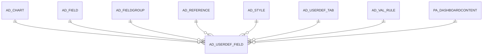

# AD_USERDEF_FIELD

Area [AD](../../data-model/ad/index.md) · class **config** (proposed) · read from database `idempiere-db` (owner `ADEMPIERE`) · 0 row(s) when profiled

Application model: `org.compiere.model.X_AD_UserDef_Field`, access level 6 - System - Client.

## Columns

| column | type | key | not null | business name | references (code) | nulls | distinct |
|---|---|---|---|---|---|---|---|
| `AD_USERDEF_FIELD_ID` | NUMBER(10,0) | PK | yes | User defined Field |  | 0 | 0 |
| `AD_CLIENT_ID` | NUMBER(10,0) |  | yes | Tenant |  | 0 | 0 |
| `AD_ORG_ID` | NUMBER(10,0) |  | yes | Organization |  | 0 | 0 |
| `ISACTIVE` | CHAR(1) |  | yes | Active |  | 0 | 0 |
| `CREATED` | DATE |  | yes | Created |  | 0 | 0 |
| `CREATEDBY` | NUMBER(10,0) |  | yes | Created By |  | 0 | 0 |
| `UPDATED` | DATE |  | yes | Updated |  | 0 | 0 |
| `UPDATEDBY` | NUMBER(10,0) |  | yes | Updated By |  | 0 | 0 |
| `AD_USERDEF_TAB_ID` | NUMBER(10,0) |  | yes | User defined Tab | [AD_USERDEF_TAB](../../data-model/ad/ad_userdef_tab.md) | 0 | 0 |
| `AD_FIELD_ID` | NUMBER(10,0) |  | yes | Field | [AD_FIELD](../../data-model/ad/ad_field.md) | 0 | 0 |
| `NAME` | VARCHAR2(60 CHAR) |  |  | Name |  | 0 | 0 |
| `DESCRIPTION` | VARCHAR2(255 CHAR) |  |  | Description |  | 0 | 0 |
| `HELP` | VARCHAR2(2000 CHAR) |  |  | Comment/Help |  | 0 | 0 |
| `ISDISPLAYED` | CHAR(1) |  |  | Displayed |  | 0 | 0 |
| `ISREADONLY` | CHAR(1) |  |  | Read Only |  | 0 | 0 |
| `ISSAMELINE` | CHAR(1) |  |  | Same Line |  | 0 | 0 |
| `ISUPDATEABLE` | CHAR(1) |  |  | Updatable |  | 0 | 0 |
| `DISPLAYLENGTH` | NUMBER(10,0) |  | yes | Display Length |  | 0 | 0 |
| `DISPLAYLOGIC` | VARCHAR2(2000 CHAR) |  |  | Display Logic |  | 0 | 0 |
| `DEFAULTVALUE` | VARCHAR2(2000 CHAR) |  |  | Default Logic |  | 0 | 0 |
| `SORTNO` | NUMBER(10,0) |  | yes | Record Sort No |  | 0 | 0 |
| `SEQNO` | NUMBER(10,0) |  | yes | Sequence |  | 0 | 0 |
| `AD_USERDEF_FIELD_UU` | VARCHAR2(36 CHAR) |  |  | AD_UserDef_Field_UU |  | 0 | 0 |
| `ISALWAYSUPDATEABLE` | CHAR(1) |  |  | Always Updatable |  | 0 | 0 |
| `MANDATORYLOGIC` | VARCHAR2(2000 CHAR) |  |  | Mandatory Logic |  | 0 | 0 |
| `READONLYLOGIC` | VARCHAR2(2000 CHAR) |  |  | Read Only Logic |  | 0 | 0 |
| `AD_REFERENCE_VALUE_ID` | NUMBER(10,0) |  |  | Reference Key | [AD_REFERENCE](../../data-model/ad/ad_reference.md) | 0 | 0 |
| `ISMANDATORY` | CHAR(1) |  |  | Mandatory |  | 0 | 0 |
| `XPOSITION` | NUMBER(10,0) |  |  | X Position |  | 0 | 0 |
| `NUMLINES` | NUMBER(10,0) |  |  | Number of Lines |  | 0 | 0 |
| `COLUMNSPAN` | NUMBER(10,0) |  |  | Column Span |  | 0 | 0 |
| `ISTOOLBARBUTTON` | CHAR(1) |  |  | Toolbar Button |  | 0 | 0 |
| `AD_REFERENCE_ID` | NUMBER(10,0) |  |  | Reference | [AD_REFERENCE](../../data-model/ad/ad_reference.md) | 0 | 0 |
| `AD_VAL_RULE_ID` | NUMBER(10,0) |  |  | Dynamic Validation | [AD_VAL_RULE](../../data-model/ad/ad_val_rule.md) | 0 | 0 |
| `VFORMAT` | VARCHAR2(255 CHAR) |  |  | Value Format |  | 0 | 0 |
| `AD_LABELSTYLE_ID` | NUMBER(10,0) |  |  | Label Style | [AD_STYLE](../../data-model/ad/ad_style.md) | 0 | 0 |
| `AD_FIELDSTYLE_ID` | NUMBER(10,0) |  |  | Field Style | [AD_STYLE](../../data-model/ad/ad_style.md) | 0 | 0 |
| `PA_DASHBOARDCONTENT_ID` | NUMBER(10,0) |  |  | Dashboard Content | [PA_DASHBOARDCONTENT](../../data-model/pa/pa_dashboardcontent.md) | 0 | 0 |
| `PLACEHOLDER` | VARCHAR2(255 CHAR) |  |  | Placeholder |  | 0 | 0 |
| `ISAUTOCOMPLETE` | CHAR(1) |  |  | Auto complete |  | 0 | 0 |
| `AD_VAL_RULE_LOOKUP_ID` | NUMBER(10,0) |  |  | Dynamic Validation (Lookup) | [AD_VAL_RULE](../../data-model/ad/ad_val_rule.md) | 0 | 0 |
| `AD_FIELDGROUP_ID` | NUMBER(10,0) |  |  | Field Group | [AD_FIELDGROUP](../../data-model/ad/ad_fieldgroup.md) | 0 | 0 |
| `SEQNOGRID` | NUMBER(10,0) |  | yes | Grid Sequence No |  | 0 | 0 |
| `ISDISPLAYEDGRID` | CHAR(1) |  |  | Show in Grid |  | 0 | 0 |
| `AD_CHART_ID` | NUMBER(10,0) |  |  | Chart | [AD_CHART](../../data-model/ad/ad_chart.md) | 0 | 0 |
| `ALWAYSUPDATABLELOGIC` | VARCHAR2(2000 CHAR) |  |  | Always Updatable Logic |  | 0 | 0 |
| `ISHTML` | CHAR(1) |  |  | HTML |  | 0 | 0 |

*references (code)* is the table the application model's code says a column points to; *Foreign keys* below are the constraints the database declares. Counts come from the profile; no value is ever shown.

## Check constraints

| name | expression |
|---|---|
| `SYS_C0021873` | `IsActive in ('Y','N')` |
| `SYS_C0021874` | `IsUpdateable in ('Y','N')` |
| `SYS_C0021876` | `IsSameLine in ('Y','N')` |
| `SYS_C0021877` | `IsDisplayed in ('Y','N')` |
| `SYS_C0021879` | `IsReadOnly in ('Y','N')` |
| `SYS_C0021880` | `IsAutocomplete IN ('Y','N')` |

## Foreign keys

**References**

| table | columns | on delete |
|---|---|---|
| [AD_CHART](../../data-model/ad/ad_chart.md) | AD_USERDEF_FIELD.AD_CHART_ID → AD_CHART.AD_CHART_ID | NO ACTION |
| [AD_FIELD](../../data-model/ad/ad_field.md) | AD_USERDEF_FIELD.AD_FIELD_ID → AD_FIELD.AD_FIELD_ID | NO ACTION |
| [AD_FIELDGROUP](../../data-model/ad/ad_fieldgroup.md) | AD_USERDEF_FIELD.AD_FIELDGROUP_ID → AD_FIELDGROUP.AD_FIELDGROUP_ID | NO ACTION |
| [AD_REFERENCE](../../data-model/ad/ad_reference.md) | AD_USERDEF_FIELD.AD_REFERENCE_VALUE_ID → AD_REFERENCE.AD_REFERENCE_ID | NO ACTION |
| [AD_STYLE](../../data-model/ad/ad_style.md) | AD_USERDEF_FIELD.AD_FIELDSTYLE_ID → AD_STYLE.AD_STYLE_ID | NO ACTION |
| [AD_USERDEF_TAB](../../data-model/ad/ad_userdef_tab.md) | AD_USERDEF_FIELD.AD_USERDEF_TAB_ID → AD_USERDEF_TAB.AD_USERDEF_TAB_ID | NO ACTION |
| [AD_VAL_RULE](../../data-model/ad/ad_val_rule.md) | AD_USERDEF_FIELD.AD_VAL_RULE_LOOKUP_ID → AD_VAL_RULE.AD_VAL_RULE_ID | NO ACTION |
| [PA_DASHBOARDCONTENT](../../data-model/pa/pa_dashboardcontent.md) | AD_USERDEF_FIELD.PA_DASHBOARDCONTENT_ID → PA_DASHBOARDCONTENT.PA_DASHBOARDCONTENT_ID | NO ACTION |

**Referenced by**

_None._

## Write behaviour

- updates: **po_only**
- deletes: **deleted_by_users**
- change log: **recorded**
- evidence: 1 citation(s)

## Schema history

126 change(s); the latest:

| applied | release | operation | column | tickets |
|---|---|---|---|---|
| 2024-05-17T16:07 | iD12 | `add_column` | IsHtml | IDEMPIERE-6147 |
| 2024-05-17T16:07 | iD12 | `add_column` | IsHtml | IDEMPIERE-6147 |
| 2023-04-09T15:47 | iD11 | `add_constraint` |  | IDEMPIERE-5567 |
| 2023-04-09T15:47 | iD11 | `add_constraint` |  | IDEMPIERE-5567 |
| 2022-10-05T20:03 | iD10 | `add_column` | AlwaysUpdatableLogic | IDEMPIERE-5349 |
| 2022-10-05T20:03 | iD10 | `add_column` | AlwaysUpdatableLogic | IDEMPIERE-5349 |
| 2022-03-15T14:30 | iD10 | `add_column` | AD_Chart_ID | IDEMPIERE-5232 |
| 2022-03-15T14:30 | iD10 | `add_column` | AD_Chart_ID | IDEMPIERE-5232 |
| 2022-03-15T14:30 | iD10 | `add_constraint` |  | IDEMPIERE-5232 |
| 2022-03-15T14:30 | iD10 | `add_constraint` |  | IDEMPIERE-5232 |
| 2021-12-05T16:45 | i8.2z | `drop_constraint` |  | IDEMPIERE-5075 |
| 2021-12-05T16:45 | i8.2z | `drop_constraint` |  | IDEMPIERE-5075 |
| 2021-12-05T16:45 | i8.2z | `add_constraint` |  | IDEMPIERE-5075 |
| 2021-12-05T16:45 | i8.2z | `add_constraint` |  | IDEMPIERE-5075 |
| 2021-10-05T17:00 | i8.2z | `create_index` |  | IDEMPIERE-4985 |

## Notes

<!-- ekos:manual id="table.ad_userdef_field.notes" -->
_Business notes about this table._
<!-- /ekos:manual -->
