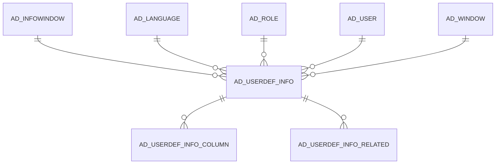

# AD_USERDEF_INFO

Area [AD](../../data-model/ad/index.md) · class **config** (proposed) · read from database `idempiere-db` (owner `ADEMPIERE`) · 0 row(s) when profiled

Application model: `org.compiere.model.X_AD_UserDef_Info`, access level 6 - System - Client.

## Columns

| column | type | key | not null | business name | references (code) | nulls | distinct |
|---|---|---|---|---|---|---|---|
| `AD_USERDEF_INFO_ID` | NUMBER(10,0) | PK | yes | User defined Info Window |  | 0 | 0 |
| `AD_CLIENT_ID` | NUMBER(10,0) |  | yes | Tenant |  | 0 | 0 |
| `AD_ORG_ID` | NUMBER(10,0) |  | yes | Organization |  | 0 | 0 |
| `ISACTIVE` | CHAR(1) |  | yes | Active |  | 0 | 0 |
| `CREATED` | DATE |  | yes | Created |  | 0 | 0 |
| `CREATEDBY` | NUMBER(10,0) |  | yes | Created By |  | 0 | 0 |
| `UPDATED` | DATE |  | yes | Updated |  | 0 | 0 |
| `UPDATEDBY` | NUMBER(10,0) |  | yes | Updated By |  | 0 | 0 |
| `AD_ROLE_ID` | NUMBER(10,0) |  |  | Role | [AD_ROLE](../../data-model/ad/ad_role.md) | 0 | 0 |
| `AD_USER_ID` | NUMBER(10,0) |  |  | User/Contact | [AD_USER](../../data-model/ad/ad_user.md) | 0 | 0 |
| `AD_INFOWINDOW_ID` | NUMBER(10,0) |  | yes | Info Window | [AD_INFOWINDOW](../../data-model/ad/ad_infowindow.md) | 0 | 0 |
| `NAME` | VARCHAR2(60 CHAR) |  |  | Name |  | 0 | 0 |
| `DESCRIPTION` | VARCHAR2(255 CHAR) |  |  | Description |  | 0 | 0 |
| `HELP` | VARCHAR2(2000 CHAR) |  |  | Comment/Help |  | 0 | 0 |
| `AD_LANGUAGE` | VARCHAR2(6 CHAR) |  |  | Language |  | 0 | 0 |
| `AD_USERDEF_INFO_UU` | VARCHAR2(36 CHAR) |  |  | AD_UserDef_Info_UU |  | 0 | 0 |
| `ISSHOWINDASHBOARD` | CHAR(1) |  |  | Show in Dashboard |  | 0 | 0 |
| `SEQNO` | NUMBER(10,0) |  | yes | Sequence |  | 0 | 0 |
| `IMAGEURL` | VARCHAR2(120 CHAR) |  |  | Image URL |  | 0 | 0 |
| `AD_WINDOW_ID` | NUMBER(10,0) |  |  | Window | [AD_WINDOW](../../data-model/ad/ad_window.md) | 0 | 0 |
| `PO_WINDOW_ID` | NUMBER(10,0) |  |  | PO Window | [AD_WINDOW](../../data-model/ad/ad_window.md) | 0 | 0 |

*references (code)* is the table the application model's code says a column points to; *Foreign keys* below are the constraints the database declares. Counts come from the profile; no value is ever shown.

## Check constraints

| name | expression |
|---|---|
| `SYS_C0019661` | `IsShowInDashboard IN ('Y','N')` |
| `SYS_C0019662` | `IsActive IN ('Y','N')` |

## Foreign keys

**References**

| table | columns | on delete |
|---|---|---|
| [AD_INFOWINDOW](../../data-model/ad/ad_infowindow.md) | AD_USERDEF_INFO.AD_INFOWINDOW_ID → AD_INFOWINDOW.AD_INFOWINDOW_ID | CASCADE |
| [AD_LANGUAGE](../../data-model/ad/ad_language.md) | AD_USERDEF_INFO.AD_LANGUAGE → AD_LANGUAGE.AD_LANGUAGE | NO ACTION |
| [AD_ROLE](../../data-model/ad/ad_role.md) | AD_USERDEF_INFO.AD_ROLE_ID → AD_ROLE.AD_ROLE_ID | CASCADE |
| [AD_USER](../../data-model/ad/ad_user.md) | AD_USERDEF_INFO.AD_USER_ID → AD_USER.AD_USER_ID | NO ACTION |
| [AD_WINDOW](../../data-model/ad/ad_window.md) | AD_USERDEF_INFO.AD_WINDOW_ID → AD_WINDOW.AD_WINDOW_ID | NO ACTION |

**Referenced by**

| table | columns | on delete |
|---|---|---|
| [AD_USERDEF_INFO_COLUMN](../../data-model/ad/ad_userdef_info_column.md) | AD_USERDEF_INFO_COLUMN.AD_USERDEF_INFO_ID → AD_USERDEF_INFO.AD_USERDEF_INFO_ID | NO ACTION |
| [AD_USERDEF_INFO_RELATED](../../data-model/ad/ad_userdef_info_related.md) | AD_USERDEF_INFO_RELATED.AD_USERDEF_INFO_ID → AD_USERDEF_INFO.AD_USERDEF_INFO_ID | NO ACTION |

## Write behaviour

- updates: **po_only**
- deletes: **deleted_by_users, deleted_by_cascade**
- change log: **recorded**
- evidence: 3 citation(s)

## Schema history

58 change(s); the latest:

| applied | release | operation | column | tickets |
|---|---|---|---|---|
| 2022-01-03T11:30 | i9 | `add_constraint` |  | IDEMPIERE-3561 |
| 2022-01-03T11:30 | i9 | `add_column` | AD_Window_ID | IDEMPIERE-3561 |
| 2022-01-03T11:30 | i9 | `add_column` | PO_Window_ID | IDEMPIERE-3561 |
| 2022-01-03T11:30 | i9 | `add_constraint` |  | IDEMPIERE-3561 |
| 2022-01-03T11:30 | i9 | `add_constraint` |  | IDEMPIERE-3561 |
| 2022-01-03T11:30 | i9 | `add_column` | PO_Window_ID | IDEMPIERE-3561 |
| 2022-01-03T11:30 | i9 | `add_constraint` |  | IDEMPIERE-3561 |
| 2022-01-03T11:30 | i9 | `add_column` | AD_Window_ID | IDEMPIERE-3561 |
| 2021-09-06T15:00 | i8.2z | `add_column` | ImageURL | IDEMPIERE-4946 |
| 2021-09-06T15:00 | i8.2z | `add_column` | IsShowInDashboard | IDEMPIERE-4946 |
| 2021-09-06T15:00 | i8.2z | `add_column` | ImageURL | IDEMPIERE-4946 |
| 2021-09-06T15:00 | i8.2z | `add_column` | SeqNo | IDEMPIERE-4946 |
| 2021-09-06T15:00 | i8.2z | `add_column` | SeqNo | IDEMPIERE-4946 |
| 2021-09-06T15:00 | i8.2z | `add_column` | IsShowInDashboard | IDEMPIERE-4946 |
| 2021-06-02T10:00 | i8.2 | `create_index` |  | IDEMPIERE-4813 |

## Notes

<!-- ekos:manual id="table.ad_userdef_info.notes" -->
_Business notes about this table._
<!-- /ekos:manual -->
