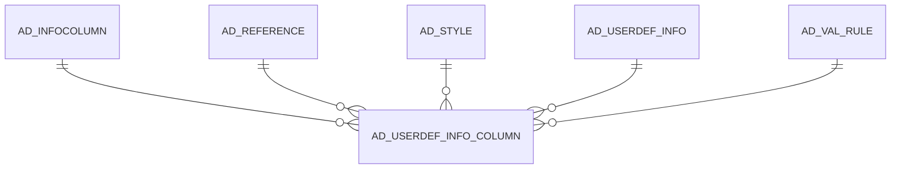

# AD_USERDEF_INFO_COLUMN

Area [AD](../../data-model/ad/index.md) · class **config** (proposed) · read from database `idempiere-db` (owner `ADEMPIERE`) · 0 row(s) when profiled

Application model: `org.compiere.model.X_AD_UserDef_Info_Column`, access level 6 - System - Client.

## Columns

| column | type | key | not null | business name | references (code) | nulls | distinct |
|---|---|---|---|---|---|---|---|
| `AD_USERDEF_INFO_COLUMN_ID` | NUMBER(10,0) | PK | yes | User defined Info Column |  | 0 | 0 |
| `AD_CLIENT_ID` | NUMBER(10,0) |  | yes | Tenant |  | 0 | 0 |
| `AD_ORG_ID` | NUMBER(10,0) |  | yes | Organization |  | 0 | 0 |
| `ISACTIVE` | CHAR(1) |  | yes | Active |  | 0 | 0 |
| `CREATED` | DATE |  | yes | Created |  | 0 | 0 |
| `CREATEDBY` | NUMBER(10,0) |  | yes | Created By |  | 0 | 0 |
| `UPDATED` | DATE |  | yes | Updated |  | 0 | 0 |
| `UPDATEDBY` | NUMBER(10,0) |  | yes | Updated By |  | 0 | 0 |
| `AD_INFOCOLUMN_ID` | NUMBER(10,0) |  | yes | Info Column | [AD_INFOCOLUMN](../../data-model/ad/ad_infocolumn.md) | 0 | 0 |
| `NAME` | VARCHAR2(60 CHAR) |  |  | Name |  | 0 | 0 |
| `DESCRIPTION` | VARCHAR2(255 CHAR) |  |  | Description |  | 0 | 0 |
| `HELP` | VARCHAR2(2000 CHAR) |  |  | Comment/Help |  | 0 | 0 |
| `AD_USERDEF_INFO_COLUMN_UU` | VARCHAR2(36 CHAR) |  |  | AD_UserDef_Info_Column_UU |  | 0 | 0 |
| `SEQNO` | NUMBER(10,0) |  |  | Sequence |  | 0 | 0 |
| `ISDISPLAYED` | CHAR(1) |  |  | Displayed |  | 0 | 0 |
| `ISQUERYCRITERIA` | CHAR(1) |  |  | Query Criteria |  | 0 | 0 |
| `AD_REFERENCE_ID` | NUMBER(10,0) |  |  | Reference | [AD_REFERENCE](../../data-model/ad/ad_reference.md) | 0 | 0 |
| `AD_REFERENCE_VALUE_ID` | NUMBER(10,0) |  |  | Reference Key | [AD_REFERENCE](../../data-model/ad/ad_reference.md) | 0 | 0 |
| `AD_VAL_RULE_ID` | NUMBER(10,0) |  |  | Dynamic Validation | [AD_VAL_RULE](../../data-model/ad/ad_val_rule.md) | 0 | 0 |
| `DISPLAYLOGIC` | VARCHAR2(2000 CHAR) |  |  | Display Logic |  | 0 | 0 |
| `QUERYOPERATOR` | VARCHAR2(10 CHAR) |  |  | Query Operator |  | 0 | 0 |
| `QUERYFUNCTION` | VARCHAR2(2000 CHAR) |  |  | Query Function |  | 0 | 0 |
| `SEQNOSELECTION` | NUMBER(10,0) |  |  | Selection Column Sequence |  | 0 | 0 |
| `DEFAULTVALUE` | VARCHAR2(2000 CHAR) |  |  | Default Logic |  | 0 | 0 |
| `ISMANDATORY` | CHAR(1) |  |  | Mandatory |  | 0 | 0 |
| `ISREADONLY` | CHAR(1) |  |  | Read Only |  | 0 | 0 |
| `PLACEHOLDER` | VARCHAR2(255 CHAR) |  |  | Placeholder |  | 0 | 0 |
| `INPUTFIELDVALIDATION` | VARCHAR2(2000 CHAR) |  |  | Input field validation |  | 0 | 0 |
| `AD_FIELDSTYLE_ID` | NUMBER(10,0) |  |  | Field Style | [AD_STYLE](../../data-model/ad/ad_style.md) | 0 | 0 |
| `ISAUTOCOMPLETE` | CHAR(1) |  |  | Auto complete |  | 0 | 0 |
| `AD_USERDEF_INFO_ID` | NUMBER(10,0) |  | yes | User defined Info Window | [AD_USERDEF_INFO](../../data-model/ad/ad_userdef_info.md) | 0 | 0 |
| `ISQUERYAFTERCHANGE` | CHAR(1) |  |  | Query After Change |  | 0 | 0 |

*references (code)* is the table the application model's code says a column points to; *Foreign keys* below are the constraints the database declares. Counts come from the profile; no value is ever shown.

## Check constraints

| name | expression |
|---|---|
| `SYS_C0020513` | `IsActive IN ('Y','N')` |

## Foreign keys

**References**

| table | columns | on delete |
|---|---|---|
| [AD_INFOCOLUMN](../../data-model/ad/ad_infocolumn.md) | AD_USERDEF_INFO_COLUMN.AD_INFOCOLUMN_ID → AD_INFOCOLUMN.AD_INFOCOLUMN_ID | NO ACTION |
| [AD_REFERENCE](../../data-model/ad/ad_reference.md) | AD_USERDEF_INFO_COLUMN.AD_REFERENCE_VALUE_ID → AD_REFERENCE.AD_REFERENCE_ID | NO ACTION |
| [AD_STYLE](../../data-model/ad/ad_style.md) | AD_USERDEF_INFO_COLUMN.AD_FIELDSTYLE_ID → AD_STYLE.AD_STYLE_ID | NO ACTION |
| [AD_USERDEF_INFO](../../data-model/ad/ad_userdef_info.md) | AD_USERDEF_INFO_COLUMN.AD_USERDEF_INFO_ID → AD_USERDEF_INFO.AD_USERDEF_INFO_ID | NO ACTION |
| [AD_VAL_RULE](../../data-model/ad/ad_val_rule.md) | AD_USERDEF_INFO_COLUMN.AD_VAL_RULE_ID → AD_VAL_RULE.AD_VAL_RULE_ID | NO ACTION |

**Referenced by**

_None._

## Write behaviour

- updates: **po_only**
- deletes: **deleted_by_users**
- change log: **recorded**
- evidence: 1 citation(s)

## Schema history

84 change(s); the latest:

| applied | release | operation | column | tickets |
|---|---|---|---|---|
| 2022-09-14T12:37 | i9 | `add_column` | IsQueryAfterChange | IDEMPIERE-5396 |
| 2022-09-14T12:37 | i9 | `add_column` | IsQueryAfterChange | IDEMPIERE-5396 |
| 2021-10-05T17:00 | i8.2z | `create_index` |  | IDEMPIERE-4985 |
| 2021-10-05T17:00 | i8.2z | `create_index` |  | IDEMPIERE-4985 |
| 2020-09-29T07:30 | i7.1z | `add_column` | IsActive | IDEMPIERE-4459 |
| 2020-09-29T07:30 | i7.1z | `add_column` | AD_Org_ID | IDEMPIERE-4459 |
| 2020-09-29T07:30 | i7.1z | `add_column` | IsMandatory | IDEMPIERE-4459 |
| 2020-09-29T07:30 | i7.1z | `add_column` | Help | IDEMPIERE-4459 |
| 2020-09-29T07:30 | i7.1z | `add_column` | AD_Reference_Value_ID | IDEMPIERE-4459 |
| 2020-09-29T07:30 | i7.1z | `add_column` | AD_InfoColumn_ID | IDEMPIERE-4459 |
| 2020-09-29T07:30 | i7.1z | `add_column` | AD_UserDef_Info_Column_UU | IDEMPIERE-4459 |
| 2020-09-29T07:30 | i7.1z | `add_column` | AD_UserDef_Info_ID | IDEMPIERE-4459 |
| 2020-09-29T07:30 | i7.1z | `add_column` | QueryOperator | IDEMPIERE-4459 |
| 2020-09-29T07:30 | i7.1z | `add_column` | QueryFunction | IDEMPIERE-4459 |
| 2020-09-29T07:30 | i7.1z | `add_column` | DisplayLogic | IDEMPIERE-4459 |

## Notes

<!-- ekos:manual id="table.ad_userdef_info_column.notes" -->
_Business notes about this table._
<!-- /ekos:manual -->
