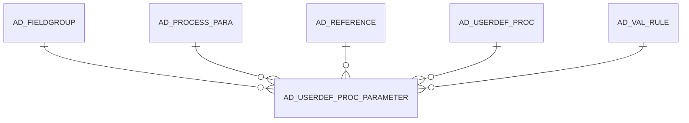

# AD_USERDEF_PROC_PARAMETER

Area [AD](../../data-model/ad/index.md) · class **config** (proposed) · read from database `idempiere-db` (owner `ADEMPIERE`) · 0 row(s) when profiled

Application model: `org.compiere.model.X_AD_UserDef_Proc_Parameter`, access level 6 - System - Client.

## Columns

| column | type | key | not null | business name | references (code) | nulls | distinct |
|---|---|---|---|---|---|---|---|
| `AD_USERDEF_PROC_PARAMETER_ID` | NUMBER(10,0) | PK | yes | AD_UserDef_Proc_Parameter_ID |  | 0 | 0 |
| `AD_USERDEF_PROC_PARAMETER_UU` | VARCHAR2(36 CHAR) |  |  | AD_UserDef_Proc_Parameter_UU |  | 0 | 0 |
| `AD_CLIENT_ID` | NUMBER(10,0) |  | yes | Tenant |  | 0 | 0 |
| `AD_ORG_ID` | NUMBER(10,0) |  | yes | Organization |  | 0 | 0 |
| `ISACTIVE` | CHAR(1) |  | yes | Active |  | 0 | 0 |
| `CREATED` | DATE |  | yes | Created |  | 0 | 0 |
| `CREATEDBY` | NUMBER(10,0) |  | yes | Created By |  | 0 | 0 |
| `UPDATED` | DATE |  | yes | Updated |  | 0 | 0 |
| `UPDATEDBY` | NUMBER(10,0) |  | yes | Updated By |  | 0 | 0 |
| `AD_USERDEF_PROC_ID` | NUMBER(10,0) |  | yes | User defined Process | [AD_USERDEF_PROC](../../data-model/ad/ad_userdef_proc.md) | 0 | 0 |
| `DESCRIPTION` | VARCHAR2(255 CHAR) |  |  | Description |  | 0 | 0 |
| `HELP` | VARCHAR2(2000 CHAR) |  |  | Comment/Help |  | 0 | 0 |
| `ISDISPLAYED` | CHAR(1) |  |  | Displayed |  | 0 | 0 |
| `DISPLAYLOGIC` | VARCHAR2(2000 CHAR) |  |  | Display Logic |  | 0 | 0 |
| `DEFAULTVALUE` | VARCHAR2(2000 CHAR) |  |  | Default Logic |  | 0 | 0 |
| `AD_PROCESS_PARA_ID` | NUMBER(10,0) |  | yes | Process Parameter | [AD_PROCESS_PARA](../../data-model/ad/ad_process_para.md) | 0 | 0 |
| `NAME` | VARCHAR2(60 CHAR) |  |  | Name |  | 0 | 0 |
| `READONLYLOGIC` | VARCHAR2(2000 CHAR) |  |  | Read Only Logic |  | 0 | 0 |
| `MANDATORYLOGIC` | VARCHAR2(2000 CHAR) |  |  | Mandatory Logic |  | 0 | 0 |
| `AD_REFERENCE_ID` | NUMBER(10,0) |  |  | Reference | [AD_REFERENCE](../../data-model/ad/ad_reference.md) | 0 | 0 |
| `AD_REFERENCE_VALUE_ID` | NUMBER(10,0) |  |  | Reference Key | [AD_REFERENCE](../../data-model/ad/ad_reference.md) | 0 | 0 |
| `AD_VAL_RULE_ID` | NUMBER(10,0) |  |  | Dynamic Validation | [AD_VAL_RULE](../../data-model/ad/ad_val_rule.md) | 0 | 0 |
| `DEFAULTVALUE2` | VARCHAR2(2000 CHAR) |  |  | Default Logic 2 |  | 0 | 0 |
| `PLACEHOLDER` | VARCHAR2(255 CHAR) |  |  | Placeholder |  | 0 | 0 |
| `PLACEHOLDER2` | VARCHAR2(255 CHAR) |  |  | Placeholder2 |  | 0 | 0 |
| `ISRANGE` | CHAR(1) |  |  | Range |  | 0 | 0 |
| `ISMANDATORY` | CHAR(1) |  |  | Mandatory |  | 0 | 0 |
| `VALUEMIN` | VARCHAR2(20 CHAR) |  |  | Min. Value |  | 0 | 0 |
| `VALUEMAX` | VARCHAR2(20 CHAR) |  |  | Max. Value |  | 0 | 0 |
| `SEQNO` | NUMBER(10,0) |  |  | Sequence |  | 0 | 0 |
| `VFORMAT` | VARCHAR2(40 CHAR) |  |  | Value Format |  | 0 | 0 |
| `AD_FIELDGROUP_ID` | NUMBER(10,0) |  |  | Field Group | [AD_FIELDGROUP](../../data-model/ad/ad_fieldgroup.md) | 0 | 0 |

*references (code)* is the table the application model's code says a column points to; *Foreign keys* below are the constraints the database declares. Counts come from the profile; no value is ever shown.

## Check constraints

| name | expression |
|---|---|
| `SYS_C0022746` | `IsDisplayed IN ('Y','N')` |
| `SYS_C0022748` | `IsRange IN ('Y','N')` |
| `SYS_C0022749` | `IsActive IN ('Y','N')` |

## Foreign keys

**References**

| table | columns | on delete |
|---|---|---|
| [AD_FIELDGROUP](../../data-model/ad/ad_fieldgroup.md) | AD_USERDEF_PROC_PARAMETER.AD_FIELDGROUP_ID → AD_FIELDGROUP.AD_FIELDGROUP_ID | NO ACTION |
| [AD_PROCESS_PARA](../../data-model/ad/ad_process_para.md) | AD_USERDEF_PROC_PARAMETER.AD_PROCESS_PARA_ID → AD_PROCESS_PARA.AD_PROCESS_PARA_ID | NO ACTION |
| [AD_REFERENCE](../../data-model/ad/ad_reference.md) | AD_USERDEF_PROC_PARAMETER.AD_REFERENCE_VALUE_ID → AD_REFERENCE.AD_REFERENCE_ID | NO ACTION |
| [AD_USERDEF_PROC](../../data-model/ad/ad_userdef_proc.md) | AD_USERDEF_PROC_PARAMETER.AD_USERDEF_PROC_ID → AD_USERDEF_PROC.AD_USERDEF_PROC_ID | NO ACTION |
| [AD_VAL_RULE](../../data-model/ad/ad_val_rule.md) | AD_USERDEF_PROC_PARAMETER.AD_VAL_RULE_ID → AD_VAL_RULE.AD_VAL_RULE_ID | NO ACTION |

**Referenced by**

_None._

## Write behaviour

- updates: **po_only**
- deletes: **deleted_by_users**
- change log: **recorded**
- evidence: 1 citation(s)

## Schema history

98 change(s); the latest:

| applied | release | operation | column | tickets |
|---|---|---|---|---|
| 2021-10-05T17:00 | i8.2z | `create_index` |  | IDEMPIERE-4985 |
| 2021-10-05T17:00 | i8.2z | `create_index` |  | IDEMPIERE-4985 |
| 2021-07-23T02:28 | i8.2z | `add_constraint` |  | IDEMPIERE-1994 |
| 2021-07-23T02:28 | i8.2z | `add_constraint` |  | IDEMPIERE-1994 |
| 2021-07-23T02:28 | i8.2z | `add_column` | AD_FieldGroup_ID | IDEMPIERE-1994 |
| 2021-07-23T02:28 | i8.2z | `add_column` | AD_FieldGroup_ID | IDEMPIERE-1994 |
| 2020-08-04T01:00 | i7.1z | `modify_column` | DEFAULTVALUE | IDEMPIERE-3862 |
| 2020-08-04T01:00 | i7.1z | `modify_column` | VALUEMAX | IDEMPIERE-3862 |
| 2020-08-04T01:00 | i7.1z | `modify_column` | DISPLAYLOGIC | IDEMPIERE-3862 |
| 2020-08-04T01:00 | i7.1z | `modify_column` | MANDATORYLOGIC | IDEMPIERE-3862 |
| 2020-08-04T01:00 | i7.1z | `modify_column` | HELP | IDEMPIERE-3862 |
| 2020-08-04T01:00 | i7.1z | `modify_column` | DESCRIPTION | IDEMPIERE-3862 |
| 2020-08-04T01:00 | i7.1z | `modify_column` | NAME | IDEMPIERE-3862 |
| 2020-08-04T01:00 | i7.1z | `modify_column` | VFORMAT | IDEMPIERE-3862 |
| 2020-08-04T01:00 | i7.1z | `modify_column` | VALUEMIN | IDEMPIERE-3862 |

## Notes

<!-- ekos:manual id="table.ad_userdef_proc_parameter.notes" -->
_Business notes about this table._
<!-- /ekos:manual -->
