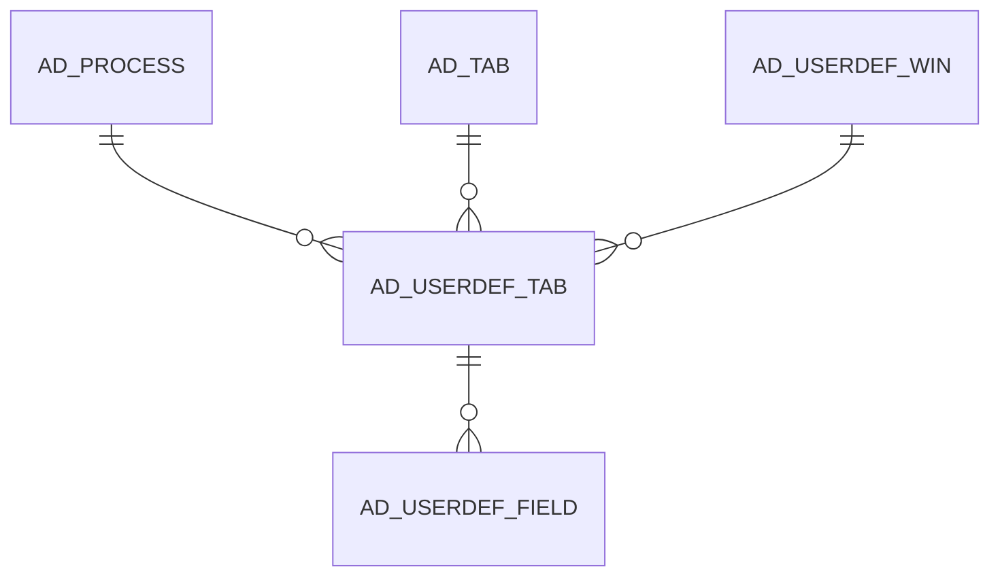

# AD_USERDEF_TAB

Area [AD](../../data-model/ad/index.md) · class **config** (proposed) · read from database `idempiere-db` (owner `ADEMPIERE`) · 0 row(s) when profiled

Application model: `org.compiere.model.X_AD_UserDef_Tab`, access level 6 - System - Client.

## Columns

| column | type | key | not null | business name | references (code) | nulls | distinct |
|---|---|---|---|---|---|---|---|
| `AD_USERDEF_TAB_ID` | NUMBER(10,0) | PK | yes | User defined Tab |  | 0 | 0 |
| `AD_CLIENT_ID` | NUMBER(10,0) |  | yes | Tenant |  | 0 | 0 |
| `AD_ORG_ID` | NUMBER(10,0) |  | yes | Organization |  | 0 | 0 |
| `ISACTIVE` | CHAR(1) |  | yes | Active |  | 0 | 0 |
| `CREATED` | DATE |  | yes | Created |  | 0 | 0 |
| `CREATEDBY` | NUMBER(10,0) |  | yes | Created By |  | 0 | 0 |
| `UPDATED` | DATE |  | yes | Updated |  | 0 | 0 |
| `UPDATEDBY` | NUMBER(10,0) |  | yes | Updated By |  | 0 | 0 |
| `AD_USERDEF_WIN_ID` | NUMBER(10,0) |  | yes | User defined Window | [AD_USERDEF_WIN](../../data-model/ad/ad_userdef_win.md) | 0 | 0 |
| `AD_TAB_ID` | NUMBER(10,0) |  | yes | Tab | [AD_TAB](../../data-model/ad/ad_tab.md) | 0 | 0 |
| `ISMULTIROWONLY` | CHAR(1) |  | yes | Multi Row Only |  | 0 | 0 |
| `NAME` | VARCHAR2(60 CHAR) |  |  | Name |  | 0 | 0 |
| `DESCRIPTION` | VARCHAR2(255 CHAR) |  |  | Description |  | 0 | 0 |
| `HELP` | VARCHAR2(2000 CHAR) |  |  | Comment/Help |  | 0 | 0 |
| `ISREADONLY` | CHAR(1) |  |  | Read Only |  | 0 | 0 |
| `ISSINGLEROW` | CHAR(1) |  |  | Single Row Layout |  | 0 | 0 |
| `AD_USERDEF_TAB_UU` | VARCHAR2(36 CHAR) |  |  | AD_UserDef_Tab_UU |  | 0 | 0 |
| `READONLYLOGIC` | VARCHAR2(2000 CHAR) |  |  | Read Only Logic |  | 0 | 0 |
| `WHERECLAUSE` | VARCHAR2(2000 CHAR) |  |  | Sql WHERE |  | 0 | 0 |
| `ORDERBYCLAUSE` | VARCHAR2(2000 CHAR) |  |  | Sql ORDER BY |  | 0 | 0 |
| `SEQNO` | NUMBER(10,0) |  |  | Sequence |  | 0 | 0 |
| `AD_PROCESS_ID` | NUMBER(10,0) |  |  | Process | [AD_PROCESS](../../data-model/ad/ad_process.md) | 0 | 0 |
| `DISPLAYLOGIC` | VARCHAR2(2000 CHAR) |  |  | Display Logic |  | 0 | 0 |
| `ISLOOKUPONLYSELECTION` | CHAR(1) |  |  | Lookup Only Selection Columns |  | 0 | 0 |
| `ISALLOWADVANCEDLOOKUP` | CHAR(1) |  |  | Allow Advanced Lookup |  | 0 | 0 |
| `ISHIGHVOLUME` | CHAR(1) |  |  | High Volume |  | 0 | 0 |
| `DELETECONFIRMATIONLOGIC` | VARCHAR2(255 CHAR) |  |  | Delete Confirmation Logic |  | 0 | 0 |

*references (code)* is the table the application model's code says a column points to; *Foreign keys* below are the constraints the database declares. Counts come from the profile; no value is ever shown.

## Check constraints

| name | expression |
|---|---|
| `SYS_C0022839` | `IsReadOnly in ('Y','N')` |
| `SYS_C0022840` | `IsSingleRow in ('Y','N')` |
| `SYS_C0022841` | `IsActive in ('Y','N')` |
| `SYS_C0022842` | `IsMultiRowOnly in ('Y','N')` |

## Foreign keys

**References**

| table | columns | on delete |
|---|---|---|
| [AD_PROCESS](../../data-model/ad/ad_process.md) | AD_USERDEF_TAB.AD_PROCESS_ID → AD_PROCESS.AD_PROCESS_ID | NO ACTION |
| [AD_TAB](../../data-model/ad/ad_tab.md) | AD_USERDEF_TAB.AD_TAB_ID → AD_TAB.AD_TAB_ID | NO ACTION |
| [AD_USERDEF_WIN](../../data-model/ad/ad_userdef_win.md) | AD_USERDEF_TAB.AD_USERDEF_WIN_ID → AD_USERDEF_WIN.AD_USERDEF_WIN_ID | NO ACTION |

**Referenced by**

| table | columns | on delete |
|---|---|---|
| [AD_USERDEF_FIELD](../../data-model/ad/ad_userdef_field.md) | AD_USERDEF_FIELD.AD_USERDEF_TAB_ID → AD_USERDEF_TAB.AD_USERDEF_TAB_ID | NO ACTION |

## Write behaviour

- updates: **po_only**
- deletes: **deleted_by_users**
- change log: **recorded**
- evidence: 1 citation(s)

## Schema history

51 change(s); the latest:

| applied | release | operation | column | tickets |
|---|---|---|---|---|
| 2023-04-09T15:47 | iD11 | `add_constraint` |  | IDEMPIERE-5567 |
| 2023-04-09T15:47 | iD11 | `add_constraint` |  | IDEMPIERE-5567 |
| 2022-06-17T12:31 | iD10 | `add_column` | DeleteConfirmationLogic | IDEMPIERE-5319 |
| 2022-06-17T12:31 | iD10 | `add_column` | DeleteConfirmationLogic | IDEMPIERE-5319 |
| 2022-01-19T10:00 | i9 | `add_column` | IsHighVolume | IDEMPIERE-3044 |
| 2022-01-19T10:00 | i9 | `add_column` | IsHighVolume | IDEMPIERE-3044 |
| 2021-12-05T16:45 | i8.2z | `add_constraint` |  | IDEMPIERE-5075 |
| 2021-12-05T16:45 | i8.2z | `drop_constraint` |  | IDEMPIERE-5075 |
| 2021-12-05T16:45 | i8.2z | `drop_constraint` |  | IDEMPIERE-5075 |
| 2021-12-05T16:45 | i8.2z | `add_constraint` |  | IDEMPIERE-5075 |
| 2021-10-05T17:00 | i8.2z | `create_index` |  | IDEMPIERE-4985 |
| 2021-10-05T17:00 | i8.2z | `create_index` |  | IDEMPIERE-4985 |
| 2020-09-11T15:00 | i7.1z | `add_column` | IsLookupOnlySelection | IDEMPIERE-3981 |
| 2020-09-11T15:00 | i7.1z | `add_column` | IsLookupOnlySelection | IDEMPIERE-3981 |
| 2020-09-11T15:00 | i7.1z | `add_column` | IsAllowAdvancedLookup | IDEMPIERE-3981 |

## Notes

<!-- ekos:manual id="table.ad_userdef_tab.notes" -->
_Business notes about this table._
<!-- /ekos:manual -->
