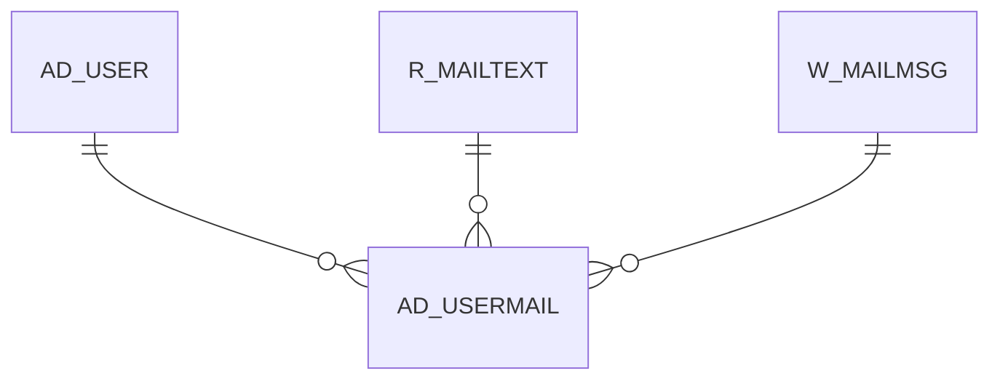

# AD_USERMAIL

Area [AD](../../data-model/ad/index.md) · class **config** (proposed) · read from database `idempiere-db` (owner `ADEMPIERE`) · 1 row(s) when profiled

Application model: `org.compiere.model.X_AD_UserMail`, access level 7 - System - Client - Org.

## Columns

| column | type | key | not null | business name | references (code) | nulls | distinct |
|---|---|---|---|---|---|---|---|
| `AD_USERMAIL_ID` | NUMBER(10,0) | PK | yes | User Mail |  | 0 | 1 |
| `AD_CLIENT_ID` | NUMBER(10,0) |  | yes | Tenant |  | 0 | 1 |
| `AD_ORG_ID` | NUMBER(10,0) |  | yes | Organization |  | 0 | 1 |
| `ISACTIVE` | CHAR(1) |  | yes | Active |  | 0 | 1 |
| `CREATED` | DATE |  | yes | Created |  | 0 | 1 |
| `CREATEDBY` | NUMBER(10,0) |  | yes | Created By |  | 0 | 1 |
| `UPDATED` | DATE |  | yes | Updated |  | 0 | 1 |
| `UPDATEDBY` | NUMBER(10,0) |  | yes | Updated By |  | 0 | 1 |
| `AD_USER_ID` | NUMBER(10,0) |  | yes | User/Contact | [AD_USER](../../data-model/ad/ad_user.md) | 0 | 1 |
| `R_MAILTEXT_ID` | NUMBER(10,0) |  |  | Mail Template | [R_MAILTEXT](../../data-model/r/r_mailtext.md) | 1 | 0 |
| `W_MAILMSG_ID` | NUMBER(10,0) |  |  |  |  | 1 | 0 |
| `MESSAGEID` | VARCHAR2(120 CHAR) |  |  | Message ID |  | 0 | 1 |
| `DELIVERYCONFIRMATION` | VARCHAR2(120 CHAR) |  |  | Delivery Confirmation |  | 1 | 0 |
| `ISDELIVERED` | CHAR(1) |  |  | Delivered |  | 0 | 1 |
| `SUBJECT` | VARCHAR2(255 CHAR) |  |  | Subject |  | 0 | 1 |
| `MAILTEXT` | VARCHAR2(2000 CHAR) |  |  | Mail Text |  | 0 | 1 |
| `AD_USERMAIL_UU` | VARCHAR2(36 CHAR) |  |  | AD_UserMail_UU |  | 0 | 1 |
| `EMAILFROM` | VARCHAR2(255 CHAR) |  |  | EMail sent from |  | 1 | 0 |
| `RECIPIENTBCC` | VARCHAR2(2000 CHAR) |  |  | Bcc |  | 1 | 0 |
| `RECIPIENTCC` | VARCHAR2(2000 CHAR) |  |  | Cc |  | 1 | 0 |
| `RECIPIENTTO` | VARCHAR2(2000 CHAR) |  |  | To |  | 1 | 0 |

*references (code)* is the table the application model's code says a column points to; *Foreign keys* below are the constraints the database declares. Counts come from the profile; no value is ever shown.

## Check constraints

| name | expression |
|---|---|
| `SYS_C0022382` | `IsActive in ('Y','N')` |

## Foreign keys

**References**

| table | columns | on delete |
|---|---|---|
| [AD_USER](../../data-model/ad/ad_user.md) | AD_USERMAIL.AD_USER_ID → AD_USER.AD_USER_ID | CASCADE |
| [R_MAILTEXT](../../data-model/r/r_mailtext.md) | AD_USERMAIL.R_MAILTEXT_ID → R_MAILTEXT.R_MAILTEXT_ID | CASCADE |
| [W_MAILMSG](../../data-model/w/w_mailmsg.md) | AD_USERMAIL.W_MAILMSG_ID → W_MAILMSG.W_MAILMSG_ID | CASCADE |

**Referenced by**

_None._

## Write behaviour

- updates: **po_only**
- deletes: **deleted_by_cascade**
- change log: **recorded**
- evidence: 4 citation(s)

## Schema history

35 change(s); the latest:

| applied | release | operation | column | tickets |
|---|---|---|---|---|
| 2023-04-09T15:47 | iD11 | `add_constraint` |  | IDEMPIERE-5567 |
| 2023-04-09T15:47 | iD11 | `add_constraint` |  | IDEMPIERE-5567 |
| 2021-12-05T16:45 | i8.2z | `drop_constraint` |  | IDEMPIERE-5075 |
| 2021-12-05T16:45 | i8.2z | `add_constraint` |  | IDEMPIERE-5075 |
| 2021-12-05T16:45 | i8.2z | `add_constraint` |  | IDEMPIERE-5075 |
| 2021-12-05T16:45 | i8.2z | `add_constraint` |  | IDEMPIERE-5075 |
| 2021-12-05T16:45 | i8.2z | `drop_constraint` |  | IDEMPIERE-5075 |
| 2021-12-05T16:45 | i8.2z | `drop_constraint` |  | IDEMPIERE-5075 |
| 2020-08-04T01:00 | i7.1z | `drop_column` | tmp_col_3_tmp | IDEMPIERE-3862 |
| 2020-08-04T01:00 | i7.1z | `add_column` | tmp_col_1_tmp | IDEMPIERE-3862 |
| 2020-08-04T01:00 | i7.1z | `drop_column` | tmp_col_1_tmp | IDEMPIERE-3862 |
| 2020-08-04T01:00 | i7.1z | `modify_column` | DELIVERYCONFIRMATION | IDEMPIERE-3862 |
| 2020-08-04T01:00 | i7.1z | `modify_column` | EMAILFROM | IDEMPIERE-3862 |
| 2020-08-04T01:00 | i7.1z | `modify_column` | RECIPIENTCC | IDEMPIERE-3862 |
| 2020-08-04T01:00 | i7.1z | `modify_column` | MAILTEXT | IDEMPIERE-3862 |

## Notes

<!-- ekos:manual id="table.ad_usermail.notes" -->
_Business notes about this table._
<!-- /ekos:manual -->
