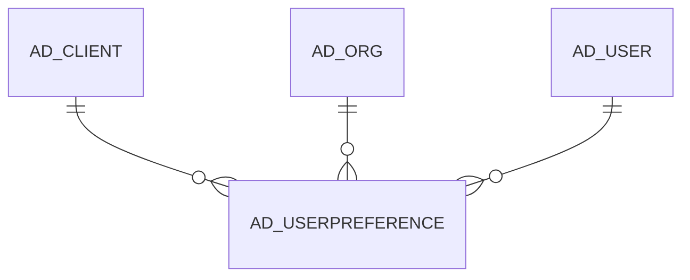

# AD_USERPREFERENCE

Area [AD](../../data-model/ad/index.md) · class **config** (proposed) · read from database `idempiere-db` (owner `ADEMPIERE`) · 0 row(s) when profiled

Application model: `org.compiere.model.X_AD_UserPreference`, access level 7 - System - Client - Org.

## Columns

| column | type | key | not null | business name | references (code) | nulls | distinct |
|---|---|---|---|---|---|---|---|
| `AD_CLIENT_ID` | NUMBER(10,0) |  | yes | Tenant |  | 0 | 0 |
| `AD_ORG_ID` | NUMBER(10,0) |  | yes | Organization |  | 0 | 0 |
| `AD_USER_ID` | NUMBER(10,0) |  | yes | User/Contact | [AD_USER](../../data-model/ad/ad_user.md) | 0 | 0 |
| `AD_USERPREFERENCE_ID` | NUMBER(10,0) | PK | yes | AD_UserPreference_ID |  | 0 | 0 |
| `AD_USERPREFERENCE_UU` | VARCHAR2(36 CHAR) |  |  | AD_UserPreference_UU |  | 0 | 0 |
| `AUTOCOMMIT` | CHAR(1) |  |  | Save on Navigate |  | 0 | 0 |
| `AUTONEW` | CHAR(1) |  |  | Automatic New Record |  | 0 | 0 |
| `CREATED` | DATE |  | yes | Created |  | 0 | 0 |
| `CREATEDBY` | NUMBER(10,0) |  | yes | Created By |  | 0 | 0 |
| `ISACTIVE` | CHAR(1) |  | yes | Active |  | 0 | 0 |
| `UPDATED` | DATE |  | yes | Updated |  | 0 | 0 |
| `UPDATEDBY` | NUMBER(10,0) |  | yes | Updated By |  | 0 | 0 |
| `AUTOMATICDECIMALPLACESFORAMOUN` | NUMBER(10,0) |  |  | Automatic Decimal Places For Amounts |  | 0 | 0 |
| `TOGGLEONDOUBLECLICK` | CHAR(1) |  |  | Toggle on Double Click |  | 0 | 0 |
| `ISDETAILEDZOOMACROSS` | CHAR(1) |  |  | Detailed Zoom Across |  | 0 | 0 |
| `ISUSESIMILARTO` | CHAR(1) |  |  | Use Similar To |  | 0 | 0 |
| `VIEWFINDRESULT` | CHAR(1) |  | yes | View find result |  | 0 | 0 |
| `GRIDAFTERFINDTHRESHOLD` | NUMBER(10,0) |  |  | Threshold |  | 0 | 0 |
| `MIGRATIONSCRIPTCOMMENT` | VARCHAR2(255 CHAR) |  |  | Migration Script Comment |  | 0 | 0 |
| `ISREADONLYSESSION` | CHAR(1) |  | yes | Read Only Session |  | 0 | 0 |
| `ISSHOWTECHNICALINFONHELP` | CHAR(1) |  | yes | Show Technical Information on Help |  | 0 | 0 |

*references (code)* is the table the application model's code says a column points to; *Foreign keys* below are the constraints the database declares. Counts come from the profile; no value is ever shown.

## Check constraints

| name | expression |
|---|---|
| `SYS_C0021158` | `IsReadOnlySession IN ('Y','N')` |
| `SYS_C0021159` | `IsActive IN ('Y','N')` |
| `SYS_C0021160` | `ToggleOnDoubleClick IN ('Y','N')` |
| `SYS_C0021161` | `IsDetailedZoomAcross IN ('Y','N')` |
| `SYS_C0021162` | `IsShowTechnicalInfOnHelp IN ('Y','N')` |
| `SYS_C0021164` | `IsUseSimilarTo IN ('Y','N')` |
| `SYS_C0021165` | `AutoNew IN ('Y','N')` |
| `SYS_C0021167` | `AutoCommit IN ('Y','N')` |

## Foreign keys

**References**

| table | columns | on delete |
|---|---|---|
| [AD_CLIENT](../../data-model/ad/ad_client.md) | AD_USERPREFERENCE.AD_CLIENT_ID → AD_CLIENT.AD_CLIENT_ID | NO ACTION |
| [AD_ORG](../../data-model/ad/ad_org.md) | AD_USERPREFERENCE.AD_ORG_ID → AD_ORG.AD_ORG_ID | NO ACTION |
| [AD_USER](../../data-model/ad/ad_user.md) | AD_USERPREFERENCE.AD_USER_ID → AD_USER.AD_USER_ID | CASCADE |

**Referenced by**

_None._

## Write behaviour

- updates: **po_only**
- deletes: **deleted_by_users, deleted_by_cascade**
- change log: **recorded**
- evidence: 2 citation(s)

## Schema history

42 change(s); the latest:

| applied | release | operation | column | tickets |
|---|---|---|---|---|
| 2024-07-06T12:29 | iD11 | `add_column` | IsReadOnlySession | IDEMPIERE-6188 |
| 2024-07-06T12:29 | iD11 | `add_column` | IsReadOnlySession | IDEMPIERE-6188 |
| 2023-10-16T11:06 | iD12 | `add_column` | IsShowTechnicalInfOnHelp | IDEMPIERE-3989 |
| 2023-10-16T11:06 | iD12 | `add_column` | IsShowTechnicalInfOnHelp | IDEMPIERE-3989 |
| 2022-09-13T15:07 | i9 | `add_constraint` |  | IDEMPIERE-3340 |
| 2022-09-13T15:07 | i9 | `drop_constraint` |  | IDEMPIERE-3340 |
| 2022-09-13T15:07 | i9 | `add_constraint` |  | IDEMPIERE-3340 |
| 2022-09-13T15:07 | i9 | `drop_constraint` |  | IDEMPIERE-3340 |
| 2020-08-04T01:00 | i7.1z | `modify_column` | MIGRATIONSCRIPTCOMMENT | IDEMPIERE-3862 |
| 2020-08-04T01:00 | i7.1z | `modify_column` | AD_USERPREFERENCE_UU | IDEMPIERE-3862 |
| 2020-05-19T23:36 | i7.1z | `add_column` | MigrationScriptComment | IDEMPIERE-2523 |
| 2020-05-19T23:36 | i7.1z | `add_column` | MigrationScriptComment | IDEMPIERE-2523 |
| 2019-07-10T10:55 | i6.2z | `add_column` | ViewFindResult | IDEMPIERE-4005 |
| 2019-07-10T10:55 | i6.2z | `add_column` | ViewFindResult | IDEMPIERE-4005 |
| 2019-07-10T10:55 | i6.2z | `add_column` | GridAfterFindThreshold | IDEMPIERE-4005 |

## Notes

<!-- ekos:manual id="table.ad_userpreference.notes" -->
_Business notes about this table._
<!-- /ekos:manual -->
