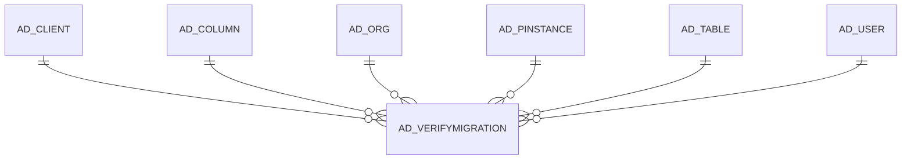

# AD_VERIFYMIGRATION

Area [AD](../../data-model/ad/index.md) · class **config** (proposed) · read from database `idempiere-db` (owner `ADEMPIERE`) · 0 row(s) when profiled

Application model: `org.compiere.model.X_AD_VerifyMigration`, access level 4 - System.

## Columns

| column | type | key | not null | business name | references (code) | nulls | distinct |
|---|---|---|---|---|---|---|---|
| `AD_VERIFYMIGRATION_ID` | NUMBER(10,0) | PK | yes | Verify Migration |  | 0 | 0 |
| `AD_CLIENT_ID` | NUMBER(10,0) |  | yes | Tenant |  | 0 | 0 |
| `AD_ORG_ID` | NUMBER(10,0) |  | yes | Organization |  | 0 | 0 |
| `CREATED` | DATE |  | yes | Created |  | 0 | 0 |
| `CREATEDBY` | NUMBER(10,0) |  | yes | Created By |  | 0 | 0 |
| `UPDATED` | DATE |  | yes | Updated |  | 0 | 0 |
| `UPDATEDBY` | NUMBER(10,0) |  | yes | Updated By |  | 0 | 0 |
| `ISACTIVE` | CHAR(1) |  | yes | Active |  | 0 | 0 |
| `AD_VERIFYMIGRATION_UU` | VARCHAR2(36 CHAR) |  |  | AD_VerifyMigration_UU |  | 0 | 0 |
| `HELP` | VARCHAR2(2000 CHAR) |  |  | Comment/Help |  | 0 | 0 |
| `AD_PINSTANCE_ID` | NUMBER(10,0) |  | yes | Process Instance | [AD_PINSTANCE](../../data-model/ad/ad_pinstance.md) | 0 | 0 |
| `AD_TABLE_ID` | NUMBER(10,0) |  | yes | Table | [AD_TABLE](../../data-model/ad/ad_table.md) | 0 | 0 |
| `RECORD_ID` | NUMBER(10,0) |  |  | Record ID |  | 0 | 0 |
| `SEQNO` | NUMBER(10,0) |  |  | Sequence |  | 0 | 0 |
| `MANUALNOTE` | VARCHAR2(4000 CHAR) |  |  | Note |  | 0 | 0 |
| `EXPECTEDVALUE` | VARCHAR2(4000 CHAR) |  |  | Expected Value |  | 0 | 0 |
| `CURRENTVALUE` | VARCHAR2(4000 CHAR) |  |  | Current Value |  | 0 | 0 |
| `PRIORITYRULE` | CHAR(1) |  |  | Priority |  | 0 | 0 |
| `ISIGNORE` | CHAR(1) |  | yes | Ignore |  | 0 | 0 |
| `AD_COLUMN_ID` | NUMBER(10,0) |  |  | Column | [AD_COLUMN](../../data-model/ad/ad_column.md) | 0 | 0 |
| `AD_CHANGELOG_ID` | NUMBER(10,0) |  |  | Change Log | `AD_CHANGELOG` | 0 | 0 |

*references (code)* is the table the application model's code says a column points to; *Foreign keys* below are the constraints the database declares. Counts come from the profile; no value is ever shown.

## Check constraints

| name | expression |
|---|---|
| `SYS_C0020764` | `IsIgnore IN ('Y','N')` |
| `SYS_C0020767` | `IsActive IN ('Y','N')` |

## Foreign keys

**References**

| table | columns | on delete |
|---|---|---|
| [AD_CLIENT](../../data-model/ad/ad_client.md) | AD_VERIFYMIGRATION.AD_CLIENT_ID → AD_CLIENT.AD_CLIENT_ID | NO ACTION |
| [AD_COLUMN](../../data-model/ad/ad_column.md) | AD_VERIFYMIGRATION.AD_COLUMN_ID → AD_COLUMN.AD_COLUMN_ID | NO ACTION |
| [AD_ORG](../../data-model/ad/ad_org.md) | AD_VERIFYMIGRATION.AD_ORG_ID → AD_ORG.AD_ORG_ID | NO ACTION |
| [AD_PINSTANCE](../../data-model/ad/ad_pinstance.md) | AD_VERIFYMIGRATION.AD_PINSTANCE_ID → AD_PINSTANCE.AD_PINSTANCE_ID | CASCADE |
| [AD_TABLE](../../data-model/ad/ad_table.md) | AD_VERIFYMIGRATION.AD_TABLE_ID → AD_TABLE.AD_TABLE_ID | NO ACTION |
| [AD_USER](../../data-model/ad/ad_user.md) | AD_VERIFYMIGRATION.CREATEDBY → AD_USER.AD_USER_ID | NO ACTION |

**Referenced by**

_None._

## Write behaviour

- updates: **po_only**
- deletes: **deleted_by_app, deleted_by_users, deleted_by_cascade**
- change log: **recorded**
- evidence: 3 citation(s)

## Schema history

58 change(s); the latest:

| applied | release | operation | column | tickets |
|---|---|---|---|---|
| 2023-01-13T19:32 | iD10 | `add_constraint` |  | IDEMPIERE-5229 |
| 2023-01-13T19:32 | iD10 | `add_column` | ManualNote | IDEMPIERE-5229 |
| 2023-01-13T19:32 | iD10 | `add_column` | Record_ID | IDEMPIERE-5229 |
| 2023-01-13T19:32 | iD10 | `add_column` | AD_Column_ID | IDEMPIERE-5229 |
| 2023-01-13T19:32 | iD10 | `add_column` | AD_VerifyMigration_UU | IDEMPIERE-5229 |
| 2023-01-13T19:32 | iD10 | `add_column` | Record_ID | IDEMPIERE-5229 |
| 2023-01-13T19:32 | iD10 | `add_column` | Updated | IDEMPIERE-5229 |
| 2023-01-13T19:32 | iD10 | `add_column` | AD_Client_ID | IDEMPIERE-5229 |
| 2023-01-13T19:32 | iD10 | `add_constraint` |  | IDEMPIERE-5229 |
| 2023-01-13T19:32 | iD10 | `add_column` | AD_Column_ID | IDEMPIERE-5229 |
| 2023-01-13T19:32 | iD10 | `add_column` | ExpectedValue | IDEMPIERE-5229 |
| 2023-01-13T19:32 | iD10 | `add_column` | IsIgnore | IDEMPIERE-5229 |
| 2023-01-13T19:32 | iD10 | `add_column` | ManualNote | IDEMPIERE-5229 |
| 2023-01-13T19:32 | iD10 | `add_column` | AD_Client_ID | IDEMPIERE-5229 |
| 2023-01-13T19:32 | iD10 | `add_column` | CurrentValue | IDEMPIERE-5229 |

## Notes

<!-- ekos:manual id="table.ad_verifymigration.notes" -->
_Business notes about this table._
<!-- /ekos:manual -->
