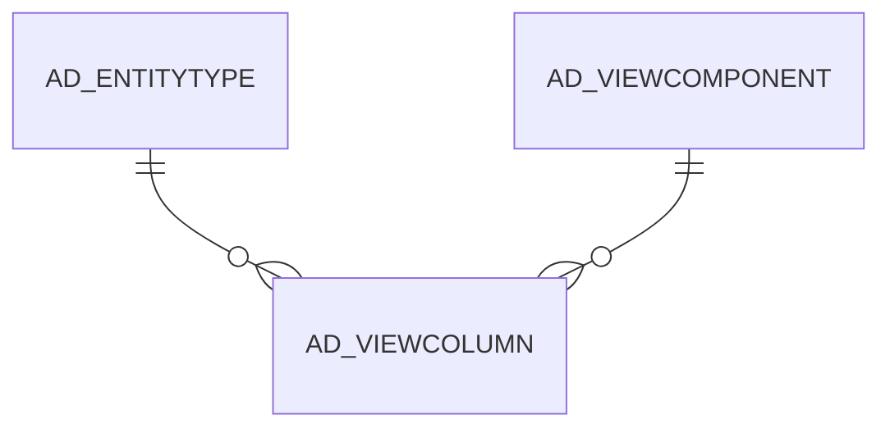

# AD_VIEWCOLUMN

Area [AD](../../data-model/ad/index.md) · class **config** (proposed) · read from database `idempiere-db` (owner `ADEMPIERE`) · 17638 row(s) when profiled

Application model: `org.compiere.model.X_AD_ViewColumn`, access level 4 - System.

## Columns

| column | type | key | not null | business name | references (code) | nulls | distinct |
|---|---|---|---|---|---|---|---|
| `AD_CLIENT_ID` | NUMBER(10,0) |  | yes | Tenant |  | 0 | 1 |
| `AD_ORG_ID` | NUMBER(10,0) |  | yes | Organization |  | 0 | 1 |
| `AD_VIEWCOLUMN_ID` | NUMBER(10,0) | PK | yes | Database View Column |  | 0 | 17638 |
| `AD_VIEWCOLUMN_UU` | VARCHAR2(36 CHAR) |  |  | AD_ViewColumn_UU |  | 0 | 17638 |
| `AD_VIEWCOMPONENT_ID` | NUMBER(10,0) |  | yes | Database View Component | [AD_VIEWCOMPONENT](../../data-model/ad/ad_viewcomponent.md) | 0 | 229 |
| `COLUMNNAME` | VARCHAR2(63 CHAR) |  | yes | DB Column Name |  | 0 | 2418 |
| `CREATED` | DATE |  | yes | Created |  | 0 | 5996 |
| `CREATEDBY` | NUMBER(10,0) |  | yes | Created By |  | 0 | 1 |
| `DBDATATYPE` | CHAR(1) |  |  | Database Data Type |  | 17634 | 2 |
| `DESCRIPTION` | VARCHAR2(255 CHAR) |  |  | Description |  | 17638 | 0 |
| `ENTITYTYPE` | VARCHAR2(40 CHAR) |  | yes | Entity Type |  | 0 | 1 |
| `HELP` | VARCHAR2(2000 CHAR) |  |  | Comment/Help |  | 17638 | 0 |
| `ISACTIVE` | CHAR(1) |  | yes | Active |  | 0 | 1 |
| `UPDATED` | DATE |  | yes | Updated |  | 0 | 6033 |
| `UPDATEDBY` | NUMBER(10,0) |  | yes | Updated By |  | 0 | 3 |
| `SEQNO` | NUMBER(10,0) |  |  | Sequence |  | 256 | 474 |
| `COLUMNSQL` | VARCHAR2(2000 CHAR) |  |  | Column SQL |  | 0 | 4060 |

*references (code)* is the table the application model's code says a column points to; *Foreign keys* below are the constraints the database declares. Counts come from the profile; no value is ever shown.

## Check constraints

| name | expression |
|---|---|
| `SYS_C0022463` | `IsActive IN ('Y','N')` |

## Foreign keys

**References**

| table | columns | on delete |
|---|---|---|
| [AD_ENTITYTYPE](../../data-model/ad/ad_entitytype.md) | AD_VIEWCOLUMN.ENTITYTYPE → AD_ENTITYTYPE.ENTITYTYPE | NO ACTION |
| [AD_VIEWCOMPONENT](../../data-model/ad/ad_viewcomponent.md) | AD_VIEWCOLUMN.AD_VIEWCOMPONENT_ID → AD_VIEWCOMPONENT.AD_VIEWCOMPONENT_ID | NO ACTION |

**Referenced by**

_None._

## Write behaviour

- updates: **po_only**
- deletes: **deleted_by_users**
- change log: **recorded**
- evidence: 1 citation(s)

## Schema history

42 change(s); the latest:

| applied | release | operation | column | tickets |
|---|---|---|---|---|
| 2024-04-03T12:26 | iD11 | `modify_column` | ColumnName | IDEMPIERE-6064 |
| 2024-04-03T12:26 | iD11 | `modify_column` | ColumnName | IDEMPIERE-6064 |
| 2020-08-04T01:00 | i7.1z | `modify_column` | AD_VIEWCOLUMN_UU | IDEMPIERE-3862 |
| 2020-08-04T01:00 | i7.1z | `modify_column` | COLUMNSQL | IDEMPIERE-3862 |
| 2020-08-04T01:00 | i7.1z | `add_column` | tmp_col_2_tmp | IDEMPIERE-3862 |
| 2020-08-04T01:00 | i7.1z | `add_column` | tmp_col_4_tmp | IDEMPIERE-3862 |
| 2020-08-04T01:00 | i7.1z | `modify_column` | HELP | IDEMPIERE-3862 |
| 2020-08-04T01:00 | i7.1z | `drop_column` | tmp_col_2_tmp | IDEMPIERE-3862 |
| 2020-08-04T01:00 | i7.1z | `modify_column` | ENTITYTYPE | IDEMPIERE-3862 |
| 2020-08-04T01:00 | i7.1z | `modify_column` | COLUMNNAME | IDEMPIERE-3862 |
| 2020-08-04T01:00 | i7.1z | `add_column` | tmp_col_1_tmp | IDEMPIERE-3862 |
| 2020-08-04T01:00 | i7.1z | `modify_column` | COLUMNNAME | IDEMPIERE-3862 |
| 2020-08-04T01:00 | i7.1z | `drop_column` | tmp_col_4_tmp | IDEMPIERE-3862 |
| 2020-08-04T01:00 | i7.1z | `drop_column` | tmp_col_3_tmp | IDEMPIERE-3862 |
| 2020-08-04T01:00 | i7.1z | `drop_column` | tmp_col_1_tmp | IDEMPIERE-3862 |

## Notes

<!-- ekos:manual id="table.ad_viewcolumn.notes" -->
_Business notes about this table._
<!-- /ekos:manual -->
