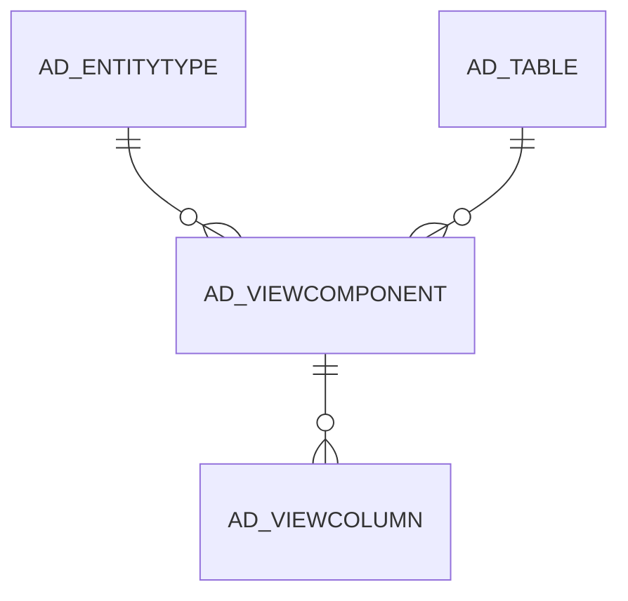

# AD_VIEWCOMPONENT

Area [AD](../../data-model/ad/index.md) · class **config** (proposed) · read from database `idempiere-db` (owner `ADEMPIERE`) · 229 row(s) when profiled

Application model: `org.compiere.model.X_AD_ViewComponent`, access level 4 - System.

## Columns

| column | type | key | not null | business name | references (code) | nulls | distinct |
|---|---|---|---|---|---|---|---|
| `AD_CLIENT_ID` | NUMBER(10,0) |  | yes | Tenant |  | 0 | 1 |
| `AD_ORG_ID` | NUMBER(10,0) |  | yes | Organization |  | 0 | 1 |
| `AD_TABLE_ID` | NUMBER(10,0) |  | yes | Table | [AD_TABLE](../../data-model/ad/ad_table.md) | 0 | 159 |
| `AD_VIEWCOMPONENT_ID` | NUMBER(10,0) | PK | yes | Database View Component |  | 0 | 229 |
| `AD_VIEWCOMPONENT_UU` | VARCHAR2(36 CHAR) |  |  | AD_ViewComponent_UU |  | 0 | 229 |
| `CREATED` | DATE |  | yes | Created |  | 0 | 85 |
| `CREATEDBY` | NUMBER(10,0) |  | yes | Created By |  | 0 | 1 |
| `DESCRIPTION` | VARCHAR2(255 CHAR) |  |  | Description |  | 229 | 0 |
| `ENTITYTYPE` | VARCHAR2(40 CHAR) |  | yes | Entity Type |  | 0 | 1 |
| `FROMCLAUSE` | VARCHAR2(4000 CHAR) |  | yes | Sql FROM |  | 0 | 199 |
| `HELP` | VARCHAR2(2000 CHAR) |  |  | Comment/Help |  | 229 | 0 |
| `ISACTIVE` | CHAR(1) |  | yes | Active |  | 0 | 1 |
| `NAME` | VARCHAR2(50 CHAR) |  | yes | Name |  | 0 | 225 |
| `OTHERCLAUSE` | VARCHAR2(2000 CHAR) |  |  | Other SQL Clause |  | 191 | 37 |
| `REFERENCED_TABLE_ID` | NUMBER(10,0) |  |  | Referenced Table | [AD_TABLE](../../data-model/ad/ad_table.md) | 223 | 6 |
| `SEQNO` | NUMBER(10,0) |  |  | Sequence |  | 0 | 16 |
| `UPDATED` | DATE |  | yes | Updated |  | 0 | 99 |
| `UPDATEDBY` | NUMBER(10,0) |  | yes | Updated By |  | 0 | 1 |
| `WHERECLAUSE` | VARCHAR2(2000 CHAR) |  |  | Sql WHERE |  | 137 | 81 |
| `ISUNIONALL` | CHAR(1) |  | yes | Is UNION ALL |  | 0 | 2 |
| `ISDISTINCT` | CHAR(1) |  | yes | Distinct |  | 0 | 1 |

*references (code)* is the table the application model's code says a column points to; *Foreign keys* below are the constraints the database declares. Counts come from the profile; no value is ever shown.

## Check constraints

| name | expression |
|---|---|
| `SYS_C0021667` | `IsActive IN ('Y','N')` |
| `SYS_C0021668` | `IsDistinct IN ('Y','N')` |
| `SYS_C0021671` | `IsUnionAll IN ('Y','N')` |

## Foreign keys

**References**

| table | columns | on delete |
|---|---|---|
| [AD_ENTITYTYPE](../../data-model/ad/ad_entitytype.md) | AD_VIEWCOMPONENT.ENTITYTYPE → AD_ENTITYTYPE.ENTITYTYPE | NO ACTION |
| [AD_TABLE](../../data-model/ad/ad_table.md) | AD_VIEWCOMPONENT.AD_TABLE_ID → AD_TABLE.AD_TABLE_ID | NO ACTION |

**Referenced by**

| table | columns | on delete |
|---|---|---|
| [AD_VIEWCOLUMN](../../data-model/ad/ad_viewcolumn.md) | AD_VIEWCOLUMN.AD_VIEWCOMPONENT_ID → AD_VIEWCOMPONENT.AD_VIEWCOMPONENT_ID | NO ACTION |

## Write behaviour

- updates: **po_only**
- deletes: **deleted_by_users**
- change log: **recorded**
- evidence: 1 citation(s)

## Schema history

56 change(s); the latest:

| applied | release | operation | column | tickets |
|---|---|---|---|---|
| 2022-09-29T07:13 | iD10 | `add_column` | IsDistinct | IDEMPIERE-5434 |
| 2022-09-29T07:13 | iD10 | `add_column` | IsDistinct | IDEMPIERE-5434 |
| 2022-03-30T15:14 | iD10 | `modify_column` | FromClause | IDEMPIERE-5243 |
| 2022-03-30T15:14 | iD10 | `modify_column` | FromClause | IDEMPIERE-5243 |
| 2021-11-28T13:38 | i8.2z | `add_column` | IsUnionAll | IDEMPIERE-5060 |
| 2021-11-28T13:38 | i8.2z | `add_column` | IsUnionAll | IDEMPIERE-5060 |
| 2020-08-04T01:00 | i7.1z | `drop_column` | tmp_col_4_tmp | IDEMPIERE-3862 |
| 2020-08-04T01:00 | i7.1z | `modify_column` | DESCRIPTION | IDEMPIERE-3862 |
| 2020-08-04T01:00 | i7.1z | `add_column` | tmp_col_6_tmp | IDEMPIERE-3862 |
| 2020-08-04T01:00 | i7.1z | `drop_column` | tmp_col_7_tmp | IDEMPIERE-3862 |
| 2020-08-04T01:00 | i7.1z | `modify_column` | HELP | IDEMPIERE-3862 |
| 2020-08-04T01:00 | i7.1z | `drop_column` | tmp_col_6_tmp | IDEMPIERE-3862 |
| 2020-08-04T01:00 | i7.1z | `add_column` | tmp_col_1_tmp | IDEMPIERE-3862 |
| 2020-08-04T01:00 | i7.1z | `modify_column` | FROMCLAUSE | IDEMPIERE-3862 |
| 2020-08-04T01:00 | i7.1z | `drop_column` | tmp_col_2_tmp | IDEMPIERE-3862 |

## Notes

<!-- ekos:manual id="table.ad_viewcomponent.notes" -->
_Business notes about this table._
<!-- /ekos:manual -->
