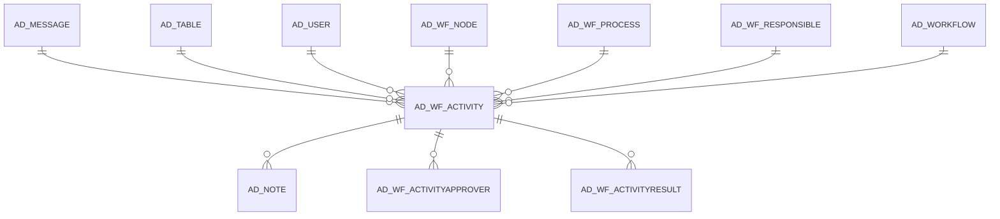

# AD_WF_ACTIVITY

Area [AD](../../data-model/ad/index.md) · class **config** (proposed) · read from database `idempiere-db` (owner `ADEMPIERE`) · 13 row(s) when profiled

Application model: `org.compiere.model.X_AD_WF_Activity`, access level 7 - System - Client - Org.

## Columns

| column | type | key | not null | business name | references (code) | nulls | distinct |
|---|---|---|---|---|---|---|---|
| `AD_WF_ACTIVITY_ID` | NUMBER(10,0) | PK | yes | Workflow Activity |  | 0 | 13 |
| `AD_CLIENT_ID` | NUMBER(10,0) |  | yes | Tenant |  | 0 | 1 |
| `AD_ORG_ID` | NUMBER(10,0) |  | yes | Organization |  | 0 | 3 |
| `ISACTIVE` | CHAR(1) |  | yes | Active |  | 0 | 1 |
| `CREATED` | DATE |  | yes | Created |  | 0 | 12 |
| `CREATEDBY` | NUMBER(10,0) |  | yes | Created By |  | 0 | 1 |
| `UPDATED` | DATE |  | yes | Updated |  | 0 | 12 |
| `UPDATEDBY` | NUMBER(10,0) |  | yes | Updated By |  | 0 | 1 |
| `AD_WF_PROCESS_ID` | NUMBER(10,0) |  | yes | Workflow Process | [AD_WF_PROCESS](../../data-model/ad/ad_wf_process.md) | 0 | 11 |
| `AD_WF_NODE_ID` | NUMBER(10,0) |  | yes | Node | [AD_WF_NODE](../../data-model/ad/ad_wf_node.md) | 0 | 4 |
| `AD_WF_RESPONSIBLE_ID` | NUMBER(10,0) |  |  | Workflow Responsible | [AD_WF_RESPONSIBLE](../../data-model/ad/ad_wf_responsible.md) | 0 | 2 |
| `AD_USER_ID` | NUMBER(10,0) |  |  | User/Contact | [AD_USER](../../data-model/ad/ad_user.md) | 0 | 2 |
| `WFSTATE` | CHAR(2) |  | yes | Workflow State |  | 0 | 2 |
| `AD_MESSAGE_ID` | NUMBER(10,0) |  |  | Message | [AD_MESSAGE](../../data-model/ad/ad_message.md) | 13 | 0 |
| `PROCESSING` | CHAR(1) |  |  | Process Now |  | 0 | 1 |
| `PROCESSED` | CHAR(1) |  | yes | Processed |  | 0 | 2 |
| `TEXTMSG` | VARCHAR2(2000 CHAR) |  |  | Text Message |  | 11 | 2 |
| `AD_WORKFLOW_ID` | NUMBER(10,0) |  | yes | Workflow | [AD_WORKFLOW](../../data-model/ad/ad_workflow.md) | 0 | 2 |
| `AD_TABLE_ID` | NUMBER(10,0) |  | yes | Table | [AD_TABLE](../../data-model/ad/ad_table.md) | 0 | 2 |
| `RECORD_ID` | NUMBER(10,0) |  | yes | Record ID |  | 0 | 11 |
| `PRIORITY` | NUMBER(10,0) |  |  | Priority |  | 0 | 1 |
| `ENDWAITTIME` | DATE |  |  | End Wait |  | 13 | 0 |
| `DATELASTALERT` | DATE |  |  | Last Alert |  | 13 | 0 |
| `DYNPRIORITYSTART` | NUMBER(10,0) |  |  | Dyn Priority Start |  | 13 | 0 |
| `AD_WF_ACTIVITY_UU` | VARCHAR2(36 CHAR) |  |  | AD_WF_Activity_UU |  | 0 | 13 |

*references (code)* is the table the application model's code says a column points to; *Foreign keys* below are the constraints the database declares. Counts come from the profile; no value is ever shown.

## Check constraints

| name | expression |
|---|---|
| `SYS_C0019714` | `IsActive in ('Y','N')` |
| `SYS_C0019715` | `Processed in ('Y','N')` |

## Foreign keys

**References**

| table | columns | on delete |
|---|---|---|
| [AD_MESSAGE](../../data-model/ad/ad_message.md) | AD_WF_ACTIVITY.AD_MESSAGE_ID → AD_MESSAGE.AD_MESSAGE_ID | NO ACTION |
| [AD_TABLE](../../data-model/ad/ad_table.md) | AD_WF_ACTIVITY.AD_TABLE_ID → AD_TABLE.AD_TABLE_ID | NO ACTION |
| [AD_USER](../../data-model/ad/ad_user.md) | AD_WF_ACTIVITY.AD_USER_ID → AD_USER.AD_USER_ID | SET NULL |
| [AD_WF_NODE](../../data-model/ad/ad_wf_node.md) | AD_WF_ACTIVITY.AD_WF_NODE_ID → AD_WF_NODE.AD_WF_NODE_ID | CASCADE |
| [AD_WF_PROCESS](../../data-model/ad/ad_wf_process.md) | AD_WF_ACTIVITY.AD_WF_PROCESS_ID → AD_WF_PROCESS.AD_WF_PROCESS_ID | CASCADE |
| [AD_WF_RESPONSIBLE](../../data-model/ad/ad_wf_responsible.md) | AD_WF_ACTIVITY.AD_WF_RESPONSIBLE_ID → AD_WF_RESPONSIBLE.AD_WF_RESPONSIBLE_ID | SET NULL |
| [AD_WORKFLOW](../../data-model/ad/ad_workflow.md) | AD_WF_ACTIVITY.AD_WORKFLOW_ID → AD_WORKFLOW.AD_WORKFLOW_ID | NO ACTION |

**Referenced by**

| table | columns | on delete |
|---|---|---|
| [AD_NOTE](../../data-model/ad/ad_note.md) | AD_NOTE.AD_WF_ACTIVITY_ID → AD_WF_ACTIVITY.AD_WF_ACTIVITY_ID | NO ACTION |
| [AD_WF_ACTIVITYAPPROVER](../../data-model/ad/ad_wf_activityapprover.md) | AD_WF_ACTIVITYAPPROVER.AD_WF_ACTIVITY_ID → AD_WF_ACTIVITY.AD_WF_ACTIVITY_ID | CASCADE |
| [AD_WF_ACTIVITYRESULT](../../data-model/ad/ad_wf_activityresult.md) | AD_WF_ACTIVITYRESULT.AD_WF_ACTIVITY_ID → AD_WF_ACTIVITY.AD_WF_ACTIVITY_ID | CASCADE |

## Write behaviour

- updates: **po_only**
- deletes: **deleted_by_app, deleted_by_cascade**
- change log: **not_recorded**
- evidence: 4 citation(s)

## Schema history

22 change(s); the latest:

| applied | release | operation | column | tickets |
|---|---|---|---|---|
| 2023-04-09T15:47 | iD11 | `add_constraint` |  | IDEMPIERE-5567 |
| 2023-04-09T15:47 | iD11 | `add_constraint` |  | IDEMPIERE-5567 |
| 2021-12-05T16:45 | i8.2z | `drop_constraint` |  | IDEMPIERE-5075 |
| 2021-12-05T16:45 | i8.2z | `drop_constraint` |  | IDEMPIERE-5075 |
| 2021-12-05T16:45 | i8.2z | `add_constraint` |  | IDEMPIERE-5075 |
| 2021-12-05T16:45 | i8.2z | `add_constraint` |  | IDEMPIERE-5075 |
| 2021-12-05T16:45 | i8.2z | `add_constraint` |  | IDEMPIERE-5075 |
| 2021-12-05T16:45 | i8.2z | `add_constraint` |  | IDEMPIERE-5075 |
| 2021-12-05T16:45 | i8.2z | `drop_constraint` |  | IDEMPIERE-5075 |
| 2021-12-05T16:45 | i8.2z | `drop_constraint` |  | IDEMPIERE-5075 |
| 2021-12-05T16:45 | i8.2z | `drop_constraint` |  | IDEMPIERE-5075 |
| 2021-12-05T16:45 | i8.2z | `add_constraint` |  | IDEMPIERE-5075 |
| 2021-12-05T16:45 | i8.2z | `add_constraint` |  | IDEMPIERE-5075 |
| 2021-12-05T16:45 | i8.2z | `drop_constraint` |  | IDEMPIERE-5075 |
| 2021-12-05T16:45 | i8.2z | `drop_constraint` |  | IDEMPIERE-5075 |

## Notes

<!-- ekos:manual id="table.ad_wf_activity.notes" -->
_Business notes about this table._
<!-- /ekos:manual -->
