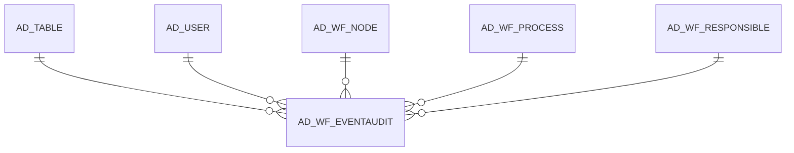

# AD_WF_EVENTAUDIT

Area [AD](../../data-model/ad/index.md) · class **config** (proposed) · read from database `idempiere-db` (owner `ADEMPIERE`) · 13 row(s) when profiled

Application model: `org.compiere.model.X_AD_WF_EventAudit`, access level 7 - System - Client - Org.

## Columns

| column | type | key | not null | business name | references (code) | nulls | distinct |
|---|---|---|---|---|---|---|---|
| `AD_WF_EVENTAUDIT_ID` | NUMBER(10,0) | PK | yes | Workflow Event Audit |  | 0 | 13 |
| `AD_CLIENT_ID` | NUMBER(10,0) |  | yes | Tenant |  | 0 | 1 |
| `AD_ORG_ID` | NUMBER(10,0) |  | yes | Organization |  | 0 | 3 |
| `ISACTIVE` | CHAR(1) |  | yes | Active |  | 0 | 1 |
| `CREATED` | DATE |  | yes | Created |  | 0 | 13 |
| `CREATEDBY` | NUMBER(10,0) |  | yes | Created By |  | 0 | 1 |
| `UPDATED` | DATE |  | yes | Updated |  | 0 | 12 |
| `UPDATEDBY` | NUMBER(10,0) |  | yes | Updated By |  | 0 | 1 |
| `EVENTTYPE` | CHAR(2) |  | yes | Event Type |  | 0 | 2 |
| `WFSTATE` | CHAR(2) |  | yes | Workflow State |  | 0 | 2 |
| `AD_WF_PROCESS_ID` | NUMBER(10,0) |  | yes | Workflow Process | [AD_WF_PROCESS](../../data-model/ad/ad_wf_process.md) | 0 | 11 |
| `AD_WF_NODE_ID` | NUMBER(10,0) |  | yes | Node | [AD_WF_NODE](../../data-model/ad/ad_wf_node.md) | 0 | 4 |
| `AD_TABLE_ID` | NUMBER(10,0) |  | yes | Table | [AD_TABLE](../../data-model/ad/ad_table.md) | 0 | 2 |
| `RECORD_ID` | NUMBER(10,0) |  | yes | Record ID |  | 0 | 11 |
| `AD_WF_RESPONSIBLE_ID` | NUMBER(10,0) |  | yes | Workflow Responsible | [AD_WF_RESPONSIBLE](../../data-model/ad/ad_wf_responsible.md) | 0 | 2 |
| `AD_USER_ID` | NUMBER(10,0) |  |  | User/Contact | [AD_USER](../../data-model/ad/ad_user.md) | 0 | 2 |
| `ELAPSEDTIMEMS` | NUMBER |  | yes | Elapsed Time ms |  | 0 | 4 |
| `ATTRIBUTENAME` | VARCHAR2(60 CHAR) |  |  | Attribute Name |  | 13 | 0 |
| `OLDVALUE` | VARCHAR2(2000 CHAR) |  |  | Old Value |  | 13 | 0 |
| `NEWVALUE` | VARCHAR2(2000 CHAR) |  |  | New Value |  | 13 | 0 |
| `DESCRIPTION` | VARCHAR2(255 CHAR) |  |  | Description |  | 13 | 0 |
| `TEXTMSG` | VARCHAR2(2000 CHAR) |  |  | Text Message |  | 11 | 2 |
| `AD_WF_EVENTAUDIT_UU` | VARCHAR2(36 CHAR) |  |  | AD_WF_EventAudit_UU |  | 0 | 13 |

*references (code)* is the table the application model's code says a column points to; *Foreign keys* below are the constraints the database declares. Counts come from the profile; no value is ever shown.

## Check constraints

| name | expression |
|---|---|
| `SYS_C0020060` | `IsActive in ('Y','N')` |

## Foreign keys

**References**

| table | columns | on delete |
|---|---|---|
| [AD_TABLE](../../data-model/ad/ad_table.md) | AD_WF_EVENTAUDIT.AD_TABLE_ID → AD_TABLE.AD_TABLE_ID | NO ACTION |
| [AD_USER](../../data-model/ad/ad_user.md) | AD_WF_EVENTAUDIT.AD_USER_ID → AD_USER.AD_USER_ID | NO ACTION |
| [AD_WF_NODE](../../data-model/ad/ad_wf_node.md) | AD_WF_EVENTAUDIT.AD_WF_NODE_ID → AD_WF_NODE.AD_WF_NODE_ID | NO ACTION |
| [AD_WF_PROCESS](../../data-model/ad/ad_wf_process.md) | AD_WF_EVENTAUDIT.AD_WF_PROCESS_ID → AD_WF_PROCESS.AD_WF_PROCESS_ID | NO ACTION |
| [AD_WF_RESPONSIBLE](../../data-model/ad/ad_wf_responsible.md) | AD_WF_EVENTAUDIT.AD_WF_RESPONSIBLE_ID → AD_WF_RESPONSIBLE.AD_WF_RESPONSIBLE_ID | NO ACTION |

**Referenced by**

_None._

## Write behaviour

- updates: **po_only**
- deletes: **soft_delete_only**
- change log: **not_recorded**
- evidence: 1 citation(s)

## Schema history

30 change(s); the latest:

| applied | release | operation | column | tickets |
|---|---|---|---|---|
| 2023-04-09T15:47 | iD11 | `add_constraint` |  | IDEMPIERE-5567 |
| 2023-04-09T15:47 | iD11 | `add_constraint` |  | IDEMPIERE-5567 |
| 2021-12-05T16:45 | i8.2z | `drop_constraint` |  | IDEMPIERE-5075 |
| 2021-12-05T16:45 | i8.2z | `drop_constraint` |  | IDEMPIERE-5075 |
| 2021-12-05T16:45 | i8.2z | `add_constraint` |  | IDEMPIERE-5075 |
| 2021-12-05T16:45 | i8.2z | `add_constraint` |  | IDEMPIERE-5075 |
| 2021-12-05T16:45 | i8.2z | `add_constraint` |  | IDEMPIERE-5075 |
| 2021-12-05T16:45 | i8.2z | `drop_constraint` |  | IDEMPIERE-5075 |
| 2021-12-05T16:45 | i8.2z | `drop_constraint` |  | IDEMPIERE-5075 |
| 2021-12-05T16:45 | i8.2z | `drop_constraint` |  | IDEMPIERE-5075 |
| 2021-12-05T16:45 | i8.2z | `add_constraint` |  | IDEMPIERE-5075 |
| 2021-12-05T16:45 | i8.2z | `add_constraint` |  | IDEMPIERE-5075 |
| 2020-08-04T01:00 | i7.1z | `drop_column` | tmp_col_4_tmp | IDEMPIERE-3862 |
| 2020-08-04T01:00 | i7.1z | `add_column` | tmp_col_4_tmp | IDEMPIERE-3862 |
| 2020-08-04T01:00 | i7.1z | `add_column` | tmp_col_6_tmp | IDEMPIERE-3862 |

## Notes

<!-- ekos:manual id="table.ad_wf_eventaudit.notes" -->
_Business notes about this table._
<!-- /ekos:manual -->
