# AD_WF_NODE

Area [AD](../../data-model/ad/index.md) · class **config** (proposed) · read from database `idempiere-db` (owner `ADEMPIERE`) · 262 row(s) when profiled

Application model: `org.compiere.model.X_AD_WF_Node`, access level 6 - System - Client.

## Columns

| column | type | key | not null | business name | references (code) | nulls | distinct |
|---|---|---|---|---|---|---|---|
| `AD_WF_NODE_ID` | NUMBER(10,0) | PK | yes | Node |  | 0 | 262 |
| `AD_CLIENT_ID` | NUMBER(10,0) |  | yes | Tenant |  | 0 | 2 |
| `AD_ORG_ID` | NUMBER(10,0) |  | yes | Organization |  | 0 | 1 |
| `ISACTIVE` | CHAR(1) |  | yes | Active |  | 0 | 2 |
| `CREATED` | DATE |  | yes | Created |  | 0 | 219 |
| `CREATEDBY` | NUMBER(10,0) |  | yes | Created By |  | 0 | 2 |
| `UPDATED` | DATE |  | yes | Updated |  | 0 | 136 |
| `UPDATEDBY` | NUMBER(10,0) |  | yes | Updated By |  | 0 | 2 |
| `NAME` | VARCHAR2(60 CHAR) |  | yes | Name |  | 0 | 130 |
| `DESCRIPTION` | VARCHAR2(255 CHAR) |  |  | Description |  | 35 | 115 |
| `AD_WORKFLOW_ID` | NUMBER(10,0) |  | yes | Workflow | [AD_WORKFLOW](../../data-model/ad/ad_workflow.md) | 0 | 57 |
| `ISCENTRALLYMAINTAINED` | CHAR(1) |  | yes | Centrally maintained |  | 0 | 2 |
| `ACTION` | CHAR(1) |  | yes | Action |  | 0 | 8 |
| `AD_WINDOW_ID` | NUMBER(10,0) |  |  | Window | [AD_WINDOW](../../data-model/ad/ad_window.md) | 158 | 88 |
| `WORKFLOW_ID` | NUMBER(10,0) |  |  | Workflow | [AD_WORKFLOW](../../data-model/ad/ad_workflow.md) | 255 | 7 |
| `AD_TASK_ID` | NUMBER(10,0) |  |  | OS Task | [AD_TASK](../../data-model/ad/ad_task.md) | 262 | 0 |
| `AD_PROCESS_ID` | NUMBER(10,0) |  |  | Process | [AD_PROCESS](../../data-model/ad/ad_process.md) | 252 | 10 |
| `AD_FORM_ID` | NUMBER(10,0) |  |  | Special Form | [AD_FORM](../../data-model/ad/ad_form.md) | 252 | 8 |
| `ENTITYTYPE` | VARCHAR2(40 CHAR) |  | yes | Entity Type |  | 0 | 4 |
| `XPOSITION` | NUMBER(10,0) |  | yes | X Position |  | 0 | 6 |
| `YPOSITION` | NUMBER(10,0) |  | yes | Y Position |  | 0 | 6 |
| `AD_WF_BLOCK_ID` | NUMBER(10,0) |  |  | Workflow Block | [AD_WF_BLOCK](../../data-model/ad/ad_wf_block.md) | 262 | 0 |
| `SUBFLOWEXECUTION` | CHAR(1) |  |  | Subflow Execution |  | 262 | 0 |
| `STARTMODE` | CHAR(1) |  |  | Start Mode |  | 262 | 0 |
| `FINISHMODE` | CHAR(1) |  |  | Finish Mode |  | 262 | 0 |
| `LIMIT` | NUMBER(10,0) |  | yes | Duration Limit |  | 0 | 1 |
| `PRIORITY` | NUMBER(10,0) |  |  | Priority |  | 128 | 1 |
| `DURATION` | NUMBER(10,0) |  | yes | Duration |  | 0 | 7 |
| `COST` | NUMBER |  | yes | Cost |  | 0 | 1 |
| `WORKINGTIME` | NUMBER(10,0) |  |  | Working Time |  | 129 | 1 |
| `WAITINGTIME` | NUMBER(10,0) |  | yes | Waiting Time |  | 0 | 5 |
| `AD_WF_RESPONSIBLE_ID` | NUMBER(10,0) |  |  | Workflow Responsible | [AD_WF_RESPONSIBLE](../../data-model/ad/ad_wf_responsible.md) | 261 | 1 |
| `AD_IMAGE_ID` | NUMBER(10,0) |  |  | Image | [AD_IMAGE](../../data-model/ad/ad_image.md) | 262 | 0 |
| `JOINELEMENT` | CHAR(1) |  | yes | Join Element |  | 0 | 1 |
| `SPLITELEMENT` | CHAR(1) |  | yes | Split Element |  | 0 | 1 |
| `WAITTIME` | NUMBER(10,0) |  |  | Wait Time |  | 113 | 1 |
| `AD_COLUMN_ID` | NUMBER(10,0) |  |  | Column | [AD_COLUMN](../../data-model/ad/ad_column.md) | 261 | 1 |
| `ATTRIBUTENAME` | VARCHAR2(60 CHAR) |  |  | Attribute Name |  | 262 | 0 |
| `ATTRIBUTEVALUE` | VARCHAR2(60 CHAR) |  |  | Attribute Value |  | 262 | 0 |
| `DOCACTION` | CHAR(2) |  |  | Document Action |  | 83 | 3 |
| `VALUE` | VARCHAR2(40 CHAR) |  | yes | Search Key |  | 0 | 126 |
| `DYNPRIORITYUNIT` | CHAR(1) |  |  | Dynamic Priority Unit |  | 262 | 0 |
| `DYNPRIORITYCHANGE` | NUMBER |  |  | Dynamic Priority Change |  | 137 | 1 |
| `EMAILRECIPIENT` | CHAR(1) |  |  | EMail Recipient |  | 262 | 0 |
| `EMAIL` | VARCHAR2(60 CHAR) |  |  | EMail Address |  | 262 | 0 |
| `R_MAILTEXT_ID` | NUMBER(10,0) |  |  | Mail Template | [R_MAILTEXT](../../data-model/r/r_mailtext.md) | 262 | 0 |
| `VALIDTO` | DATE |  |  | Valid to |  | 262 | 0 |
| `ISMILESTONE` | CHAR(1) |  |  | Is Milestone |  | 0 | 1 |
| `ISSUBCONTRACTING` | CHAR(1) |  |  | Is Subcontracting |  | 0 | 2 |
| `UNITSCYCLES` | NUMBER |  |  | Units by Cycles |  | 0 | 2 |
| `MOVINGTIME` | NUMBER(10,0) |  |  | Moving Time |  | 253 | 2 |
| `OVERLAPUNITS` | NUMBER(10,0) |  |  | Overlap Units |  | 241 | 1 |
| `C_BPARTNER_ID` | NUMBER(10,0) |  |  | Business Partner | [C_BPARTNER](../../data-model/c/c_bpartner.md) | 262 | 0 |
| `QUEUINGTIME` | NUMBER(10,0) |  |  | Queuing Time |  | 253 | 1 |
| `S_RESOURCE_ID` | NUMBER(10,0) |  |  | Resource | [S_RESOURCE](../../data-model/s/s_resource.md) | 253 | 8 |
| `SETUPTIME` | NUMBER(10,0) |  |  | Setup Time |  | 253 | 4 |
| `VALIDFROM` | DATE |  |  | Valid from |  | 262 | 0 |
| `YIELD` | NUMBER(10,0) |  |  | Yield % |  | 224 | 1 |
| `AD_WF_NODE_UU` | VARCHAR2(36 CHAR) |  |  | AD_WF_Node_UU |  | 0 | 262 |
| `HELP` | CLOB |  |  | Comment/Help |  | 183 | 0 |
| `AD_CTXHELP_ID` | NUMBER(10,0) |  |  | Context Help | [AD_CTXHELP](../../data-model/ad/ad_ctxhelp.md) | 262 | 0 |
| `AD_INFOWINDOW_ID` | NUMBER(10,0) |  |  | Info Window | [AD_INFOWINDOW](../../data-model/ad/ad_infowindow.md) | 258 | 1 |
| `ISATTACHEDDOCUMENTTOEMAIL` | CHAR(1 CHAR) |  | yes | Attached Document |  | 0 | 1 |

*references (code)* is the table the application model's code says a column points to; *Foreign keys* below are the constraints the database declares. Counts come from the profile; no value is ever shown.

## Check constraints

| name | expression |
|---|---|
| `SYS_C0020722` | `IsMilestone IN ('Y','N')` |
| `SYS_C0020723` | `IsActive in ('Y','N')` |
| `SYS_C0020724` | `IsAttachedDocumentToEmail IN ('Y','N')` |
| `SYS_C0020725` | `IsCentrallyMaintained in ('Y','N')` |
| `SYS_C0020727` | `IsSubcontracting IN ('Y','N')` |

## Foreign keys

**References**

| table | columns | on delete |
|---|---|---|
| [AD_CLIENT](../../data-model/ad/ad_client.md) | AD_WF_NODE.AD_CLIENT_ID → AD_CLIENT.AD_CLIENT_ID | NO ACTION |
| [AD_COLUMN](../../data-model/ad/ad_column.md) | AD_WF_NODE.AD_COLUMN_ID → AD_COLUMN.AD_COLUMN_ID | NO ACTION |
| [AD_CTXHELP](../../data-model/ad/ad_ctxhelp.md) | AD_WF_NODE.AD_CTXHELP_ID → AD_CTXHELP.AD_CTXHELP_ID | NO ACTION |
| [AD_ENTITYTYPE](../../data-model/ad/ad_entitytype.md) | AD_WF_NODE.ENTITYTYPE → AD_ENTITYTYPE.ENTITYTYPE | NO ACTION |
| [AD_FORM](../../data-model/ad/ad_form.md) | AD_WF_NODE.AD_FORM_ID → AD_FORM.AD_FORM_ID | NO ACTION |
| [AD_IMAGE](../../data-model/ad/ad_image.md) | AD_WF_NODE.AD_IMAGE_ID → AD_IMAGE.AD_IMAGE_ID | NO ACTION |
| [AD_INFOWINDOW](../../data-model/ad/ad_infowindow.md) | AD_WF_NODE.AD_INFOWINDOW_ID → AD_INFOWINDOW.AD_INFOWINDOW_ID | NO ACTION |
| [AD_ORG](../../data-model/ad/ad_org.md) | AD_WF_NODE.AD_ORG_ID → AD_ORG.AD_ORG_ID | NO ACTION |
| [AD_PROCESS](../../data-model/ad/ad_process.md) | AD_WF_NODE.AD_PROCESS_ID → AD_PROCESS.AD_PROCESS_ID | NO ACTION |
| [AD_TASK](../../data-model/ad/ad_task.md) | AD_WF_NODE.AD_TASK_ID → AD_TASK.AD_TASK_ID | NO ACTION |
| [AD_WF_BLOCK](../../data-model/ad/ad_wf_block.md) | AD_WF_NODE.AD_WF_BLOCK_ID → AD_WF_BLOCK.AD_WF_BLOCK_ID | SET NULL |
| [AD_WF_RESPONSIBLE](../../data-model/ad/ad_wf_responsible.md) | AD_WF_NODE.AD_WF_RESPONSIBLE_ID → AD_WF_RESPONSIBLE.AD_WF_RESPONSIBLE_ID | NO ACTION |
| [AD_WINDOW](../../data-model/ad/ad_window.md) | AD_WF_NODE.AD_WINDOW_ID → AD_WINDOW.AD_WINDOW_ID | NO ACTION |
| [AD_WORKFLOW](../../data-model/ad/ad_workflow.md) | AD_WF_NODE.AD_WORKFLOW_ID → AD_WORKFLOW.AD_WORKFLOW_ID | CASCADE |
| [C_BPARTNER](../../data-model/c/c_bpartner.md) | AD_WF_NODE.C_BPARTNER_ID → C_BPARTNER.C_BPARTNER_ID | NO ACTION |
| [R_MAILTEXT](../../data-model/r/r_mailtext.md) | AD_WF_NODE.R_MAILTEXT_ID → R_MAILTEXT.R_MAILTEXT_ID | NO ACTION |
| [S_RESOURCE](../../data-model/s/s_resource.md) | AD_WF_NODE.S_RESOURCE_ID → S_RESOURCE.S_RESOURCE_ID | NO ACTION |

**Referenced by**

| table | columns | on delete |
|---|---|---|
| [AD_WF_ACTIVITY](../../data-model/ad/ad_wf_activity.md) | AD_WF_ACTIVITY.AD_WF_NODE_ID → AD_WF_NODE.AD_WF_NODE_ID | CASCADE |
| [AD_WF_EVENTAUDIT](../../data-model/ad/ad_wf_eventaudit.md) | AD_WF_EVENTAUDIT.AD_WF_NODE_ID → AD_WF_NODE.AD_WF_NODE_ID | NO ACTION |
| [AD_WF_NODENEXT](../../data-model/ad/ad_wf_nodenext.md) | AD_WF_NODENEXT.AD_WF_NEXT_ID → AD_WF_NODE.AD_WF_NODE_ID | CASCADE |
| [AD_WF_NODE_PARA](../../data-model/ad/ad_wf_node_para.md) | AD_WF_NODE_PARA.AD_WF_NODE_ID → AD_WF_NODE.AD_WF_NODE_ID | NO ACTION |
| [AD_WF_NODE_TRL](../../data-model/ad/ad_wf_node_trl.md) | AD_WF_NODE_TRL.AD_WF_NODE_ID → AD_WF_NODE.AD_WF_NODE_ID | CASCADE |
| [AD_WIZARDPROCESS](../../data-model/ad/ad_wizardprocess.md) | AD_WIZARDPROCESS.AD_WF_NODE_ID → AD_WF_NODE.AD_WF_NODE_ID | NO ACTION |
| [AD_WORKFLOW](../../data-model/ad/ad_workflow.md) | AD_WORKFLOW.AD_WF_NODE_ID → AD_WF_NODE.AD_WF_NODE_ID | NO ACTION |
| [ASP_CLIENTEXCEPTION](../../data-model/asp/asp_clientexception.md) | ASP_CLIENTEXCEPTION.AD_WF_NODE_ID → AD_WF_NODE.AD_WF_NODE_ID | NO ACTION |
| [PP_ORDER_NODE](../../data-model/pp/pp_order_node.md) | PP_ORDER_NODE.AD_WF_NODE_ID → AD_WF_NODE.AD_WF_NODE_ID | NO ACTION |
| [PP_ORDER_NODENEXT](../../data-model/pp/pp_order_nodenext.md) | PP_ORDER_NODENEXT.AD_WF_NEXT_ID → AD_WF_NODE.AD_WF_NODE_ID | NO ACTION |
| [PP_ORDER_WORKFLOW](../../data-model/pp/pp_order_workflow.md) | PP_ORDER_WORKFLOW.AD_WF_NODE_ID → AD_WF_NODE.AD_WF_NODE_ID | NO ACTION |
| [PP_WF_NODE_ASSET](../../data-model/pp/pp_wf_node_asset.md) | PP_WF_NODE_ASSET.AD_WF_NODE_ID → AD_WF_NODE.AD_WF_NODE_ID | NO ACTION |
| [PP_WF_NODE_PRODUCT](../../data-model/pp/pp_wf_node_product.md) | PP_WF_NODE_PRODUCT.AD_WF_NODE_ID → AD_WF_NODE.AD_WF_NODE_ID | NO ACTION |

```mermaid
erDiagram
  AD_CLIENT ||--o{ AD_WF_NODE : ""
  AD_COLUMN ||--o{ AD_WF_NODE : ""
  AD_CTXHELP ||--o{ AD_WF_NODE : ""
  AD_ENTITYTYPE ||--o{ AD_WF_NODE : ""
  AD_FORM ||--o{ AD_WF_NODE : ""
  AD_IMAGE ||--o{ AD_WF_NODE : ""
  AD_INFOWINDOW ||--o{ AD_WF_NODE : ""
  AD_ORG ||--o{ AD_WF_NODE : ""
  AD_PROCESS ||--o{ AD_WF_NODE : ""
  AD_TASK ||--o{ AD_WF_NODE : ""
  AD_WF_BLOCK ||--o{ AD_WF_NODE : ""
  AD_WF_NODE ||--o{ AD_WF_ACTIVITY : ""
  AD_WF_NODE ||--o{ AD_WF_EVENTAUDIT : ""
  AD_WF_NODE ||--o{ AD_WF_NODENEXT : ""
  AD_WF_NODE ||--o{ AD_WF_NODE_PARA : ""
  AD_WF_NODE ||--o{ AD_WF_NODE_TRL : ""
  AD_WF_NODE ||--o{ AD_WIZARDPROCESS : ""
  AD_WF_NODE ||--o{ AD_WORKFLOW : ""
  AD_WF_NODE ||--o{ ASP_CLIENTEXCEPTION : ""
  AD_WF_NODE ||--o{ PP_ORDER_NODE : ""
  AD_WF_NODE ||--o{ PP_ORDER_NODENEXT : ""
  AD_WF_NODE ||--o{ PP_ORDER_WORKFLOW : ""
  AD_WF_NODE ||--o{ PP_WF_NODE_ASSET : ""
  AD_WF_NODE ||--o{ PP_WF_NODE_PRODUCT : ""
  AD_WF_RESPONSIBLE ||--o{ AD_WF_NODE : ""
  AD_WINDOW ||--o{ AD_WF_NODE : ""
  AD_WORKFLOW ||--o{ AD_WF_NODE : ""
  C_BPARTNER ||--o{ AD_WF_NODE : ""
  R_MAILTEXT ||--o{ AD_WF_NODE : ""
  S_RESOURCE ||--o{ AD_WF_NODE : ""
```

## Write behaviour

- updates: **raw_sql_skips_updated**
- deletes: **deleted_by_users, deleted_by_cascade**
- change log: **recorded**
- evidence: 9 citation(s)

## Read by

| kind | name |
|---|---|
| Procedure | [AD_Synchronize](../../logic/ad_synchronize.md) |

## Written by

| kind | name |
|---|---|
| Procedure | [AD_Synchronize](../../logic/ad_synchronize.md) |

## Schema history

70 change(s); the latest:

| applied | release | operation | column | tickets |
|---|---|---|---|---|
| 2023-04-09T15:47 | iD11 | `add_constraint` |  | IDEMPIERE-5567 |
| 2023-04-09T15:47 | iD11 | `add_constraint` |  | IDEMPIERE-5567 |
| 2022-04-19T09:45 | iD10 | `add_column` | IsAttachedDocumentToEmail | IDEMPIERE-5261 |
| 2022-04-19T09:45 | iD10 | `add_column` | IsAttachedDocumentToEmail | IDEMPIERE-5261 |
| 2021-12-05T16:45 | i8.2z | `drop_constraint` |  | IDEMPIERE-5075 |
| 2021-12-05T16:45 | i8.2z | `add_constraint` |  | IDEMPIERE-5075 |
| 2021-12-05T16:45 | i8.2z | `add_constraint` |  | IDEMPIERE-5075 |
| 2021-12-05T16:45 | i8.2z | `drop_constraint` |  | IDEMPIERE-5075 |
| 2021-12-05T16:45 | i8.2z | `drop_constraint` |  | IDEMPIERE-5075 |
| 2021-12-05T16:45 | i8.2z | `add_constraint` |  | IDEMPIERE-5075 |
| 2021-12-05T16:45 | i8.2z | `add_constraint` |  | IDEMPIERE-5075 |
| 2021-12-05T16:45 | i8.2z | `add_constraint` |  | IDEMPIERE-5075 |
| 2021-12-05T16:45 | i8.2z | `add_constraint` |  | IDEMPIERE-5075 |
| 2021-12-05T16:45 | i8.2z | `drop_constraint` |  | IDEMPIERE-5075 |
| 2021-12-05T16:45 | i8.2z | `add_constraint` |  | IDEMPIERE-5075 |

## Notes

<!-- ekos:manual id="table.ad_wf_node.notes" -->
_Business notes about this table._
<!-- /ekos:manual -->
