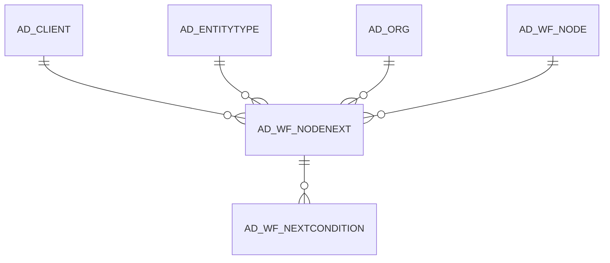

# AD_WF_NODENEXT

Area [AD](../../data-model/ad/index.md) · class **config** (proposed) · read from database `idempiere-db` (owner `ADEMPIERE`) · 207 row(s) when profiled

Application model: `org.compiere.model.X_AD_WF_NodeNext`, access level 6 - System - Client.

## Columns

| column | type | key | not null | business name | references (code) | nulls | distinct |
|---|---|---|---|---|---|---|---|
| `AD_WF_NODENEXT_ID` | NUMBER(10,0) | PK | yes | Node Transition |  | 0 | 207 |
| `AD_CLIENT_ID` | NUMBER(10,0) |  | yes | Tenant |  | 0 | 2 |
| `AD_ORG_ID` | NUMBER(10,0) |  | yes | Organization |  | 0 | 1 |
| `ISACTIVE` | CHAR(1) |  | yes | Active |  | 0 | 2 |
| `CREATED` | DATE |  | yes | Created |  | 0 | 173 |
| `CREATEDBY` | NUMBER(10,0) |  | yes | Created By |  | 0 | 2 |
| `UPDATED` | DATE |  | yes | Updated |  | 0 | 106 |
| `UPDATEDBY` | NUMBER(10,0) |  | yes | Updated By |  | 0 | 2 |
| `AD_WF_NODE_ID` | NUMBER(10,0) |  | yes | Node | [AD_WF_NODE](../../data-model/ad/ad_wf_node.md) | 0 | 176 |
| `AD_WF_NEXT_ID` | NUMBER(10,0) |  | yes | Next Node | [AD_WF_NODE](../../data-model/ad/ad_wf_node.md) | 0 | 203 |
| `DESCRIPTION` | VARCHAR2(255 CHAR) |  |  | Description |  | 134 | 3 |
| `SEQNO` | NUMBER(10,0) |  | yes | Sequence |  | 0 | 3 |
| `ENTITYTYPE` | VARCHAR2(40 CHAR) |  | yes | Entity Type |  | 0 | 4 |
| `TRANSITIONCODE` | VARCHAR2(2000 CHAR) |  |  | Transition Code |  | 207 | 0 |
| `ISSTDUSERWORKFLOW` | CHAR(1) |  | yes | Std User Workflow |  | 0 | 2 |
| `AD_WF_NODENEXT_UU` | VARCHAR2(36 CHAR) |  |  | AD_WF_NodeNext_UU |  | 0 | 207 |

*references (code)* is the table the application model's code says a column points to; *Foreign keys* below are the constraints the database declares. Counts come from the profile; no value is ever shown.

## Check constraints

| name | expression |
|---|---|
| `SYS_C0020783` | `IsActive in ('Y','N')` |

## Foreign keys

**References**

| table | columns | on delete |
|---|---|---|
| [AD_CLIENT](../../data-model/ad/ad_client.md) | AD_WF_NODENEXT.AD_CLIENT_ID → AD_CLIENT.AD_CLIENT_ID | NO ACTION |
| [AD_ENTITYTYPE](../../data-model/ad/ad_entitytype.md) | AD_WF_NODENEXT.ENTITYTYPE → AD_ENTITYTYPE.ENTITYTYPE | NO ACTION |
| [AD_ORG](../../data-model/ad/ad_org.md) | AD_WF_NODENEXT.AD_ORG_ID → AD_ORG.AD_ORG_ID | NO ACTION |
| [AD_WF_NODE](../../data-model/ad/ad_wf_node.md) | AD_WF_NODENEXT.AD_WF_NEXT_ID → AD_WF_NODE.AD_WF_NODE_ID | CASCADE |

**Referenced by**

| table | columns | on delete |
|---|---|---|
| [AD_WF_NEXTCONDITION](../../data-model/ad/ad_wf_nextcondition.md) | AD_WF_NEXTCONDITION.AD_WF_NODENEXT_ID → AD_WF_NODENEXT.AD_WF_NODENEXT_ID | CASCADE |

## Write behaviour

- updates: **raw_sql_skips_updated**
- deletes: **deleted_by_users, deleted_by_cascade**
- change log: **recorded**
- evidence: 3 citation(s)

## Schema history

22 change(s); the latest:

| applied | release | operation | column | tickets |
|---|---|---|---|---|
| 2023-04-09T15:47 | iD11 | `add_constraint` |  | IDEMPIERE-5567 |
| 2023-04-09T15:47 | iD11 | `add_constraint` |  | IDEMPIERE-5567 |
| 2021-12-05T16:45 | i8.2z | `add_constraint` |  | IDEMPIERE-5075 |
| 2021-12-05T16:45 | i8.2z | `add_constraint` |  | IDEMPIERE-5075 |
| 2021-12-05T16:45 | i8.2z | `add_constraint` |  | IDEMPIERE-5075 |
| 2021-12-05T16:45 | i8.2z | `drop_constraint` |  | IDEMPIERE-5075 |
| 2021-12-05T16:45 | i8.2z | `add_constraint` |  | IDEMPIERE-5075 |
| 2021-12-05T16:45 | i8.2z | `drop_constraint` |  | IDEMPIERE-5075 |
| 2021-12-05T16:45 | i8.2z | `drop_constraint` |  | IDEMPIERE-5075 |
| 2021-12-05T16:45 | i8.2z | `drop_constraint` |  | IDEMPIERE-5075 |
| 2021-12-05T16:45 | i8.2z | `drop_constraint` |  | IDEMPIERE-5075 |
| 2021-12-05T16:45 | i8.2z | `add_constraint` |  | IDEMPIERE-5075 |
| 2020-08-04T01:00 | i7.1z | `modify_column` | ENTITYTYPE | IDEMPIERE-3862 |
| 2020-08-04T01:00 | i7.1z | `drop_column` | tmp_col_2_tmp | IDEMPIERE-3862 |
| 2020-08-04T01:00 | i7.1z | `modify_column` | TRANSITIONCODE | IDEMPIERE-3862 |

## Notes

<!-- ekos:manual id="table.ad_wf_nodenext.notes" -->
_Business notes about this table._
<!-- /ekos:manual -->
