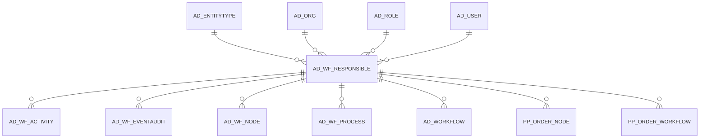

# AD_WF_RESPONSIBLE

Area [AD](../../data-model/ad/index.md) · class **config** (proposed) · read from database `idempiere-db` (owner `ADEMPIERE`) · 2 row(s) when profiled

Application model: `org.compiere.model.X_AD_WF_Responsible`, access level 6 - System - Client.

## Columns

| column | type | key | not null | business name | references (code) | nulls | distinct |
|---|---|---|---|---|---|---|---|
| `AD_WF_RESPONSIBLE_ID` | NUMBER(10,0) | PK | yes | Workflow Responsible |  | 0 | 2 |
| `AD_CLIENT_ID` | NUMBER(10,0) |  | yes | Tenant |  | 0 | 1 |
| `AD_ORG_ID` | NUMBER(10,0) |  | yes | Organization |  | 0 | 1 |
| `ISACTIVE` | CHAR(1) |  | yes | Active |  | 0 | 1 |
| `CREATED` | DATE |  | yes | Created |  | 0 | 2 |
| `CREATEDBY` | NUMBER(10,0) |  | yes | Created By |  | 0 | 1 |
| `UPDATED` | DATE |  | yes | Updated |  | 0 | 1 |
| `UPDATEDBY` | NUMBER(10,0) |  | yes | Updated By |  | 0 | 1 |
| `NAME` | VARCHAR2(60 CHAR) |  | yes | Name |  | 0 | 2 |
| `DESCRIPTION` | VARCHAR2(255 CHAR) |  |  | Description |  | 0 | 2 |
| `RESPONSIBLETYPE` | CHAR(1) |  | yes | Responsible Type |  | 0 | 2 |
| `AD_USER_ID` | NUMBER(10,0) |  |  | User/Contact | [AD_USER](../../data-model/ad/ad_user.md) | 1 | 1 |
| `AD_ROLE_ID` | NUMBER(10,0) |  |  | Role | [AD_ROLE](../../data-model/ad/ad_role.md) | 0 | 1 |
| `ENTITYTYPE` | VARCHAR2(40 CHAR) |  | yes | Entity Type |  | 0 | 1 |
| `AD_WF_RESPONSIBLE_UU` | VARCHAR2(36 CHAR) |  |  | AD_WF_Responsible_UU |  | 0 | 2 |

*references (code)* is the table the application model's code says a column points to; *Foreign keys* below are the constraints the database declares. Counts come from the profile; no value is ever shown.

## Check constraints

| name | expression |
|---|---|
| `SYS_C0019674` | `IsActive in ('Y','N')` |

## Foreign keys

**References**

| table | columns | on delete |
|---|---|---|
| [AD_ENTITYTYPE](../../data-model/ad/ad_entitytype.md) | AD_WF_RESPONSIBLE.ENTITYTYPE → AD_ENTITYTYPE.ENTITYTYPE | NO ACTION |
| [AD_ORG](../../data-model/ad/ad_org.md) | AD_WF_RESPONSIBLE.AD_ORG_ID → AD_ORG.AD_ORG_ID | NO ACTION |
| [AD_ROLE](../../data-model/ad/ad_role.md) | AD_WF_RESPONSIBLE.AD_ROLE_ID → AD_ROLE.AD_ROLE_ID | NO ACTION |
| [AD_USER](../../data-model/ad/ad_user.md) | AD_WF_RESPONSIBLE.AD_USER_ID → AD_USER.AD_USER_ID | NO ACTION |

**Referenced by**

| table | columns | on delete |
|---|---|---|
| [AD_WF_ACTIVITY](../../data-model/ad/ad_wf_activity.md) | AD_WF_ACTIVITY.AD_WF_RESPONSIBLE_ID → AD_WF_RESPONSIBLE.AD_WF_RESPONSIBLE_ID | SET NULL |
| [AD_WF_EVENTAUDIT](../../data-model/ad/ad_wf_eventaudit.md) | AD_WF_EVENTAUDIT.AD_WF_RESPONSIBLE_ID → AD_WF_RESPONSIBLE.AD_WF_RESPONSIBLE_ID | NO ACTION |
| [AD_WF_NODE](../../data-model/ad/ad_wf_node.md) | AD_WF_NODE.AD_WF_RESPONSIBLE_ID → AD_WF_RESPONSIBLE.AD_WF_RESPONSIBLE_ID | NO ACTION |
| [AD_WF_PROCESS](../../data-model/ad/ad_wf_process.md) | AD_WF_PROCESS.AD_WF_RESPONSIBLE_ID → AD_WF_RESPONSIBLE.AD_WF_RESPONSIBLE_ID | NO ACTION |
| [AD_WORKFLOW](../../data-model/ad/ad_workflow.md) | AD_WORKFLOW.AD_WF_RESPONSIBLE_ID → AD_WF_RESPONSIBLE.AD_WF_RESPONSIBLE_ID | NO ACTION |
| [PP_ORDER_NODE](../../data-model/pp/pp_order_node.md) | PP_ORDER_NODE.AD_WF_RESPONSIBLE_ID → AD_WF_RESPONSIBLE.AD_WF_RESPONSIBLE_ID | NO ACTION |
| [PP_ORDER_WORKFLOW](../../data-model/pp/pp_order_workflow.md) | PP_ORDER_WORKFLOW.AD_WF_RESPONSIBLE_ID → AD_WF_RESPONSIBLE.AD_WF_RESPONSIBLE_ID | NO ACTION |

## Write behaviour

- updates: **po_only**
- deletes: **deleted_by_users**
- change log: **recorded**
- evidence: 1 citation(s)

## Schema history

26 change(s); the latest:

| applied | release | operation | column | tickets |
|---|---|---|---|---|
| 2024-02-02T09:15 | iD13 | `add_column` | Override_ID | IDEMPIERE-6028 |
| 2024-02-02T09:15 | iD13 | `add_constraint` |  | IDEMPIERE-6028 |
| 2024-02-02T09:15 | iD13 | `add_column` | Override_ID | IDEMPIERE-6028 |
| 2024-02-02T09:15 | iD13 | `add_constraint` |  | IDEMPIERE-6028 |
| 2023-04-09T15:47 | iD11 | `add_constraint` |  | IDEMPIERE-5567 |
| 2023-04-09T15:47 | iD11 | `add_constraint` |  | IDEMPIERE-5567 |
| 2021-12-05T16:45 | i8.2z | `drop_constraint` |  | IDEMPIERE-5075 |
| 2021-12-05T16:45 | i8.2z | `add_constraint` |  | IDEMPIERE-5075 |
| 2021-12-05T16:45 | i8.2z | `drop_constraint` |  | IDEMPIERE-5075 |
| 2021-12-05T16:45 | i8.2z | `add_constraint` |  | IDEMPIERE-5075 |
| 2021-12-05T16:45 | i8.2z | `drop_constraint` |  | IDEMPIERE-5075 |
| 2021-12-05T16:45 | i8.2z | `drop_constraint` |  | IDEMPIERE-5075 |
| 2021-12-05T16:45 | i8.2z | `add_constraint` |  | IDEMPIERE-5075 |
| 2021-12-05T16:45 | i8.2z | `add_constraint` |  | IDEMPIERE-5075 |
| 2020-08-04T01:00 | i7.1z | `add_column` | tmp_col_2_tmp | IDEMPIERE-3862 |

## Open conflicts

| type | attribute | explanation |
|---|---|---|
| `mandatory_but_nullable` | `columns.AD_Role_ID.nullable` | unexplained |
| `model_column_missing` | `columns.Override_ID` | unexplained |

## Notes

<!-- ekos:manual id="table.ad_wf_responsible.notes" -->
_Business notes about this table._
<!-- /ekos:manual -->
