# AD_WINDOW

Area [AD](../../data-model/ad/index.md) · class **config** (proposed) · read from database `idempiere-db` (owner `ADEMPIERE`) · 447 row(s) when profiled

Application model: `org.compiere.model.X_AD_Window`, access level 4 - System.

## Columns

| column | type | key | not null | business name | references (code) | nulls | distinct |
|---|---|---|---|---|---|---|---|
| `AD_WINDOW_ID` | NUMBER(10,0) | PK | yes | Window |  | 0 | 447 |
| `AD_CLIENT_ID` | NUMBER(10,0) |  | yes | Tenant |  | 0 | 1 |
| `AD_ORG_ID` | NUMBER(10,0) |  | yes | Organization |  | 0 | 1 |
| `ISACTIVE` | CHAR(1) |  | yes | Active |  | 0 | 2 |
| `CREATED` | DATE |  | yes | Created |  | 0 | 403 |
| `CREATEDBY` | NUMBER(10,0) |  | yes | Created By |  | 0 | 3 |
| `UPDATED` | DATE |  | yes | Updated |  | 0 | 308 |
| `UPDATEDBY` | NUMBER(10,0) |  | yes | Updated By |  | 0 | 3 |
| `NAME` | VARCHAR2(60 CHAR) |  | yes | Name |  | 0 | 447 |
| `DESCRIPTION` | VARCHAR2(255 CHAR) |  |  | Description |  | 87 | 356 |
| `HELP` | VARCHAR2(2000 CHAR) |  |  | Comment/Help |  | 150 | 292 |
| `WINDOWTYPE` | CHAR(1) |  |  | Window Type |  | 0 | 3 |
| `ISSOTRX` | CHAR(1) |  | yes | Sales Transaction |  | 0 | 2 |
| `ENTITYTYPE` | VARCHAR2(40 CHAR) |  | yes | Entity Type |  | 0 | 6 |
| `PROCESSING` | CHAR(1) |  |  | Process Now |  | 1 | 1 |
| `AD_IMAGE_ID` | NUMBER(10,0) |  |  | Image | [AD_IMAGE](../../data-model/ad/ad_image.md) | 428 | 7 |
| `AD_COLOR_ID` | NUMBER(10,0) |  |  | System Color | [AD_COLOR](../../data-model/ad/ad_color.md) | 447 | 0 |
| `ISDEFAULT` | CHAR(1) |  | yes | Default |  | 0 | 1 |
| `WINHEIGHT` | NUMBER(10,0) |  |  | Window Height |  | 316 | 4 |
| `WINWIDTH` | NUMBER(10,0) |  |  | Window Width |  | 317 | 4 |
| `ISBETAFUNCTIONALITY` | CHAR(1) |  | yes | Beta Functionality |  | 0 | 2 |
| `AD_WINDOW_UU` | VARCHAR2(36 CHAR) |  |  | AD_Window_UU |  | 0 | 447 |
| `TITLELOGIC` | VARCHAR2(255 CHAR) |  |  | Title Logic |  | 443 | 4 |
| `PREDEFINEDCONTEXTVARIABLES` | VARCHAR2(4000 CHAR) |  |  | Predefined Context Variables |  | 415 | 3 |

*references (code)* is the table the application model's code says a column points to; *Foreign keys* below are the constraints the database declares. Counts come from the profile; no value is ever shown.

## Check constraints

| name | expression |
|---|---|
| `SYS_C0021407` | `IsActive in ('Y','N')` |
| `SYS_C0021408` | `IsSOTrx in ('Y','N')` |

## Foreign keys

**References**

| table | columns | on delete |
|---|---|---|
| [AD_CLIENT](../../data-model/ad/ad_client.md) | AD_WINDOW.AD_CLIENT_ID → AD_CLIENT.AD_CLIENT_ID | NO ACTION |
| [AD_COLOR](../../data-model/ad/ad_color.md) | AD_WINDOW.AD_COLOR_ID → AD_COLOR.AD_COLOR_ID | NO ACTION |
| [AD_ENTITYTYPE](../../data-model/ad/ad_entitytype.md) | AD_WINDOW.ENTITYTYPE → AD_ENTITYTYPE.ENTITYTYPE | NO ACTION |
| [AD_IMAGE](../../data-model/ad/ad_image.md) | AD_WINDOW.AD_IMAGE_ID → AD_IMAGE.AD_IMAGE_ID | NO ACTION |
| [AD_ORG](../../data-model/ad/ad_org.md) | AD_WINDOW.AD_ORG_ID → AD_ORG.AD_ORG_ID | NO ACTION |

**Referenced by**

| table | columns | on delete |
|---|---|---|
| [AD_IMPORTTEMPLATE](../../data-model/ad/ad_importtemplate.md) | AD_IMPORTTEMPLATE.AD_WINDOW_ID → AD_WINDOW.AD_WINDOW_ID | NO ACTION |
| [AD_INFOWINDOW](../../data-model/ad/ad_infowindow.md) | AD_INFOWINDOW.AD_WINDOW_ID → AD_WINDOW.AD_WINDOW_ID | NO ACTION |
| [AD_ISSUE](../../data-model/ad/ad_issue.md) | AD_ISSUE.AD_WINDOW_ID → AD_WINDOW.AD_WINDOW_ID | SET NULL |
| [AD_MENU](../../data-model/ad/ad_menu.md) | AD_MENU.AD_WINDOW_ID → AD_WINDOW.AD_WINDOW_ID | NO ACTION |
| [AD_PACKAGE_EXP_COMMON](../../data-model/ad/ad_package_exp_common.md) | AD_PACKAGE_EXP_COMMON.AD_WINDOW_ID → AD_WINDOW.AD_WINDOW_ID | NO ACTION |
| [AD_PACKAGE_EXP_DETAIL](../../data-model/ad/ad_package_exp_detail.md) | AD_PACKAGE_EXP_DETAIL.AD_WINDOW_ID → AD_WINDOW.AD_WINDOW_ID | NO ACTION |
| [AD_PREFERENCE](../../data-model/ad/ad_preference.md) | AD_PREFERENCE.AD_WINDOW_ID → AD_WINDOW.AD_WINDOW_ID | NO ACTION |
| [AD_PRINTFORMAT](../../data-model/ad/ad_printformat.md) | AD_PRINTFORMAT.AD_WINDOW_ID → AD_WINDOW.AD_WINDOW_ID | NO ACTION |
| [AD_RECENTITEM](../../data-model/ad/ad_recentitem.md) | AD_RECENTITEM.AD_WINDOW_ID → AD_WINDOW.AD_WINDOW_ID | CASCADE |
| [AD_REF_TABLE](../../data-model/ad/ad_ref_table.md) | AD_REF_TABLE.AD_WINDOW_ID → AD_WINDOW.AD_WINDOW_ID | NO ACTION |
| [AD_SEARCHDEFINITION](../../data-model/ad/ad_searchdefinition.md) | AD_SEARCHDEFINITION.AD_WINDOW_ID → AD_WINDOW.AD_WINDOW_ID | NO ACTION |
| [AD_STATUSLINEUSEDIN](../../data-model/ad/ad_statuslineusedin.md) | AD_STATUSLINEUSEDIN.AD_WINDOW_ID → AD_WINDOW.AD_WINDOW_ID | NO ACTION |
| [AD_TAB](../../data-model/ad/ad_tab.md) | AD_TAB.AD_WINDOW_ID → AD_WINDOW.AD_WINDOW_ID | CASCADE |
| [AD_TABLE](../../data-model/ad/ad_table.md) | AD_TABLE.PO_WINDOW_ID → AD_WINDOW.AD_WINDOW_ID | NO ACTION |
| [AD_TOOLBARBUTTONRESTRICT](../../data-model/ad/ad_toolbarbuttonrestrict.md) | AD_TOOLBARBUTTONRESTRICT.AD_WINDOW_ID → AD_WINDOW.AD_WINDOW_ID | NO ACTION |
| [AD_USERDEF_INFO](../../data-model/ad/ad_userdef_info.md) | AD_USERDEF_INFO.AD_WINDOW_ID → AD_WINDOW.AD_WINDOW_ID | NO ACTION |
| [AD_USERDEF_WIN](../../data-model/ad/ad_userdef_win.md) | AD_USERDEF_WIN.AD_WINDOW_ID → AD_WINDOW.AD_WINDOW_ID | NO ACTION |
| [AD_USERQUERY](../../data-model/ad/ad_userquery.md) | AD_USERQUERY.AD_WINDOW_ID → AD_WINDOW.AD_WINDOW_ID | NO ACTION |
| [AD_WF_NODE](../../data-model/ad/ad_wf_node.md) | AD_WF_NODE.AD_WINDOW_ID → AD_WINDOW.AD_WINDOW_ID | NO ACTION |
| [AD_WINDOW_ACCESS](../../data-model/ad/ad_window_access.md) | AD_WINDOW_ACCESS.AD_WINDOW_ID → AD_WINDOW.AD_WINDOW_ID | CASCADE |
| [AD_WINDOW_TRL](../../data-model/ad/ad_window_trl.md) | AD_WINDOW_TRL.AD_WINDOW_ID → AD_WINDOW.AD_WINDOW_ID | CASCADE |
| [AD_WORKBENCHWINDOW](../../data-model/ad/ad_workbenchwindow.md) | AD_WORKBENCHWINDOW.AD_WINDOW_ID → AD_WINDOW.AD_WINDOW_ID | NO ACTION |
| [AD_ZOOMCONDITION](../../data-model/ad/ad_zoomcondition.md) | AD_ZOOMCONDITION.AD_WINDOW_ID → AD_WINDOW.AD_WINDOW_ID | NO ACTION |
| [ASP_CLIENTEXCEPTION](../../data-model/asp/asp_clientexception.md) | ASP_CLIENTEXCEPTION.AD_WINDOW_ID → AD_WINDOW.AD_WINDOW_ID | NO ACTION |
| [ASP_WINDOW](../../data-model/asp/asp_window.md) | ASP_WINDOW.AD_WINDOW_ID → AD_WINDOW.AD_WINDOW_ID | NO ACTION |
| [PA_DASHBOARDCONTENT](../../data-model/pa/pa_dashboardcontent.md) | PA_DASHBOARDCONTENT.AD_WINDOW_ID → AD_WINDOW.AD_WINDOW_ID | NO ACTION |
| [PA_DOCUMENTSTATUS](../../data-model/pa/pa_documentstatus.md) | PA_DOCUMENTSTATUS.AD_WINDOW_ID → AD_WINDOW.AD_WINDOW_ID | NO ACTION |
| [PP_ORDER_NODE](../../data-model/pp/pp_order_node.md) | PP_ORDER_NODE.AD_WINDOW_ID → AD_WINDOW.AD_WINDOW_ID | NO ACTION |

```mermaid
erDiagram
  AD_CLIENT ||--o{ AD_WINDOW : ""
  AD_COLOR ||--o{ AD_WINDOW : ""
  AD_ENTITYTYPE ||--o{ AD_WINDOW : ""
  AD_IMAGE ||--o{ AD_WINDOW : ""
  AD_ORG ||--o{ AD_WINDOW : ""
  AD_WINDOW ||--o{ AD_IMPORTTEMPLATE : ""
  AD_WINDOW ||--o{ AD_INFOWINDOW : ""
  AD_WINDOW ||--o{ AD_ISSUE : ""
  AD_WINDOW ||--o{ AD_MENU : ""
  AD_WINDOW ||--o{ AD_PACKAGE_EXP_COMMON : ""
  AD_WINDOW ||--o{ AD_PACKAGE_EXP_DETAIL : ""
  AD_WINDOW ||--o{ AD_PREFERENCE : ""
  AD_WINDOW ||--o{ AD_PRINTFORMAT : ""
  AD_WINDOW ||--o{ AD_RECENTITEM : ""
  AD_WINDOW ||--o{ AD_REF_TABLE : ""
  AD_WINDOW ||--o{ AD_SEARCHDEFINITION : ""
  AD_WINDOW ||--o{ AD_STATUSLINEUSEDIN : ""
  AD_WINDOW ||--o{ AD_TAB : ""
  AD_WINDOW ||--o{ AD_TABLE : ""
  AD_WINDOW ||--o{ AD_TOOLBARBUTTONRESTRICT : ""
  AD_WINDOW ||--o{ AD_USERDEF_INFO : ""
  AD_WINDOW ||--o{ AD_USERDEF_WIN : ""
  AD_WINDOW ||--o{ AD_USERQUERY : ""
  AD_WINDOW ||--o{ AD_WF_NODE : ""
  AD_WINDOW ||--o{ AD_WINDOW_ACCESS : ""
  AD_WINDOW ||--o{ AD_WINDOW_TRL : ""
  AD_WINDOW ||--o{ AD_WORKBENCHWINDOW : ""
  AD_WINDOW ||--o{ AD_ZOOMCONDITION : ""
  AD_WINDOW ||--o{ ASP_CLIENTEXCEPTION : ""
```

4 more neighbour(s) not drawn.

## Write behaviour

- updates: **po_only**
- deletes: **deleted_by_users**
- change log: **recorded**
- evidence: 1 citation(s)

## Read by

| kind | name |
|---|---|
| Procedure | [AD_Synchronize](../../logic/ad_synchronize.md) |
| View | `AD_WINDOW_VT` |
| View | `ad_window_vt` |

## Schema history

35 change(s); the latest:

| applied | release | operation | column | tickets |
|---|---|---|---|---|
| 2023-04-09T15:47 | iD11 | `add_constraint` |  | IDEMPIERE-5567 |
| 2023-04-09T15:47 | iD11 | `add_constraint` |  | IDEMPIERE-5567 |
| 2021-12-05T16:45 | i8.2z | `drop_constraint` |  | IDEMPIERE-5075 |
| 2021-12-05T16:45 | i8.2z | `add_constraint` |  | IDEMPIERE-5075 |
| 2021-12-05T16:45 | i8.2z | `add_constraint` |  | IDEMPIERE-5075 |
| 2021-12-05T16:45 | i8.2z | `drop_constraint` |  | IDEMPIERE-5075 |
| 2021-12-05T16:45 | i8.2z | `add_constraint` |  | IDEMPIERE-5075 |
| 2021-12-05T16:45 | i8.2z | `drop_constraint` |  | IDEMPIERE-5075 |
| 2021-12-05T16:45 | i8.2z | `add_constraint` |  | IDEMPIERE-5075 |
| 2021-12-05T16:45 | i8.2z | `add_constraint` |  | IDEMPIERE-5075 |
| 2021-12-05T16:45 | i8.2z | `drop_constraint` |  | IDEMPIERE-5075 |
| 2021-12-05T16:45 | i8.2z | `drop_constraint` |  | IDEMPIERE-5075 |
| 2021-02-19T19:22 | i8.2 | `add_column` | PredefinedContextVariables | IDEMPIERE-4713 |
| 2021-02-19T19:22 | i8.2 | `add_column` | PredefinedContextVariables | IDEMPIERE-4713 |
| 2020-08-04T01:00 | i7.1z | `modify_column` | TITLELOGIC | IDEMPIERE-3862 |

## Open conflicts

| type | attribute | explanation |
|---|---|---|
| `mandatory_but_nullable` | `columns.WindowType.nullable` | unexplained |

## Notes

<!-- ekos:manual id="table.ad_window.notes" -->
_Business notes about this table._
<!-- /ekos:manual -->
