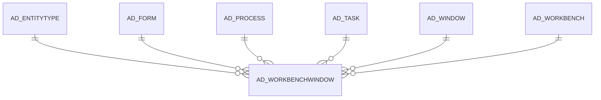

# AD_WORKBENCHWINDOW

Area [AD](../../data-model/ad/index.md) · class **config** (proposed) · read from database `idempiere-db` (owner `ADEMPIERE`) · 2 row(s) when profiled

## Columns

| column | type | key | not null | business name | references (code) | nulls | distinct |
|---|---|---|---|---|---|---|---|
| `AD_WORKBENCHWINDOW_ID` | NUMBER(10,0) | PK | yes |  |  | 0 | 2 |
| `AD_CLIENT_ID` | NUMBER(10,0) |  | yes |  |  | 0 | 1 |
| `AD_ORG_ID` | NUMBER(10,0) |  | yes |  |  | 0 | 1 |
| `ISACTIVE` | CHAR(1) |  | yes |  |  | 0 | 1 |
| `CREATED` | DATE |  | yes |  |  | 0 | 2 |
| `CREATEDBY` | NUMBER(10,0) |  | yes |  |  | 0 | 1 |
| `UPDATED` | DATE |  | yes |  |  | 0 | 1 |
| `UPDATEDBY` | NUMBER(10,0) |  | yes |  |  | 0 | 1 |
| `AD_WORKBENCH_ID` | NUMBER(10,0) |  | yes |  |  | 0 | 1 |
| `SEQNO` | NUMBER(10,0) |  | yes |  |  | 0 | 2 |
| `ISPRIMARY` | CHAR(1) |  | yes |  |  | 0 | 2 |
| `AD_WINDOW_ID` | NUMBER(10,0) |  |  |  |  | 0 | 2 |
| `AD_FORM_ID` | NUMBER(10,0) |  |  |  |  | 2 | 0 |
| `AD_PROCESS_ID` | NUMBER(10,0) |  |  |  |  | 2 | 0 |
| `AD_TASK_ID` | NUMBER(10,0) |  |  |  |  | 2 | 0 |
| `ENTITYTYPE` | VARCHAR2(40 CHAR) |  | yes |  |  | 0 | 1 |
| `AD_WORKBENCHWINDOW_UU` | VARCHAR2(36 CHAR) |  |  |  |  | 0 | 2 |

*references (code)* is the table the application model's code says a column points to; *Foreign keys* below are the constraints the database declares. Counts come from the profile; no value is ever shown.

## Check constraints

| name | expression |
|---|---|
| `SYS_C0020251` | `IsActive in ('Y','N')` |
| `SYS_C0020252` | `IsPrimary in ('Y','N')` |

## Foreign keys

**References**

| table | columns | on delete |
|---|---|---|
| [AD_ENTITYTYPE](../../data-model/ad/ad_entitytype.md) | AD_WORKBENCHWINDOW.ENTITYTYPE → AD_ENTITYTYPE.ENTITYTYPE | NO ACTION |
| [AD_FORM](../../data-model/ad/ad_form.md) | AD_WORKBENCHWINDOW.AD_FORM_ID → AD_FORM.AD_FORM_ID | NO ACTION |
| [AD_PROCESS](../../data-model/ad/ad_process.md) | AD_WORKBENCHWINDOW.AD_PROCESS_ID → AD_PROCESS.AD_PROCESS_ID | NO ACTION |
| [AD_TASK](../../data-model/ad/ad_task.md) | AD_WORKBENCHWINDOW.AD_TASK_ID → AD_TASK.AD_TASK_ID | NO ACTION |
| [AD_WINDOW](../../data-model/ad/ad_window.md) | AD_WORKBENCHWINDOW.AD_WINDOW_ID → AD_WINDOW.AD_WINDOW_ID | NO ACTION |
| [AD_WORKBENCH](../../data-model/ad/ad_workbench.md) | AD_WORKBENCHWINDOW.AD_WORKBENCH_ID → AD_WORKBENCH.AD_WORKBENCH_ID | NO ACTION |

**Referenced by**

_None._

## Write behaviour

- updates: **po_only**
- deletes: **deleted_by_users**
- change log: **recorded**
- evidence: 1 citation(s)

## Schema history

18 change(s); the latest:

| applied | release | operation | column | tickets |
|---|---|---|---|---|
| 2023-04-09T15:47 | iD11 | `add_constraint` |  | IDEMPIERE-5567 |
| 2023-04-09T15:47 | iD11 | `add_constraint` |  | IDEMPIERE-5567 |
| 2021-12-05T16:45 | i8.2z | `drop_constraint` |  | IDEMPIERE-5075 |
| 2021-12-05T16:45 | i8.2z | `add_constraint` |  | IDEMPIERE-5075 |
| 2021-12-05T16:45 | i8.2z | `add_constraint` |  | IDEMPIERE-5075 |
| 2021-12-05T16:45 | i8.2z | `add_constraint` |  | IDEMPIERE-5075 |
| 2021-12-05T16:45 | i8.2z | `add_constraint` |  | IDEMPIERE-5075 |
| 2021-12-05T16:45 | i8.2z | `drop_constraint` |  | IDEMPIERE-5075 |
| 2021-12-05T16:45 | i8.2z | `drop_constraint` |  | IDEMPIERE-5075 |
| 2021-12-05T16:45 | i8.2z | `drop_constraint` |  | IDEMPIERE-5075 |
| 2021-12-05T16:45 | i8.2z | `drop_constraint` |  | IDEMPIERE-5075 |
| 2021-12-05T16:45 | i8.2z | `drop_constraint` |  | IDEMPIERE-5075 |
| 2021-12-05T16:45 | i8.2z | `add_constraint` |  | IDEMPIERE-5075 |
| 2021-12-05T16:45 | i8.2z | `add_constraint` |  | IDEMPIERE-5075 |
| 2020-08-04T01:00 | i7.1z | `modify_column` | AD_WORKBENCHWINDOW_UU | IDEMPIERE-3862 |

## Open conflicts

| type | attribute | explanation |
|---|---|---|
| `table_without_model` | `model_class` | unexplained |

## Notes

<!-- ekos:manual id="table.ad_workbenchwindow.notes" -->
_Business notes about this table._
<!-- /ekos:manual -->
