# AD_WORKFLOW

Area [AD](../../data-model/ad/index.md) · class **config** (proposed) · read from database `idempiere-db` (owner `ADEMPIERE`) · 58 row(s) when profiled

Application model: `org.compiere.model.X_AD_Workflow`, access level 6 - System - Client.

## Columns

| column | type | key | not null | business name | references (code) | nulls | distinct |
|---|---|---|---|---|---|---|---|
| `AD_WORKFLOW_ID` | NUMBER(10,0) | PK | yes | Workflow |  | 0 | 58 |
| `AD_CLIENT_ID` | NUMBER(10,0) |  | yes | Tenant |  | 0 | 2 |
| `AD_ORG_ID` | NUMBER(10,0) |  | yes | Organization |  | 0 | 1 |
| `ISACTIVE` | CHAR(1) |  | yes | Active |  | 0 | 2 |
| `CREATED` | DATE |  | yes | Created |  | 0 | 58 |
| `CREATEDBY` | NUMBER(10,0) |  | yes | Created By |  | 0 | 2 |
| `UPDATED` | DATE |  | yes | Updated |  | 0 | 48 |
| `UPDATEDBY` | NUMBER(10,0) |  | yes | Updated By |  | 0 | 2 |
| `NAME` | VARCHAR2(60 CHAR) |  | yes | Name |  | 0 | 58 |
| `DESCRIPTION` | VARCHAR2(255 CHAR) |  |  | Description |  | 10 | 47 |
| `ACCESSLEVEL` | CHAR(1) |  | yes | Data Access Level |  | 0 | 5 |
| `AD_WF_NODE_ID` | NUMBER(10,0) |  |  | Node | [AD_WF_NODE](../../data-model/ad/ad_wf_node.md) | 4 | 54 |
| `ENTITYTYPE` | VARCHAR2(40 CHAR) |  | yes | Entity Type |  | 0 | 4 |
| `DURATIONUNIT` | CHAR(1) |  |  | Duration Unit |  | 14 | 3 |
| `AUTHOR` | VARCHAR2(20 CHAR) |  | yes | Author |  | 0 | 8 |
| `VERSION` | NUMBER(10,0) |  | yes | Version |  | 0 | 2 |
| `VALIDFROM` | DATE |  |  | Valid from |  | 58 | 0 |
| `VALIDTO` | DATE |  |  | Valid to |  | 58 | 0 |
| `PRIORITY` | NUMBER(10,0) |  |  | Priority |  | 27 | 1 |
| `LIMIT` | NUMBER(10,0) |  |  | Duration Limit |  | 27 | 2 |
| `DURATION` | NUMBER(10,0) |  | yes | Duration |  | 0 | 2 |
| `COST` | NUMBER |  | yes | Cost |  | 0 | 1 |
| `WORKINGTIME` | NUMBER(10,0) |  | yes | Working Time |  | 0 | 1 |
| `WAITINGTIME` | NUMBER(10,0) |  | yes | Waiting Time |  | 0 | 1 |
| `AD_WF_RESPONSIBLE_ID` | NUMBER(10,0) |  |  | Workflow Responsible | [AD_WF_RESPONSIBLE](../../data-model/ad/ad_wf_responsible.md) | 56 | 2 |
| `PUBLISHSTATUS` | CHAR(1) |  | yes | Publication Status |  | 0 | 4 |
| `AD_WORKFLOWPROCESSOR_ID` | NUMBER(10,0) |  |  | Workflow Processor | [AD_WORKFLOWPROCESSOR](../../data-model/ad/ad_workflowprocessor.md) | 58 | 0 |
| `VALUE` | VARCHAR2(40 CHAR) |  | yes | Search Key |  | 0 | 58 |
| `ISDEFAULT` | CHAR(1) |  | yes | Default |  | 0 | 1 |
| `AD_TABLE_ID` | NUMBER(10,0) |  |  | Table | [AD_TABLE](../../data-model/ad/ad_table.md) | 28 | 30 |
| `VALIDATEWORKFLOW` | CHAR(1) |  |  | Validate Workflow |  | 51 | 1 |
| `WORKFLOWTYPE` | CHAR(1) |  | yes | Workflow Type |  | 0 | 4 |
| `DOCVALUELOGIC` | VARCHAR2(2000 CHAR) |  |  | Document Value Logic |  | 57 | 1 |
| `ISVALID` | CHAR(1) |  | yes | Valid |  | 0 | 2 |
| `S_RESOURCE_ID` | NUMBER(10,0) |  |  | Resource | [S_RESOURCE](../../data-model/s/s_resource.md) | 57 | 1 |
| `SETUPTIME` | NUMBER(10,0) |  |  | Setup Time |  | 53 | 1 |
| `MOVINGTIME` | NUMBER(10,0) |  |  | Moving Time |  | 53 | 1 |
| `PROCESSTYPE` | CHAR(2) |  |  | Process Type |  | 54 | 3 |
| `DOCUMENTNO` | VARCHAR2(30 CHAR) |  |  | Document No |  | 34 | 8 |
| `QTYBATCHSIZE` | NUMBER |  |  | Qty Batch Size |  | 0 | 3 |
| `QUEUINGTIME` | NUMBER(10,0) |  |  | Queuing Time |  | 53 | 1 |
| `ISBETAFUNCTIONALITY` | CHAR(1) |  | yes | Beta Functionality |  | 0 | 2 |
| `YIELD` | NUMBER(10,0) |  |  | Yield % |  | 49 | 1 |
| `UNITSCYCLES` | NUMBER |  |  | Units by Cycles |  | 57 | 1 |
| `OVERLAPUNITS` | NUMBER |  |  | Overlap Units |  | 57 | 1 |
| `AD_WORKFLOW_UU` | VARCHAR2(36 CHAR) |  |  | AD_Workflow_UU |  | 0 | 58 |
| `HELP` | CLOB |  |  | Comment/Help |  | 37 | 0 |
| `AD_CTXHELP_ID` | NUMBER(10,0) |  |  | Context Help | [AD_CTXHELP](../../data-model/ad/ad_ctxhelp.md) | 58 | 0 |

*references (code)* is the table the application model's code says a column points to; *Foreign keys* below are the constraints the database declares. Counts come from the profile; no value is ever shown.

## Check constraints

| name | expression |
|---|---|
| `SYS_C0021224` | `IsActive in ('Y','N')` |
| `SYS_C0021225` | `IsBetaFunctionality IN ('Y','N')` |

## Foreign keys

**References**

| table | columns | on delete |
|---|---|---|
| [AD_CLIENT](../../data-model/ad/ad_client.md) | AD_WORKFLOW.AD_CLIENT_ID → AD_CLIENT.AD_CLIENT_ID | NO ACTION |
| [AD_CTXHELP](../../data-model/ad/ad_ctxhelp.md) | AD_WORKFLOW.AD_CTXHELP_ID → AD_CTXHELP.AD_CTXHELP_ID | NO ACTION |
| [AD_ENTITYTYPE](../../data-model/ad/ad_entitytype.md) | AD_WORKFLOW.ENTITYTYPE → AD_ENTITYTYPE.ENTITYTYPE | NO ACTION |
| [AD_ORG](../../data-model/ad/ad_org.md) | AD_WORKFLOW.AD_ORG_ID → AD_ORG.AD_ORG_ID | NO ACTION |
| [AD_TABLE](../../data-model/ad/ad_table.md) | AD_WORKFLOW.AD_TABLE_ID → AD_TABLE.AD_TABLE_ID | NO ACTION |
| [AD_WF_NODE](../../data-model/ad/ad_wf_node.md) | AD_WORKFLOW.AD_WF_NODE_ID → AD_WF_NODE.AD_WF_NODE_ID | NO ACTION |
| [AD_WF_RESPONSIBLE](../../data-model/ad/ad_wf_responsible.md) | AD_WORKFLOW.AD_WF_RESPONSIBLE_ID → AD_WF_RESPONSIBLE.AD_WF_RESPONSIBLE_ID | NO ACTION |
| [AD_WORKFLOWPROCESSOR](../../data-model/ad/ad_workflowprocessor.md) | AD_WORKFLOW.AD_WORKFLOWPROCESSOR_ID → AD_WORKFLOWPROCESSOR.AD_WORKFLOWPROCESSOR_ID | SET NULL |
| [S_RESOURCE](../../data-model/s/s_resource.md) | AD_WORKFLOW.S_RESOURCE_ID → S_RESOURCE.S_RESOURCE_ID | NO ACTION |

**Referenced by**

| table | columns | on delete |
|---|---|---|
| [AD_MENU](../../data-model/ad/ad_menu.md) | AD_MENU.AD_WORKFLOW_ID → AD_WORKFLOW.AD_WORKFLOW_ID | NO ACTION |
| [AD_PACKAGE_EXP_COMMON](../../data-model/ad/ad_package_exp_common.md) | AD_PACKAGE_EXP_COMMON.AD_WORKFLOW_ID → AD_WORKFLOW.AD_WORKFLOW_ID | NO ACTION |
| [AD_PACKAGE_EXP_DETAIL](../../data-model/ad/ad_package_exp_detail.md) | AD_PACKAGE_EXP_DETAIL.AD_WORKFLOW_ID → AD_WORKFLOW.AD_WORKFLOW_ID | NO ACTION |
| [AD_PROCESS](../../data-model/ad/ad_process.md) | AD_PROCESS.AD_WORKFLOW_ID → AD_WORKFLOW.AD_WORKFLOW_ID | NO ACTION |
| [AD_WF_ACTIVITY](../../data-model/ad/ad_wf_activity.md) | AD_WF_ACTIVITY.AD_WORKFLOW_ID → AD_WORKFLOW.AD_WORKFLOW_ID | NO ACTION |
| [AD_WF_BLOCK](../../data-model/ad/ad_wf_block.md) | AD_WF_BLOCK.AD_WORKFLOW_ID → AD_WORKFLOW.AD_WORKFLOW_ID | CASCADE |
| [AD_WF_NODE](../../data-model/ad/ad_wf_node.md) | AD_WF_NODE.AD_WORKFLOW_ID → AD_WORKFLOW.AD_WORKFLOW_ID | CASCADE |
| [AD_WF_PROCESS](../../data-model/ad/ad_wf_process.md) | AD_WF_PROCESS.AD_WORKFLOW_ID → AD_WORKFLOW.AD_WORKFLOW_ID | CASCADE |
| [AD_WORKFLOW_ACCESS](../../data-model/ad/ad_workflow_access.md) | AD_WORKFLOW_ACCESS.AD_WORKFLOW_ID → AD_WORKFLOW.AD_WORKFLOW_ID | CASCADE |
| [AD_WORKFLOW_TRL](../../data-model/ad/ad_workflow_trl.md) | AD_WORKFLOW_TRL.AD_WORKFLOW_ID → AD_WORKFLOW.AD_WORKFLOW_ID | CASCADE |
| [ASP_CLIENTEXCEPTION](../../data-model/asp/asp_clientexception.md) | ASP_CLIENTEXCEPTION.AD_WORKFLOW_ID → AD_WORKFLOW.AD_WORKFLOW_ID | NO ACTION |
| [ASP_WORKFLOW](../../data-model/asp/asp_workflow.md) | ASP_WORKFLOW.AD_WORKFLOW_ID → AD_WORKFLOW.AD_WORKFLOW_ID | NO ACTION |
| [HR_PROCESS](../../data-model/hr/hr_process.md) | HR_PROCESS.AD_WORKFLOW_ID → AD_WORKFLOW.AD_WORKFLOW_ID | NO ACTION |
| `I_PRODUCTPLANNING` | I_PRODUCTPLANNING.AD_WORKFLOW_ID → AD_WORKFLOW.AD_WORKFLOW_ID | NO ACTION |
| [PP_ORDER](../../data-model/pp/pp_order.md) | PP_ORDER.AD_WORKFLOW_ID → AD_WORKFLOW.AD_WORKFLOW_ID | NO ACTION |
| [PP_ORDER_COST](../../data-model/pp/pp_order_cost.md) | PP_ORDER_COST.AD_WORKFLOW_ID → AD_WORKFLOW.AD_WORKFLOW_ID | NO ACTION |
| [PP_ORDER_NODE](../../data-model/pp/pp_order_node.md) | PP_ORDER_NODE.AD_WORKFLOW_ID → AD_WORKFLOW.AD_WORKFLOW_ID | NO ACTION |
| [PP_ORDER_WORKFLOW](../../data-model/pp/pp_order_workflow.md) | PP_ORDER_WORKFLOW.AD_WORKFLOW_ID → AD_WORKFLOW.AD_WORKFLOW_ID | NO ACTION |
| [PP_PRODUCT_PLANNING](../../data-model/pp/pp_product_planning.md) | PP_PRODUCT_PLANNING.AD_WORKFLOW_ID → AD_WORKFLOW.AD_WORKFLOW_ID | NO ACTION |
| [QM_SPECIFICATION](../../data-model/qm/qm_specification.md) | QM_SPECIFICATION.AD_WORKFLOW_ID → AD_WORKFLOW.AD_WORKFLOW_ID | NO ACTION |

```mermaid
erDiagram
  AD_CLIENT ||--o{ AD_WORKFLOW : ""
  AD_CTXHELP ||--o{ AD_WORKFLOW : ""
  AD_ENTITYTYPE ||--o{ AD_WORKFLOW : ""
  AD_ORG ||--o{ AD_WORKFLOW : ""
  AD_TABLE ||--o{ AD_WORKFLOW : ""
  AD_WF_NODE ||--o{ AD_WORKFLOW : ""
  AD_WF_RESPONSIBLE ||--o{ AD_WORKFLOW : ""
  AD_WORKFLOW ||--o{ AD_MENU : ""
  AD_WORKFLOW ||--o{ AD_PACKAGE_EXP_COMMON : ""
  AD_WORKFLOW ||--o{ AD_PACKAGE_EXP_DETAIL : ""
  AD_WORKFLOW ||--o{ AD_PROCESS : ""
  AD_WORKFLOW ||--o{ AD_WF_ACTIVITY : ""
  AD_WORKFLOW ||--o{ AD_WF_BLOCK : ""
  AD_WORKFLOW ||--o{ AD_WF_NODE : ""
  AD_WORKFLOW ||--o{ AD_WF_PROCESS : ""
  AD_WORKFLOW ||--o{ AD_WORKFLOW_ACCESS : ""
  AD_WORKFLOW ||--o{ AD_WORKFLOW_TRL : ""
  AD_WORKFLOW ||--o{ ASP_CLIENTEXCEPTION : ""
  AD_WORKFLOW ||--o{ ASP_WORKFLOW : ""
  AD_WORKFLOW ||--o{ HR_PROCESS : ""
  AD_WORKFLOW ||--o{ I_PRODUCTPLANNING : ""
  AD_WORKFLOW ||--o{ PP_ORDER : ""
  AD_WORKFLOW ||--o{ PP_ORDER_COST : ""
  AD_WORKFLOW ||--o{ PP_ORDER_NODE : ""
  AD_WORKFLOW ||--o{ PP_ORDER_WORKFLOW : ""
  AD_WORKFLOW ||--o{ PP_PRODUCT_PLANNING : ""
  AD_WORKFLOW ||--o{ QM_SPECIFICATION : ""
  AD_WORKFLOWPROCESSOR ||--o{ AD_WORKFLOW : ""
  S_RESOURCE ||--o{ AD_WORKFLOW : ""
```

## Write behaviour

- updates: **raw_sql_skips_updated**
- deletes: **deleted_by_users**
- change log: **recorded**
- evidence: 2 citation(s)

## Read by

| kind | name |
|---|---|
| Procedure | [AD_Synchronize](../../logic/ad_synchronize.md) |

## Schema history

51 change(s); the latest:

| applied | release | operation | column | tickets |
|---|---|---|---|---|
| 2023-04-09T15:47 | iD11 | `add_constraint` |  | IDEMPIERE-5567 |
| 2023-04-09T15:47 | iD11 | `add_constraint` |  | IDEMPIERE-5567 |
| 2021-12-05T16:45 | i8.2z | `add_constraint` |  | IDEMPIERE-5075 |
| 2021-12-05T16:45 | i8.2z | `drop_constraint` |  | IDEMPIERE-5075 |
| 2021-12-05T16:45 | i8.2z | `add_constraint` |  | IDEMPIERE-5075 |
| 2021-12-05T16:45 | i8.2z | `drop_constraint` |  | IDEMPIERE-5075 |
| 2021-12-05T16:45 | i8.2z | `add_constraint` |  | IDEMPIERE-5075 |
| 2021-12-05T16:45 | i8.2z | `drop_constraint` |  | IDEMPIERE-5075 |
| 2021-12-05T16:45 | i8.2z | `drop_constraint` |  | IDEMPIERE-5075 |
| 2021-12-05T16:45 | i8.2z | `drop_constraint` |  | IDEMPIERE-5075 |
| 2021-12-05T16:45 | i8.2z | `drop_constraint` |  | IDEMPIERE-5075 |
| 2021-12-05T16:45 | i8.2z | `add_constraint` |  | IDEMPIERE-5075 |
| 2021-12-05T16:45 | i8.2z | `add_constraint` |  | IDEMPIERE-5075 |
| 2021-12-05T16:45 | i8.2z | `drop_constraint` |  | IDEMPIERE-5075 |
| 2021-12-05T16:45 | i8.2z | `drop_constraint` |  | IDEMPIERE-5075 |

## Notes

<!-- ekos:manual id="table.ad_workflow.notes" -->
_Business notes about this table._
<!-- /ekos:manual -->
