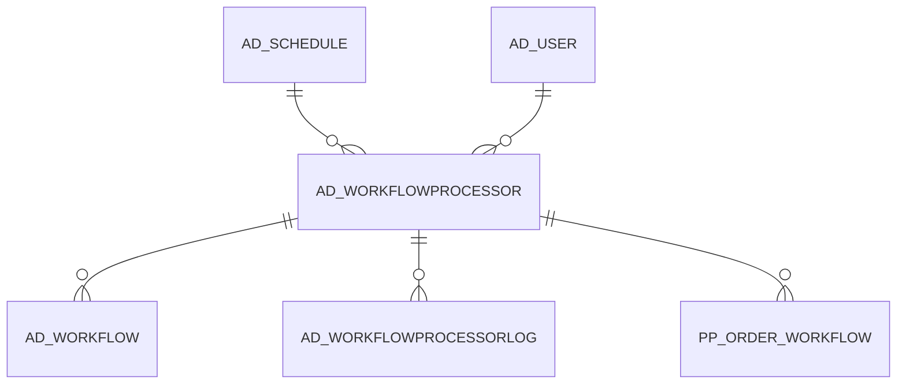

# AD_WORKFLOWPROCESSOR

Area [AD](../../data-model/ad/index.md) · class **config** (proposed) · read from database `idempiere-db` (owner `ADEMPIERE`) · 1 row(s) when profiled

Application model: `org.compiere.model.X_AD_WorkflowProcessor`, access level 6 - System - Client.

## Columns

| column | type | key | not null | business name | references (code) | nulls | distinct |
|---|---|---|---|---|---|---|---|
| `AD_WORKFLOWPROCESSOR_ID` | NUMBER(10,0) | PK | yes | Workflow Processor |  | 0 | 1 |
| `AD_CLIENT_ID` | NUMBER(10,0) |  | yes | Tenant |  | 0 | 1 |
| `AD_ORG_ID` | NUMBER(10,0) |  | yes | Organization |  | 0 | 1 |
| `ISACTIVE` | CHAR(1) |  | yes | Active |  | 0 | 1 |
| `CREATED` | DATE |  | yes | Created |  | 0 | 1 |
| `CREATEDBY` | NUMBER(10,0) |  | yes | Created By |  | 0 | 1 |
| `UPDATED` | DATE |  | yes | Updated |  | 0 | 1 |
| `UPDATEDBY` | NUMBER(10,0) |  | yes | Updated By |  | 0 | 1 |
| `NAME` | VARCHAR2(60 CHAR) |  | yes | Name |  | 0 | 1 |
| `DESCRIPTION` | VARCHAR2(255 CHAR) |  |  | Description |  | 1 | 0 |
| `FREQUENCYTYPE` | CHAR(1) |  |  |  |  | 0 | 1 |
| `FREQUENCY` | NUMBER(10,0) |  |  |  |  | 0 | 1 |
| `DATELASTRUN` | DATE |  |  | Date Last Run |  | 0 | 1 |
| `DATENEXTRUN` | DATE |  |  | Date Next Run |  | 0 | 1 |
| `SUPERVISOR_ID` | NUMBER(10,0) |  | yes | Supervisor | [AD_USER](../../data-model/ad/ad_user.md) | 0 | 1 |
| `KEEPLOGDAYS` | NUMBER(10,0) |  | yes | Days to keep Log |  | 0 | 1 |
| `PROCESSING` | CHAR(1) |  |  | Process Now |  | 0 | 1 |
| `INACTIVITYALERTDAYS` | NUMBER(10,0) |  |  | Inactivity Alert Days |  | 0 | 1 |
| `REMINDDAYS` | NUMBER(10,0) |  |  | Reminder Days |  | 0 | 1 |
| `ALERTOVERPRIORITY` | NUMBER(10,0) |  |  | Alert over Priority |  | 1 | 0 |
| `AD_WORKFLOWPROCESSOR_UU` | VARCHAR2(36 CHAR) |  |  | AD_WorkflowProcessor_UU |  | 0 | 1 |
| `AD_SCHEDULE_ID` | NUMBER(10,0) |  | yes | Schedule | [AD_SCHEDULE](../../data-model/ad/ad_schedule.md) | 0 | 1 |

*references (code)* is the table the application model's code says a column points to; *Foreign keys* below are the constraints the database declares. Counts come from the profile; no value is ever shown.

## Foreign keys

**References**

| table | columns | on delete |
|---|---|---|
| [AD_SCHEDULE](../../data-model/ad/ad_schedule.md) | AD_WORKFLOWPROCESSOR.AD_SCHEDULE_ID → AD_SCHEDULE.AD_SCHEDULE_ID | NO ACTION |
| [AD_USER](../../data-model/ad/ad_user.md) | AD_WORKFLOWPROCESSOR.SUPERVISOR_ID → AD_USER.AD_USER_ID | NO ACTION |

**Referenced by**

| table | columns | on delete |
|---|---|---|
| [AD_WORKFLOW](../../data-model/ad/ad_workflow.md) | AD_WORKFLOW.AD_WORKFLOWPROCESSOR_ID → AD_WORKFLOWPROCESSOR.AD_WORKFLOWPROCESSOR_ID | SET NULL |
| `AD_WORKFLOWPROCESSORLOG` | AD_WORKFLOWPROCESSORLOG.AD_WORKFLOWPROCESSOR_ID → AD_WORKFLOWPROCESSOR.AD_WORKFLOWPROCESSOR_ID | CASCADE |
| [PP_ORDER_WORKFLOW](../../data-model/pp/pp_order_workflow.md) | PP_ORDER_WORKFLOW.AD_WORKFLOWPROCESSOR_ID → AD_WORKFLOWPROCESSOR.AD_WORKFLOWPROCESSOR_ID | NO ACTION |

## Write behaviour

- updates: **po_only**
- deletes: **deleted_by_users**
- change log: **recorded**
- evidence: 1 citation(s)

## Schema history

17 change(s); the latest:

| applied | release | operation | column | tickets |
|---|---|---|---|---|
| 2023-04-09T15:47 | iD11 | `add_constraint` |  | IDEMPIERE-5567 |
| 2023-04-09T15:47 | iD11 | `add_constraint` |  | IDEMPIERE-5567 |
| 2021-12-05T16:45 | i8.2z | `drop_constraint` |  | IDEMPIERE-5075 |
| 2021-12-05T16:45 | i8.2z | `add_constraint` |  | IDEMPIERE-5075 |
| 2021-12-05T16:45 | i8.2z | `add_constraint` |  | IDEMPIERE-5075 |
| 2021-12-05T16:45 | i8.2z | `drop_constraint` |  | IDEMPIERE-5075 |
| 2020-08-04T01:00 | i7.1z | `drop_column` | tmp_col_3_tmp | IDEMPIERE-3862 |
| 2020-08-04T01:00 | i7.1z | `drop_column` | tmp_col_2_tmp | IDEMPIERE-3862 |
| 2020-08-04T01:00 | i7.1z | `drop_column` | tmp_col_1_tmp | IDEMPIERE-3862 |
| 2020-08-04T01:00 | i7.1z | `modify_column` | DESCRIPTION | IDEMPIERE-3862 |
| 2020-08-04T01:00 | i7.1z | `modify_column` | NAME | IDEMPIERE-3862 |
| 2020-08-04T01:00 | i7.1z | `modify_column` | NAME | IDEMPIERE-3862 |
| 2020-08-04T01:00 | i7.1z | `modify_column` | NAME | IDEMPIERE-3862 |
| 2020-08-04T01:00 | i7.1z | `add_column` | tmp_col_2_tmp | IDEMPIERE-3862 |
| 2020-08-04T01:00 | i7.1z | `add_column` | tmp_col_1_tmp | IDEMPIERE-3862 |

## Notes

<!-- ekos:manual id="table.ad_workflowprocessor.notes" -->
_Business notes about this table._
<!-- /ekos:manual -->
