# Area AD

260 table(s), 252 in scope.

```mermaid
erDiagram
  AD_CLIENT ||--o{ AD_COLUMN : ""
  AD_CLIENT ||--o{ AD_FIELD : ""
  AD_CLIENT ||--o{ AD_LANGUAGE : ""
  AD_CLIENT ||--o{ AD_MENU : ""
  AD_CLIENT ||--o{ AD_MESSAGE : ""
  AD_CLIENT ||--o{ AD_ORG : ""
  AD_CLIENT ||--o{ AD_REFERENCE : ""
  AD_CLIENT ||--o{ AD_ROLE : ""
  AD_CLIENT ||--o{ AD_TAB : ""
  AD_CLIENT ||--o{ AD_TABLE : ""
  AD_CLIENT ||--o{ AD_TASK : ""
  AD_CLIENT ||--o{ AD_USER : ""
  AD_CLIENT ||--o{ AD_VAL_RULE : ""
  AD_CLIENT ||--o{ AD_WF_NODE : ""
  AD_CLIENT ||--o{ AD_WF_PROCESS : ""
  AD_CLIENT ||--o{ AD_WINDOW : ""
  AD_CLIENT ||--o{ AD_WORKFLOW : ""
  AD_COLUMN ||--o{ AD_FIELD : ""
  AD_COLUMN ||--o{ AD_TAB : ""
  AD_COLUMN ||--o{ AD_TREE : ""
  AD_COLUMN ||--o{ AD_WF_NODE : ""
  AD_ENTITYTYPE ||--o{ AD_COLUMN : ""
  AD_ENTITYTYPE ||--o{ AD_FIELD : ""
  AD_ENTITYTYPE ||--o{ AD_FORM : ""
  AD_ENTITYTYPE ||--o{ AD_IMAGE : ""
  AD_ENTITYTYPE ||--o{ AD_INFOCOLUMN : ""
  AD_ENTITYTYPE ||--o{ AD_INFOWINDOW : ""
  AD_ENTITYTYPE ||--o{ AD_MENU : ""
  AD_ENTITYTYPE ||--o{ AD_MESSAGE : ""
  AD_ENTITYTYPE ||--o{ AD_PACKAGE_EXP_DETAIL : ""
  AD_ENTITYTYPE ||--o{ AD_PROCESS : ""
  AD_ENTITYTYPE ||--o{ AD_PROCESS_PARA : ""
  AD_ENTITYTYPE ||--o{ AD_REFERENCE : ""
  AD_ENTITYTYPE ||--o{ AD_STYLE : ""
  AD_ENTITYTYPE ||--o{ AD_TAB : ""
  AD_ENTITYTYPE ||--o{ AD_TABLE : ""
  AD_ENTITYTYPE ||--o{ AD_TASK : ""
  AD_ENTITYTYPE ||--o{ AD_VAL_RULE : ""
  AD_ENTITYTYPE ||--o{ AD_WF_NODE : ""
  AD_ENTITYTYPE ||--o{ AD_WINDOW : ""
  AD_ENTITYTYPE ||--o{ AD_WORKFLOW : ""
  AD_FORM ||--o{ AD_MENU : ""
  AD_FORM ||--o{ AD_PACKAGE_EXP_COMMON : ""
  AD_FORM ||--o{ AD_PACKAGE_EXP_DETAIL : ""
  AD_FORM ||--o{ AD_PROCESS : ""
  AD_FORM ||--o{ AD_WF_NODE : ""
  AD_IMAGE ||--o{ AD_TAB : ""
  AD_IMAGE ||--o{ AD_USER : ""
  AD_IMAGE ||--o{ AD_WF_NODE : ""
  AD_IMAGE ||--o{ AD_WINDOW : ""
  AD_INFOWINDOW ||--o{ AD_COLUMN : ""
  AD_INFOWINDOW ||--o{ AD_INFOCOLUMN : ""
  AD_INFOWINDOW ||--o{ AD_MENU : ""
  AD_INFOWINDOW ||--o{ AD_PACKAGE_EXP_DETAIL : ""
  AD_INFOWINDOW ||--o{ AD_WF_NODE : ""
  AD_LANGUAGE ||--o{ AD_CLIENT : ""
  AD_MENU ||--o{ AD_PACKAGE_EXP_COMMON : ""
  AD_MENU ||--o{ AD_PACKAGE_EXP_DETAIL : ""
  AD_MESSAGE ||--o{ AD_COLUMN : ""
  AD_MESSAGE ||--o{ AD_PACKAGE_EXP_DETAIL : ""
  AD_MESSAGE ||--o{ AD_WF_PROCESS : ""
  AD_ORG ||--o{ AD_COLUMN : ""
  AD_ORG ||--o{ AD_FIELD : ""
  AD_ORG ||--o{ AD_LANGUAGE : ""
  AD_ORG ||--o{ AD_MENU : ""
  AD_ORG ||--o{ AD_MESSAGE : ""
  AD_ORG ||--o{ AD_REFERENCE : ""
  AD_ORG ||--o{ AD_ROLE : ""
  AD_ORG ||--o{ AD_TAB : ""
  AD_ORG ||--o{ AD_TABLE : ""
  AD_ORG ||--o{ AD_TASK : ""
  AD_ORG ||--o{ AD_USER : ""
  AD_ORG ||--o{ AD_VAL_RULE : ""
  AD_ORG ||--o{ AD_WF_NODE : ""
  AD_ORG ||--o{ AD_WF_PROCESS : ""
  AD_ORG ||--o{ AD_WINDOW : ""
  AD_ORG ||--o{ AD_WORKFLOW : ""
  AD_PRINTFORMAT ||--o{ AD_PACKAGE_EXP_DETAIL : ""
  AD_PRINTFORMAT ||--o{ AD_PROCESS : ""
  AD_PROCESS ||--o{ AD_COLUMN : ""
  AD_PROCESS ||--o{ AD_INFOWINDOW : ""
  AD_PROCESS ||--o{ AD_MENU : ""
  AD_PROCESS ||--o{ AD_PACKAGE_EXP_COMMON : ""
  AD_PROCESS ||--o{ AD_PACKAGE_EXP_DETAIL : ""
  AD_PROCESS ||--o{ AD_PRINTFORMAT : ""
  AD_PROCESS ||--o{ AD_PROCESS_PARA : ""
  AD_PROCESS ||--o{ AD_TAB : ""
  AD_PROCESS ||--o{ AD_WF_NODE : ""
  AD_REFERENCE ||--o{ AD_COLUMN : ""
  AD_REFERENCE ||--o{ AD_FIELD : ""
  AD_REFERENCE ||--o{ AD_INFOCOLUMN : ""
  AD_REFERENCE ||--o{ AD_PACKAGE_EXP_DETAIL : ""
  AD_REFERENCE ||--o{ AD_PROCESS_PARA : ""
  AD_ROLE ||--o{ AD_PACKAGE_EXP_COMMON : ""
  AD_ROLE ||--o{ AD_PACKAGE_EXP_DETAIL : ""
  AD_STYLE ||--o{ AD_FIELD : ""
  AD_STYLE ||--o{ AD_INFOCOLUMN : ""
  AD_TAB ||--o{ AD_FIELD : ""
  AD_TAB ||--o{ AD_TAB : ""
  AD_TABLE ||--o{ AD_COLUMN : ""
  AD_TABLE ||--o{ AD_INFOWINDOW : ""
  AD_TABLE ||--o{ AD_PACKAGE_EXP_COMMON : ""
  AD_TABLE ||--o{ AD_PACKAGE_EXP_DETAIL : ""
  AD_TABLE ||--o{ AD_PRINTFORMAT : ""
  AD_TABLE ||--o{ AD_TAB : ""
  AD_TABLE ||--o{ AD_TREE : ""
  AD_TABLE ||--o{ AD_WF_PROCESS : ""
  AD_TABLE ||--o{ AD_WORKFLOW : ""
  AD_TASK ||--o{ AD_MENU : ""
  AD_TASK ||--o{ AD_WF_NODE : ""
  AD_TREE ||--o{ AD_ROLE : ""
  AD_USER ||--o{ AD_ROLE : ""
  AD_USER ||--o{ AD_USER : ""
  AD_USER ||--o{ AD_WF_PROCESS : ""
  AD_VAL_RULE ||--o{ AD_COLUMN : ""
  AD_VAL_RULE ||--o{ AD_FIELD : ""
  AD_VAL_RULE ||--o{ AD_INFOCOLUMN : ""
  AD_VAL_RULE ||--o{ AD_PACKAGE_EXP_DETAIL : ""
  AD_VAL_RULE ||--o{ AD_PROCESS_PARA : ""
  AD_VAL_RULE ||--o{ AD_TABLE : ""
  AD_WF_NODE ||--o{ AD_WORKFLOW : ""
  AD_WF_PROCESS ||--o{ AD_WF_PROCESS : ""
  AD_WINDOW ||--o{ AD_INFOWINDOW : ""
  AD_WINDOW ||--o{ AD_MENU : ""
  AD_WINDOW ||--o{ AD_PACKAGE_EXP_COMMON : ""
  AD_WINDOW ||--o{ AD_PACKAGE_EXP_DETAIL : ""
  AD_WINDOW ||--o{ AD_PRINTFORMAT : ""
  AD_WINDOW ||--o{ AD_TAB : ""
  AD_WINDOW ||--o{ AD_TABLE : ""
  AD_WINDOW ||--o{ AD_WF_NODE : ""
  AD_WORKFLOW ||--o{ AD_MENU : ""
  AD_WORKFLOW ||--o{ AD_PACKAGE_EXP_COMMON : ""
  AD_WORKFLOW ||--o{ AD_PACKAGE_EXP_DETAIL : ""
  AD_WORKFLOW ||--o{ AD_PROCESS : ""
  AD_WORKFLOW ||--o{ AD_WF_NODE : ""
  AD_WORKFLOW ||--o{ AD_WF_PROCESS : ""
```

The diagram shows the 30 most connected tables; 222 more are listed below.

| table | class | scope | rows | description |
|---|---|---|---|---|
| `AD_ACCESSLOG` | log | out | 0 |  |
| [AD_ALERT](../../data-model/ad/ad_alert.md) | config | in | 1 |  |
| [AD_ALERTPROCESSOR](../../data-model/ad/ad_alertprocessor.md) | config | in | 1 |  |
| `AD_ALERTPROCESSORLOG` | log | out | 0 |  |
| [AD_ALERTRECIPIENT](../../data-model/ad/ad_alertrecipient.md) | config | in | 1 |  |
| [AD_ALERTRULE](../../data-model/ad/ad_alertrule.md) | config | in | 1 |  |
| [AD_ARCHIVE](../../data-model/ad/ad_archive.md) | config | in | 0 |  |
| [AD_ARCHIVE_BLOB](../../data-model/ad/ad_archive_blob.md) | unclassified | in |  |  |
| [AD_ATTACHMENT](../../data-model/ad/ad_attachment.md) | config | in | 1 |  |
| [AD_ATTACHMENTFILE](../../data-model/ad/ad_attachmentfile.md) | unclassified | in |  |  |
| [AD_ATTACHMENTNOTE](../../data-model/ad/ad_attachmentnote.md) | config | in | 0 |  |
| [AD_ATTACHMENT_ENTRY](../../data-model/ad/ad_attachment_entry.md) | unclassified | in |  |  |
| [AD_ATTRIBUTE](../../data-model/ad/ad_attribute.md) | config | in | 0 | User Defined Attributes |
| [AD_ATTRIBUTE_VALUE](../../data-model/ad/ad_attribute_value.md) | config | in | 0 | Values for user defined attributes |
| [AD_AUTHORIZATIONACCOUNT](../../data-model/ad/ad_authorizationaccount.md) | config | in | 0 |  |
| [AD_AUTHORIZATIONCREDENTIAL](../../data-model/ad/ad_authorizationcredential.md) | config | in | 0 |  |
| [AD_AUTHORIZATIONPROVIDER](../../data-model/ad/ad_authorizationprovider.md) | config | in | 2 |  |
| [AD_AUTHORIZATIONSCOPEPROV](../../data-model/ad/ad_authorizationscopeprov.md) | config | in | 3 |  |
| [AD_BROADCASTMESSAGE](../../data-model/ad/ad_broadcastmessage.md) | config | in | 0 |  |
| [AD_BROADCASTMESSAGE_TRL](../../data-model/ad/ad_broadcastmessage_trl.md) | translation | in | 0 |  |
| `AD_CHANGELOG` | log | out | 0 |  |
| [AD_CHART](../../data-model/ad/ad_chart.md) | config | in | 4 |  |
| [AD_CHARTDATASOURCE](../../data-model/ad/ad_chartdatasource.md) | config | in | 6 |  |
| [AD_CHARTDATASOURCE_TRL](../../data-model/ad/ad_chartdatasource_trl.md) | translation | in | 6 |  |
| [AD_CHART_TRL](../../data-model/ad/ad_chart_trl.md) | translation | in | 4 |  |
| [AD_CLIENT](../../data-model/ad/ad_client.md) | config | in | 2 |  |
| [AD_CLIENTINFO](../../data-model/ad/ad_clientinfo.md) | config | in | 2 |  |
| [AD_CLIENTSHARE](../../data-model/ad/ad_clientshare.md) | config | in | 0 |  |
| [AD_COLOR](../../data-model/ad/ad_color.md) | config | in | 0 |  |
| [AD_COLOR_TRL](../../data-model/ad/ad_color_trl.md) | translation | in | 0 |  |
| [AD_COLUMN](../../data-model/ad/ad_column.md) | config | in | 26006 | AD Column definition |
| [AD_COLUMN_ACCESS](../../data-model/ad/ad_column_access.md) | config | in | 0 |  |
| [AD_COLUMN_TRL](../../data-model/ad/ad_column_trl.md) | translation | in | 26006 |  |
| [AD_CTXHELP](../../data-model/ad/ad_ctxhelp.md) | config | in | 0 |  |
| [AD_CTXHELPMSG](../../data-model/ad/ad_ctxhelpmsg.md) | config | in | 0 |  |
| [AD_CTXHELPMSG_TRL](../../data-model/ad/ad_ctxhelpmsg_trl.md) | translation | in | 0 |  |
| [AD_CTXHELPSUGGESTION](../../data-model/ad/ad_ctxhelpsuggestion.md) | config | in | 0 |  |
| [AD_DESKTOP](../../data-model/ad/ad_desktop.md) | config | in | 1 |  |
| [AD_DESKTOPWORKBENCH](../../data-model/ad/ad_desktopworkbench.md) | config | in | 1 |  |
| [AD_DESKTOP_TRL](../../data-model/ad/ad_desktop_trl.md) | translation | in | 1 |  |
| [AD_DOCUMENT_ACTION_ACCESS](../../data-model/ad/ad_document_action_access.md) | config | in | 2156 |  |
| [AD_ELEMENT](../../data-model/ad/ad_element.md) | config | in | 5923 |  |
| [AD_ELEMENT_TRL](../../data-model/ad/ad_element_trl.md) | translation | in | 5923 |  |
| [AD_ENTITYTYPE](../../data-model/ad/ad_entitytype.md) | config | in | 12 |  |
| [AD_ERROR](../../data-model/ad/ad_error.md) | config | in | 0 |  |
| [AD_FIELD](../../data-model/ad/ad_field.md) | config | in | 20951 |  |
| [AD_FIELDGROUP](../../data-model/ad/ad_fieldgroup.md) | config | in | 77 |  |
| [AD_FIELDGROUP_TRL](../../data-model/ad/ad_fieldgroup_trl.md) | translation | in | 77 |  |
| [AD_FIELDSUGGESTION](../../data-model/ad/ad_fieldsuggestion.md) | config | in | 0 |  |
| [AD_FIELD_TRL](../../data-model/ad/ad_field_trl.md) | translation | in | 20951 |  |
| [AD_FIND](../../data-model/ad/ad_find.md) | config | in | 0 | Search Window |
| [AD_FORM](../../data-model/ad/ad_form.md) | config | in | 50 |  |
| [AD_FORM_ACCESS](../../data-model/ad/ad_form_access.md) | config | in | 134 |  |
| [AD_FORM_TRL](../../data-model/ad/ad_form_trl.md) | translation | in | 50 |  |
| [AD_HOUSEKEEPING](../../data-model/ad/ad_housekeeping.md) | config | in | 9 |  |
| [AD_IMAGE](../../data-model/ad/ad_image.md) | config | in | 10 |  |
| [AD_IMAGE_BLOB](../../data-model/ad/ad_image_blob.md) | unclassified | in |  |  |
| [AD_IMPFORMAT](../../data-model/ad/ad_impformat.md) | config | in | 15 |  |
| [AD_IMPFORMAT_ROW](../../data-model/ad/ad_impformat_row.md) | config | in | 163 |  |
| [AD_IMPORTTEMPLATE](../../data-model/ad/ad_importtemplate.md) | config | in | 0 |  |
| [AD_IMPORTTEMPLATEACCESS](../../data-model/ad/ad_importtemplateaccess.md) | config | in | 0 |  |
| [AD_INDEXCOLUMN](../../data-model/ad/ad_indexcolumn.md) | config | in | 1518 |  |
| [AD_INFOCOLUMN](../../data-model/ad/ad_infocolumn.md) | config | in | 198 |  |
| [AD_INFOCOLUMN_TRL](../../data-model/ad/ad_infocolumn_trl.md) | translation | in | 198 |  |
| [AD_INFOPROCESS](../../data-model/ad/ad_infoprocess.md) | config | in | 11 |  |
| [AD_INFORELATED](../../data-model/ad/ad_inforelated.md) | config | in | 0 |  |
| [AD_INFOWINDOW](../../data-model/ad/ad_infowindow.md) | config | in | 17 |  |
| [AD_INFOWINDOW_ACCESS](../../data-model/ad/ad_infowindow_access.md) | config | in | 76 |  |
| [AD_INFOWINDOW_TRL](../../data-model/ad/ad_infowindow_trl.md) | translation | in | 17 |  |
| [AD_ISSUE](../../data-model/ad/ad_issue.md) | config | in | 0 | Compiere Automatic Issue Reporting |
| [AD_LABEL](../../data-model/ad/ad_label.md) | config | in | 0 |  |
| [AD_LABELASSIGNMENT](../../data-model/ad/ad_labelassignment.md) | config | in | 0 |  |
| [AD_LABELCATEGORY](../../data-model/ad/ad_labelcategory.md) | config | in | 0 |  |
| [AD_LABELCATEGORYTABLE](../../data-model/ad/ad_labelcategorytable.md) | config | in | 0 |  |
| [AD_LABELCATEGORY_TRL](../../data-model/ad/ad_labelcategory_trl.md) | translation | in | 0 |  |
| [AD_LABELPRINTER](../../data-model/ad/ad_labelprinter.md) | config | in | 0 |  |
| [AD_LABELPRINTERFUNCTION](../../data-model/ad/ad_labelprinterfunction.md) | config | in | 0 |  |
| [AD_LABEL_TRL](../../data-model/ad/ad_label_trl.md) | translation | in | 0 |  |
| [AD_LANGUAGE](../../data-model/ad/ad_language.md) | config | in | 109 |  |
| [AD_LDAPACCESS](../../data-model/ad/ad_ldapaccess.md) | config | in | 0 |  |
| [AD_LDAPPROCESSOR](../../data-model/ad/ad_ldapprocessor.md) | config | in | 1 |  |
| `AD_LDAPPROCESSORLOG` | log | out | 0 |  |
| [AD_MENU](../../data-model/ad/ad_menu.md) | config | in | 808 |  |
| [AD_MENU_TRL](../../data-model/ad/ad_menu_trl.md) | translation | in | 808 |  |
| [AD_MESSAGE](../../data-model/ad/ad_message.md) | config | in | 2061 |  |
| [AD_MESSAGE_TRL](../../data-model/ad/ad_message_trl.md) | translation | in | 2061 |  |
| [AD_MIGRATIONSCRIPT](../../data-model/ad/ad_migrationscript.md) | config | in | 1211 |  |
| [AD_MODELGENERATORTEMPLATE](../../data-model/ad/ad_modelgeneratortemplate.md) | config | in | 0 |  |
| [AD_MODELVALIDATOR](../../data-model/ad/ad_modelvalidator.md) | config | in | 3 |  |
| [AD_MODIFICATION](../../data-model/ad/ad_modification.md) | config | in | 0 |  |
| [AD_NOTE](../../data-model/ad/ad_note.md) | config | in | 0 |  |
| [AD_ORG](../../data-model/ad/ad_org.md) | config | in | 10 |  |
| [AD_ORGINFO](../../data-model/ad/ad_orginfo.md) | config | in | 10 |  |
| [AD_ORGTYPE](../../data-model/ad/ad_orgtype.md) | config | in | 3 |  |
| [AD_PACKAGE_EXP](../../data-model/ad/ad_package_exp.md) | config | in | 0 |  |
| [AD_PACKAGE_EXP_COMMON](../../data-model/ad/ad_package_exp_common.md) | config | in | 0 |  |
| [AD_PACKAGE_EXP_DETAIL](../../data-model/ad/ad_package_exp_detail.md) | config | in | 0 |  |
| [AD_PACKAGE_IMP](../../data-model/ad/ad_package_imp.md) | config | in | 0 |  |
| [AD_PACKAGE_IMP_BACKUP](../../data-model/ad/ad_package_imp_backup.md) | config | in | 0 |  |
| [AD_PACKAGE_IMP_DETAIL](../../data-model/ad/ad_package_imp_detail.md) | config | in | 0 |  |
| [AD_PACKAGE_IMP_INST](../../data-model/ad/ad_package_imp_inst.md) | config | in | 0 |  |
| [AD_PACKAGE_IMP_PROC](../../data-model/ad/ad_package_imp_proc.md) | config | in | 0 |  |
| [AD_PACKAGE_UUID_MAP](../../data-model/ad/ad_package_uuid_map.md) | config | in | 0 |  |
| [AD_PASSWORDRESETTOKEN](../../data-model/ad/ad_passwordresettoken.md) | unclassified | in |  |  |
| [AD_PASSWORDRULE](../../data-model/ad/ad_passwordrule.md) | config | in | 0 |  |
| [AD_PASSWORD_HISTORY](../../data-model/ad/ad_password_history.md) | config | in | 0 |  |
| [AD_PINSTANCE](../../data-model/ad/ad_pinstance.md) | config | in | 0 | Internal Process Table |
| `AD_PINSTANCE_LOG` | log | out | 0 |  |
| [AD_PINSTANCE_PARA](../../data-model/ad/ad_pinstance_para.md) | config | in | 0 |  |
| [AD_POSTIT](../../data-model/ad/ad_postit.md) | config | in | 0 |  |
| [AD_PREFERENCE](../../data-model/ad/ad_preference.md) | config | in | 17 |  |
| [AD_PRINTCOLOR](../../data-model/ad/ad_printcolor.md) | config | in | 23 |  |
| [AD_PRINTCOLOR_TRL](../../data-model/ad/ad_printcolor_trl.md) | translation | in | 23 |  |
| [AD_PRINTFONT](../../data-model/ad/ad_printfont.md) | config | in | 66 |  |
| [AD_PRINTFORM](../../data-model/ad/ad_printform.md) | config | in | 2 |  |
| [AD_PRINTFORMAT](../../data-model/ad/ad_printformat.md) | config | in | 92 |  |
| [AD_PRINTFORMATITEM](../../data-model/ad/ad_printformatitem.md) | config | in | 2737 |  |
| [AD_PRINTFORMATITEM_TRL](../../data-model/ad/ad_printformatitem_trl.md) | translation | in | 2737 |  |
| [AD_PRINTFORMAT_TRL](../../data-model/ad/ad_printformat_trl.md) | translation | in | 92 |  |
| [AD_PRINTGRAPH](../../data-model/ad/ad_printgraph.md) | config | in | 0 |  |
| [AD_PRINTHEADERFOOTER](../../data-model/ad/ad_printheaderfooter.md) | config | in | 0 |  |
| [AD_PRINTLABEL](../../data-model/ad/ad_printlabel.md) | config | in | 0 |  |
| [AD_PRINTLABELLINE](../../data-model/ad/ad_printlabelline.md) | config | in | 0 |  |
| [AD_PRINTLABELLINE_TRL](../../data-model/ad/ad_printlabelline_trl.md) | translation | in | 0 |  |
| [AD_PRINTPAPER](../../data-model/ad/ad_printpaper.md) | config | in | 4 |  |
| [AD_PRINTTABLEFORMAT](../../data-model/ad/ad_printtableformat.md) | config | in | 2 |  |
| [AD_PRIVATE_ACCESS](../../data-model/ad/ad_private_access.md) | config | in | 0 |  |
| [AD_PROCESS](../../data-model/ad/ad_process.md) | config | in | 472 |  |
| [AD_PROCESS_ACCESS](../../data-model/ad/ad_process_access.md) | config | in | 1297 |  |
| [AD_PROCESS_DRILLRULE](../../data-model/ad/ad_process_drillrule.md) | config | in | 0 |  |
| [AD_PROCESS_DRILLRULE_PARA](../../data-model/ad/ad_process_drillrule_para.md) | config | in | 0 |  |
| [AD_PROCESS_DRILLRULE_TRL](../../data-model/ad/ad_process_drillrule_trl.md) | translation | in | 0 |  |
| [AD_PROCESS_PARA](../../data-model/ad/ad_process_para.md) | config | in | 1187 |  |
| [AD_PROCESS_PARA_TRL](../../data-model/ad/ad_process_para_trl.md) | translation | in | 1187 |  |
| [AD_PROCESS_TRL](../../data-model/ad/ad_process_trl.md) | translation | in | 472 |  |
| [AD_RECENTITEM](../../data-model/ad/ad_recentitem.md) | config | in | 0 |  |
| [AD_RECORD_ACCESS](../../data-model/ad/ad_record_access.md) | config | in | 0 |  |
| [AD_REFERENCE](../../data-model/ad/ad_reference.md) | config | in | 586 |  |
| [AD_REFERENCE_TRL](../../data-model/ad/ad_reference_trl.md) | translation | in | 586 |  |
| [AD_REF_LIST](../../data-model/ad/ad_ref_list.md) | config | in | 1499 |  |
| [AD_REF_LIST_TRL](../../data-model/ad/ad_ref_list_trl.md) | translation | in | 1499 |  |
| [AD_REF_TABLE](../../data-model/ad/ad_ref_table.md) | config | in | 233 |  |
| [AD_REGISTRATION](../../data-model/ad/ad_registration.md) | config | in | 0 | System Registration (Singeton) |
| [AD_RELATIONTYPE](../../data-model/ad/ad_relationtype.md) | config | in | 6 |  |
| [AD_REPLICATION](../../data-model/ad/ad_replication.md) | config | in | 1 |  |
| [AD_REPLICATIONDOCUMENT](../../data-model/ad/ad_replicationdocument.md) | config | in | 1 |  |
| [AD_REPLICATIONSTRATEGY](../../data-model/ad/ad_replicationstrategy.md) | config | in | 2 |  |
| [AD_REPLICATIONTABLE](../../data-model/ad/ad_replicationtable.md) | config | in | 473 |  |
| `AD_REPLICATION_LOG` | log | out | 0 |  |
| [AD_REPLICATION_RUN](../../data-model/ad/ad_replication_run.md) | config | in | 0 |  |
| [AD_REPORTVIEW](../../data-model/ad/ad_reportview.md) | config | in | 102 |  |
| [AD_REPORTVIEW_COL](../../data-model/ad/ad_reportview_col.md) | config | in | 0 |  |
| [AD_REPORTVIEW_COLUMN](../../data-model/ad/ad_reportview_column.md) | config | in | 0 |  |
| [AD_REQUIREDPLUGIN](../../data-model/ad/ad_requiredplugin.md) | unclassified | in |  |  |
| [AD_ROLE](../../data-model/ad/ad_role.md) | config | in | 5 |  |
| [AD_ROLE_INCLUDED](../../data-model/ad/ad_role_included.md) | config | in | 0 |  |
| [AD_ROLE_ORGACCESS](../../data-model/ad/ad_role_orgaccess.md) | config | in | 18 | Base For OrgList |
| [AD_RULE](../../data-model/ad/ad_rule.md) | config | in | 4 |  |
| [AD_SCHEDULE](../../data-model/ad/ad_schedule.md) | config | in | 5 |  |
| [AD_SCHEDULER](../../data-model/ad/ad_scheduler.md) | config | in | 0 |  |
| `AD_SCHEDULERLOG` | log | out | 0 |  |
| [AD_SCHEDULERRECIPIENT](../../data-model/ad/ad_schedulerrecipient.md) | config | in | 1 |  |
| [AD_SCHEDULER_PARA](../../data-model/ad/ad_scheduler_para.md) | config | in | 14 |  |
| [AD_SEARCHDEFINITION](../../data-model/ad/ad_searchdefinition.md) | config | in | 2 |  |
| [AD_SEQUENCE](../../data-model/ad/ad_sequence.md) | config | in | 1438 |  |
| [AD_SEQUENCE_AUDIT](../../data-model/ad/ad_sequence_audit.md) | config | in | 0 |  |
| [AD_SEQUENCE_NO](../../data-model/ad/ad_sequence_no.md) | config | in | 0 |  |
| [AD_SESSION](../../data-model/ad/ad_session.md) | config | in | 0 |  |
| [AD_SMTP](../../data-model/ad/ad_smtp.md) | config | in | 0 |  |
| [AD_STATUSLINE](../../data-model/ad/ad_statusline.md) | config | in | 7 |  |
| [AD_STATUSLINEUSEDIN](../../data-model/ad/ad_statuslineusedin.md) | config | in | 14 |  |
| [AD_STORAGEPROVIDER](../../data-model/ad/ad_storageprovider.md) | config | in | 0 |  |
| [AD_STYLE](../../data-model/ad/ad_style.md) | config | in | 1 |  |
| [AD_STYLELINE](../../data-model/ad/ad_styleline.md) | config | in | 1 |  |
| [AD_SYSCONFIG](../../data-model/ad/ad_sysconfig.md) | config | in | 192 |  |
| [AD_SYSTEM](../../data-model/ad/ad_system.md) | config | in | 1 |  |
| [AD_TAB](../../data-model/ad/ad_tab.md) | config | in | 1137 |  |
| [AD_TABLE](../../data-model/ad/ad_table.md) | config | in | 1056 | AD_Table definition |
| [AD_TABLEATTRIBUTE](../../data-model/ad/ad_tableattribute.md) | unclassified | in |  |  |
| [AD_TABLEATTRIBUTESET](../../data-model/ad/ad_tableattributeset.md) | unclassified | in |  |  |
| [AD_TABLEINDEX](../../data-model/ad/ad_tableindex.md) | config | in | 1181 |  |
| [AD_TABLEPARTITION](../../data-model/ad/ad_tablepartition.md) | config | in | 0 |  |
| [AD_TABLEVALRULE](../../data-model/ad/ad_tablevalrule.md) | config | in | 0 |  |
| [AD_TABLE_ACCESS](../../data-model/ad/ad_table_access.md) | config | in | 1 |  |
| [AD_TABLE_SCRIPTVALIDATOR](../../data-model/ad/ad_table_scriptvalidator.md) | config | in | 0 |  |
| [AD_TABLE_TRL](../../data-model/ad/ad_table_trl.md) | translation | in | 1056 |  |
| [AD_TAB_CUSTOMIZATION](../../data-model/ad/ad_tab_customization.md) | config | in | 0 |  |
| [AD_TAB_TRL](../../data-model/ad/ad_tab_trl.md) | translation | in | 1137 |  |
| [AD_TASK](../../data-model/ad/ad_task.md) | config | in | 3 |  |
| [AD_TASKINSTANCE](../../data-model/ad/ad_taskinstance.md) | config | in | 0 |  |
| [AD_TASK_ACCESS](../../data-model/ad/ad_task_access.md) | config | in | 3 |  |
| [AD_TASK_TRL](../../data-model/ad/ad_task_trl.md) | translation | in | 3 |  |
| [AD_TOOLBARBUTTON](../../data-model/ad/ad_toolbarbutton.md) | config | in | 86 |  |
| [AD_TOOLBARBUTTONRESTRICT](../../data-model/ad/ad_toolbarbuttonrestrict.md) | config | in | 0 |  |
| [AD_TREE](../../data-model/ad/ad_tree.md) | config | in | 23 |  |
| [AD_TREEBAR](../../data-model/ad/ad_treebar.md) | config | in | 24 | User Shortcuts |
| [AD_TREENODE](../../data-model/ad/ad_treenode.md) | config | in | 406 | Generic TreeNodes |
| [AD_TREENODEBP](../../data-model/ad/ad_treenodebp.md) | config | in | 18 | TreeNodes for Business Partners |
| [AD_TREENODECMC](../../data-model/ad/ad_treenodecmc.md) | config | in | 5 | Contariner Tree Nodes |
| [AD_TREENODECMM](../../data-model/ad/ad_treenodecmm.md) | config | in | 3 | Media Tree Nodes |
| [AD_TREENODECMS](../../data-model/ad/ad_treenodecms.md) | config | in | 5 | Container Stage Tree Nodes |
| [AD_TREENODECMT](../../data-model/ad/ad_treenodecmt.md) | config | in | 4 | Template Tree Nodes |
| [AD_TREENODEMM](../../data-model/ad/ad_treenodemm.md) | config | in | 809 | TreeNodes for Menues |
| [AD_TREENODEPR](../../data-model/ad/ad_treenodepr.md) | config | in | 55 | TreeNodes for Products |
| [AD_TREENODEU1](../../data-model/ad/ad_treenodeu1.md) | config | in | 0 | User Defined Tree Nodes 3 |
| [AD_TREENODEU2](../../data-model/ad/ad_treenodeu2.md) | config | in | 0 | User Defined Tree Nodes 4 |
| [AD_TREENODEU3](../../data-model/ad/ad_treenodeu3.md) | config | in | 0 |  |
| [AD_TREENODEU4](../../data-model/ad/ad_treenodeu4.md) | config | in | 0 |  |
| [AD_TREE_FAVORITE](../../data-model/ad/ad_tree_favorite.md) | config | in | 4 |  |
| [AD_TREE_FAVORITE_NODE](../../data-model/ad/ad_tree_favorite_node.md) | config | in | 24 |  |
| [AD_USER](../../data-model/ad/ad_user.md) | config | in | 9 |  |
| [AD_USERBPACCESS](../../data-model/ad/ad_userbpaccess.md) | config | in | 0 |  |
| [AD_USERDEF_FIELD](../../data-model/ad/ad_userdef_field.md) | config | in | 0 |  |
| [AD_USERDEF_FORM](../../data-model/ad/ad_userdef_form.md) | unclassified | in |  |  |
| [AD_USERDEF_INFO](../../data-model/ad/ad_userdef_info.md) | config | in | 0 |  |
| [AD_USERDEF_INFO_COLUMN](../../data-model/ad/ad_userdef_info_column.md) | config | in | 0 |  |
| [AD_USERDEF_INFO_RELATED](../../data-model/ad/ad_userdef_info_related.md) | config | in | 0 |  |
| [AD_USERDEF_PROC](../../data-model/ad/ad_userdef_proc.md) | config | in | 0 |  |
| [AD_USERDEF_PROC_PARAMETER](../../data-model/ad/ad_userdef_proc_parameter.md) | config | in | 0 |  |
| [AD_USERDEF_TAB](../../data-model/ad/ad_userdef_tab.md) | config | in | 0 |  |
| [AD_USERDEF_THEME](../../data-model/ad/ad_userdef_theme.md) | config | in | 0 |  |
| [AD_USERDEF_THEME_DETAIL](../../data-model/ad/ad_userdef_theme_detail.md) | config | in | 0 |  |
| [AD_USERDEF_WIN](../../data-model/ad/ad_userdef_win.md) | config | in | 0 |  |
| [AD_USERMAIL](../../data-model/ad/ad_usermail.md) | config | in | 1 |  |
| [AD_USERPREFERENCE](../../data-model/ad/ad_userpreference.md) | config | in | 0 |  |
| [AD_USERQUERY](../../data-model/ad/ad_userquery.md) | config | in | 2 |  |
| [AD_USER_ORGACCESS](../../data-model/ad/ad_user_orgaccess.md) | config | in | 0 |  |
| [AD_USER_ROLES](../../data-model/ad/ad_user_roles.md) | config | in | 11 |  |
| [AD_USER_SUBSTITUTE](../../data-model/ad/ad_user_substitute.md) | config | in | 0 |  |
| [AD_VAL_RULE](../../data-model/ad/ad_val_rule.md) | config | in | 330 |  |
| [AD_VERIFYMIGRATION](../../data-model/ad/ad_verifymigration.md) | config | in | 0 |  |
| [AD_VIEWCOLUMN](../../data-model/ad/ad_viewcolumn.md) | config | in | 17638 |  |
| [AD_VIEWCOMPONENT](../../data-model/ad/ad_viewcomponent.md) | config | in | 229 |  |
| [AD_WF_ACTIVITY](../../data-model/ad/ad_wf_activity.md) | config | in | 13 |  |
| [AD_WF_ACTIVITYAPPROVER](../../data-model/ad/ad_wf_activityapprover.md) | config | in | 0 |  |
| [AD_WF_ACTIVITYRESULT](../../data-model/ad/ad_wf_activityresult.md) | config | in | 0 |  |
| [AD_WF_BLOCK](../../data-model/ad/ad_wf_block.md) | config | in | 0 |  |
| [AD_WF_EVENTAUDIT](../../data-model/ad/ad_wf_eventaudit.md) | config | in | 13 |  |
| [AD_WF_NEXTCONDITION](../../data-model/ad/ad_wf_nextcondition.md) | config | in | 1 |  |
| [AD_WF_NODE](../../data-model/ad/ad_wf_node.md) | config | in | 262 |  |
| [AD_WF_NODENEXT](../../data-model/ad/ad_wf_nodenext.md) | config | in | 207 |  |
| [AD_WF_NODE_PARA](../../data-model/ad/ad_wf_node_para.md) | config | in | 1 |  |
| [AD_WF_NODE_TRL](../../data-model/ad/ad_wf_node_trl.md) | translation | in | 262 |  |
| [AD_WF_PROCESS](../../data-model/ad/ad_wf_process.md) | config | in | 11 |  |
| [AD_WF_PROCESSDATA](../../data-model/ad/ad_wf_processdata.md) | config | in | 0 |  |
| [AD_WF_RESPONSIBLE](../../data-model/ad/ad_wf_responsible.md) | config | in | 2 |  |
| [AD_WINDOW](../../data-model/ad/ad_window.md) | config | in | 447 |  |
| [AD_WINDOW_ACCESS](../../data-model/ad/ad_window_access.md) | config | in | 1266 |  |
| [AD_WINDOW_TRL](../../data-model/ad/ad_window_trl.md) | translation | in | 447 |  |
| [AD_WIZARDPROCESS](../../data-model/ad/ad_wizardprocess.md) | config | in | 0 |  |
| [AD_WLISTBOX_CUSTOMIZATION](../../data-model/ad/ad_wlistbox_customization.md) | config | in | 0 |  |
| [AD_WORKBENCH](../../data-model/ad/ad_workbench.md) | config | in | 1 |  |
| [AD_WORKBENCHWINDOW](../../data-model/ad/ad_workbenchwindow.md) | config | in | 2 |  |
| [AD_WORKBENCH_TRL](../../data-model/ad/ad_workbench_trl.md) | translation | in | 1 |  |
| [AD_WORKFLOW](../../data-model/ad/ad_workflow.md) | config | in | 58 |  |
| [AD_WORKFLOWPROCESSOR](../../data-model/ad/ad_workflowprocessor.md) | config | in | 1 |  |
| `AD_WORKFLOWPROCESSORLOG` | log | out | 0 |  |
| [AD_WORKFLOW_ACCESS](../../data-model/ad/ad_workflow_access.md) | config | in | 177 |  |
| [AD_WORKFLOW_TRL](../../data-model/ad/ad_workflow_trl.md) | translation | in | 58 |  |
| [AD_ZOOMCONDITION](../../data-model/ad/ad_zoomcondition.md) | config | in | 11 |  |
