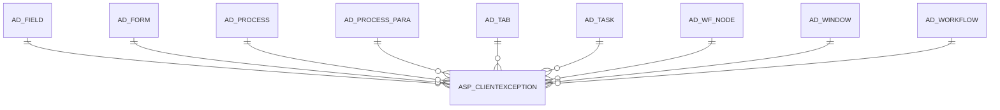

# ASP_CLIENTEXCEPTION

Area [ASP](../../data-model/asp/index.md) · class **business** (proposed) · read from database `idempiere-db` (owner `ADEMPIERE`) · 0 row(s) when profiled

Application model: `org.compiere.model.X_ASP_ClientException`, access level 2 - Client.

## Columns

| column | type | key | not null | business name | references (code) | nulls | distinct |
|---|---|---|---|---|---|---|---|
| `AD_CLIENT_ID` | NUMBER(10,0) |  | yes | Tenant |  | 0 | 0 |
| `AD_FIELD_ID` | NUMBER(10,0) |  |  | Field | [AD_FIELD](../../data-model/ad/ad_field.md) | 0 | 0 |
| `AD_FORM_ID` | NUMBER(10,0) |  |  | Special Form | [AD_FORM](../../data-model/ad/ad_form.md) | 0 | 0 |
| `AD_ORG_ID` | NUMBER(10,0) |  | yes | Organization |  | 0 | 0 |
| `AD_PROCESS_ID` | NUMBER(10,0) |  |  | Process | [AD_PROCESS](../../data-model/ad/ad_process.md) | 0 | 0 |
| `AD_PROCESS_PARA_ID` | NUMBER(10,0) |  |  | Process Parameter | [AD_PROCESS_PARA](../../data-model/ad/ad_process_para.md) | 0 | 0 |
| `AD_TAB_ID` | NUMBER(10,0) |  |  | Tab | [AD_TAB](../../data-model/ad/ad_tab.md) | 0 | 0 |
| `AD_TASK_ID` | NUMBER(10,0) |  |  | OS Task | [AD_TASK](../../data-model/ad/ad_task.md) | 0 | 0 |
| `AD_WF_NODE_ID` | NUMBER(10,0) |  |  | Node | [AD_WF_NODE](../../data-model/ad/ad_wf_node.md) | 0 | 0 |
| `AD_WINDOW_ID` | NUMBER(10,0) |  |  | Window | [AD_WINDOW](../../data-model/ad/ad_window.md) | 0 | 0 |
| `AD_WORKFLOW_ID` | NUMBER(10,0) |  |  | Workflow | [AD_WORKFLOW](../../data-model/ad/ad_workflow.md) | 0 | 0 |
| `ASP_CLIENTEXCEPTION_ID` | NUMBER(10,0) | PK | yes | Tenant Exception |  | 0 | 0 |
| `ASP_STATUS` | CHAR(1) |  | yes | ASP Status |  | 0 | 0 |
| `CREATED` | DATE |  | yes | Created |  | 0 | 0 |
| `CREATEDBY` | NUMBER(10,0) |  | yes | Created By |  | 0 | 0 |
| `ISACTIVE` | CHAR(1) |  | yes | Active |  | 0 | 0 |
| `UPDATED` | DATE |  | yes | Updated |  | 0 | 0 |
| `UPDATEDBY` | NUMBER(10,0) |  | yes | Updated By |  | 0 | 0 |
| `ASP_CLIENTEXCEPTION_UU` | VARCHAR2(36 CHAR) |  |  | ASP_ClientException_UU |  | 0 | 0 |

*references (code)* is the table the application model's code says a column points to; *Foreign keys* below are the constraints the database declares. Counts come from the profile; no value is ever shown.

## Check constraints

| name | expression |
|---|---|
| `SYS_C0021621` | `IsActive IN ('Y','N')` |

## Foreign keys

**References**

| table | columns | on delete |
|---|---|---|
| [AD_FIELD](../../data-model/ad/ad_field.md) | ASP_CLIENTEXCEPTION.AD_FIELD_ID → AD_FIELD.AD_FIELD_ID | NO ACTION |
| [AD_FORM](../../data-model/ad/ad_form.md) | ASP_CLIENTEXCEPTION.AD_FORM_ID → AD_FORM.AD_FORM_ID | NO ACTION |
| [AD_PROCESS](../../data-model/ad/ad_process.md) | ASP_CLIENTEXCEPTION.AD_PROCESS_ID → AD_PROCESS.AD_PROCESS_ID | NO ACTION |
| [AD_PROCESS_PARA](../../data-model/ad/ad_process_para.md) | ASP_CLIENTEXCEPTION.AD_PROCESS_PARA_ID → AD_PROCESS_PARA.AD_PROCESS_PARA_ID | NO ACTION |
| [AD_TAB](../../data-model/ad/ad_tab.md) | ASP_CLIENTEXCEPTION.AD_TAB_ID → AD_TAB.AD_TAB_ID | NO ACTION |
| [AD_TASK](../../data-model/ad/ad_task.md) | ASP_CLIENTEXCEPTION.AD_TASK_ID → AD_TASK.AD_TASK_ID | NO ACTION |
| [AD_WF_NODE](../../data-model/ad/ad_wf_node.md) | ASP_CLIENTEXCEPTION.AD_WF_NODE_ID → AD_WF_NODE.AD_WF_NODE_ID | NO ACTION |
| [AD_WINDOW](../../data-model/ad/ad_window.md) | ASP_CLIENTEXCEPTION.AD_WINDOW_ID → AD_WINDOW.AD_WINDOW_ID | NO ACTION |
| [AD_WORKFLOW](../../data-model/ad/ad_workflow.md) | ASP_CLIENTEXCEPTION.AD_WORKFLOW_ID → AD_WORKFLOW.AD_WORKFLOW_ID | NO ACTION |

**Referenced by**

_None._

## Write behaviour

- updates: **po_only**
- deletes: **deleted_by_users**
- change log: **recorded**
- evidence: 1 citation(s)

## Schema history

34 change(s); the latest:

| applied | release | operation | column | tickets |
|---|---|---|---|---|
| 2023-04-09T15:47 | iD11 | `add_constraint` |  | IDEMPIERE-5567 |
| 2023-04-09T15:47 | iD11 | `add_constraint` |  | IDEMPIERE-5567 |
| 2021-12-05T16:45 | i8.2z | `drop_constraint` |  | IDEMPIERE-5075 |
| 2021-12-05T16:45 | i8.2z | `add_constraint` |  | IDEMPIERE-5075 |
| 2021-12-05T16:45 | i8.2z | `drop_constraint` |  | IDEMPIERE-5075 |
| 2021-12-05T16:45 | i8.2z | `drop_constraint` |  | IDEMPIERE-5075 |
| 2021-12-05T16:45 | i8.2z | `drop_constraint` |  | IDEMPIERE-5075 |
| 2021-12-05T16:45 | i8.2z | `add_constraint` |  | IDEMPIERE-5075 |
| 2021-12-05T16:45 | i8.2z | `drop_constraint` |  | IDEMPIERE-5075 |
| 2021-12-05T16:45 | i8.2z | `add_constraint` |  | IDEMPIERE-5075 |
| 2021-12-05T16:45 | i8.2z | `drop_constraint` |  | IDEMPIERE-5075 |
| 2021-12-05T16:45 | i8.2z | `add_constraint` |  | IDEMPIERE-5075 |
| 2021-12-05T16:45 | i8.2z | `add_constraint` |  | IDEMPIERE-5075 |
| 2021-12-05T16:45 | i8.2z | `add_constraint` |  | IDEMPIERE-5075 |
| 2021-12-05T16:45 | i8.2z | `add_constraint` |  | IDEMPIERE-5075 |

## Notes

<!-- ekos:manual id="table.asp_clientexception.notes" -->
_Business notes about this table._
<!-- /ekos:manual -->
