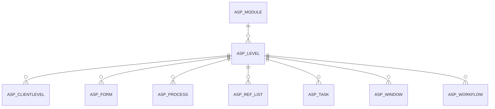

# ASP_LEVEL

Area [ASP](../../data-model/asp/index.md) · class **business** (proposed) · read from database `idempiere-db` (owner `ADEMPIERE`) · 0 row(s) when profiled

Application model: `org.compiere.model.X_ASP_Level`, access level 4 - System.

## Columns

| column | type | key | not null | business name | references (code) | nulls | distinct |
|---|---|---|---|---|---|---|---|
| `AD_CLIENT_ID` | NUMBER(10,0) |  | yes | Tenant |  | 0 | 0 |
| `AD_ORG_ID` | NUMBER(10,0) |  | yes | Organization |  | 0 | 0 |
| `ASP_LEVEL_ID` | NUMBER(10,0) | PK | yes | ASP Level |  | 0 | 0 |
| `ASP_MODULE_ID` | NUMBER(10,0) |  | yes | ASP Module | [ASP_MODULE](../../data-model/asp/asp_module.md) | 0 | 0 |
| `CREATED` | DATE |  | yes | Created |  | 0 | 0 |
| `CREATEDBY` | NUMBER(10,0) |  | yes | Created By |  | 0 | 0 |
| `DESCRIPTION` | VARCHAR2(255 CHAR) |  |  | Description |  | 0 | 0 |
| `HELP` | VARCHAR2(2000 CHAR) |  |  | Comment/Help |  | 0 | 0 |
| `ISACTIVE` | CHAR(1) |  | yes | Active |  | 0 | 0 |
| `NAME` | VARCHAR2(60 CHAR) |  | yes | Name |  | 0 | 0 |
| `PROCESSING` | CHAR(1) |  |  | Process Now |  | 0 | 0 |
| `UPDATED` | DATE |  | yes | Updated |  | 0 | 0 |
| `UPDATEDBY` | NUMBER(10,0) |  | yes | Updated By |  | 0 | 0 |
| `VALUE` | VARCHAR2(40 CHAR) |  | yes | Search Key |  | 0 | 0 |
| `ASP_LEVEL_UU` | VARCHAR2(36 CHAR) |  |  | ASP_Level_UU |  | 0 | 0 |

*references (code)* is the table the application model's code says a column points to; *Foreign keys* below are the constraints the database declares. Counts come from the profile; no value is ever shown.

## Check constraints

| name | expression |
|---|---|
| `SYS_C0021527` | `IsActive IN ('Y','N')` |

## Foreign keys

**References**

| table | columns | on delete |
|---|---|---|
| [ASP_MODULE](../../data-model/asp/asp_module.md) | ASP_LEVEL.ASP_MODULE_ID → ASP_MODULE.ASP_MODULE_ID | NO ACTION |

**Referenced by**

| table | columns | on delete |
|---|---|---|
| [ASP_CLIENTLEVEL](../../data-model/asp/asp_clientlevel.md) | ASP_CLIENTLEVEL.ASP_LEVEL_ID → ASP_LEVEL.ASP_LEVEL_ID | NO ACTION |
| [ASP_FORM](../../data-model/asp/asp_form.md) | ASP_FORM.ASP_LEVEL_ID → ASP_LEVEL.ASP_LEVEL_ID | NO ACTION |
| [ASP_PROCESS](../../data-model/asp/asp_process.md) | ASP_PROCESS.ASP_LEVEL_ID → ASP_LEVEL.ASP_LEVEL_ID | NO ACTION |
| [ASP_REF_LIST](../../data-model/asp/asp_ref_list.md) | ASP_REF_LIST.ASP_LEVEL_ID → ASP_LEVEL.ASP_LEVEL_ID | NO ACTION |
| [ASP_TASK](../../data-model/asp/asp_task.md) | ASP_TASK.ASP_LEVEL_ID → ASP_LEVEL.ASP_LEVEL_ID | NO ACTION |
| [ASP_WINDOW](../../data-model/asp/asp_window.md) | ASP_WINDOW.ASP_LEVEL_ID → ASP_LEVEL.ASP_LEVEL_ID | NO ACTION |
| [ASP_WORKFLOW](../../data-model/asp/asp_workflow.md) | ASP_WORKFLOW.ASP_LEVEL_ID → ASP_LEVEL.ASP_LEVEL_ID | NO ACTION |

## Write behaviour

- updates: **po_only**
- deletes: **deleted_by_users**
- change log: **recorded**
- evidence: 1 citation(s)

## Schema history

31 change(s); the latest:

| applied | release | operation | column | tickets |
|---|---|---|---|---|
| 2023-04-09T15:47 | iD11 | `add_constraint` |  | IDEMPIERE-5567 |
| 2023-04-09T15:47 | iD11 | `add_constraint` |  | IDEMPIERE-5567 |
| 2021-12-05T16:45 | i8.2z | `drop_constraint` |  | IDEMPIERE-5075 |
| 2021-12-05T16:45 | i8.2z | `add_constraint` |  | IDEMPIERE-5075 |
| 2020-08-04T01:00 | i7.1z | `add_column` | tmp_col_4_tmp | IDEMPIERE-3862 |
| 2020-08-04T01:00 | i7.1z | `add_column` | tmp_col_1_tmp | IDEMPIERE-3862 |
| 2020-08-04T01:00 | i7.1z | `modify_column` | NAME | IDEMPIERE-3862 |
| 2020-08-04T01:00 | i7.1z | `modify_column` | NAME | IDEMPIERE-3862 |
| 2020-08-04T01:00 | i7.1z | `modify_column` | VALUE | IDEMPIERE-3862 |
| 2020-08-04T01:00 | i7.1z | `modify_column` | VALUE | IDEMPIERE-3862 |
| 2020-08-04T01:00 | i7.1z | `drop_column` | tmp_col_4_tmp | IDEMPIERE-3862 |
| 2020-08-04T01:00 | i7.1z | `modify_column` | DESCRIPTION | IDEMPIERE-3862 |
| 2020-08-04T01:00 | i7.1z | `add_column` | tmp_col_2_tmp | IDEMPIERE-3862 |
| 2020-08-04T01:00 | i7.1z | `modify_column` | NAME | IDEMPIERE-3862 |
| 2020-08-04T01:00 | i7.1z | `add_column` | tmp_col_5_tmp | IDEMPIERE-3862 |

## Notes

<!-- ekos:manual id="table.asp_level.notes" -->
_Business notes about this table._
<!-- /ekos:manual -->
