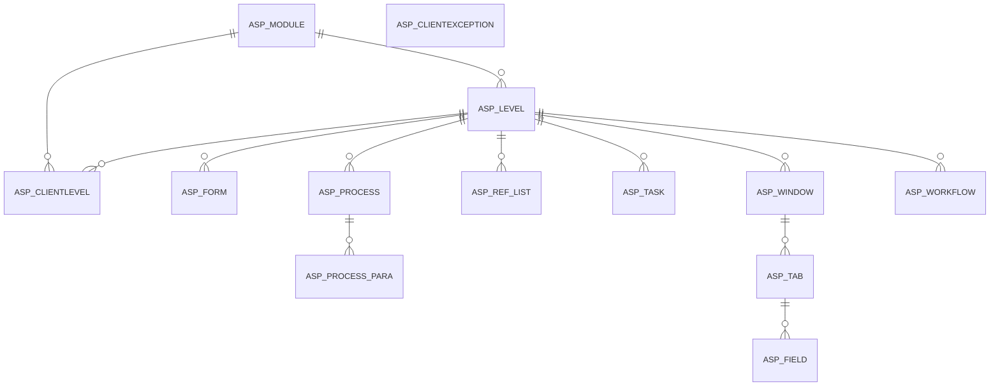

# Area ASP

13 table(s), 13 in scope.

| table | class | scope | rows | description |
|---|---|---|---|---|
| [ASP_CLIENTEXCEPTION](../../data-model/asp/asp_clientexception.md) | business | in | 0 |  |
| [ASP_CLIENTLEVEL](../../data-model/asp/asp_clientlevel.md) | business | in | 0 |  |
| [ASP_FIELD](../../data-model/asp/asp_field.md) | business | in | 0 |  |
| [ASP_FORM](../../data-model/asp/asp_form.md) | business | in | 0 |  |
| [ASP_LEVEL](../../data-model/asp/asp_level.md) | business | in | 0 |  |
| [ASP_MODULE](../../data-model/asp/asp_module.md) | business | in | 0 |  |
| [ASP_PROCESS](../../data-model/asp/asp_process.md) | business | in | 0 |  |
| [ASP_PROCESS_PARA](../../data-model/asp/asp_process_para.md) | business | in | 0 |  |
| [ASP_REF_LIST](../../data-model/asp/asp_ref_list.md) | business | in | 0 |  |
| [ASP_TAB](../../data-model/asp/asp_tab.md) | business | in | 0 |  |
| [ASP_TASK](../../data-model/asp/asp_task.md) | business | in | 0 |  |
| [ASP_WINDOW](../../data-model/asp/asp_window.md) | business | in | 0 |  |
| [ASP_WORKFLOW](../../data-model/asp/asp_workflow.md) | business | in | 0 |  |
