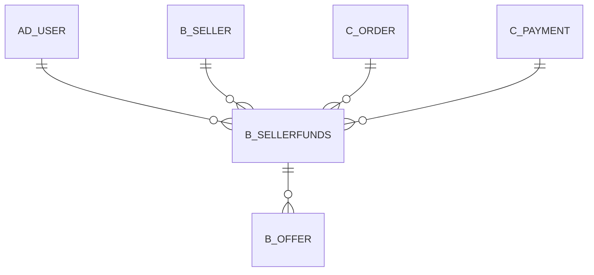

# B_SELLERFUNDS

Area [B](../../data-model/b/index.md) · class **business** (proposed) · read from database `idempiere-db` (owner `ADEMPIERE`) · 0 row(s) when profiled

Application model: `org.compiere.model.X_B_SellerFunds`, access level 3 - Client - Org.

## Columns

| column | type | key | not null | business name | references (code) | nulls | distinct |
|---|---|---|---|---|---|---|---|
| `B_SELLERFUNDS_ID` | NUMBER(10,0) | PK | yes | Seller Funds |  | 0 | 0 |
| `AD_CLIENT_ID` | NUMBER(10,0) |  | yes | Tenant |  | 0 | 0 |
| `AD_ORG_ID` | NUMBER(10,0) |  | yes | Organization |  | 0 | 0 |
| `ISACTIVE` | CHAR(1) |  | yes | Active |  | 0 | 0 |
| `CREATED` | DATE |  | yes | Created |  | 0 | 0 |
| `CREATEDBY` | NUMBER(10,0) |  | yes | Created By |  | 0 | 0 |
| `UPDATED` | DATE |  | yes | Updated |  | 0 | 0 |
| `UPDATEDBY` | NUMBER(10,0) |  | yes | Updated By |  | 0 | 0 |
| `AD_USER_ID` | NUMBER(10,0) |  | yes | User/Contact | [AD_USER](../../data-model/ad/ad_user.md) | 0 | 0 |
| `C_ORDER_ID` | NUMBER(10,0) |  |  | Order | [C_ORDER](../../data-model/c/c_order.md) | 0 | 0 |
| `C_PAYMENT_ID` | NUMBER(10,0) |  |  | Payment | [C_PAYMENT](../../data-model/c/c_payment.md) | 0 | 0 |
| `COMMITTEDAMT` | NUMBER |  | yes | Committed Amount |  | 0 | 0 |
| `NONCOMMITTEDAMT` | NUMBER |  | yes | Not Committed Amount |  | 0 | 0 |
| `B_SELLERFUNDS_UU` | VARCHAR2(36 CHAR) |  |  | B_SellerFunds_UU |  | 0 | 0 |

*references (code)* is the table the application model's code says a column points to; *Foreign keys* below are the constraints the database declares. Counts come from the profile; no value is ever shown.

## Check constraints

| name | expression |
|---|---|
| `SYS_C0020501` | `IsActive in ('Y','N')` |

## Foreign keys

**References**

| table | columns | on delete |
|---|---|---|
| [AD_USER](../../data-model/ad/ad_user.md) | B_SELLERFUNDS.AD_USER_ID → AD_USER.AD_USER_ID | NO ACTION |
| [B_SELLER](../../data-model/b/b_seller.md) | B_SELLERFUNDS.AD_USER_ID → B_SELLER.AD_USER_ID | NO ACTION |
| [C_ORDER](../../data-model/c/c_order.md) | B_SELLERFUNDS.C_ORDER_ID → C_ORDER.C_ORDER_ID | NO ACTION |
| [C_PAYMENT](../../data-model/c/c_payment.md) | B_SELLERFUNDS.C_PAYMENT_ID → C_PAYMENT.C_PAYMENT_ID | NO ACTION |

**Referenced by**

| table | columns | on delete |
|---|---|---|
| [B_OFFER](../../data-model/b/b_offer.md) | B_OFFER.B_SELLERFUNDS_ID → B_SELLERFUNDS.B_SELLERFUNDS_ID | NO ACTION |

## Write behaviour

- updates: **po_only**
- deletes: **deleted_by_users**
- change log: **recorded**
- evidence: 1 citation(s)

## Schema history

13 change(s); the latest:

| applied | release | operation | column | tickets |
|---|---|---|---|---|
| 2023-04-09T15:47 | iD11 | `add_constraint` |  | IDEMPIERE-5567 |
| 2023-04-09T15:47 | iD11 | `add_constraint` |  | IDEMPIERE-5567 |
| 2021-12-05T16:45 | i8.2z | `drop_constraint` |  | IDEMPIERE-5075 |
| 2021-12-05T16:45 | i8.2z | `add_constraint` |  | IDEMPIERE-5075 |
| 2021-12-05T16:45 | i8.2z | `add_constraint` |  | IDEMPIERE-5075 |
| 2021-12-05T16:45 | i8.2z | `drop_constraint` |  | IDEMPIERE-5075 |
| 2021-12-05T16:45 | i8.2z | `add_constraint` |  | IDEMPIERE-5075 |
| 2021-12-05T16:45 | i8.2z | `drop_constraint` |  | IDEMPIERE-5075 |
| 2021-12-05T16:45 | i8.2z | `drop_constraint` |  | IDEMPIERE-5075 |
| 2021-12-05T16:45 | i8.2z | `add_constraint` |  | IDEMPIERE-5075 |
| 2020-08-04T01:00 | i7.1z | `drop_column` | tmp_col_1_tmp | IDEMPIERE-3862 |
| 2020-08-04T01:00 | i7.1z | `add_column` | tmp_col_1_tmp | IDEMPIERE-3862 |
| 2020-08-04T01:00 | i7.1z | `modify_column` | B_SELLERFUNDS_UU | IDEMPIERE-3862 |

## Notes

<!-- ekos:manual id="table.b_sellerfunds.notes" -->
_Business notes about this table._
<!-- /ekos:manual -->
