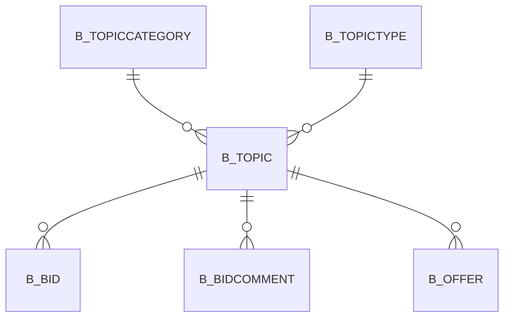

# B_TOPIC

Area [B](../../data-model/b/index.md) · class **business** (proposed) · read from database `idempiere-db` (owner `ADEMPIERE`) · 0 row(s) when profiled

Application model: `org.compiere.model.X_B_Topic`, access level 3 - Client - Org.

## Columns

| column | type | key | not null | business name | references (code) | nulls | distinct |
|---|---|---|---|---|---|---|---|
| `B_TOPIC_ID` | NUMBER(10,0) | PK | yes | Topic |  | 0 | 0 |
| `AD_CLIENT_ID` | NUMBER(10,0) |  | yes | Tenant |  | 0 | 0 |
| `AD_ORG_ID` | NUMBER(10,0) |  | yes | Organization |  | 0 | 0 |
| `ISACTIVE` | CHAR(1) |  | yes | Active |  | 0 | 0 |
| `CREATED` | DATE |  | yes | Created |  | 0 | 0 |
| `CREATEDBY` | NUMBER(10,0) |  | yes | Created By |  | 0 | 0 |
| `UPDATED` | DATE |  | yes | Updated |  | 0 | 0 |
| `UPDATEDBY` | NUMBER(10,0) |  | yes | Updated By |  | 0 | 0 |
| `DOCUMENTNO` | VARCHAR2(30 CHAR) |  | yes | Document No |  | 0 | 0 |
| `NAME` | VARCHAR2(60 CHAR) |  | yes | Name |  | 0 | 0 |
| `DESCRIPTION` | VARCHAR2(255 CHAR) |  |  | Description |  | 0 | 0 |
| `TEXTMSG` | VARCHAR2(2000 CHAR) |  |  | Text Message |  | 0 | 0 |
| `TOPICSTATUS` | CHAR(2) |  | yes | Topic Status |  | 0 | 0 |
| `TOPICACTION` | CHAR(2) |  | yes | Topic Action |  | 0 | 0 |
| `ISPUBLISHED` | CHAR(1) |  | yes | Published |  | 0 | 0 |
| `TEXTDETAILS` | CLOB |  |  | Details |  | 0 |  |
| `PROCESSING` | CHAR(1) |  |  | Process Now |  | 0 | 0 |
| `PROCESSED` | CHAR(1) |  | yes | Processed |  | 0 | 0 |
| `B_TOPICTYPE_ID` | NUMBER(10,0) |  | yes | Topic Type | [B_TOPICTYPE](../../data-model/b/b_topictype.md) | 0 | 0 |
| `B_TOPICCATEGORY_ID` | NUMBER(10,0) |  | yes | Topic Category | [B_TOPICCATEGORY](../../data-model/b/b_topiccategory.md) | 0 | 0 |
| `DECISIONDATE` | DATE |  | yes | Decision date |  | 0 | 0 |
| `B_TOPIC_UU` | VARCHAR2(36 CHAR) |  |  | B_Topic_UU |  | 0 | 0 |

*references (code)* is the table the application model's code says a column points to; *Foreign keys* below are the constraints the database declares. Counts come from the profile; no value is ever shown.

## Check constraints

| name | expression |
|---|---|
| `SYS_C0020327` | `IsActive in ('Y','N')` |
| `SYS_C0020329` | `Processed in ('Y','N')` |
| `SYS_C0020330` | `IsPublished in ('Y','N')` |

## Foreign keys

**References**

| table | columns | on delete |
|---|---|---|
| [B_TOPICCATEGORY](../../data-model/b/b_topiccategory.md) | B_TOPIC.B_TOPICCATEGORY_ID → B_TOPICCATEGORY.B_TOPICCATEGORY_ID | NO ACTION |
| [B_TOPICTYPE](../../data-model/b/b_topictype.md) | B_TOPIC.B_TOPICTYPE_ID → B_TOPICTYPE.B_TOPICTYPE_ID | NO ACTION |

**Referenced by**

| table | columns | on delete |
|---|---|---|
| [B_BID](../../data-model/b/b_bid.md) | B_BID.B_TOPIC_ID → B_TOPIC.B_TOPIC_ID | NO ACTION |
| [B_BIDCOMMENT](../../data-model/b/b_bidcomment.md) | B_BIDCOMMENT.B_TOPIC_ID → B_TOPIC.B_TOPIC_ID | NO ACTION |
| [B_OFFER](../../data-model/b/b_offer.md) | B_OFFER.B_TOPIC_ID → B_TOPIC.B_TOPIC_ID | NO ACTION |

## Write behaviour

- updates: **po_only**
- deletes: **deleted_by_users**
- change log: **recorded**
- evidence: 1 citation(s)

## Schema history

25 change(s); the latest:

| applied | release | operation | column | tickets |
|---|---|---|---|---|
| 2023-04-09T15:47 | iD11 | `add_constraint` |  | IDEMPIERE-5567 |
| 2023-04-09T15:47 | iD11 | `add_constraint` |  | IDEMPIERE-5567 |
| 2021-12-05T16:45 | i8.2z | `add_constraint` |  | IDEMPIERE-5075 |
| 2021-12-05T16:45 | i8.2z | `add_constraint` |  | IDEMPIERE-5075 |
| 2021-12-05T16:45 | i8.2z | `drop_constraint` |  | IDEMPIERE-5075 |
| 2021-12-05T16:45 | i8.2z | `drop_constraint` |  | IDEMPIERE-5075 |
| 2020-08-04T01:00 | i7.1z | `modify_column` | B_TOPIC_UU | IDEMPIERE-3862 |
| 2020-08-04T01:00 | i7.1z | `add_column` | tmp_col_5_tmp | IDEMPIERE-3862 |
| 2020-08-04T01:00 | i7.1z | `modify_column` | NAME | IDEMPIERE-3862 |
| 2020-08-04T01:00 | i7.1z | `modify_column` | DOCUMENTNO | IDEMPIERE-3862 |
| 2020-08-04T01:00 | i7.1z | `modify_column` | DESCRIPTION | IDEMPIERE-3862 |
| 2020-08-04T01:00 | i7.1z | `modify_column` | DOCUMENTNO | IDEMPIERE-3862 |
| 2020-08-04T01:00 | i7.1z | `drop_column` | tmp_col_2_tmp | IDEMPIERE-3862 |
| 2020-08-04T01:00 | i7.1z | `add_column` | tmp_col_2_tmp | IDEMPIERE-3862 |
| 2020-08-04T01:00 | i7.1z | `drop_column` | tmp_col_4_tmp | IDEMPIERE-3862 |

## Notes

<!-- ekos:manual id="table.b_topic.notes" -->
_Business notes about this table._
<!-- /ekos:manual -->
