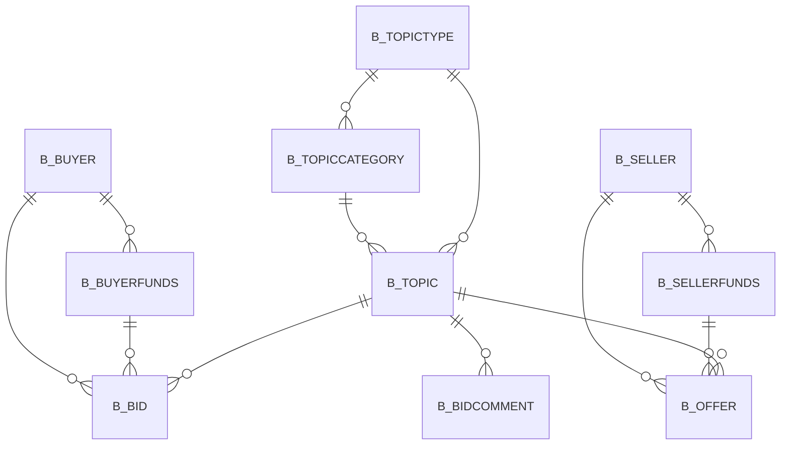

# Area B

10 table(s), 10 in scope.

| table | class | scope | rows | description |
|---|---|---|---|---|
| [B_BID](../../data-model/b/b_bid.md) | business | in | 0 |  |
| [B_BIDCOMMENT](../../data-model/b/b_bidcomment.md) | business | in | 0 |  |
| [B_BUYER](../../data-model/b/b_buyer.md) | business | in | 0 |  |
| [B_BUYERFUNDS](../../data-model/b/b_buyerfunds.md) | business | in | 0 |  |
| [B_OFFER](../../data-model/b/b_offer.md) | business | in | 0 |  |
| [B_SELLER](../../data-model/b/b_seller.md) | business | in | 0 |  |
| [B_SELLERFUNDS](../../data-model/b/b_sellerfunds.md) | business | in | 0 |  |
| [B_TOPIC](../../data-model/b/b_topic.md) | business | in | 0 |  |
| [B_TOPICCATEGORY](../../data-model/b/b_topiccategory.md) | business | in | 0 |  |
| [B_TOPICTYPE](../../data-model/b/b_topictype.md) | business | in | 0 |  |
