# C_ACCTSCHEMA

Area [C](../../data-model/c/index.md) · class **business** (proposed) · read from database `idempiere-db` (owner `ADEMPIERE`) · 2 row(s) when profiled

Application model: `org.compiere.model.X_C_AcctSchema`, access level 2 - Client.

## Columns

| column | type | key | not null | business name | references (code) | nulls | distinct |
|---|---|---|---|---|---|---|---|
| `C_ACCTSCHEMA_ID` | NUMBER(10,0) | PK | yes | Accounting Schema |  | 0 | 2 |
| `AD_CLIENT_ID` | NUMBER(10,0) |  | yes | Tenant |  | 0 | 1 |
| `AD_ORG_ID` | NUMBER(10,0) |  | yes | Organization |  | 0 | 1 |
| `ISACTIVE` | CHAR(1) |  | yes | Active |  | 0 | 1 |
| `CREATED` | DATE |  | yes | Created |  | 0 | 2 |
| `CREATEDBY` | NUMBER(10,0) |  | yes | Created By |  | 0 | 2 |
| `UPDATED` | DATE |  | yes | Updated |  | 0 | 2 |
| `UPDATEDBY` | NUMBER(10,0) |  | yes | Updated By |  | 0 | 1 |
| `NAME` | VARCHAR2(60 CHAR) |  | yes | Name |  | 0 | 2 |
| `DESCRIPTION` | VARCHAR2(255 CHAR) |  |  | Description |  | 2 | 0 |
| `GAAP` | CHAR(2) |  | yes | GAAP |  | 0 | 1 |
| `ISACCRUAL` | CHAR(1) |  | yes | Accrual |  | 0 | 1 |
| `COSTINGMETHOD` | CHAR(1) |  | yes | Costing Method |  | 0 | 1 |
| `C_CURRENCY_ID` | NUMBER(10,0) |  | yes | Currency | [C_CURRENCY](../../data-model/c/c_currency.md) | 0 | 2 |
| `AUTOPERIODCONTROL` | CHAR(1) |  | yes | Automatic Period Control |  | 0 | 1 |
| `C_PERIOD_ID` | NUMBER(10,0) |  |  | Period | [C_PERIOD](../../data-model/c/c_period.md) | 0 | 1 |
| `PERIOD_OPENHISTORY` | NUMBER(10,0) |  |  | History Days |  | 0 | 1 |
| `PERIOD_OPENFUTURE` | NUMBER(10,0) |  |  | Future Days |  | 0 | 1 |
| `SEPARATOR` | CHAR(1) |  | yes | Element Separator |  | 0 | 1 |
| `HASALIAS` | CHAR(1) |  | yes | Use Account Alias |  | 0 | 1 |
| `HASCOMBINATION` | CHAR(1) |  | yes | Use Account Combination Control |  | 0 | 1 |
| `ISTRADEDISCOUNTPOSTED` | CHAR(1) |  | yes | Post Trade Discount |  | 0 | 1 |
| `ISDISCOUNTCORRECTSTAX` | CHAR(1) |  | yes | Correct tax for Discounts/Charges |  | 0 | 1 |
| `M_COSTTYPE_ID` | NUMBER(10,0) |  |  | Cost Type | [M_COSTTYPE](../../data-model/m/m_costtype.md) | 0 | 1 |
| `COSTINGLEVEL` | CHAR(1) |  | yes | Costing Level |  | 0 | 1 |
| `ISADJUSTCOGS` | CHAR(1) |  | yes | Adjust COGS |  | 0 | 2 |
| `AD_ORGONLY_ID` | NUMBER(10,0) |  |  | Only Organization |  | 2 | 0 |
| `ISPOSTSERVICES` | CHAR(1) |  | yes | Post Services Separately |  | 0 | 1 |
| `ISEXPLICITCOSTADJUSTMENT` | CHAR(1) |  | yes | Explicit Cost Adjustment |  | 0 | 1 |
| `COMMITMENTTYPE` | CHAR(1) |  | yes | Commitment Type |  | 0 | 1 |
| `PROCESSING` | CHAR(1) |  |  | Process Now |  | 1 | 1 |
| `TAXCORRECTIONTYPE` | CHAR(1) |  |  | Tax Correction |  | 0 | 2 |
| `ISALLOWNEGATIVEPOSTING` | CHAR(1) |  |  | Allow Negative Posting |  | 0 | 1 |
| `ISPOSTIFCLEARINGEQUAL` | CHAR(1) |  |  | Post if Clearing Equal |  | 0 | 1 |
| `C_ACCTSCHEMA_UU` | VARCHAR2(36 CHAR) |  |  | C_AcctSchema_UU |  | 0 | 2 |

*references (code)* is the table the application model's code says a column points to; *Foreign keys* below are the constraints the database declares. Counts come from the profile; no value is ever shown.

## Check constraints

| name | expression |
|---|---|
| `SYS_C0021712` | `AutoPeriodControl in ('Y','N')` |
| `SYS_C0021713` | `IsAccrual in ('Y','N')` |
| `SYS_C0021714` | `HasCombination in ('Y','N')` |
| `SYS_C0021715` | `IsDiscountCorrectsTax in ('Y','N')` |
| `SYS_C0021716` | `IsPostIfClearingEqual IN ('Y','N')` |
| `SYS_C0021717` | `IsTradeDiscountPosted in ('Y','N')` |
| `SYS_C0021719` | `isallownegativeposting IN ('Y','N')` |
| `SYS_C0021720` | `HasAlias in ('Y','N')` |
| `SYS_C0021722` | `IsActive in ('Y','N')` |

## Foreign keys

**References**

| table | columns | on delete |
|---|---|---|
| [AD_CLIENT](../../data-model/ad/ad_client.md) | C_ACCTSCHEMA.AD_CLIENT_ID → AD_CLIENT.AD_CLIENT_ID | NO ACTION |
| [AD_ORG](../../data-model/ad/ad_org.md) | C_ACCTSCHEMA.AD_ORGONLY_ID → AD_ORG.AD_ORG_ID | NO ACTION |
| [C_CURRENCY](../../data-model/c/c_currency.md) | C_ACCTSCHEMA.C_CURRENCY_ID → C_CURRENCY.C_CURRENCY_ID | NO ACTION |
| [C_PERIOD](../../data-model/c/c_period.md) | C_ACCTSCHEMA.C_PERIOD_ID → C_PERIOD.C_PERIOD_ID | NO ACTION |
| [M_COSTTYPE](../../data-model/m/m_costtype.md) | C_ACCTSCHEMA.M_COSTTYPE_ID → M_COSTTYPE.M_COSTTYPE_ID | NO ACTION |

**Referenced by**

| table | columns | on delete |
|---|---|---|
| [AD_CLIENTINFO](../../data-model/ad/ad_clientinfo.md) | AD_CLIENTINFO.C_ACCTSCHEMA1_ID → C_ACCTSCHEMA.C_ACCTSCHEMA_ID | NO ACTION |
| [A_ASSET_ACCT](../../data-model/a/a_asset_acct.md) | A_ASSET_ACCT.C_ACCTSCHEMA_ID → C_ACCTSCHEMA.C_ACCTSCHEMA_ID | NO ACTION |
| [A_ASSET_CHANGE](../../data-model/a/a_asset_change.md) | A_ASSET_CHANGE.C_ACCTSCHEMA_ID → C_ACCTSCHEMA.C_ACCTSCHEMA_ID | NO ACTION |
| [A_ASSET_CHANGE_AMT](../../data-model/a/a_asset_change_amt.md) | A_ASSET_CHANGE_AMT.C_ACCTSCHEMA_ID → C_ACCTSCHEMA.C_ACCTSCHEMA_ID | NO ACTION |
| [A_ASSET_GROUP_ACCT](../../data-model/a/a_asset_group_acct.md) | A_ASSET_GROUP_ACCT.C_ACCTSCHEMA_ID → C_ACCTSCHEMA.C_ACCTSCHEMA_ID | NO ACTION |
| [A_ASSET_REVAL_ENTRY](../../data-model/a/a_asset_reval_entry.md) | A_ASSET_REVAL_ENTRY.C_ACCTSCHEMA_ID → C_ACCTSCHEMA.C_ACCTSCHEMA_ID | NO ACTION |
| [A_ASSET_TRANSFER](../../data-model/a/a_asset_transfer.md) | A_ASSET_TRANSFER.C_ACCTSCHEMA_ID → C_ACCTSCHEMA.C_ACCTSCHEMA_ID | NO ACTION |
| [A_DEPRECIATION_ENTRY](../../data-model/a/a_depreciation_entry.md) | A_DEPRECIATION_ENTRY.C_ACCTSCHEMA_ID → C_ACCTSCHEMA.C_ACCTSCHEMA_ID | NO ACTION |
| [A_DEPRECIATION_EXP](../../data-model/a/a_depreciation_exp.md) | A_DEPRECIATION_EXP.C_ACCTSCHEMA_ID → C_ACCTSCHEMA.C_ACCTSCHEMA_ID | CASCADE |
| [A_DEPRECIATION_WORKFILE](../../data-model/a/a_depreciation_workfile.md) | A_DEPRECIATION_WORKFILE.C_ACCTSCHEMA_ID → C_ACCTSCHEMA.C_ACCTSCHEMA_ID | CASCADE |
| [A_FUNDINGMODE_ACCT](../../data-model/a/a_fundingmode_acct.md) | A_FUNDINGMODE_ACCT.C_ACCTSCHEMA_ID → C_ACCTSCHEMA.C_ACCTSCHEMA_ID | NO ACTION |
| [C_ACCTPROCESSOR](../../data-model/c/c_acctprocessor.md) | C_ACCTPROCESSOR.C_ACCTSCHEMA_ID → C_ACCTSCHEMA.C_ACCTSCHEMA_ID | NO ACTION |
| [C_ACCTSCHEMA_DEFAULT](../../data-model/c/c_acctschema_default.md) | C_ACCTSCHEMA_DEFAULT.C_ACCTSCHEMA_ID → C_ACCTSCHEMA.C_ACCTSCHEMA_ID | CASCADE |
| [C_ACCTSCHEMA_ELEMENT](../../data-model/c/c_acctschema_element.md) | C_ACCTSCHEMA_ELEMENT.C_ACCTSCHEMA_ID → C_ACCTSCHEMA.C_ACCTSCHEMA_ID | CASCADE |
| [C_ACCTSCHEMA_GL](../../data-model/c/c_acctschema_gl.md) | C_ACCTSCHEMA_GL.C_ACCTSCHEMA_ID → C_ACCTSCHEMA.C_ACCTSCHEMA_ID | CASCADE |
| [C_BANKACCOUNT_ACCT](../../data-model/c/c_bankaccount_acct.md) | C_BANKACCOUNT_ACCT.C_ACCTSCHEMA_ID → C_ACCTSCHEMA.C_ACCTSCHEMA_ID | CASCADE |
| [C_BP_CUSTOMER_ACCT](../../data-model/c/c_bp_customer_acct.md) | C_BP_CUSTOMER_ACCT.C_ACCTSCHEMA_ID → C_ACCTSCHEMA.C_ACCTSCHEMA_ID | CASCADE |
| [C_BP_EMPLOYEE_ACCT](../../data-model/c/c_bp_employee_acct.md) | C_BP_EMPLOYEE_ACCT.C_ACCTSCHEMA_ID → C_ACCTSCHEMA.C_ACCTSCHEMA_ID | CASCADE |
| [C_BP_GROUP_ACCT](../../data-model/c/c_bp_group_acct.md) | C_BP_GROUP_ACCT.C_ACCTSCHEMA_ID → C_ACCTSCHEMA.C_ACCTSCHEMA_ID | CASCADE |
| [C_BP_VENDOR_ACCT](../../data-model/c/c_bp_vendor_acct.md) | C_BP_VENDOR_ACCT.C_ACCTSCHEMA_ID → C_ACCTSCHEMA.C_ACCTSCHEMA_ID | CASCADE |
| [C_CASHBOOK_ACCT](../../data-model/c/c_cashbook_acct.md) | C_CASHBOOK_ACCT.C_ACCTSCHEMA_ID → C_ACCTSCHEMA.C_ACCTSCHEMA_ID | CASCADE |
| [C_CHARGE_ACCT](../../data-model/c/c_charge_acct.md) | C_CHARGE_ACCT.C_ACCTSCHEMA_ID → C_ACCTSCHEMA.C_ACCTSCHEMA_ID | CASCADE |
| [C_CURRENCY_ACCT](../../data-model/c/c_currency_acct.md) | C_CURRENCY_ACCT.C_ACCTSCHEMA_ID → C_ACCTSCHEMA.C_ACCTSCHEMA_ID | CASCADE |
| [C_INTERORG_ACCT](../../data-model/c/c_interorg_acct.md) | C_INTERORG_ACCT.C_ACCTSCHEMA_ID → C_ACCTSCHEMA.C_ACCTSCHEMA_ID | CASCADE |
| [C_PROJECT_ACCT](../../data-model/c/c_project_acct.md) | C_PROJECT_ACCT.C_ACCTSCHEMA_ID → C_ACCTSCHEMA.C_ACCTSCHEMA_ID | CASCADE |
| [C_REVENUERECOGNITION_PLAN](../../data-model/c/c_revenuerecognition_plan.md) | C_REVENUERECOGNITION_PLAN.C_ACCTSCHEMA_ID → C_ACCTSCHEMA.C_ACCTSCHEMA_ID | NO ACTION |
| [C_TAXDECLARATIONACCT](../../data-model/c/c_taxdeclarationacct.md) | C_TAXDECLARATIONACCT.C_ACCTSCHEMA_ID → C_ACCTSCHEMA.C_ACCTSCHEMA_ID | CASCADE |
| [C_TAX_ACCT](../../data-model/c/c_tax_acct.md) | C_TAX_ACCT.C_ACCTSCHEMA_ID → C_ACCTSCHEMA.C_ACCTSCHEMA_ID | CASCADE |
| [C_VALIDCOMBINATION](../../data-model/c/c_validcombination.md) | C_VALIDCOMBINATION.C_ACCTSCHEMA_ID → C_ACCTSCHEMA.C_ACCTSCHEMA_ID | CASCADE |
| [C_WITHHOLDING_ACCT](../../data-model/c/c_withholding_acct.md) | C_WITHHOLDING_ACCT.C_ACCTSCHEMA_ID → C_ACCTSCHEMA.C_ACCTSCHEMA_ID | CASCADE |
| [FACT_ACCT](../../data-model/fact/fact_acct.md) | FACT_ACCT.C_ACCTSCHEMA_ID → C_ACCTSCHEMA.C_ACCTSCHEMA_ID | CASCADE |
| [FACT_ACCT_SUMMARY](../../data-model/fact/fact_acct_summary.md) | FACT_ACCT_SUMMARY.C_ACCTSCHEMA_ID → C_ACCTSCHEMA.C_ACCTSCHEMA_ID | NO ACTION |
| [GL_BUDGETCONTROL](../../data-model/gl/gl_budgetcontrol.md) | GL_BUDGETCONTROL.C_ACCTSCHEMA_ID → C_ACCTSCHEMA.C_ACCTSCHEMA_ID | NO ACTION |
| [GL_DISTRIBUTION](../../data-model/gl/gl_distribution.md) | GL_DISTRIBUTION.C_ACCTSCHEMA_ID → C_ACCTSCHEMA.C_ACCTSCHEMA_ID | NO ACTION |
| [GL_FUND](../../data-model/gl/gl_fund.md) | GL_FUND.C_ACCTSCHEMA_ID → C_ACCTSCHEMA.C_ACCTSCHEMA_ID | NO ACTION |
| [GL_JOURNAL](../../data-model/gl/gl_journal.md) | GL_JOURNAL.C_ACCTSCHEMA_ID → C_ACCTSCHEMA.C_ACCTSCHEMA_ID | NO ACTION |
| [GL_JOURNALGENERATOR](../../data-model/gl/gl_journalgenerator.md) | GL_JOURNALGENERATOR.C_ACCTSCHEMA_ID → C_ACCTSCHEMA.C_ACCTSCHEMA_ID | NO ACTION |
| [HR_CONCEPT_ACCT](../../data-model/hr/hr_concept_acct.md) | HR_CONCEPT_ACCT.C_ACCTSCHEMA_ID → C_ACCTSCHEMA.C_ACCTSCHEMA_ID | NO ACTION |
| `I_ASSET` | I_ASSET.C_ACCTSCHEMA_ID → C_ACCTSCHEMA.C_ACCTSCHEMA_ID | NO ACTION |
| `I_FAJOURNAL` | I_FAJOURNAL.C_ACCTSCHEMA_ID → C_ACCTSCHEMA.C_ACCTSCHEMA_ID | NO ACTION |
| `I_FIXEDASSET` | I_FIXEDASSET.C_ACCTSCHEMA_ID → C_ACCTSCHEMA.C_ACCTSCHEMA_ID | CASCADE |
| `I_GLJOURNAL` | I_GLJOURNAL.C_ACCTSCHEMA_ID → C_ACCTSCHEMA.C_ACCTSCHEMA_ID | SET NULL |
| [M_COST](../../data-model/m/m_cost.md) | M_COST.C_ACCTSCHEMA_ID → C_ACCTSCHEMA.C_ACCTSCHEMA_ID | CASCADE |
| [M_COSTDETAIL](../../data-model/m/m_costdetail.md) | M_COSTDETAIL.C_ACCTSCHEMA_ID → C_ACCTSCHEMA.C_ACCTSCHEMA_ID | NO ACTION |
| [M_COSTQUEUE](../../data-model/m/m_costqueue.md) | M_COSTQUEUE.C_ACCTSCHEMA_ID → C_ACCTSCHEMA.C_ACCTSCHEMA_ID | CASCADE |
| [M_PRODUCT_ACCT](../../data-model/m/m_product_acct.md) | M_PRODUCT_ACCT.C_ACCTSCHEMA_ID → C_ACCTSCHEMA.C_ACCTSCHEMA_ID | CASCADE |
| [M_PRODUCT_CATEGORY_ACCT](../../data-model/m/m_product_category_acct.md) | M_PRODUCT_CATEGORY_ACCT.C_ACCTSCHEMA_ID → C_ACCTSCHEMA.C_ACCTSCHEMA_ID | CASCADE |
| [M_WAREHOUSE_ACCT](../../data-model/m/m_warehouse_acct.md) | M_WAREHOUSE_ACCT.C_ACCTSCHEMA_ID → C_ACCTSCHEMA.C_ACCTSCHEMA_ID | CASCADE |
| [PA_RATIO](../../data-model/pa/pa_ratio.md) | PA_RATIO.C_ACCTSCHEMA_ID → C_ACCTSCHEMA.C_ACCTSCHEMA_ID | NO ACTION |
| [PA_REPORT](../../data-model/pa/pa_report.md) | PA_REPORT.C_ACCTSCHEMA_ID → C_ACCTSCHEMA.C_ACCTSCHEMA_ID | NO ACTION |
| [PP_ORDER_COST](../../data-model/pp/pp_order_cost.md) | PP_ORDER_COST.C_ACCTSCHEMA_ID → C_ACCTSCHEMA.C_ACCTSCHEMA_ID | NO ACTION |

```mermaid
erDiagram
  AD_CLIENT ||--o{ C_ACCTSCHEMA : ""
  AD_ORG ||--o{ C_ACCTSCHEMA : ""
  C_ACCTSCHEMA ||--o{ AD_CLIENTINFO : ""
  C_ACCTSCHEMA ||--o{ A_ASSET_ACCT : ""
  C_ACCTSCHEMA ||--o{ A_ASSET_CHANGE : ""
  C_ACCTSCHEMA ||--o{ A_ASSET_CHANGE_AMT : ""
  C_ACCTSCHEMA ||--o{ A_ASSET_GROUP_ACCT : ""
  C_ACCTSCHEMA ||--o{ A_ASSET_REVAL_ENTRY : ""
  C_ACCTSCHEMA ||--o{ A_ASSET_TRANSFER : ""
  C_ACCTSCHEMA ||--o{ A_DEPRECIATION_ENTRY : ""
  C_ACCTSCHEMA ||--o{ A_DEPRECIATION_EXP : ""
  C_ACCTSCHEMA ||--o{ A_DEPRECIATION_WORKFILE : ""
  C_ACCTSCHEMA ||--o{ A_FUNDINGMODE_ACCT : ""
  C_ACCTSCHEMA ||--o{ C_ACCTPROCESSOR : ""
  C_ACCTSCHEMA ||--o{ C_ACCTSCHEMA_DEFAULT : ""
  C_ACCTSCHEMA ||--o{ C_ACCTSCHEMA_ELEMENT : ""
  C_ACCTSCHEMA ||--o{ C_ACCTSCHEMA_GL : ""
  C_ACCTSCHEMA ||--o{ C_BANKACCOUNT_ACCT : ""
  C_ACCTSCHEMA ||--o{ C_BP_CUSTOMER_ACCT : ""
  C_ACCTSCHEMA ||--o{ C_BP_EMPLOYEE_ACCT : ""
  C_ACCTSCHEMA ||--o{ C_BP_GROUP_ACCT : ""
  C_ACCTSCHEMA ||--o{ C_BP_VENDOR_ACCT : ""
  C_ACCTSCHEMA ||--o{ C_CASHBOOK_ACCT : ""
  C_ACCTSCHEMA ||--o{ C_CHARGE_ACCT : ""
  C_ACCTSCHEMA ||--o{ C_CURRENCY_ACCT : ""
  C_ACCTSCHEMA ||--o{ C_INTERORG_ACCT : ""
  C_ACCTSCHEMA ||--o{ C_PROJECT_ACCT : ""
  C_CURRENCY ||--o{ C_ACCTSCHEMA : ""
  C_PERIOD ||--o{ C_ACCTSCHEMA : ""
```

27 more neighbour(s) not drawn.

## Write behaviour

- updates: **raw_sql_skips_updated**
- deletes: **deleted_by_users**
- change log: **recorded**
- evidence: 3 citation(s)

## Read by

| kind | name |
|---|---|
| Procedure | [IsMemberOfAcctSchema](../../logic/ismemberofacctschema.md) |
| Procedure | [currencyBase](../../logic/currencybase.md) |
| Procedure | [currencyConvertInvoice](../../logic/currencyconvertinvoice.md) |
| Procedure | [currencyConvertPayment](../../logic/currencyconvertpayment.md) |
| Procedure | [ismemberofacctschema](../../logic/ismemberofacctschema.md) |
| Procedure | [paymentTermDiscount](../../logic/paymenttermdiscount.md) |
| Procedure | [paymenttermDiscount](../../logic/paymenttermdiscount.md) |
| View | `RV_COST` |
| View | `RV_COSTDETAIL` |
| View | `RV_COSTSUMMARY` |
| View | `rv_cost` |
| View | `rv_costdetail` |
| View | `rv_costsummary` |

## Schema history

32 change(s); the latest:

| applied | release | operation | column | tickets |
|---|---|---|---|---|
| 2024-09-24T18:18 | iD13 | `add_column` | StartDate | IDEMPIERE-6254 |
| 2024-09-24T18:18 | iD13 | `add_column` | EndDate | IDEMPIERE-6254 |
| 2024-09-24T18:18 | iD13 | `add_column` | EndDate | IDEMPIERE-6254 |
| 2024-09-24T18:18 | iD13 | `add_column` | StartDate | IDEMPIERE-6254 |
| 2024-09-03T14:11 | iD12 | `add_column` | BackDateDay | IDEMPIERE-6203 |
| 2024-09-03T14:11 | iD12 | `add_column` | BackDateDay | IDEMPIERE-6203 |
| 2023-04-09T15:47 | iD11 | `add_constraint` |  | IDEMPIERE-5567 |
| 2023-04-09T15:47 | iD11 | `add_constraint` |  | IDEMPIERE-5567 |
| 2021-12-05T16:45 | i8.2z | `drop_constraint` |  | IDEMPIERE-5075 |
| 2021-12-05T16:45 | i8.2z | `drop_constraint` |  | IDEMPIERE-5075 |
| 2021-12-05T16:45 | i8.2z | `add_constraint` |  | IDEMPIERE-5075 |
| 2021-12-05T16:45 | i8.2z | `drop_constraint` |  | IDEMPIERE-5075 |
| 2021-12-05T16:45 | i8.2z | `drop_constraint` |  | IDEMPIERE-5075 |
| 2021-12-05T16:45 | i8.2z | `add_constraint` |  | IDEMPIERE-5075 |
| 2021-12-05T16:45 | i8.2z | `add_constraint` |  | IDEMPIERE-5075 |

## Open conflicts

| type | attribute | explanation |
|---|---|---|
| `model_column_missing` | `columns.BackDateDay` | unexplained |
| `model_column_missing` | `columns.EndDate` | unexplained |
| `mandatory_but_nullable` | `columns.M_CostType_ID.nullable` | unexplained |
| `model_column_missing` | `columns.StartDate` | unexplained |
| `mandatory_but_nullable` | `columns.TaxCorrectionType.nullable` | unexplained |

## Notes

<!-- ekos:manual id="table.c_acctschema.notes" -->
_Business notes about this table._
<!-- /ekos:manual -->
