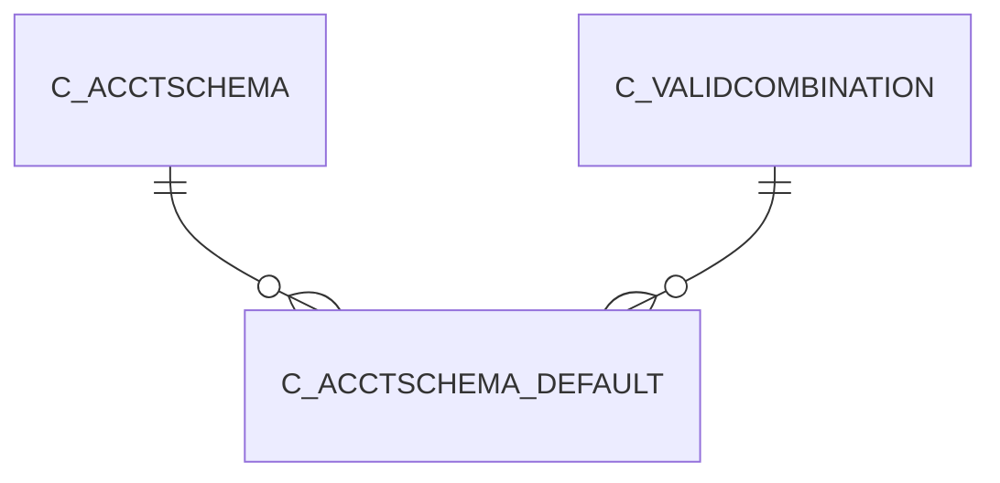

# C_ACCTSCHEMA_DEFAULT

Area [C](../../data-model/c/index.md) · class **business** (proposed) · read from database `idempiere-db` (owner `ADEMPIERE`) · 2 row(s) when profiled

Application model: `org.compiere.model.X_C_AcctSchema_Default`, access level 2 - Client.

## Columns

| column | type | key | not null | business name | references (code) | nulls | distinct |
|---|---|---|---|---|---|---|---|
| `C_ACCTSCHEMA_ID` | NUMBER(10,0) | PK | yes | Accounting Schema | [C_ACCTSCHEMA](../../data-model/c/c_acctschema.md) | 0 | 2 |
| `AD_CLIENT_ID` | NUMBER(10,0) |  | yes | Tenant |  | 0 | 1 |
| `AD_ORG_ID` | NUMBER(10,0) |  | yes | Organization |  | 0 | 1 |
| `ISACTIVE` | CHAR(1) |  | yes | Active |  | 0 | 1 |
| `CREATED` | DATE |  | yes | Created |  | 0 | 2 |
| `CREATEDBY` | NUMBER(10,0) |  | yes | Created By |  | 0 | 2 |
| `UPDATED` | DATE |  | yes | Updated |  | 0 | 2 |
| `UPDATEDBY` | NUMBER(10,0) |  | yes | Updated By |  | 0 | 1 |
| `W_INVENTORY_ACCT` | NUMBER(10,0) |  |  |  |  | 1 | 1 |
| `W_INVACTUALADJUST_ACCT` | NUMBER(10,0) |  |  |  |  | 1 | 1 |
| `W_DIFFERENCES_ACCT` | NUMBER(10,0) |  | yes | Warehouse Differences |  | 0 | 2 |
| `W_REVALUATION_ACCT` | NUMBER(10,0) |  |  |  |  | 1 | 1 |
| `P_REVENUE_ACCT` | NUMBER(10,0) |  | yes | Product Revenue |  | 0 | 2 |
| `P_EXPENSE_ACCT` | NUMBER(10,0) |  | yes | Product Expense |  | 0 | 2 |
| `P_ASSET_ACCT` | NUMBER(10,0) |  | yes | Product Asset |  | 0 | 2 |
| `P_PURCHASEPRICEVARIANCE_ACCT` | NUMBER(10,0) |  | yes | Purchase Price Variance |  | 0 | 2 |
| `P_INVOICEPRICEVARIANCE_ACCT` | NUMBER(10,0) |  | yes | Invoice Price Variance |  | 0 | 2 |
| `P_TRADEDISCOUNTREC_ACCT` | NUMBER(10,0) |  | yes | Trade Discount Received |  | 0 | 2 |
| `P_TRADEDISCOUNTGRANT_ACCT` | NUMBER(10,0) |  | yes | Trade Discount Granted |  | 0 | 2 |
| `P_COGS_ACCT` | NUMBER(10,0) |  | yes | Product COGS |  | 0 | 2 |
| `C_RECEIVABLE_ACCT` | NUMBER(10,0) |  | yes | Customer Receivables |  | 0 | 2 |
| `C_PREPAYMENT_ACCT` | NUMBER(10,0) |  | yes | Customer Prepayment |  | 0 | 2 |
| `V_LIABILITY_ACCT` | NUMBER(10,0) |  | yes | Vendor Liability |  | 0 | 2 |
| `V_LIABILITY_SERVICES_ACCT` | NUMBER(10,0) |  |  | Vendor Service Liability |  | 1 | 1 |
| `V_PREPAYMENT_ACCT` | NUMBER(10,0) |  | yes | Vendor Prepayment |  | 0 | 2 |
| `PAYDISCOUNT_EXP_ACCT` | NUMBER(10,0) |  | yes | Payment Discount Expense |  | 0 | 2 |
| `WRITEOFF_ACCT` | NUMBER(10,0) |  | yes | Write-off |  | 0 | 2 |
| `PAYDISCOUNT_REV_ACCT` | NUMBER(10,0) |  | yes | Payment Discount Revenue |  | 0 | 2 |
| `UNREALIZEDGAIN_ACCT` | NUMBER(10,0) |  | yes | Unrealized Gain Acct |  | 0 | 2 |
| `UNREALIZEDLOSS_ACCT` | NUMBER(10,0) |  | yes | Unrealized Loss Acct |  | 0 | 2 |
| `REALIZEDGAIN_ACCT` | NUMBER(10,0) |  | yes | Realized Gain Acct |  | 0 | 2 |
| `REALIZEDLOSS_ACCT` | NUMBER(10,0) |  | yes | Realized Loss Acct |  | 0 | 2 |
| `WITHHOLDING_ACCT` | NUMBER(10,0) |  |  |  |  | 1 | 1 |
| `E_PREPAYMENT_ACCT` | NUMBER(10,0) |  |  |  |  | 1 | 1 |
| `E_EXPENSE_ACCT` | NUMBER(10,0) |  |  |  |  | 1 | 1 |
| `PJ_ASSET_ACCT` | NUMBER(10,0) |  | yes | Project Asset |  | 0 | 2 |
| `PJ_WIP_ACCT` | NUMBER(10,0) |  | yes | Work In Progress |  | 0 | 2 |
| `T_EXPENSE_ACCT` | NUMBER(10,0) |  | yes | Tax Expense |  | 0 | 2 |
| `T_LIABILITY_ACCT` | NUMBER(10,0) |  |  |  |  | 1 | 1 |
| `T_RECEIVABLES_ACCT` | NUMBER(10,0) |  |  |  |  | 1 | 1 |
| `T_DUE_ACCT` | NUMBER(10,0) |  | yes | Tax Due |  | 0 | 2 |
| `T_CREDIT_ACCT` | NUMBER(10,0) |  | yes | Tax Credit |  | 0 | 2 |
| `B_INTRANSIT_ACCT` | NUMBER(10,0) |  | yes | Bank In Transit |  | 0 | 2 |
| `B_ASSET_ACCT` | NUMBER(10,0) |  | yes | Bank Asset |  | 0 | 2 |
| `B_EXPENSE_ACCT` | NUMBER(10,0) |  |  |  |  | 1 | 1 |
| `B_INTERESTREV_ACCT` | NUMBER(10,0) |  | yes | Bank Interest Revenue |  | 0 | 2 |
| `B_INTERESTEXP_ACCT` | NUMBER(10,0) |  | yes | Bank Interest Expense |  | 0 | 2 |
| `B_UNIDENTIFIED_ACCT` | NUMBER(10,0) |  |  |  |  | 1 | 1 |
| `B_UNALLOCATEDCASH_ACCT` | NUMBER(10,0) |  | yes | Unallocated Cash |  | 0 | 2 |
| `B_PAYMENTSELECT_ACCT` | NUMBER(10,0) |  | yes | Payment Selection |  | 0 | 2 |
| `B_SETTLEMENTGAIN_ACCT` | NUMBER(10,0) |  |  |  |  | 1 | 1 |
| `B_SETTLEMENTLOSS_ACCT` | NUMBER(10,0) |  |  |  |  | 1 | 1 |
| `B_REVALUATIONGAIN_ACCT` | NUMBER(10,0) |  |  |  |  | 1 | 1 |
| `B_REVALUATIONLOSS_ACCT` | NUMBER(10,0) |  |  |  |  | 1 | 1 |
| `CH_EXPENSE_ACCT` | NUMBER(10,0) |  | yes | Charge Account |  | 0 | 2 |
| `CH_REVENUE_ACCT` | NUMBER(10,0) |  |  |  |  | 2 | 0 |
| `UNEARNEDREVENUE_ACCT` | NUMBER(10,0) |  |  | Unearned Revenue |  | 0 | 2 |
| `NOTINVOICEDRECEIVABLES_ACCT` | NUMBER(10,0) |  |  |  |  | 1 | 1 |
| `NOTINVOICEDREVENUE_ACCT` | NUMBER(10,0) |  |  |  |  | 1 | 1 |
| `NOTINVOICEDRECEIPTS_ACCT` | NUMBER(10,0) |  | yes | Not-invoiced Receipts |  | 0 | 2 |
| `CB_ASSET_ACCT` | NUMBER(10,0) |  |  | Cash Book Asset |  | 1 | 1 |
| `CB_CASHTRANSFER_ACCT` | NUMBER(10,0) |  |  | Cash Transfer |  | 1 | 1 |
| `CB_DIFFERENCES_ACCT` | NUMBER(10,0) |  |  | Cash Book Differences |  | 1 | 1 |
| `CB_EXPENSE_ACCT` | NUMBER(10,0) |  |  | Cash Book Expense |  | 1 | 1 |
| `CB_RECEIPT_ACCT` | NUMBER(10,0) |  |  | Cash Book Receipt |  | 1 | 1 |
| `PROCESSING` | CHAR(1) |  |  | Process Now |  | 1 | 1 |
| `C_RECEIVABLE_SERVICES_ACCT` | NUMBER(10,0) |  |  | Receivable Services |  | 1 | 1 |
| `P_INVENTORYCLEARING_ACCT` | NUMBER(10,0) |  | yes | Inventory Clearing |  | 0 | 2 |
| `P_COSTADJUSTMENT_ACCT` | NUMBER(10,0) |  | yes | Cost Adjustment |  | 0 | 2 |
| `P_WIP_ACCT` | NUMBER(10,0) |  |  |  |  | 1 | 1 |
| `P_METHODCHANGEVARIANCE_ACCT` | NUMBER(10,0) |  |  |  |  | 1 | 1 |
| `P_USAGEVARIANCE_ACCT` | NUMBER(10,0) |  |  |  |  | 1 | 1 |
| `P_RATEVARIANCE_ACCT` | NUMBER(10,0) |  |  | Rate Variance |  | 0 | 2 |
| `P_MIXVARIANCE_ACCT` | NUMBER(10,0) |  |  |  |  | 1 | 1 |
| `P_FLOORSTOCK_ACCT` | NUMBER(10,0) |  |  |  |  | 1 | 1 |
| `P_COSTOFPRODUCTION_ACCT` | NUMBER(10,0) |  |  |  |  | 1 | 1 |
| `P_LABOR_ACCT` | NUMBER(10,0) |  |  |  |  | 1 | 1 |
| `P_BURDEN_ACCT` | NUMBER(10,0) |  |  |  |  | 1 | 1 |
| `P_OUTSIDEPROCESSING_ACCT` | NUMBER(10,0) |  |  |  |  | 1 | 1 |
| `P_OVERHEAD_ACCT` | NUMBER(10,0) |  |  |  |  | 1 | 1 |
| `P_SCRAP_ACCT` | NUMBER(10,0) |  |  |  |  | 1 | 1 |
| `P_AVERAGECOSTVARIANCE_ACCT` | NUMBER(10,0) |  |  | Average Cost Variance |  | 0 | 2 |
| `C_ACCTSCHEMA_DEFAULT_UU` | VARCHAR2(36 CHAR) |  |  | C_AcctSchema_Default_UU |  | 0 | 2 |
| `P_LANDEDCOSTCLEARING_ACCT` | NUMBER(10,0) |  |  | Landed Cost Clearing |  | 0 | 2 |

*references (code)* is the table the application model's code says a column points to; *Foreign keys* below are the constraints the database declares. Counts come from the profile; no value is ever shown.

## Check constraints

| name | expression |
|---|---|
| `SYS_C0019659` | `IsActive in ('Y','N')` |

## Foreign keys

**References**

| table | columns | on delete |
|---|---|---|
| [C_ACCTSCHEMA](../../data-model/c/c_acctschema.md) | C_ACCTSCHEMA_DEFAULT.C_ACCTSCHEMA_ID → C_ACCTSCHEMA.C_ACCTSCHEMA_ID | CASCADE |
| [C_VALIDCOMBINATION](../../data-model/c/c_validcombination.md) | C_ACCTSCHEMA_DEFAULT.CH_REVENUE_ACCT → C_VALIDCOMBINATION.C_VALIDCOMBINATION_ID | NO ACTION |

**Referenced by**

_None._

## Write behaviour

- updates: **po_only**
- deletes: **deleted_by_users, deleted_by_cascade**
- change log: **recorded**
- evidence: 2 citation(s)

## Schema history

205 change(s); the latest:

| applied | release | operation | column | tickets |
|---|---|---|---|---|
| 2023-04-09T15:47 | iD11 | `add_constraint` |  | IDEMPIERE-5567 |
| 2023-04-09T15:47 | iD11 | `add_constraint` |  | IDEMPIERE-5567 |
| 2021-12-05T16:45 | i8.2z | `add_constraint` |  | IDEMPIERE-5075 |
| 2021-12-05T16:45 | i8.2z | `add_constraint` |  | IDEMPIERE-5075 |
| 2021-12-05T16:45 | i8.2z | `add_constraint` |  | IDEMPIERE-5075 |
| 2021-12-05T16:45 | i8.2z | `drop_constraint` |  | IDEMPIERE-5075 |
| 2021-12-05T16:45 | i8.2z | `drop_constraint` |  | IDEMPIERE-5075 |
| 2021-12-05T16:45 | i8.2z | `drop_constraint` |  | IDEMPIERE-5075 |
| 2021-12-05T16:45 | i8.2z | `drop_constraint` |  | IDEMPIERE-5075 |
| 2021-12-05T16:45 | i8.2z | `add_constraint` |  | IDEMPIERE-5075 |
| 2021-12-05T16:45 | i8.2z | `drop_constraint` |  | IDEMPIERE-5075 |
| 2021-12-05T16:45 | i8.2z | `drop_constraint` |  | IDEMPIERE-5075 |
| 2021-12-05T16:45 | i8.2z | `drop_constraint` |  | IDEMPIERE-5075 |
| 2021-12-05T16:45 | i8.2z | `add_constraint` |  | IDEMPIERE-5075 |
| 2021-12-05T16:45 | i8.2z | `drop_constraint` |  | IDEMPIERE-5075 |

## Open conflicts

| type | attribute | explanation |
|---|---|---|
| `mandatory_but_nullable` | `columns.P_RateVariance_Acct.nullable` | unexplained |

## Notes

<!-- ekos:manual id="table.c_acctschema_default.notes" -->
_Business notes about this table._
<!-- /ekos:manual -->
