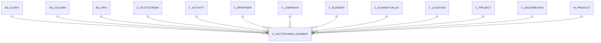

# C_ACCTSCHEMA_ELEMENT

Area [C](../../data-model/c/index.md) · class **business** (proposed) · read from database `idempiere-db` (owner `ADEMPIERE`) · 12 row(s) when profiled

Application model: `org.compiere.model.X_C_AcctSchema_Element`, access level 2 - Client.

## Columns

| column | type | key | not null | business name | references (code) | nulls | distinct |
|---|---|---|---|---|---|---|---|
| `C_ACCTSCHEMA_ELEMENT_ID` | NUMBER(10,0) | PK | yes | Acct.Schema Element |  | 0 | 12 |
| `ISACTIVE` | CHAR(1) |  | yes | Active |  | 0 | 1 |
| `CREATED` | DATE |  | yes | Created |  | 0 | 7 |
| `CREATEDBY` | NUMBER(10,0) |  | yes | Created By |  | 0 | 2 |
| `UPDATED` | DATE |  | yes | Updated |  | 0 | 7 |
| `AD_ORG_ID` | NUMBER(10,0) |  | yes | Organization |  | 0 | 1 |
| `UPDATEDBY` | NUMBER(10,0) |  | yes | Updated By |  | 0 | 2 |
| `C_ACCTSCHEMA_ID` | NUMBER(10,0) |  | yes | Accounting Schema | [C_ACCTSCHEMA](../../data-model/c/c_acctschema.md) | 0 | 2 |
| `ELEMENTTYPE` | CHAR(2) |  | yes | Type |  | 0 | 6 |
| `NAME` | VARCHAR2(60 CHAR) |  | yes | Name |  | 0 | 6 |
| `SEQNO` | NUMBER(10,0) |  | yes | Sequence |  | 0 | 6 |
| `C_ELEMENT_ID` | NUMBER(10,0) |  |  | Element | [C_ELEMENT](../../data-model/c/c_element.md) | 10 | 1 |
| `AD_CLIENT_ID` | NUMBER(10,0) |  | yes | Tenant |  | 0 | 1 |
| `ISMANDATORY` | CHAR(1) |  | yes | Mandatory |  | 0 | 2 |
| `ISBALANCED` | CHAR(1) |  | yes | Balanced |  | 0 | 2 |
| `ORG_ID` | NUMBER(10,0) |  |  | Organization |  | 10 | 1 |
| `C_ELEMENTVALUE_ID` | NUMBER(10,0) |  |  | Account Element | [C_ELEMENTVALUE](../../data-model/c/c_elementvalue.md) | 10 | 1 |
| `M_PRODUCT_ID` | NUMBER(10,0) |  |  | Product | [M_PRODUCT](../../data-model/m/m_product.md) | 10 | 1 |
| `C_BPARTNER_ID` | NUMBER(10,0) |  |  | Business Partner | [C_BPARTNER](../../data-model/c/c_bpartner.md) | 10 | 1 |
| `C_LOCATION_ID` | NUMBER(10,0) |  |  | Address | [C_LOCATION](../../data-model/c/c_location.md) | 12 | 0 |
| `C_SALESREGION_ID` | NUMBER(10,0) |  |  | Sales Region | [C_SALESREGION](../../data-model/c/c_salesregion.md) | 12 | 0 |
| `C_PROJECT_ID` | NUMBER(10,0) |  |  | Project | [C_PROJECT](../../data-model/c/c_project.md) | 10 | 1 |
| `C_CAMPAIGN_ID` | NUMBER(10,0) |  |  | Campaign | [C_CAMPAIGN](../../data-model/c/c_campaign.md) | 10 | 1 |
| `C_ACTIVITY_ID` | NUMBER(10,0) |  |  | Activity | [C_ACTIVITY](../../data-model/c/c_activity.md) | 12 | 0 |
| `AD_COLUMN_ID` | NUMBER(10,0) |  |  | Column | [AD_COLUMN](../../data-model/ad/ad_column.md) | 12 | 0 |
| `C_ACCTSCHEMA_ELEMENT_UU` | VARCHAR2(36 CHAR) |  |  | C_AcctSchema_Element_UU |  | 0 | 12 |

*references (code)* is the table the application model's code says a column points to; *Foreign keys* below are the constraints the database declares. Counts come from the profile; no value is ever shown.

## Check constraints

| name | expression |
|---|---|
| `SYS_C0022029` | `IsBalanced in ('Y','N')` |
| `SYS_C0022031` | `IsMandatory in ('Y','N')` |
| `SYS_C0022032` | `IsActive in ('Y','N')` |

## Foreign keys

**References**

| table | columns | on delete |
|---|---|---|
| [AD_CLIENT](../../data-model/ad/ad_client.md) | C_ACCTSCHEMA_ELEMENT.AD_CLIENT_ID → AD_CLIENT.AD_CLIENT_ID | NO ACTION |
| [AD_COLUMN](../../data-model/ad/ad_column.md) | C_ACCTSCHEMA_ELEMENT.AD_COLUMN_ID → AD_COLUMN.AD_COLUMN_ID | NO ACTION |
| [AD_ORG](../../data-model/ad/ad_org.md) | C_ACCTSCHEMA_ELEMENT.AD_ORG_ID → AD_ORG.AD_ORG_ID | NO ACTION |
| [C_ACCTSCHEMA](../../data-model/c/c_acctschema.md) | C_ACCTSCHEMA_ELEMENT.C_ACCTSCHEMA_ID → C_ACCTSCHEMA.C_ACCTSCHEMA_ID | CASCADE |
| [C_ACTIVITY](../../data-model/c/c_activity.md) | C_ACCTSCHEMA_ELEMENT.C_ACTIVITY_ID → C_ACTIVITY.C_ACTIVITY_ID | NO ACTION |
| [C_BPARTNER](../../data-model/c/c_bpartner.md) | C_ACCTSCHEMA_ELEMENT.C_BPARTNER_ID → C_BPARTNER.C_BPARTNER_ID | NO ACTION |
| [C_CAMPAIGN](../../data-model/c/c_campaign.md) | C_ACCTSCHEMA_ELEMENT.C_CAMPAIGN_ID → C_CAMPAIGN.C_CAMPAIGN_ID | NO ACTION |
| [C_ELEMENT](../../data-model/c/c_element.md) | C_ACCTSCHEMA_ELEMENT.C_ELEMENT_ID → C_ELEMENT.C_ELEMENT_ID | NO ACTION |
| [C_ELEMENTVALUE](../../data-model/c/c_elementvalue.md) | C_ACCTSCHEMA_ELEMENT.C_ELEMENTVALUE_ID → C_ELEMENTVALUE.C_ELEMENTVALUE_ID | NO ACTION |
| [C_LOCATION](../../data-model/c/c_location.md) | C_ACCTSCHEMA_ELEMENT.C_LOCATION_ID → C_LOCATION.C_LOCATION_ID | NO ACTION |
| [C_PROJECT](../../data-model/c/c_project.md) | C_ACCTSCHEMA_ELEMENT.C_PROJECT_ID → C_PROJECT.C_PROJECT_ID | NO ACTION |
| [C_SALESREGION](../../data-model/c/c_salesregion.md) | C_ACCTSCHEMA_ELEMENT.C_SALESREGION_ID → C_SALESREGION.C_SALESREGION_ID | NO ACTION |
| [M_PRODUCT](../../data-model/m/m_product.md) | C_ACCTSCHEMA_ELEMENT.M_PRODUCT_ID → M_PRODUCT.M_PRODUCT_ID | NO ACTION |

**Referenced by**

_None._

## Write behaviour

- updates: **raw_sql_skips_updated**
- deletes: **deleted_by_users, deleted_by_cascade**
- change log: **recorded**
- evidence: 10 citation(s)

## Schema history

74 change(s); the latest:

| applied | release | operation | column | tickets |
|---|---|---|---|---|
| 2024-05-14T13:59 | iD13 | `add_column` | A_Asset_ID | IDEMPIERE-5598 |
| 2024-05-14T13:59 | iD13 | `modify_column` | M_AttributeSetInstance_ID | IDEMPIERE-5598 |
| 2024-05-14T13:59 | iD13 | `add_constraint` |  | IDEMPIERE-5598 |
| 2024-05-14T13:59 | iD13 | `modify_column` | C_CostCenter_ID | IDEMPIERE-5598 |
| 2024-05-14T13:59 | iD13 | `add_constraint` |  | IDEMPIERE-5598 |
| 2024-05-14T13:59 | iD13 | `add_constraint` |  | IDEMPIERE-5598 |
| 2024-05-14T13:59 | iD13 | `add_constraint` |  | IDEMPIERE-5598 |
| 2024-05-14T13:59 | iD13 | `add_column` | C_CostCenter_ID | IDEMPIERE-5598 |
| 2024-05-14T13:59 | iD13 | `add_column` | C_Charge_ID | IDEMPIERE-5598 |
| 2024-05-14T13:59 | iD13 | `add_constraint` |  | IDEMPIERE-5598 |
| 2024-05-14T13:59 | iD13 | `add_column` | M_AttributeSetInstance_ID | IDEMPIERE-5598 |
| 2024-05-14T13:59 | iD13 | `add_column` | M_Warehouse_ID | IDEMPIERE-5598 |
| 2024-05-14T13:59 | iD13 | `add_constraint` |  | IDEMPIERE-5598 |
| 2024-05-14T13:59 | iD13 | `add_constraint` |  | IDEMPIERE-5598 |
| 2024-05-14T13:59 | iD13 | `add_constraint` |  | IDEMPIERE-5598 |

## Open conflicts

| type | attribute | explanation |
|---|---|---|
| `model_column_missing` | `columns.AD_Column2_ID` | unexplained |
| `model_column_missing` | `columns.A_Asset_ID` | unexplained |
| `model_column_missing` | `columns.C_Charge_ID` | unexplained |
| `model_column_missing` | `columns.C_CostCenter_ID` | unexplained |
| `model_column_missing` | `columns.C_Department_ID` | unexplained |
| `mandatory_but_nullable` | `columns.C_Element_ID.nullable` | unexplained |
| `model_column_missing` | `columns.C_Employee_ID` | unexplained |
| `model_column_missing` | `columns.M_AttributeSetInstance_ID` | unexplained |
| `model_column_missing` | `columns.M_Warehouse_ID` | unexplained |
| `mandatory_but_nullable` | `columns.Org_ID.nullable` | unexplained |

## Notes

<!-- ekos:manual id="table.c_acctschema_element.notes" -->
_Business notes about this table._
<!-- /ekos:manual -->
