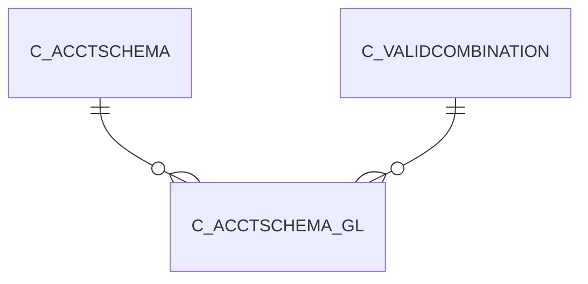

# C_ACCTSCHEMA_GL

Area [C](../../data-model/c/index.md) · class **business** (proposed) · read from database `idempiere-db` (owner `ADEMPIERE`) · 2 row(s) when profiled

Application model: `org.compiere.model.X_C_AcctSchema_GL`, access level 2 - Client.

## Columns

| column | type | key | not null | business name | references (code) | nulls | distinct |
|---|---|---|---|---|---|---|---|
| `C_ACCTSCHEMA_ID` | NUMBER(10,0) | PK | yes | Accounting Schema | [C_ACCTSCHEMA](../../data-model/c/c_acctschema.md) | 0 | 2 |
| `AD_CLIENT_ID` | NUMBER(10,0) |  | yes | Tenant |  | 0 | 1 |
| `AD_ORG_ID` | NUMBER(10,0) |  | yes | Organization |  | 0 | 1 |
| `ISACTIVE` | CHAR(1) |  | yes | Active |  | 0 | 1 |
| `CREATED` | DATE |  | yes | Created |  | 0 | 2 |
| `CREATEDBY` | NUMBER(10,0) |  | yes | Created By |  | 0 | 2 |
| `UPDATED` | DATE |  | yes | Updated |  | 0 | 2 |
| `UPDATEDBY` | NUMBER(10,0) |  | yes | Updated By |  | 0 | 1 |
| `USESUSPENSEBALANCING` | CHAR(1) |  | yes | Use Suspense Balancing |  | 0 | 1 |
| `SUSPENSEBALANCING_ACCT` | NUMBER(10,0) |  |  | Suspense Balancing Acct |  | 0 | 2 |
| `USESUSPENSEERROR` | CHAR(1) |  | yes | Use Suspense Error |  | 0 | 2 |
| `SUSPENSEERROR_ACCT` | NUMBER(10,0) |  |  |  |  | 1 | 1 |
| `USECURRENCYBALANCING` | CHAR(1) |  | yes | Use Currency Balancing |  | 0 | 1 |
| `CURRENCYBALANCING_ACCT` | NUMBER(10,0) |  |  | Currency Balancing Acct |  | 0 | 2 |
| `RETAINEDEARNING_ACCT` | NUMBER(10,0) |  |  |  |  | 1 | 1 |
| `INCOMESUMMARY_ACCT` | NUMBER(10,0) |  |  |  |  | 1 | 1 |
| `INTERCOMPANYDUETO_ACCT` | NUMBER(10,0) |  | yes | Intercompany Due To Acct |  | 0 | 2 |
| `INTERCOMPANYDUEFROM_ACCT` | NUMBER(10,0) |  | yes | Intercompany Due From Acct |  | 0 | 2 |
| `PPVOFFSET_ACCT` | NUMBER(10,0) |  | yes | PPV Offset |  | 0 | 2 |
| `COMMITMENTOFFSET_ACCT` | NUMBER(10,0) |  | yes | Commitment Offset |  | 0 | 2 |
| `COMMITMENTOFFSETSALES_ACCT` | NUMBER(10,0) |  | yes | Commitment Offset Sales |  | 0 | 2 |
| `C_ACCTSCHEMA_GL_UU` | VARCHAR2(36 CHAR) |  |  | C_AcctSchema_GL_UU |  | 0 | 2 |

*references (code)* is the table the application model's code says a column points to; *Foreign keys* below are the constraints the database declares. Counts come from the profile; no value is ever shown.

## Check constraints

| name | expression |
|---|---|
| `SYS_C0022002` | `IsActive in ('Y','N')` |
| `SYS_C0022004` | `UseCurrencyBalancing in ('Y','N')` |
| `SYS_C0022005` | `UseSuspenseBalancing in ('Y','N')` |
| `SYS_C0022006` | `UseSuspenseError in ('Y','N')` |

## Foreign keys

**References**

| table | columns | on delete |
|---|---|---|
| [C_ACCTSCHEMA](../../data-model/c/c_acctschema.md) | C_ACCTSCHEMA_GL.C_ACCTSCHEMA_ID → C_ACCTSCHEMA.C_ACCTSCHEMA_ID | CASCADE |
| [C_VALIDCOMBINATION](../../data-model/c/c_validcombination.md) | C_ACCTSCHEMA_GL.COMMITMENTOFFSETSALES_ACCT → C_VALIDCOMBINATION.C_VALIDCOMBINATION_ID | NO ACTION |

**Referenced by**

_None._

## Write behaviour

- updates: **po_only**
- deletes: **deleted_by_users, deleted_by_cascade**
- change log: **recorded**
- evidence: 2 citation(s)

## Schema history

27 change(s); the latest:

| applied | release | operation | column | tickets |
|---|---|---|---|---|
| 2023-04-09T15:47 | iD11 | `add_constraint` |  | IDEMPIERE-5567 |
| 2023-04-09T15:47 | iD11 | `add_constraint` |  | IDEMPIERE-5567 |
| 2021-12-05T16:45 | i8.2z | `drop_constraint` |  | IDEMPIERE-5075 |
| 2021-12-05T16:45 | i8.2z | `add_constraint` |  | IDEMPIERE-5075 |
| 2021-12-05T16:45 | i8.2z | `add_constraint` |  | IDEMPIERE-5075 |
| 2021-12-05T16:45 | i8.2z | `drop_constraint` |  | IDEMPIERE-5075 |
| 2021-12-05T16:45 | i8.2z | `add_constraint` |  | IDEMPIERE-5075 |
| 2021-12-05T16:45 | i8.2z | `drop_constraint` |  | IDEMPIERE-5075 |
| 2021-12-05T16:45 | i8.2z | `drop_constraint` |  | IDEMPIERE-5075 |
| 2021-12-05T16:45 | i8.2z | `add_constraint` |  | IDEMPIERE-5075 |
| 2021-12-05T16:45 | i8.2z | `drop_constraint` |  | IDEMPIERE-5075 |
| 2021-12-05T16:45 | i8.2z | `add_constraint` |  | IDEMPIERE-5075 |
| 2021-12-05T16:45 | i8.2z | `drop_constraint` |  | IDEMPIERE-5075 |
| 2021-12-05T16:45 | i8.2z | `add_constraint` |  | IDEMPIERE-5075 |
| 2021-12-05T16:45 | i8.2z | `drop_constraint` |  | IDEMPIERE-5075 |

## Notes

<!-- ekos:manual id="table.c_acctschema_gl.notes" -->
_Business notes about this table._
<!-- /ekos:manual -->
