# C_ACTIVITY

Area [C](../../data-model/c/index.md) · class **business** (proposed) · read from database `idempiere-db` (owner `ADEMPIERE`) · 0 row(s) when profiled

Application model: `org.compiere.model.X_C_Activity`, access level 2 - Client.

## Columns

| column | type | key | not null | business name | references (code) | nulls | distinct |
|---|---|---|---|---|---|---|---|
| `C_ACTIVITY_ID` | NUMBER(10,0) | PK | yes | Activity |  | 0 | 0 |
| `AD_CLIENT_ID` | NUMBER(10,0) |  | yes | Tenant |  | 0 | 0 |
| `AD_ORG_ID` | NUMBER(10,0) |  | yes | Organization |  | 0 | 0 |
| `ISACTIVE` | CHAR(1) |  | yes | Active |  | 0 | 0 |
| `CREATED` | DATE |  | yes | Created |  | 0 | 0 |
| `CREATEDBY` | NUMBER(10,0) |  | yes | Created By |  | 0 | 0 |
| `UPDATED` | DATE |  | yes | Updated |  | 0 | 0 |
| `UPDATEDBY` | NUMBER(10,0) |  | yes | Updated By |  | 0 | 0 |
| `VALUE` | VARCHAR2(40 CHAR) |  | yes | Search Key |  | 0 | 0 |
| `NAME` | VARCHAR2(60 CHAR) |  | yes | Name |  | 0 | 0 |
| `DESCRIPTION` | VARCHAR2(255 CHAR) |  |  | Description |  | 0 | 0 |
| `ISSUMMARY` | CHAR(1) |  | yes | Summary Level |  | 0 | 0 |
| `HELP` | VARCHAR2(2000 CHAR) |  |  | Comment/Help |  | 0 | 0 |
| `C_ACTIVITY_UU` | VARCHAR2(36 CHAR) |  |  | C_Activity_UU |  | 0 | 0 |

*references (code)* is the table the application model's code says a column points to; *Foreign keys* below are the constraints the database declares. Counts come from the profile; no value is ever shown.

## Check constraints

| name | expression |
|---|---|
| `SYS_C0021227` | `IsActive in ('Y','N')` |

## Foreign keys

**References**

_None._

**Referenced by**

| table | columns | on delete |
|---|---|---|
| [A_ASSET](../../data-model/a/a_asset.md) | A_ASSET.C_ACTIVITY_ID → C_ACTIVITY.C_ACTIVITY_ID | NO ACTION |
| [C_ACCTSCHEMA_ELEMENT](../../data-model/c/c_acctschema_element.md) | C_ACCTSCHEMA_ELEMENT.C_ACTIVITY_ID → C_ACTIVITY.C_ACTIVITY_ID | NO ACTION |
| [C_ACTIVITY_TRL](../../data-model/c/c_activity_trl.md) | C_ACTIVITY_TRL.C_ACTIVITY_ID → C_ACTIVITY.C_ACTIVITY_ID | CASCADE |
| [C_CASH](../../data-model/c/c_cash.md) | C_CASH.C_ACTIVITY_ID → C_ACTIVITY.C_ACTIVITY_ID | NO ACTION |
| [C_CASHPLAN](../../data-model/c/c_cashplan.md) | C_CASHPLAN.C_ACTIVITY_ID → C_ACTIVITY.C_ACTIVITY_ID | NO ACTION |
| [C_CASHPLANLINE](../../data-model/c/c_cashplanline.md) | C_CASHPLANLINE.C_ACTIVITY_ID → C_ACTIVITY.C_ACTIVITY_ID | NO ACTION |
| [C_INVOICE](../../data-model/c/c_invoice.md) | C_INVOICE.C_ACTIVITY_ID → C_ACTIVITY.C_ACTIVITY_ID | NO ACTION |
| [C_INVOICEBATCHLINE](../../data-model/c/c_invoicebatchline.md) | C_INVOICEBATCHLINE.C_ACTIVITY_ID → C_ACTIVITY.C_ACTIVITY_ID | NO ACTION |
| [C_INVOICELINE](../../data-model/c/c_invoiceline.md) | C_INVOICELINE.C_ACTIVITY_ID → C_ACTIVITY.C_ACTIVITY_ID | NO ACTION |
| [C_ORDER](../../data-model/c/c_order.md) | C_ORDER.C_ACTIVITY_ID → C_ACTIVITY.C_ACTIVITY_ID | NO ACTION |
| [C_ORDERLINE](../../data-model/c/c_orderline.md) | C_ORDERLINE.C_ACTIVITY_ID → C_ACTIVITY.C_ACTIVITY_ID | NO ACTION |
| [C_PAYMENT](../../data-model/c/c_payment.md) | C_PAYMENT.C_ACTIVITY_ID → C_ACTIVITY.C_ACTIVITY_ID | NO ACTION |
| [C_PAYMENTTRANSACTION](../../data-model/c/c_paymenttransaction.md) | C_PAYMENTTRANSACTION.C_ACTIVITY_ID → C_ACTIVITY.C_ACTIVITY_ID | NO ACTION |
| [C_PROJECT](../../data-model/c/c_project.md) | C_PROJECT.C_ACTIVITY_ID → C_ACTIVITY.C_ACTIVITY_ID | NO ACTION |
| [C_VALIDCOMBINATION](../../data-model/c/c_validcombination.md) | C_VALIDCOMBINATION.C_ACTIVITY_ID → C_ACTIVITY.C_ACTIVITY_ID | NO ACTION |
| [DD_ORDER](../../data-model/dd/dd_order.md) | DD_ORDER.C_ACTIVITY_ID → C_ACTIVITY.C_ACTIVITY_ID | NO ACTION |
| [DD_ORDERLINE](../../data-model/dd/dd_orderline.md) | DD_ORDERLINE.C_ACTIVITY_ID → C_ACTIVITY.C_ACTIVITY_ID | NO ACTION |
| [FACT_ACCT](../../data-model/fact/fact_acct.md) | FACT_ACCT.C_ACTIVITY_ID → C_ACTIVITY.C_ACTIVITY_ID | NO ACTION |
| [FACT_ACCT_SUMMARY](../../data-model/fact/fact_acct_summary.md) | FACT_ACCT_SUMMARY.C_ACTIVITY_ID → C_ACTIVITY.C_ACTIVITY_ID | NO ACTION |
| [GL_DISTRIBUTION](../../data-model/gl/gl_distribution.md) | GL_DISTRIBUTION.C_ACTIVITY_ID → C_ACTIVITY.C_ACTIVITY_ID | NO ACTION |
| [GL_DISTRIBUTIONLINE](../../data-model/gl/gl_distributionline.md) | GL_DISTRIBUTIONLINE.C_ACTIVITY_ID → C_ACTIVITY.C_ACTIVITY_ID | NO ACTION |
| [GL_JOURNALLINE](../../data-model/gl/gl_journalline.md) | GL_JOURNALLINE.C_ACTIVITY_ID → C_ACTIVITY.C_ACTIVITY_ID | NO ACTION |
| [HR_DEPARTMENT](../../data-model/hr/hr_department.md) | HR_DEPARTMENT.C_ACTIVITY_ID → C_ACTIVITY.C_ACTIVITY_ID | NO ACTION |
| [HR_EMPLOYEE](../../data-model/hr/hr_employee.md) | HR_EMPLOYEE.C_ACTIVITY_ID → C_ACTIVITY.C_ACTIVITY_ID | NO ACTION |
| [HR_MOVEMENT](../../data-model/hr/hr_movement.md) | HR_MOVEMENT.C_ACTIVITY_ID → C_ACTIVITY.C_ACTIVITY_ID | NO ACTION |
| `I_FAJOURNAL` | I_FAJOURNAL.C_ACTIVITY_ID → C_ACTIVITY.C_ACTIVITY_ID | NO ACTION |
| `I_GLJOURNAL` | I_GLJOURNAL.C_ACTIVITY_ID → C_ACTIVITY.C_ACTIVITY_ID | SET NULL |
| `I_INVOICE` | I_INVOICE.C_ACTIVITY_ID → C_ACTIVITY.C_ACTIVITY_ID | SET NULL |
| `I_ORDER` | I_ORDER.C_ACTIVITY_ID → C_ACTIVITY.C_ACTIVITY_ID | SET NULL |
| [M_INOUT](../../data-model/m/m_inout.md) | M_INOUT.C_ACTIVITY_ID → C_ACTIVITY.C_ACTIVITY_ID | NO ACTION |
| [M_INOUTLINE](../../data-model/m/m_inoutline.md) | M_INOUTLINE.C_ACTIVITY_ID → C_ACTIVITY.C_ACTIVITY_ID | NO ACTION |
| [M_INVENTORY](../../data-model/m/m_inventory.md) | M_INVENTORY.C_ACTIVITY_ID → C_ACTIVITY.C_ACTIVITY_ID | NO ACTION |
| [M_MOVEMENT](../../data-model/m/m_movement.md) | M_MOVEMENT.C_ACTIVITY_ID → C_ACTIVITY.C_ACTIVITY_ID | NO ACTION |
| [M_PRODUCTION](../../data-model/m/m_production.md) | M_PRODUCTION.C_ACTIVITY_ID → C_ACTIVITY.C_ACTIVITY_ID | NO ACTION |
| [M_PROMOTIONPRECONDITION](../../data-model/m/m_promotionprecondition.md) | M_PROMOTIONPRECONDITION.C_ACTIVITY_ID → C_ACTIVITY.C_ACTIVITY_ID | NO ACTION |
| [PA_REPORTCOLUMN](../../data-model/pa/pa_reportcolumn.md) | PA_REPORTCOLUMN.C_ACTIVITY_ID → C_ACTIVITY.C_ACTIVITY_ID | NO ACTION |
| [PA_REPORTSOURCE](../../data-model/pa/pa_reportsource.md) | PA_REPORTSOURCE.C_ACTIVITY_ID → C_ACTIVITY.C_ACTIVITY_ID | NO ACTION |
| [PP_COST_COLLECTOR](../../data-model/pp/pp_cost_collector.md) | PP_COST_COLLECTOR.C_ACTIVITY_ID → C_ACTIVITY.C_ACTIVITY_ID | NO ACTION |
| [PP_ORDER](../../data-model/pp/pp_order.md) | PP_ORDER.C_ACTIVITY_ID → C_ACTIVITY.C_ACTIVITY_ID | NO ACTION |
| [R_REQUEST](../../data-model/r/r_request.md) | R_REQUEST.C_ACTIVITY_ID → C_ACTIVITY.C_ACTIVITY_ID | NO ACTION |
| [R_REQUESTACTION](../../data-model/r/r_requestaction.md) | R_REQUESTACTION.C_ACTIVITY_ID → C_ACTIVITY.C_ACTIVITY_ID | NO ACTION |
| [S_TIMEEXPENSELINE](../../data-model/s/s_timeexpenseline.md) | S_TIMEEXPENSELINE.C_ACTIVITY_ID → C_ACTIVITY.C_ACTIVITY_ID | NO ACTION |
| `T_AGING` | T_AGING.C_ACTIVITY_ID → C_ACTIVITY.C_ACTIVITY_ID | CASCADE |

```mermaid
erDiagram
  C_ACTIVITY ||--o{ A_ASSET : ""
  C_ACTIVITY ||--o{ C_ACCTSCHEMA_ELEMENT : ""
  C_ACTIVITY ||--o{ C_ACTIVITY_TRL : ""
  C_ACTIVITY ||--o{ C_CASH : ""
  C_ACTIVITY ||--o{ C_CASHPLAN : ""
  C_ACTIVITY ||--o{ C_CASHPLANLINE : ""
  C_ACTIVITY ||--o{ C_INVOICE : ""
  C_ACTIVITY ||--o{ C_INVOICEBATCHLINE : ""
  C_ACTIVITY ||--o{ C_INVOICELINE : ""
  C_ACTIVITY ||--o{ C_ORDER : ""
  C_ACTIVITY ||--o{ C_ORDERLINE : ""
  C_ACTIVITY ||--o{ C_PAYMENT : ""
  C_ACTIVITY ||--o{ C_PAYMENTTRANSACTION : ""
  C_ACTIVITY ||--o{ C_PROJECT : ""
  C_ACTIVITY ||--o{ C_VALIDCOMBINATION : ""
  C_ACTIVITY ||--o{ DD_ORDER : ""
  C_ACTIVITY ||--o{ DD_ORDERLINE : ""
  C_ACTIVITY ||--o{ FACT_ACCT : ""
  C_ACTIVITY ||--o{ FACT_ACCT_SUMMARY : ""
  C_ACTIVITY ||--o{ GL_DISTRIBUTION : ""
  C_ACTIVITY ||--o{ GL_DISTRIBUTIONLINE : ""
  C_ACTIVITY ||--o{ GL_JOURNALLINE : ""
  C_ACTIVITY ||--o{ HR_DEPARTMENT : ""
  C_ACTIVITY ||--o{ HR_EMPLOYEE : ""
  C_ACTIVITY ||--o{ HR_MOVEMENT : ""
  C_ACTIVITY ||--o{ I_FAJOURNAL : ""
  C_ACTIVITY ||--o{ I_GLJOURNAL : ""
  C_ACTIVITY ||--o{ I_INVOICE : ""
  C_ACTIVITY ||--o{ I_ORDER : ""
```

14 more neighbour(s) not drawn.

## Write behaviour

- updates: **po_only**
- deletes: **deleted_by_users**
- change log: **recorded**
- evidence: 1 citation(s)

## Schema history

22 change(s); the latest:

| applied | release | operation | column | tickets |
|---|---|---|---|---|
| 2023-04-09T15:47 | iD11 | `add_constraint` |  | IDEMPIERE-5567 |
| 2023-04-09T15:47 | iD11 | `add_constraint` |  | IDEMPIERE-5567 |
| 2020-08-04T01:00 | i7.1z | `drop_column` | tmp_col_3_tmp | IDEMPIERE-3862 |
| 2020-08-04T01:00 | i7.1z | `modify_column` | NAME | IDEMPIERE-3862 |
| 2020-08-04T01:00 | i7.1z | `modify_column` | NAME | IDEMPIERE-3862 |
| 2020-08-04T01:00 | i7.1z | `create_index` |  | IDEMPIERE-3862 |
| 2020-08-04T01:00 | i7.1z | `add_column` | tmp_col_1_tmp | IDEMPIERE-3862 |
| 2020-08-04T01:00 | i7.1z | `drop_column` | tmp_col_2_tmp | IDEMPIERE-3862 |
| 2020-08-04T01:00 | i7.1z | `drop_column` | tmp_col_5_tmp | IDEMPIERE-3862 |
| 2020-08-04T01:00 | i7.1z | `modify_column` | NAME | IDEMPIERE-3862 |
| 2020-08-04T01:00 | i7.1z | `add_column` | tmp_col_2_tmp | IDEMPIERE-3862 |
| 2020-08-04T01:00 | i7.1z | `modify_column` | DESCRIPTION | IDEMPIERE-3862 |
| 2020-08-04T01:00 | i7.1z | `add_column` | tmp_col_5_tmp | IDEMPIERE-3862 |
| 2020-08-04T01:00 | i7.1z | `modify_column` | VALUE | IDEMPIERE-3862 |
| 2020-08-04T01:00 | i7.1z | `add_column` | tmp_col_3_tmp | IDEMPIERE-3862 |

## Notes

<!-- ekos:manual id="table.c_activity.notes" -->
_Business notes about this table._
<!-- /ekos:manual -->
