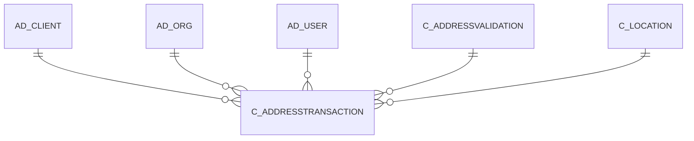

# C_ADDRESSTRANSACTION

Area [C](../../data-model/c/index.md) · class **business** (proposed) · read from database `idempiere-db` (owner `ADEMPIERE`) · 0 row(s) when profiled

Application model: `org.compiere.model.X_C_AddressTransaction`, access level 3 - Client - Org.

## Columns

| column | type | key | not null | business name | references (code) | nulls | distinct |
|---|---|---|---|---|---|---|---|
| `AD_CLIENT_ID` | NUMBER(10,0) |  | yes | Tenant |  | 0 | 0 |
| `AD_ORG_ID` | NUMBER(10,0) |  | yes | Organization |  | 0 | 0 |
| `ADDRESS1` | VARCHAR2(60 CHAR) |  |  | Address 1 |  | 0 | 0 |
| `ADDRESS2` | VARCHAR2(60 CHAR) |  |  | Address 2 |  | 0 | 0 |
| `ADDRESS3` | VARCHAR2(60 CHAR) |  |  | Address 3 |  | 0 | 0 |
| `ADDRESS4` | VARCHAR2(60 CHAR) |  |  | Address 4 |  | 0 | 0 |
| `C_ADDRESSTRANSACTION_ID` | NUMBER(10,0) | PK | yes | Address Transaction |  | 0 | 0 |
| `C_ADDRESSTRANSACTION_UU` | VARCHAR2(36 CHAR) |  |  | C_AddressTransaction_UU |  | 0 | 0 |
| `C_ADDRESSVALIDATION_ID` | NUMBER(10,0) |  | yes | Address Validation | [C_ADDRESSVALIDATION](../../data-model/c/c_addressvalidation.md) | 0 | 0 |
| `C_LOCATION_ID` | NUMBER(10,0) |  |  | Address | [C_LOCATION](../../data-model/c/c_location.md) | 0 | 0 |
| `CITY` | VARCHAR2(60 CHAR) |  |  | City |  | 0 | 0 |
| `CREATED` | DATE |  | yes | Created |  | 0 | 0 |
| `CREATEDBY` | NUMBER(10,0) |  | yes | Created By |  | 0 | 0 |
| `ISACTIVE` | CHAR(1) |  | yes | Active |  | 0 | 0 |
| `ISVALID` | CHAR(1) |  | yes | Valid |  | 0 | 0 |
| `POSTAL` | VARCHAR2(10 CHAR) |  |  | ZIP |  | 0 | 0 |
| `PROCESSED` | CHAR(1) |  | yes | Processed |  | 0 | 0 |
| `REGION` | VARCHAR2(60 CHAR) |  |  | Region |  | 0 | 0 |
| `RESULT` | VARCHAR2(2000 CHAR) |  |  | Result |  | 0 | 0 |
| `UPDATED` | DATE |  | yes | Updated |  | 0 | 0 |
| `UPDATEDBY` | NUMBER(10,0) |  | yes | Updated By |  | 0 | 0 |
| `COUNTRY` | VARCHAR2(60 CHAR) |  |  | Country |  | 0 | 0 |
| `COMMENTS` | VARCHAR2(2000 CHAR) |  |  | Comments |  | 0 | 0 |
| `ADDRESS5` | VARCHAR2(60 CHAR) |  |  | Address 5 |  | 0 | 0 |

*references (code)* is the table the application model's code says a column points to; *Foreign keys* below are the constraints the database declares. Counts come from the profile; no value is ever shown.

## Check constraints

| name | expression |
|---|---|
| `SYS_C0020160` | `Processed IN ('Y','N')` |
| `SYS_C0020161` | `IsActive IN ('Y','N')` |
| `SYS_C0020163` | `IsValid IN ('Y','N')` |

## Foreign keys

**References**

| table | columns | on delete |
|---|---|---|
| [AD_CLIENT](../../data-model/ad/ad_client.md) | C_ADDRESSTRANSACTION.AD_CLIENT_ID → AD_CLIENT.AD_CLIENT_ID | NO ACTION |
| [AD_ORG](../../data-model/ad/ad_org.md) | C_ADDRESSTRANSACTION.AD_ORG_ID → AD_ORG.AD_ORG_ID | NO ACTION |
| [AD_USER](../../data-model/ad/ad_user.md) | C_ADDRESSTRANSACTION.CREATEDBY → AD_USER.AD_USER_ID | NO ACTION |
| [C_ADDRESSVALIDATION](../../data-model/c/c_addressvalidation.md) | C_ADDRESSTRANSACTION.C_ADDRESSVALIDATION_ID → C_ADDRESSVALIDATION.C_ADDRESSVALIDATION_ID | NO ACTION |
| [C_LOCATION](../../data-model/c/c_location.md) | C_ADDRESSTRANSACTION.C_LOCATION_ID → C_LOCATION.C_LOCATION_ID | NO ACTION |

**Referenced by**

_None._

## Write behaviour

- updates: **po_only**
- deletes: **deleted_by_users**
- change log: **recorded**
- evidence: 1 citation(s)

## Schema history

96 change(s); the latest:

| applied | release | operation | column | tickets |
|---|---|---|---|---|
| 2020-08-04T01:00 | i7.1z | `add_column` | tmp_col_6_tmp | IDEMPIERE-3862 |
| 2020-08-04T01:00 | i7.1z | `drop_column` | tmp_col_2_tmp | IDEMPIERE-3862 |
| 2020-08-04T01:00 | i7.1z | `add_column` | tmp_col_1_tmp | IDEMPIERE-3862 |
| 2020-08-04T01:00 | i7.1z | `modify_column` | CITY | IDEMPIERE-3862 |
| 2020-08-04T01:00 | i7.1z | `drop_column` | tmp_col_4_tmp | IDEMPIERE-3862 |
| 2020-08-04T01:00 | i7.1z | `modify_column` | COUNTRY | IDEMPIERE-3862 |
| 2020-08-04T01:00 | i7.1z | `drop_column` | tmp_col_6_tmp | IDEMPIERE-3862 |
| 2020-08-04T01:00 | i7.1z | `add_column` | tmp_col_2_tmp | IDEMPIERE-3862 |
| 2020-08-04T01:00 | i7.1z | `add_column` | tmp_col_4_tmp | IDEMPIERE-3862 |
| 2020-08-04T01:00 | i7.1z | `modify_column` | ADDRESS3 | IDEMPIERE-3862 |
| 2020-08-04T01:00 | i7.1z | `add_column` | tmp_col_3_tmp | IDEMPIERE-3862 |
| 2020-08-04T01:00 | i7.1z | `modify_column` | ADDRESS1 | IDEMPIERE-3862 |
| 2020-08-04T01:00 | i7.1z | `drop_column` | tmp_col_10_tmp | IDEMPIERE-3862 |
| 2020-08-04T01:00 | i7.1z | `add_column` | tmp_col_7_tmp | IDEMPIERE-3862 |
| 2020-08-04T01:00 | i7.1z | `drop_column` | tmp_col_8_tmp | IDEMPIERE-3862 |

## Notes

<!-- ekos:manual id="table.c_addresstransaction.notes" -->
_Business notes about this table._
<!-- /ekos:manual -->
