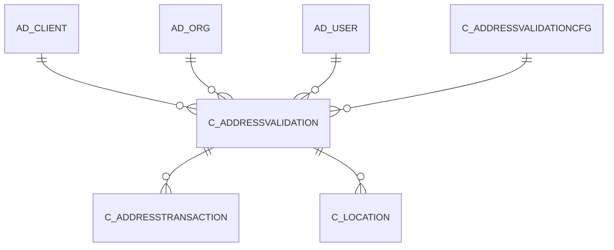

# C_ADDRESSVALIDATION

Area [C](../../data-model/c/index.md) · class **business** (proposed) · read from database `idempiere-db` (owner `ADEMPIERE`) · 0 row(s) when profiled

Application model: `org.compiere.model.X_C_AddressValidation`, access level 3 - Client - Org.

## Columns

| column | type | key | not null | business name | references (code) | nulls | distinct |
|---|---|---|---|---|---|---|---|
| `AD_CLIENT_ID` | NUMBER(10,0) |  | yes | Tenant |  | 0 | 0 |
| `AD_ORG_ID` | NUMBER(10,0) |  | yes | Organization |  | 0 | 0 |
| `C_ADDRESSVALIDATION_ID` | NUMBER(10,0) | PK | yes | Address Validation |  | 0 | 0 |
| `C_ADDRESSVALIDATION_UU` | VARCHAR2(36 CHAR) |  |  | C_AddressValidation_UU |  | 0 | 0 |
| `C_ADDRESSVALIDATIONCFG_ID` | NUMBER(10,0) |  | yes | Address Validation Configuration | [C_ADDRESSVALIDATIONCFG](../../data-model/c/c_addressvalidationcfg.md) | 0 | 0 |
| `CONNECTIONKEY` | VARCHAR2(60 CHAR) |  |  | Connection Key |  | 0 | 0 |
| `CONNECTIONPASSWORD` | VARCHAR2(60 CHAR) |  | yes | Connection Password |  | 0 | 0 |
| `CREATED` | DATE |  | yes | Created |  | 0 | 0 |
| `CREATEDBY` | NUMBER(10,0) |  | yes | Created By |  | 0 | 0 |
| `ISACTIVE` | CHAR(1) |  | yes | Active |  | 0 | 0 |
| `NAME` | VARCHAR2(60 CHAR) |  | yes | Name |  | 0 | 0 |
| `UPDATED` | DATE |  | yes | Updated |  | 0 | 0 |
| `UPDATEDBY` | NUMBER(10,0) |  | yes | Updated By |  | 0 | 0 |
| `USERID` | VARCHAR2(60 CHAR) |  | yes | User ID |  | 0 | 0 |
| `SHIPPERACCOUNT` | VARCHAR2(40 CHAR) |  |  | Shipper Account Number |  | 0 | 0 |
| `SHIPPERMETER` | VARCHAR2(255 CHAR) |  |  | Shipper Meter |  | 0 | 0 |
| `SEQNO` | NUMBER(10,0) |  | yes | Sequence |  | 0 | 0 |

*references (code)* is the table the application model's code says a column points to; *Foreign keys* below are the constraints the database declares. Counts come from the profile; no value is ever shown.

## Check constraints

| name | expression |
|---|---|
| `SYS_C0021103` | `IsActive IN ('Y','N')` |

## Foreign keys

**References**

| table | columns | on delete |
|---|---|---|
| [AD_CLIENT](../../data-model/ad/ad_client.md) | C_ADDRESSVALIDATION.AD_CLIENT_ID → AD_CLIENT.AD_CLIENT_ID | NO ACTION |
| [AD_ORG](../../data-model/ad/ad_org.md) | C_ADDRESSVALIDATION.AD_ORG_ID → AD_ORG.AD_ORG_ID | NO ACTION |
| [AD_USER](../../data-model/ad/ad_user.md) | C_ADDRESSVALIDATION.CREATEDBY → AD_USER.AD_USER_ID | NO ACTION |
| [C_ADDRESSVALIDATIONCFG](../../data-model/c/c_addressvalidationcfg.md) | C_ADDRESSVALIDATION.C_ADDRESSVALIDATIONCFG_ID → C_ADDRESSVALIDATIONCFG.C_ADDRESSVALIDATIONCFG_ID | NO ACTION |

**Referenced by**

| table | columns | on delete |
|---|---|---|
| [C_ADDRESSTRANSACTION](../../data-model/c/c_addresstransaction.md) | C_ADDRESSTRANSACTION.C_ADDRESSVALIDATION_ID → C_ADDRESSVALIDATION.C_ADDRESSVALIDATION_ID | NO ACTION |
| [C_LOCATION](../../data-model/c/c_location.md) | C_LOCATION.C_ADDRESSVALIDATION_ID → C_ADDRESSVALIDATION.C_ADDRESSVALIDATION_ID | NO ACTION |

## Write behaviour

- updates: **po_only**
- deletes: **deleted_by_users**
- change log: **recorded**
- evidence: 1 citation(s)

## Schema history

73 change(s); the latest:

| applied | release | operation | column | tickets |
|---|---|---|---|---|
| 2020-08-04T01:00 | i7.1z | `modify_column` | USERID | IDEMPIERE-3862 |
| 2020-08-04T01:00 | i7.1z | `modify_column` | NAME | IDEMPIERE-3862 |
| 2020-08-04T01:00 | i7.1z | `drop_column` | tmp_col_2_tmp | IDEMPIERE-3862 |
| 2020-08-04T01:00 | i7.1z | `drop_column` | tmp_col_5_tmp | IDEMPIERE-3862 |
| 2020-08-04T01:00 | i7.1z | `add_column` | tmp_col_7_tmp | IDEMPIERE-3862 |
| 2020-08-04T01:00 | i7.1z | `add_column` | tmp_col_5_tmp | IDEMPIERE-3862 |
| 2020-08-04T01:00 | i7.1z | `add_column` | tmp_col_3_tmp | IDEMPIERE-3862 |
| 2020-08-04T01:00 | i7.1z | `modify_column` | USERID | IDEMPIERE-3862 |
| 2020-08-04T01:00 | i7.1z | `modify_column` | NAME | IDEMPIERE-3862 |
| 2020-08-04T01:00 | i7.1z | `modify_column` | CONNECTIONPASSWORD | IDEMPIERE-3862 |
| 2020-08-04T01:00 | i7.1z | `modify_column` | CONNECTIONKEY | IDEMPIERE-3862 |
| 2020-08-04T01:00 | i7.1z | `drop_column` | tmp_col_7_tmp | IDEMPIERE-3862 |
| 2020-08-04T01:00 | i7.1z | `drop_column` | tmp_col_6_tmp | IDEMPIERE-3862 |
| 2020-08-04T01:00 | i7.1z | `modify_column` | C_ADDRESSVALIDATION_UU | IDEMPIERE-3862 |
| 2020-08-04T01:00 | i7.1z | `modify_column` | USERID | IDEMPIERE-3862 |

## Notes

<!-- ekos:manual id="table.c_addressvalidation.notes" -->
_Business notes about this table._
<!-- /ekos:manual -->
