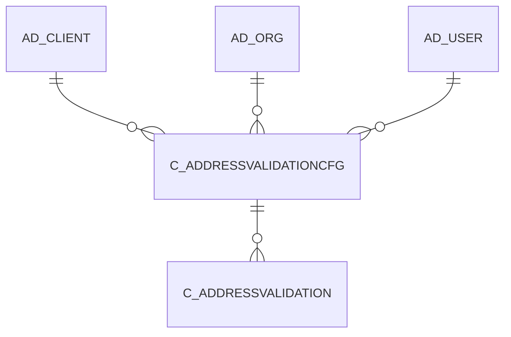

# C_ADDRESSVALIDATIONCFG

Area [C](../../data-model/c/index.md) · class **business** (proposed) · read from database `idempiere-db` (owner `ADEMPIERE`) · 0 row(s) when profiled

Application model: `org.compiere.model.X_C_AddressValidationCfg`, access level 6 - System - Client.

## Columns

| column | type | key | not null | business name | references (code) | nulls | distinct |
|---|---|---|---|---|---|---|---|
| `AD_CLIENT_ID` | NUMBER(10,0) |  | yes | Tenant |  | 0 | 0 |
| `AD_ORG_ID` | NUMBER(10,0) |  | yes | Organization |  | 0 | 0 |
| `ADDRESSVALIDATIONCLASS` | VARCHAR2(100 CHAR) |  |  | Address Validation Class |  | 0 | 0 |
| `C_ADDRESSVALIDATIONCFG_ID` | NUMBER(10,0) | PK | yes | Address Validation Configuration |  | 0 | 0 |
| `C_ADDRESSVALIDATIONCFG_UU` | VARCHAR2(36 CHAR) |  |  | C_AddressValidationCfg_UU |  | 0 | 0 |
| `CREATED` | DATE |  | yes | Created |  | 0 | 0 |
| `CREATEDBY` | NUMBER(10,0) |  | yes | Created By |  | 0 | 0 |
| `DESCRIPTION` | VARCHAR2(255 CHAR) |  |  | Description |  | 0 | 0 |
| `HOSTADDRESS` | VARCHAR2(60 CHAR) |  | yes | Host Address |  | 0 | 0 |
| `HOSTPORT` | NUMBER(10,0) |  | yes | Host port |  | 0 | 0 |
| `ISACTIVE` | CHAR(1) |  | yes | Active |  | 0 | 0 |
| `NAME` | VARCHAR2(60 CHAR) |  | yes | Name |  | 0 | 0 |
| `PROXYADDRESS` | VARCHAR2(60 CHAR) |  |  | Proxy address |  | 0 | 0 |
| `PROXYLOGON` | VARCHAR2(60 CHAR) |  |  | Proxy logon |  | 0 | 0 |
| `PROXYPASSWORD` | VARCHAR2(60 CHAR) |  |  | Proxy password |  | 0 | 0 |
| `PROXYPORT` | NUMBER(10,0) |  |  | Proxy port |  | 0 | 0 |
| `SERVICEPATH` | VARCHAR2(60 CHAR) |  |  | Service Path |  | 0 | 0 |
| `UPDATED` | DATE |  | yes | Updated |  | 0 | 0 |
| `UPDATEDBY` | NUMBER(10,0) |  | yes | Updated By |  | 0 | 0 |

*references (code)* is the table the application model's code says a column points to; *Foreign keys* below are the constraints the database declares. Counts come from the profile; no value is ever shown.

## Check constraints

| name | expression |
|---|---|
| `SYS_C0019820` | `IsActive IN ('Y','N')` |

## Foreign keys

**References**

| table | columns | on delete |
|---|---|---|
| [AD_CLIENT](../../data-model/ad/ad_client.md) | C_ADDRESSVALIDATIONCFG.AD_CLIENT_ID → AD_CLIENT.AD_CLIENT_ID | NO ACTION |
| [AD_ORG](../../data-model/ad/ad_org.md) | C_ADDRESSVALIDATIONCFG.AD_ORG_ID → AD_ORG.AD_ORG_ID | NO ACTION |
| [AD_USER](../../data-model/ad/ad_user.md) | C_ADDRESSVALIDATIONCFG.CREATEDBY → AD_USER.AD_USER_ID | NO ACTION |

**Referenced by**

| table | columns | on delete |
|---|---|---|
| [C_ADDRESSVALIDATION](../../data-model/c/c_addressvalidation.md) | C_ADDRESSVALIDATION.C_ADDRESSVALIDATIONCFG_ID → C_ADDRESSVALIDATIONCFG.C_ADDRESSVALIDATIONCFG_ID | NO ACTION |

## Write behaviour

- updates: **po_only**
- deletes: **deleted_by_users**
- change log: **recorded**
- evidence: 1 citation(s)

## Schema history

67 change(s); the latest:

| applied | release | operation | column | tickets |
|---|---|---|---|---|
| 2020-08-04T01:00 | i7.1z | `modify_column` | HOSTADDRESS | IDEMPIERE-3862 |
| 2020-08-04T01:00 | i7.1z | `add_column` | tmp_col_2_tmp | IDEMPIERE-3862 |
| 2020-08-04T01:00 | i7.1z | `modify_column` | NAME | IDEMPIERE-3862 |
| 2020-08-04T01:00 | i7.1z | `add_column` | tmp_col_4_tmp | IDEMPIERE-3862 |
| 2020-08-04T01:00 | i7.1z | `add_column` | tmp_col_9_tmp | IDEMPIERE-3862 |
| 2020-08-04T01:00 | i7.1z | `modify_column` | HOSTADDRESS | IDEMPIERE-3862 |
| 2020-08-04T01:00 | i7.1z | `modify_column` | NAME | IDEMPIERE-3862 |
| 2020-08-04T01:00 | i7.1z | `modify_column` | C_ADDRESSVALIDATIONCFG_UU | IDEMPIERE-3862 |
| 2020-08-04T01:00 | i7.1z | `add_column` | tmp_col_6_tmp | IDEMPIERE-3862 |
| 2020-08-04T01:00 | i7.1z | `add_column` | tmp_col_3_tmp | IDEMPIERE-3862 |
| 2020-08-04T01:00 | i7.1z | `modify_column` | NAME | IDEMPIERE-3862 |
| 2020-08-04T01:00 | i7.1z | `modify_column` | PROXYPASSWORD | IDEMPIERE-3862 |
| 2020-08-04T01:00 | i7.1z | `modify_column` | SERVICEPATH | IDEMPIERE-3862 |
| 2020-08-04T01:00 | i7.1z | `modify_column` | PROXYADDRESS | IDEMPIERE-3862 |
| 2020-08-04T01:00 | i7.1z | `add_column` | tmp_col_1_tmp | IDEMPIERE-3862 |

## Notes

<!-- ekos:manual id="table.c_addressvalidationcfg.notes" -->
_Business notes about this table._
<!-- /ekos:manual -->
